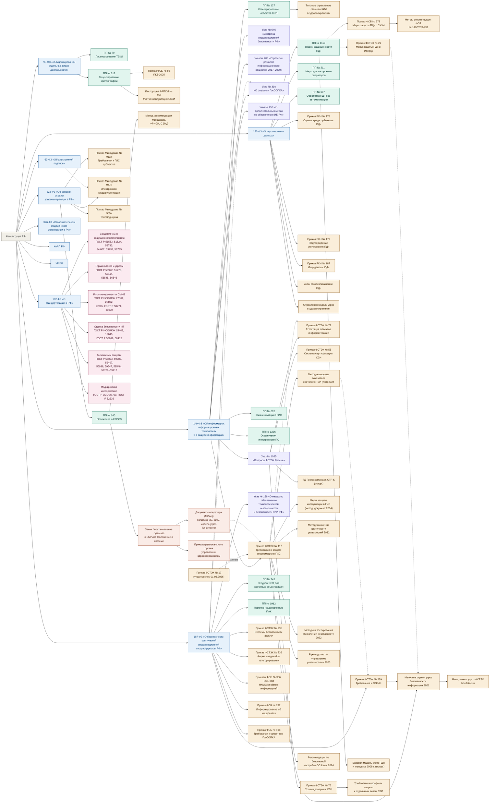

# Анализ безопасности автоматизированных систем (АБАС)

## Общее

**Направление:** государственная информационная система (ГИС)  
**Объект информатизации:** Единая медицинская информационно-аналитическая система субъекта РФ  
**Выполнил:** студент группы ИВТ-21-22 Туктин К.В.

## Система нормативно-правового регулирования в области анализа безопасности государственных информационных систем

Сведения об использовании ИИ

{Сгенерировано с помощью Claude (Anthropic, версия Claude Opus 5.5): «По дисциплине "Анализ безопасности автоматизированных систем" нужно глубоко изучить порядок проведения анализа безопасности некоторой системы. Каждый студент выбирает своё направление и объект информатизации в рамках этого направления и разрабатывает теорию, практику, которая поможет понять, как проводится анализ безопасности автоматизированной системы. Я в качестве направления для анализа безопасности выбрал государственную информационную систему, в качестве объекта информатизации я выбрал Единую медицинскую информационно-аналитическую систему субъекта РФ. В результате должен быть представлен набор расписанных тем, которые раскрывают весь порядок анализа безопасности рассматриваемого объекта информатизации. На первом самом важном этапе нужно подобрать набор/иерархию нормативно правовых актов и руководящих документов в РФ (Федеральные Законы, Постановления Правительства, Приказы, Методологические документы и так далее), которые регулируют и регламентируют порядок проведения анализа безопасности ГИС (государственной информационной системы - Единая медицинская информационно-аналитическая система субъекта РФ). На основе этой нормативно-правовой и методологической базы должны быть сформированы группы нормативно-правовых, регуляторных и методологических документов, из этих групп нужно будет сформировать темы. На этой нормативке будет строится теория и практика каждой отдельной темы. По моему Объекту информатизации сформируй такой набор нормативных, руководящих и методологических документов»}

### Уровень 0. Конституционная основа

|№| Документ | Значение для ЕМИАС |
|---|---|---|
|1| Конституция РФ, ст. 23, 24, 41 | Неприкосновенность частной жизни, недопустимость сбора сведений о частной жизни без согласия, право на охрану здоровья. Это исходная ценность, которую защищает система. |

---

### Уровень 1. Федеральные законы

**Группа 1.1. Базовые законы об информации и её защите**

|№| Документ | Значение для ЕМИАС |
|---|---|---|
|1| 149-ФЗ «Об информации, информационных технологиях и о защите информации» | ст. 13–14: понятие и порядок создания ГИС; ст. 16: обязанность защищать информацию; требования о защите информации в ГИС. Это ключевой закон для статуса объекта. |
|2| 152-ФЗ «О персональных данных» | ст. 10: сведения о здоровье относятся к специальной категории ПДн; ст. 18.1 и 19: меры оператора, уровни защищенности, оценка вреда; ст. 21: уведомление об инцидентах. |
|3| 187-ФЗ «О безопасности критической информационной инфраструктуры РФ» | Здравоохранение входит в сферы КИИ, поэтому ЕМИАС подлежит категорированию. С учётом изменений 2025 г. (58-ФЗ) действуют типовые отраслевые объекты КИИ. |
|4| 63-ФЗ «Об электронной подписи» | Юридическая значимость электронных медицинских документов (ЭМД), подписанных усиленной квалифицированной электронной подписью (УКЭП). |
|5| 99-ФЗ «О лицензировании отдельных видов деятельности» | Лицензии ФСТЭК (ТЗКИ) и ФСБ (криптография) для оператора и подрядчиков. |
|6| 162-ФЗ «О стандартизации в РФ» | Правовой статус ГОСТ Р, применяемых при анализе. |

**Группа 1.2. Отраслевые законы (здравоохранение)**

| Документ | Значение для ЕМИАС |
|---|---|
| 323-ФЗ «Об основах охраны здоровья граждан в РФ» | ст. 13: врачебная тайна; гл. 14 (ст. 91, 91.1): ЕГИСЗ, ГИС в сфере здравоохранения субъектов РФ, обязательное взаимодействие с ЕГИСЗ. Определяет правовой статус ЕМИАС. |
| 326-ФЗ «Об обязательном медицинском страховании в РФ» | Обмен персонифицированными сведениями с ТФОМС и страховыми медорганизациями, то есть внешний интерфейс системы. |

**Группа 1.3. Ответственность**

| Документ | Значение для ЕМИАС |
|---|---|
| КоАП РФ, ст. 13.11, 13.12, 13.14, 13.12.1, 19.7 | Нарушения в области ПДн, требований о защите информации и требований к КИИ. |
| УК РФ, ст. 137, 272, 272.1, 274, 274.1 | Нарушение неприкосновенности частной жизни, неправомерный доступ, незаконное использование ПДн (ст. 272.1 введена в 2024 г.), воздействие на КИИ. |

---

## Уровень 2. Акты Президента РФ

| Документ | Значение для ЕМИАС |
|---|---|
| Указ № 646 от 05.12.2016 «Доктрина информационной безопасности РФ» | Стратегические цели и угрозы. Используется в теоретической части. |
| Указ № 203 от 09.05.2017 «Стратегия развития информационного общества 2017–2030» | Цифровизация здравоохранения и доверенная среда. |
| Указ № 31с от 15.01.2013 | Создание ГосСОПКА (текст ограниченного доступа, достаточно ссылки). |
| Указ № 166 от 30.03.2022 | Запрет на приобретение иностранного ПО для значимых объектов КИИ и переход на отечественное ПО. |
| Указ № 250 от 01.05.2022 «О дополнительных мерах по обеспечению ИБ РФ» | Ответственность руководителя за ИБ, структурное подразделение ИБ, запрет иностранных СЗИ с 2025 г. Распространяется на органы власти субъектов и госучреждения (уточнить охват оператора ЕМИАС). |
| Указ № 1085 от 16.08.2004 | Положение о ФСТЭК России: полномочия регулятора. |

---

## Уровень 3. Постановления Правительства РФ

**Группа 3.1. ГИС — общий порядок**

| Документ | Значение для ЕМИАС |
|---|---|
| ПП № 676 от 06.07.2015 | Требования к порядку создания, развития, ввода в эксплуатацию, эксплуатации и вывода из эксплуатации ГИС. Защита информации встроена в каждую стадию жизненного цикла. |
| ПП № 1236 от 16.11.2015 | Ограничения на допуск иностранного ПО для государственных нужд. |

**Группа 3.2. Здравоохранение**

| Документ | Значение для ЕМИАС |
|---|---|
| ПП № 140 от 09.02.2022 «О единой государственной информационной системе в сфере здравоохранения» | Положение о ЕГИСЗ, порядок взаимодействия ГИС субъектов с ЕГИСЗ, требования к подключаемым системам. Ключевой отраслевой акт для ЕМИАС. |

**Группа 3.3. Персональные данные**

| Документ | Значение для ЕМИАС |
|---|---|
| ПП № 1119 от 01.11.2012 | Требования к защите ПДн при обработке в ИСПДн и определение уровня защищенности (УЗ). Для специальной категории ПДн более чем 100 тыс. субъектов это, как правило, УЗ-1 или УЗ-2 в зависимости от типа актуальных угроз. |
| ПП № 211 от 21.03.2012 | Перечень мер по 152-ФЗ для операторов — государственных и муниципальных органов. |
| ПП № 687 от 15.09.2008 | Обработка ПДн без средств автоматизации (бумажные медкарты, выгрузки). |

**Группа 3.4. КИИ**

| Документ | Значение для ЕМИАС |
|---|---|
| ПП № 127 от 08.02.2018 | Правила категорирования объектов КИИ и перечень показателей значимости. |
| ПП № 452 от 17.02.2018 | Правила подготовки и использования ресурсов единой сети электросвязи для КИИ (уточнить номер и дату). |
| ПП № 1912 от 14.11.2023 | Переход субъектов КИИ на преимущественное применение доверенных ПАК. |

**Группа 3.5. Лицензирование**

| Документ | Значение для ЕМИАС |
|---|---|
| ПП № 79 от 03.02.2012 | Лицензирование деятельности по ТЗКИ. |
| ПП № 313 от 16.04.2012 | Лицензирование деятельности, связанной с шифровальными средствами. |

---

## Уровень 4. Нормативные акты федеральных органов исполнительной власти

**Группа 4.1. ФСТЭК России — защита информации в ГИС и ПДн**

| Документ | Значение для ЕМИАС |
|---|---|
| **Приказ № 117 от 11.04.2025** «Требования о защите информации, содержащейся в ГИС, иных ИС госорганов, ГУП, госучреждений» (действует с 01.03.2026) | Главный документ анализа: классификация ГИС, требования к организации и содержанию мер защиты, контроль. |
| Приказ № 17 от 11.02.2013 (утратил силу) | Нужен для истории вопроса и для сравнительного анализа в теории. Действующие аттестаты могли быть выданы по нему. |
| Приказ № 21 от 18.02.2013 | Состав и содержание мер по обеспечению безопасности ПДн в ИСПДн. Применяется совместно с требованиями к ГИС. |
| Методический документ «Меры защиты информации в ГИС» от 11.02.2014 | Детализация мер. Применимость при Приказе № 117 уточнить: возможна новая редакция. |

**Группа 4.2. ФСТЭК России — КИИ**

| Документ | Значение для ЕМИАС |
|---|---|
| Приказ № 239 от 25.12.2017 | Требования по обеспечению безопасности значимых объектов КИИ и базовый набор мер по категориям. |
| Приказ № 235 от 21.12.2017 | Требования к созданию систем безопасности значимых объектов КИИ и обеспечению их функционирования. |
| Приказ № 236 от 22.12.2017 | Форма сведений о результатах категорирования. |

**Группа 4.3. ФСТЭК России — оценка соответствия**

| Документ | Значение для ЕМИАС |
|---|---|
| Приказ № 77 от 29.04.2021 | Порядок организации и проведения работ по аттестации объектов информатизации. ЕМИАС как ГИС подлежит обязательной аттестации. |
| Приказ № 55 от 03.04.2018 | Положение о системе сертификации средств защиты информации. |
| Приказ № 76 от 02.06.2020 | Требования по безопасности информации и уровни доверия к СЗИ. |
| Профили защиты и требования к отдельным типам СЗИ (МЭ, СОВ, САВЗ, СДЗ, ОС и др.) | Обоснование выбора сертифицированных СЗИ. |

**Группа 4.4. ФСТЭК России — методические документы (ядро практической части)**

| Документ | Значение для ЕМИАС |
|---|---|
| Методика оценки угроз безопасности информации от 05.02.2021 | Построение модели угроз ЕМИАС: негативные последствия, объекты воздействия, нарушители, сценарии. |
| Банк данных угроз безопасности информации (bdu.fstec.ru) | Перечень угроз и уязвимостей. Обязательный источник для модели угроз. |
| Методика оценки уровня критичности уязвимостей программных, программно-аппаратных средств от 28.10.2022 | Анализ уязвимостей. |
| Методика тестирования обновлений безопасности от 28.10.2022 | Безопасная установка обновлений. |
| Руководство по организации процесса управления уязвимостями от 17.05.2023 | Процесс vulnerability management. |
| Методика оценки показателя состояния технической защиты информации и обеспечения безопасности значимых объектов КИИ от 02.05.2024 | Количественная оценка защищенности (показатель Кзи). |
| Рекомендации по безопасной настройке операционных систем Linux (2024) | Анализ конфигураций. |
| Базовая модель угроз ПДн и Методика определения актуальных угроз ПДн (2008) | Историческая база. В части определения угроз заменены Методикой 2021 г. |
| Руководящие документы Гостехкомиссии (1992–2001): «Классификация АС», «СВТ», «Межсетевые экраны», СТР-К | Теоретическая часть: эволюция подходов. СТР-К частично применяется до сих пор. |

> Уточнить: ФСТЭК обсуждала проект методики анализа защищённости информационных систем. Если он утверждён, это центральный документ для практической темы по анализу защищённости.

**Группа 4.5. ФСБ России — криптография и ГосСОПКА**

| Документ | Значение для ЕМИАС |
|---|---|
| Приказ № 378 от 10.07.2014 | Меры по обеспечению безопасности ПДн с использованием СКЗИ для каждого уровня защищенности. |
| Приказ № 66 от 09.02.2005 (ПКЗ-2005) | Разработка, производство, реализация и эксплуатация СКЗИ. |
| Методические рекомендации № 149/7/2/6-432 от 31.03.2015 | Определение угроз безопасности ПДн, актуальных при использовании СКЗИ, и выбор класса СКЗИ (КС1–КА). |
| Приказ № 366 от 24.07.2018 | О Национальном координационном центре по компьютерным инцидентам (НКЦКИ). |
| Приказ № 367 от 24.07.2018 | Перечень информации, представляемой в ГосСОПКА. |
| Приказ № 368 от 24.07.2018 | Порядок обмена информацией о компьютерных инцидентах. |
| Приказ № 282 от 19.06.2019 | Порядок информирования ФСБ о компьютерных инцидентах и реагирования на них. |
| Приказ № 196 от 06.05.2019 | Требования к средствам ГосСОПКА. |

**Группа 4.6. Роскомнадзор — персональные данные**

| Документ | Значение для ЕМИАС |
|---|---|
| Приказ № 178 от 27.10.2022 | Требования к оценке вреда, который может быть причинён субъектам ПДн. |
| Приказ № 179 от 28.10.2022 | Требования к подтверждению уничтожения ПДн. |
| Приказ № 187 от 14.11.2022 | Порядок взаимодействия с Роскомнадзором при инцидентах (утечках) ПДн. |
| Акты об обезличивании ПДн | Нужны для аналитической подсистемы ЕМИАС. В 2024–2025 гг. регулирование менялось, уточнить действующий акт. |

**Группа 4.7. Минздрав России — отраслевые требования**

| Документ | Значение для ЕМИАС |
|---|---|
| **Приказ № 911н от 24.12.2018** «Требования к ГИС в сфере здравоохранения субъектов РФ, МИС медорганизаций и ИС фармацевтических организаций» | Обязательные функциональные требования к ЕМИАС, включая требования по защите информации и взаимодействию с ЕГИСЗ. Ключевой отраслевой документ. |
| Приказ № 947н от 07.09.2020 | Порядок организации документооборота в сфере охраны здоровья в части ведения медицинской документации в форме электронных документов. |
| Приказ № 965н от 30.11.2017 | Телемедицинские технологии: защищённое взаимодействие. |
| Методические рекомендации Минздрава и ЦНИИОИЗ по ГИС субъектов и МИС, Федеральный реестр НСИ, структуры СЭМД | Интеграционные интерфейсы и форматы. Важны для описания объекта. |
| Отраслевая модель угроз Минздравсоцразвития (2009) и отраслевые перечни типовых объектов КИИ в здравоохранении | Отраслевая специфика угроз и категорирования. Уточнить актуальность документов. |

---

## Уровень 5. Национальные стандарты

**Группа 5.1. Создание АС в защищённом исполнении**

ГОСТ Р 51583-2014 (порядок создания АС в защищённом исполнении), ГОСТ Р 51624-2000 (общие требования к АС в защищённом исполнении), ГОСТ Р 59793-2021 (стадии создания АС), ГОСТ 34.602-2020 (техническое задание), ГОСТ Р 59792-2021 (виды испытаний АС), ГОСТ Р 59795-2021 (требования к документам).

**Группа 5.2. Терминология и угрозы**

ГОСТ Р 50922-2006 (основные термины), ГОСТ Р 51275-2006 (факторы, воздействующие на информацию), ГОСТ Р 53114-2008 (обеспечение ИБ в организации), ГОСТ Р 56545-2015 и 56546-2015 (описание и классификация уязвимостей).

**Группа 5.3. Риск-менеджмент и СМИБ**

ГОСТ Р ИСО/МЭК 27001-2021, 27002-2021, 27005-2010, ГОСТ Р 58771-2019 (технологии оценки риска), ГОСТ Р ИСО 31000.

**Группа 5.4. Оценка безопасности ИТ**

ГОСТ Р ИСО/МЭК 15408-1/2/3, ГОСТ Р ИСО/МЭК 18045-2013, ГОСТ Р 56939-2024 (разработка безопасного ПО), ГОСТ Р 58412-2019 (угрозы на этапах разработки ПО).

**Группа 5.5. Отдельные механизмы защиты**

ГОСТ Р 58833-2020 (идентификация и аутентификация), ГОСТ Р 59383-2021 (управление доступом), ГОСТ Р 59407-2021 (базовая архитектура защиты ПДн), ГОСТ Р 56938-2016 (виртуализация), ГОСТ Р 59547-2021 (мониторинг ИБ), ГОСТ Р 59548-2022 (регистрация событий безопасности), серия ГОСТ Р 59709…59712-2022 (управление компьютерными инцидентами).

**Группа 5.6. Медицинская информатика**

ГОСТ Р ИСО 27799 (менеджмент защиты информации о здоровье), ГОСТ Р 52636-2006 (электронная история болезни). Номер и год редакции уточнить.

---

## Уровень 6. Региональные и локальные документы

| Документ | Назначение |
|---|---|
| Закон или постановление правительства субъекта о создании ЕМИАС и Положение о системе | Правовое основание, оператор, участники, состав подсистем. |
| Приказы регионального органа управления здравоохранением | Порядок подключения медорганизаций и регламент эксплуатации. |
| Документы оператора (как правило, ГБУЗ «МИАЦ»): политика ИБ, акт классификации ГИС, акт определения УЗ ПДн, акт категорирования КИИ, модель угроз, ТЗ на систему защиты, технический проект, эксплуатационная документация СЗИ, аттестат соответствия | Это объект и результат анализа безопасности. На практических занятиях их разрабатывают как учебные образцы. |

---

Стрелка означает, что дочерний документ издан во исполнение родительского или детализирует его применительно к ЕМИАС. Формально указы Президента не подчинены федеральным законам (и те и другие основаны на Конституции), поэтому связь «закон → указ» здесь тематическая. Пунктиром показаны дополнительные связи, когда документ опирается сразу на несколько актов.
 

## Как из групп формируются темы

Логика: каждая тема соответствует этапу анализа безопасности, и за ней закреплена группа документов.

1. **Нормативно-правовая база защиты ГИС в здравоохранении.** Группы 0, 1.1–1.3 и 2. Теория: иерархия актов, регуляторы (ФСТЭК, ФСБ, Роскомнадзор, Минздрав, Минцифры).
2. **ЕМИАС как объект информатизации: правовой статус, обследование и описание.** Группы 1.2, 3.2, 4.7 и 6. Практика: архитектура, подсистемы, внешние интерфейсы (ЕГИСЗ, ТФОМС, ЕПГУ, ЛИС, PACS), информационные потоки.
3. **Определение состава защищаемой информации и правовых режимов.** 152-ФЗ, 323-ФЗ, ПП № 1119. Практика: перечень сведений (врачебная тайна, специальные категории ПДн, биометрия).
4. **Классификация ГИС и определение уровня защищенности ПДн.** Приказ № 117 и ПП № 1119. Практика: акт классификации и акт определения УЗ.
5. **Категорирование ЕМИАС как объекта КИИ.** 187-ФЗ, ПП № 127, Приказ № 236. Практика: расчёт показателей значимости и сведения для ФСТЭК.
6. **Моделирование угроз и нарушителей.** Методика 2021 г., БДУ, рекомендации ФСБ 2015 г., Приказ Роскомнадзора № 178. Практика: модель угроз ЕМИАС.
7. **Формирование требований и набора мер защиты.** Приказы ФСТЭК № 117, 21, 239, Приказ ФСБ № 378. Практика: базовый набор, его адаптация, уточнение и дополнение, ТЗ на систему защиты.
8. **Выбор сертифицированных СЗИ и СКЗИ, импортозамещение.** Приказы № 55 и 76, ПКЗ-2005, Указы № 166 и 250, ПП № 1912. Практика: обоснование выбора средств.
9. **Анализ уязвимостей и защищённости.** Методические документы ФСТЭК 2022–2023 гг., ГОСТ Р 56545/56546. Практика: сканирование, оценка критичности, тестирование на проникновение.
10. **Оценка рисков ИБ.** ГОСТ Р ИСО/МЭК 27005, ГОСТ Р 58771. Практика: реестр рисков ЕМИАС.
11. **Защищённый юридически значимый электронный медицинский документооборот.** 63-ФЗ, Приказ № 947н, ПП № 140. Практика: анализ процесса подписания и передачи СЭМД в РЭМД.
12. **Мониторинг, управление инцидентами и взаимодействие с ГосСОПКА.** Приказы ФСБ № 282 и 368, Приказ Роскомнадзора № 187, ГОСТ Р 59547/59548/59709. Практика: регламент реагирования.
13. **Аттестация и ввод в эксплуатацию.** Приказ ФСТЭК № 77, ПП № 676, ГОСТ Р 59792. Практика: программа и методики аттестационных испытаний.
14. **Контроль защищённости в ходе эксплуатации и количественная оценка.** Приказ № 117 (раздел о контроле), Методика 2024 г. (показатель Кзи), государственный контроль и надзор, ответственность по КоАП и УК.

Если нужно, следующим шагом могу подробно расписать любую из тем, например построить модель угроз ЕМИАС по Методике 2021 г. или выполнить классификацию по Приказу № 117 на условных исходных данных. Могу также оформить этот перечень отдельным документом.

