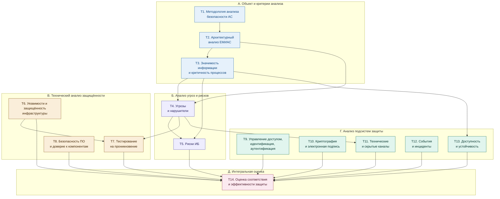

# Анализ безопасности автоматизированных систем (АБАС)

## Общее

**Направление:** государственная информационная система (ГИС)  
**Объект информатизации:** Единая медицинская информационно-аналитическая система субъекта РФ  
**Выполнил:** студент группы ИВТ-21-22 Туктин К.В.

## Задание 1. Система нормативно-правового регулирования в области анализа безопасности государственных информационных систем

Сведения об использовании ИИ

{Сгенерировано с помощью Claude (Anthropic, версия Claude Opus 5.5): «По дисциплине "Анализ безопасности автоматизированных систем" нужно глубоко изучить порядок проведения анализа безопасности некоторой системы. Каждый студент выбирает своё направление и объект информатизации в рамках этого направления и разрабатывает теорию, практику, которая поможет понять, как проводится анализ безопасности автоматизированной системы. Я в качестве направления для анализа безопасности выбрал государственную информационную систему, в качестве объекта информатизации я выбрал Единую медицинскую информационно-аналитическую систему субъекта РФ. В результате должен быть представлен набор расписанных тем, которые раскрывают весь порядок анализа безопасности рассматриваемого объекта информатизации. На первом самом важном этапе нужно подобрать набор/иерархию нормативно правовых актов и руководящих документов в РФ (Федеральные Законы, Постановления Правительства, Приказы, Методологические документы и так далее), которые регулируют и регламентируют порядок проведения анализа безопасности ГИС (государственной информационной системы - Единая медицинская информационно-аналитическая система субъекта РФ). На основе этой нормативно-правовой и методологической базы должны быть сформированы группы нормативно-правовых, регуляторных и методологических документов, из этих групп нужно будет сформировать темы. На этой нормативке будет строится теория и практика каждой отдельной темы. По моему Объекту информатизации сформируй такой набор нормативных, руководящих и методологических документов. Не нужно формировать темы так, будто они стадии жизненного цикла: 1) ГИС как объект защиты; 2) Классификация, уровень защищённости, категорирование; 3) Моделирование угроз; 4) Формирование требований и проектирование системы защиты; 5) Анализ уязвимостей, защищённости и аттестация; 6) Эксплуатация ЕМИАС: мониторинг, инциденты, контроль - так не надо. У меня тема "Анализ безопасности автоматизированных систем", а значит нужно раскрыть различные области анализа безопасности и упомянуть ГОСТы, связанные с автоматизированными системами и анализом их безопасности. Форма ответа должна быть примерно в том же виде, что и в файле "Неудача.md" с аналогичным деревом, в котором узлы - это нормативные-правовые документы и связаны как дерево по иерархии юридической силы, при этом рёбра обозначают тематическую детализацию, то есть какие-то менее юридически значимые документы связаны как документы, детализирующие тематику вышестоящих документов. Нужно поменять только темы и их группировку»}

---
### Уровень 0. Конституционная основа

| Документ | Что полезного для анализа безопасности ЕМИАС | Темы |
|---|---|---|
| Конституция РФ, ст. 23, 24, 41, 55 | Ст. 23 гарантирует неприкосновенность частной жизни, личную и семейную тайну. Ст. 24 запрещает сбор, хранение, использование и распространение информации о частной жизни без согласия лица. Ст. 41 закрепляет право на охрану здоровья. Ст. 55 ч. 3 допускает ограничение прав только федеральным законом. Отсюда два вывода для анализа. Во-первых, конфиденциальность сведений о пациентах — конституционная ценность, а не только требование ведомственных приказов; это вершина системы критериев, по которым оценивается ЕМИАС (Т1). Во-вторых, доступность ЕМИАС тоже защищаемое свойство: её отказ напрямую затрагивает право на медицинскую помощь. Поэтому последствия нарушения доступности учитываются при оценке значимости (Т3), а сама доступность выделена в отдельную область анализа (Т13). | Т1, Т3, Т13 |

---

### Уровень 1. Федеральные законы

#### Группа 1.1. Базовые законы об информации и её защите

| Документ | Что полезного для анализа безопасности ЕМИАС | Темы |
|---|---|---|
| 149-ФЗ «Об информации, информационных технологиях и о защите информации» | Ст. 2 даёт понятия «информационная система», «оператор ИС», «обладатель информации»; по ним в Т2 определяются роли (обладатель — региональный орган управления здравоохранением, оператор — как правило, МИАЦ). Ст. 5 и 9 вводят категории доступа и информацию ограниченного доступа, к которой относится врачебная тайна. Ст. 12.1 — основание реестра российского ПО (Т8). Ст. 13–14 определяют ГИС: создаётся на основании закона или решения органа власти, требования к её созданию и эксплуатации устанавливает Правительство (ПП № 676), контроль за их соблюдением — ПП № 675. Федеральный закон № 568-ФЗ от 29.12.2025 систематизировал ГИС (разделение на федеральные и региональные ГИС, ведомственные ИС); как это отражается на статусе ЕМИАС и с какой даты действуют отдельные нормы, нужно сверить с текстом. Ключевая ст. 16: ч. 4 перечисляет обязанности оператора — предотвращать несанкционированный доступ, своевременно обнаруживать его, не допускать неблагоприятных последствий и воздействия на технические средства, обеспечивать незамедлительное восстановление информации, постоянно контролировать уровень защищённости, размещать базы данных в РФ. Этот перечень — готовый набор целей безопасности, и каждая цель проверяется в своей области анализа: обнаружение НСД — в Т12, восстановление — в Т13, постоянный контроль защищённости — в Т6 и Т14. Ч. 5 закрепляет, что требования о защите информации в ГИС устанавливают ФСТЭК и ФСБ, отсюда обязательность Приказа № 117 и приказов ФСБ. | Т1, Т2, Т12, Т13, Т14 |
| 152-ФЗ «О персональных данных» | Ст. 3 даёт понятия обработки, оператора, информационной системы ПДн. Ст. 5 задаёт принципы (соответствие целям, минимизация, точность, ограниченный срок хранения); по ним в Т2 проверяется избыточность данных в подсистемах и выгрузках ЕМИАС. Ст. 10 относит сведения о здоровье к специальной категории; ч. 2 п. 4 разрешает их обработку без согласия в медико-профилактических целях лицами, обязанными хранить врачебную тайну. Это определяет законные потоки данных, а всё, что выходит за них (аналитика сторонними организациями, передача подрядчикам), требует отдельного основания. Ст. 18 ч. 5 — локализация баз ПДн граждан РФ. Ст. 18.1 — организационные меры оператора, включая оценку вреда (Т3) и внутренний контроль (Т14). Ст. 19 ч. 2 перечисляет меры обеспечения безопасности, и почти каждая из них соответствует отдельной области анализа: определение угроз (Т4), применение средств, прошедших оценку соответствия (Т8), оценка эффективности мер до ввода в эксплуатацию (Т14), обнаружение фактов НСД (Т12), восстановление ПДн (Т13), правила доступа и регистрация действий (Т9, Т12), контроль (Т14). Ч. 3–4 отсылают к ПП № 1119 и приказам ФСТЭК и ФСБ, ч. 5 — к отраслевым моделям угроз, ч. 12 обязывает взаимодействовать с ГосСОПКА. Ст. 21 ч. 3.1 обязывает уведомлять Роскомнадзор об утечке в течение 24 и 72 часов. Обязанность определить угрозы — основание не исключать без обоснования и угрозы утечки по техническим каналам (Т11). | Т1, Т2, Т3, Т4, Т9, Т11, Т12, Т14 |
| 187-ФЗ «О безопасности критической информационной инфраструктуры РФ» | Ст. 2 относит здравоохранение к сферам КИИ, поэтому медорганизации и оператор ЕМИАС являются субъектами КИИ, а сама система — объектом КИИ. Изменения, внесённые Федеральным законом № 58-ФЗ от 07.04.2025 (действуют с 01.09.2025), ввели типовые отраслевые объекты КИИ, отраслевые особенности категорирования и требования к ПО и ПАК на значимых объектах. Перечень типовых отраслевых объектов утверждён Распоряжением Правительства № 360-р от 26.02.2026, и медицинские ИС, включая региональные, в него входят (позицию сверить с текстом). Поэтому для ЕМИАС вопрос стоит уже не «объект КИИ или нет», а «какая категория значимости» (Т3). Ст. 7 устанавливает категорирование и обязанность направить сведения в ФСТЭК. Ст. 9 обязывает субъекта информировать ФСБ о компьютерных инцидентах, реагировать на них и содействовать ФСБ в обнаружении и ликвидации последствий атак (Т12). Ст. 10 требует создать систему безопасности значимого объекта; ст. 11 — выполнять требования ФСТЭК (Приказы № 235, 239); ст. 12 — оценка безопасности КИИ силами ФСБ; ст. 13 — государственный контроль ФСТЭК, включая плановые проверки (Т14). Требования к происхождению ПО и ПАК — основа анализа доверия к компонентам (Т8). В итоге ЕМИАС одновременно ГИС, ИСПДн и объект КИИ, и критерии трёх режимов нужно сводить в единую систему (Т1). | Т1, Т3, Т8, Т12, Т14 |
| 63-ФЗ «Об электронной подписи» | Ст. 5–6 определяют виды подписи и условия равнозначности собственноручной; для медицинских документов применяется усиленная квалифицированная подпись (УКЭП) медработника и медорганизации. Ст. 10 обязывает владельцев обеспечивать конфиденциальность ключей и прекращать использование скомпрометированных. Ст. 11 задаёт условия признания УКЭП действительной, это важно для долговременной проверки подписей в архиве ЭМД. Ст. 12 требует средств ЭП, подтверждённых ФСБ. При анализе криптографической защиты (Т10) и в модели угроз (Т4) отсюда вытекают угрозы компрометации ключей, использования чужого токена (типичная проблема общих токенов в отделениях), подмены документа после подписания и непроверяемости подписи в будущем. | Т4, Т10 |
| 99-ФЗ «О лицензировании отдельных видов деятельности» | Ст. 12 включает в перечень лицензируемых видов деятельность с шифровальными средствами (ФСБ) и техническую защиту конфиденциальной информации (ФСТЭК). Для анализа важно проверить, кто и на каком основании выполняет работы по защите и анализу ЕМИАС. Методика анализа защищённости ФСТЭК 2025 г. прямо требует от исполнителя лицензии на ТЗКИ с правом аттестационных испытаний и контроля защищённости, поэтому правомочность исполнителя проверяется и при анализе уязвимостей и пентесте (Т6, Т7), и при аттестации (Т14). Монтаж и обслуживание СКЗИ в медорганизациях — вопрос Т10. | Т6, Т7, Т10, Т14 |
| 162-ФЗ «О стандартизации в РФ» | Ст. 26 устанавливает, что национальные стандарты применяются добровольно, но становятся обязательными, если на них сослались в нормативном акте или договоре, например в ТЗ на систему защиты ЕМИАС или в договоре на доработку прикладного ПО. Это правовое обоснование использования ГОСТ Р как критериев анализа (Т1). Если в ТЗ указано «в соответствии с ГОСТ Р 51583-2014», а в договоре с разработчиком — «в соответствии с ГОСТ Р 56939-2024», выполнение стандартов проверяется как обязательное (Т8, Т14). | Т1, Т8, Т14 |

#### Группа 1.2. Отраслевые законы (здравоохранение)

| Документ | Что полезного для анализа безопасности ЕМИАС | Темы |
|---|---|---|
| 323-ФЗ «Об основах охраны здоровья граждан в РФ» | Ст. 13 определяет состав врачебной тайны: факт обращения, состояние здоровья, диагноз, иные сведения, полученные при обследовании и лечении. Ч. 4 содержит закрытый перечень случаев передачи без согласия: запросы следствия и суда, угроза распространения инфекций, контроль в системе ОМС, контроль качества медицинской помощи и др. По этому перечню в Т2 строится матрица допустимых информационных потоков, а в Т9 — критерии правомерности доступа; любой поток или доступ вне них — признак нарушения или угрозы. Вывод сведений о пациенте на табло или экран, видимый посторонним, тоже разглашение врачебной тайны; это правовое обоснование анализа видового канала (Т11). Ст. 36.2 регулирует телемедицину. Ст. 91 вводит ГИС в сфере здравоохранения (ЕГИСЗ, ГИС субъектов, МИС медорганизаций) и требует обрабатывать в них ПДн с соблюдением врачебной тайны. Ст. 91.1 устанавливает, что ГИС субъектов обязаны предоставлять сведения в ЕГИСЗ. Отсюда граница ответственности, которую фиксирует архитектурный анализ: региональный оператор отвечает за свой сегмент и за защищённость канала до ЕГИСЗ. Ст. 92 — персонифицированный учёт. | Т1, Т2, Т9, Т11 |
| 326-ФЗ «Об обязательном медицинском страховании в РФ» | Глава о персонифицированном учёте в сфере ОМС определяет состав сведений о застрахованных и оказанной медицинской помощи, которые передаются в ТФОМС и страховые медорганизации (реестры счетов). Для архитектурного анализа (Т2) это внешний интерфейс ЕМИАС с особым профилем угроз. Здесь критична целостность, а не только конфиденциальность: подмена или искажение реестров ведёт к финансовому ущербу и мошенничеству с оплатой медицинской помощи. Это учитывается в негативных последствиях при оценке значимости (Т3) и в сценариях модели угроз (Т4). | Т2, Т3, Т4 |

#### Группа 1.3. Ответственность

| Документ | Что полезного для анализа безопасности ЕМИАС | Темы |
|---|---|---|
| КоАП РФ, ст. 13.11, 13.12, 13.12.1, 13.14, 19.5, 19.7 | Ст. 13.11 — нарушения в области ПДн. С 30.05.2025 действуют части об утечках, в том числе специальных категорий ПДн, со значительными и оборотными штрафами. Ст. 13.12 — нарушение правил защиты информации, включая использование несертифицированных СЗИ и нарушение требований о защите информации. Ст. 13.12.1 — нарушение требований в области КИИ. Ст. 13.14 — разглашение информации ограниченного доступа лицом, получившим к ней доступ по службе; это прямая ответственность медработников. Ст. 19.5 — неисполнение предписаний ФСТЭК и Роскомнадзора; ст. 19.7 — непредставление сведений (например, о категорировании). В анализе рисков (Т5) эти составы используются для оценки ущерба оператору, а при оценке соответствия (Т14) — как перечень контрольных точек, которые проверяют регуляторы. | Т5, Т14 |
| УК РФ, ст. 137, 272, 272.1, 273, 274, 274.1 | Ст. 137 — незаконное собирание и распространение сведений о частной жизни. Ст. 272 — неправомерный доступ к охраняемой компьютерной информации. Ст. 272.1 (с 2024 г.) — незаконные использование, передача, сбор и хранение компьютерной информации, содержащей ПДн, с квалифицирующими признаками для специальных категорий. Ст. 273 — вредоносные программы. Ст. 274 — нарушение правил эксплуатации средств хранения и обработки информации. Ст. 274.1 — неправомерное воздействие на КИИ. Для модели нарушителя (Т4) это показывает правовые риски внутреннего нарушителя (продажа выгрузок из ЕМИАС, «пробив» данных пациентов) и сдерживающий фактор, который учитывается при оценке мотивации. Те же составы задают правовую рамку тестирования на проникновение (Т7): действия исполнителя без договора и согласованных границ работ формально подпадают под ст. 272–274.1. | Т4, Т7 |

---

### Уровень 2. Акты Президента РФ

| Документ | Что полезного для анализа безопасности ЕМИАС | Темы |
|---|---|---|
| Указ № 646 от 05.12.2016 «Доктрина информационной безопасности РФ» | Определяет национальные интересы в информационной сфере и основные угрозы: целенаправленное воздействие на КИИ, использование ИТ в преступных целях, утечки информации, зависимость от иностранных технологий. Используется в Т1 для обоснования актуальности, а в Т4 — для перечня внешних источников угроз высокого уровня: иностранные спецслужбы, преступные группы. | Т1, Т4 |
| Указ № 203 от 09.05.2017 «Стратегия развития информационного общества 2017–2030» | Закрепляет принципы обеспечения безопасности обработки ПДн, приоритета отечественных технологий и создания доверенной информационной среды; цифровизация здравоохранения названа одним из направлений. Даёт стратегическое обоснование защиты медицинских данных (Т1) и требований к происхождению и доверию к компонентам (Т8). | Т1, Т8 |
| Указ № 31с от 15.01.2013 | Создаёт ГосСОПКА — государственную систему обнаружения, предупреждения и ликвидации последствий компьютерных атак на информационные ресурсы РФ. Текст ограниченного доступа. Значение для ЕМИАС: ресурсы системы должны быть охвачены мониторингом в рамках ГосСОПКА (через собственный, ведомственный или коммерческий центр), а инциденты передаются в НКЦКИ. Это внешний контур анализа событий и инцидентов (Т12). | Т12 |
| Указ № 166 от 30.03.2022 | С 31.03.2022 заказчикам, являющимся субъектами КИИ, запрещено без согласования закупать иностранное ПО для значимых объектов КИИ, а с 01.01.2025 — использовать его на таких объектах. Для анализа ЕМИАС это означает инвентаризацию ПО по происхождению (ОС, СУБД, средства виртуализации, прикладное ПО, СЗИ) в рамках анализа доверия к компонентам (Т8). Угрозы прекращения поддержки и обновлений, недоступности лицензий включаются в модель угроз (Т4) и учитываются при анализе устойчивости (Т13). | Т4, Т8, Т13 |
| Указ № 250 от 01.05.2022 «О дополнительных мерах по обеспечению ИБ РФ» | Возлагает на руководителя персональную ответственность за ИБ, требует назначить заместителя, отвечающего за ИБ, и создать структурное подразделение по ИБ (типовые положения утверждены ПП № 1272 от 15.07.2022). С 01.01.2025 запрещает использовать СЗИ из недружественных государств. Предусматривает оценку защищённости, в том числе с участием ФСБ. Распространяется на органы власти субъектов, государственные учреждения в ряде статусов и субъекты КИИ; охват оператора ЕМИАС нужно установить по его статусу. Для анализа даёт требования к организационной структуре ИБ оператора (Т1, Т14) и к происхождению СЗИ (Т8). | Т1, Т8, Т14 |
| Указ № 1085 от 16.08.2004 «Вопросы Федеральной службы по техническому и экспортному контролю» | Утверждает Положение о ФСТЭК: регулятор устанавливает требования по технической защите информации, организует аттестацию и сертификацию, лицензирует ТЗКИ, осуществляет контроль в области безопасности ГИС и КИИ. Подпункт 4 пункта 8 Положения — основание, на котором ФСТЭК утверждает методические документы (на него, например, прямо ссылается Методика оценки критичности уязвимостей 2025 г.). Нужен, чтобы в Т1 обосновать юридическую силу приказов и методик ФСТЭК, а в Т14 — её контрольные полномочия. | Т1, Т14 |

---

### Уровень 3. Постановления и распоряжения Правительства РФ

#### Группа 3.1. ГИС — общий порядок

| Документ | Что полезного для анализа безопасности ЕМИАС | Темы |
|---|---|---|
| ПП № 676 от 06.07.2015 | Требования к порядку создания, развития, ввода в эксплуатацию, эксплуатации и вывода из эксплуатации ГИС. Для анализа важно следующее. Защита информации обеспечивается на каждой стадии жизненного цикла. ТЗ на ГИС и модель угроз согласуются с ФСТЭК и ФСБ в части требований о защите информации. Ввод в эксплуатацию допускается только после аттестации по требованиям защиты информации (Т14). Технические средства ГИС размещаются на территории РФ (Т2). При выводе из эксплуатации обеспечивается защита и уничтожение информации. При модернизации ЕМИАС (новая подсистема, перенос в другой ЦОД) постановление обязывает пересмотреть исходные данные архитектурного анализа и модель угроз и, как правило, провести повторную аттестацию. В 2026 г. Минцифры вынесло на обсуждение изменения в связи с 568-ФЗ (функциональный и технический заказчик, поэтапный ввод в эксплуатацию); действующую редакцию сверить. | Т1, Т2, Т14 |
| ПП № 675 от 06.07.2015 | Порядок контроля за соблюдением требований к созданию, развитию, эксплуатации и выводу из эксплуатации ГИС (ч. 2.1 ст. 13 и ч. 6 ст. 14 149-ФЗ). Показывает, что соответствие ГИС установленным требованиям, включая требования о защите информации, проверяется не только самим оператором, но и извне. Используется в Т14 при описании форм внешнего контроля (порядок применения к региональным ГИС сверить). | Т14 |
| ПП № 1236 от 16.11.2015 | Устанавливает запрет на закупку иностранного ПО для государственных нужд при наличии российского аналога в едином реестре и порядок обоснования исключений. В анализе доверия к компонентам (Т8) используется для проверки состава ПО ЕМИАС: есть ли каждый компонент в реестре российского ПО, есть ли обоснования для иностранных компонентов. | Т8 |

#### Группа 3.2. Здравоохранение

| Документ | Что полезного для анализа безопасности ЕМИАС | Темы |
|---|---|---|
| ПП № 140 от 09.02.2022 «О единой государственной информационной системе в сфере здравоохранения» | Положение о ЕГИСЗ описывает её подсистемы (федеральные регистры, реестр электронных медицинских документов, интегрированная электронная медицинская карта, НСИ и др.), участников, состав и сроки предоставления сведений, порядок доступа, способы взаимодействия (ЕСИА, СМЭВ, защищённая сеть передачи данных). Для ЕМИАС это главный источник для описания внешних интерфейсов и границ доверия (Т2): какие данные, в каком составе, по какому каналу и с какой аутентификацией уходят из региональной системы в федеральную и на Госуслуги. Каждый такой интерфейс становится объектом воздействия и точкой входа в модели угроз (Т4). Аутентификация пользователей через ЕСИА анализируется в Т9, регистрация ЭМД в реестре — в Т10. | Т2, Т4, Т9, Т10 |

#### Группа 3.3. Персональные данные

| Документ | Что полезного для анализа безопасности ЕМИАС | Темы |
|---|---|---|
| ПП № 1119 от 01.11.2012 | Вводит три типа актуальных угроз (связанных с недокументированными возможностями системного ПО, прикладного ПО или не связанных с ними) и четыре уровня защищенности ПДн. Для ЕМИАС (специальные категории ПДн, более 100 тыс. субъектов, не являющихся сотрудниками) получается УЗ-1 при актуальных угрозах 2-го типа и УЗ-2 при угрозах только 3-го типа. Обоснование типа угроз — ключевой и спорный момент анализа значимости (Т3), и опирается оно на результаты анализа ПО и доверия к нему (Т8). Постановление также задаёт требования по уровням: режим помещений, сохранность носителей, перечень допущенных лиц, СЗИ, прошедшие оценку соответствия, назначение ответственного (УЗ-2), автоматическую регистрацию изменений полномочий и подразделение по защите (УЗ-1); регистрация изменений полномочий проверяется в Т9. Контроль выполнения требований — не реже одного раза в три года (Т14). | Т3, Т8, Т9, Т14 |
| ПП № 211 от 21.03.2012 | Перечень организационных мер по 152-ФЗ для операторов — государственных и муниципальных органов: ответственный, правила обработки, перечни должностей и обрабатываемых ПДн, типовые обязательства и формы согласий, правила внутреннего контроля, обезличивание. Напрямую применяется к органу управления здравоохранением субъекта; для ГБУЗ «МИАЦ» как учреждения служит образцом состава организационных документов. При оценке соответствия (Т14) по этому перечню проверяется полнота организационно-распорядительной документации, а перечни должностей с доступом к ПДн — исходные данные для анализа управления доступом (Т9). | Т9, Т14 |
| ПП № 687 от 15.09.2008 | Правила обработки ПДн без средств автоматизации: обособление ПДн на материальных носителях, раздельное хранение по целям, требования к типовым формам и журналам. Для ЕМИАС это бумажные документы, которые порождает система: распечатки медкарт, направлений, справок, выгрузки отчётов. Такой поток выходит за границу АС и часто упускается: в архитектурном анализе (Т2) он фиксируется как выход информации на материальный носитель, в модели угроз (Т4) — как канал утечки. | Т2, Т4 |

#### Группа 3.4. КИИ

| Документ | Что полезного для анализа безопасности ЕМИАС | Темы |
|---|---|---|
| ПП № 127 от 08.02.2018 (в ред. ПП № 1762 от 07.11.2025) | Правила категорирования: создание комиссии, определение процессов, выявление критических процессов, составление перечня объектов КИИ, оценка масштаба возможных последствий компьютерных инцидентов по показателям значимости (социальная, политическая, экономическая, экологическая, значимость для обороны и безопасности), присвоение категории, пересмотр. После изменений 187-ФЗ и ПП № 1762 категорирование проводится в отношении объектов, соответствующих перечню типовых отраслевых объектов, с учётом отраслевых особенностей (порядок в действующей редакции сверить). Для ЕМИАС особенно важны показатели причинения ущерба жизни и здоровью (недоступность сведений о пациенте при экстренной помощи), отсутствия доступа к государственной услуге (запись к врачу, сервисы на Госуслугах) и нарушения функционирования органа власти. Практика Т3 — расчёт этих показателей на условных данных региона; оценка допустимого времени простоя одновременно служит исходными данными для Т13. | Т3, Т13 |
| Распоряжение № 360-р от 26.02.2026 | Перечень типовых отраслевых объектов КИИ (около 400 позиций, часть — по здравоохранению): ЕГИСЗ, медицинские ИС медорганизаций и региональные медицинские системы, ГИС ОМС, ИС для управления медицинским оборудованием и др. Для ЕМИАС это отправная точка анализа значимости (Т3): установить, каким позициям перечня соответствуют система и её подсистемы (например, лабораторные или радиологические модули), что требует опоры на архитектурный анализ (Т2). Конкретные позиции и последующие изменения сверить с текстом. | Т2, Т3 |
| Проект ПП «Об утверждении отраслевых особенностей категорирования объектов КИИ в сфере здравоохранения» (Минздрав, 04.07.2025) | Определяет порядок установления соответствия объектов КИИ в сфере здравоохранения критериям значимости, отраслевые признаки значимости и порядок расчёта показателей. Для других отраслей аналогичные постановления приняты в 2026 г. (наука, связь и др.). Принят ли документ для здравоохранения на момент выполнения работы, нужно проверить; если принят, расчёт показателей в Т3 выполняется по нему, а не только по общим правилам ПП № 127. | Т3 |
| ПП № 743 от 08.06.2019 | Правила подготовки и использования ресурсов единой сети электросвязи РФ для обеспечения функционирования значимых объектов КИИ. Устанавливает условия использования сетей связи значимыми объектами, включая ограничения, связанные с размещением оборудования и управлением из-за рубежа (детали уточнить по тексту). Применяется к каналам связи между медорганизациями, ЦОД ЕМИАС и ЕГИСЗ: при анализе сетевой инфраструктуры (Т6) и зависимости от операторов связи (Т13). | Т6, Т13 |
| ПП № 1912 от 14.11.2023 | Порядок перехода субъектов КИИ на преимущественное применение доверенных программно-аппаратных комплексов на значимых объектах: критерии доверенности (российское происхождение, подтверждённое соответствие требованиям ФСТЭК и ФСБ), планы перехода и их согласование, сроки (уточнить). Для ЕМИАС — проверка серверного и сетевого оборудования в рамках анализа доверия к компонентам (Т8). | Т8 |

#### Группа 3.5. Лицензирование

| Документ | Что полезного для анализа безопасности ЕМИАС | Темы |
|---|---|---|
| ПП № 79 от 03.02.2012 | Положение о лицензировании деятельности по ТЗКИ: перечень работ (контроль защищённости информации от НСД и от утечки по техническим каналам, проектирование, установка и настройка СЗИ, аттестационные испытания) и лицензионные требования к персоналу и контрольно-измерительному оборудованию. При анализе используется для проверки правомочности исполнителей: анализ защищённости и пентест (Т6, Т7), инструментальный контроль технических каналов (Т11), аттестация и внешняя оценка уровня зрелости (Т14). | Т6, Т7, Т11, Т14 |
| ПП № 313 от 16.04.2012 | Положение о лицензировании деятельности с шифровальными средствами: перечень работ (монтаж, установка, наладка, техническое обслуживание СКЗИ) и случаи, когда лицензия не требуется (в том числе эксплуатация для собственных нужд при определённых условиях). Для ЕМИАС — криптошлюзы и VPN-клиенты, которыми медорганизации подключаются к защищённой сети, и средства УКЭП (Т10). | Т10 |

---

### Уровень 4. Нормативные акты и методические документы федеральных органов исполнительной власти

#### Группа 4.1. ФСТЭК России — требования о защите информации в ГИС и ПДн

| Документ | Что полезного для анализа безопасности ЕМИАС | Темы |
|---|---|---|
| **Приказ № 117 от 11.04.2025** (действует с 01.03.2026; изменения — Приказ № 137 от 08.05.2026) | Главный нормативный документ анализа. Распространяется на ГИС и иные ИС государственных органов, ГУП и государственных учреждений, по разъяснениям — и на ИСПДн и объекты КИИ в госсекторе. В отличие от Приказа № 17 не содержит таблицы базовых мер: мероприятия и меры перечислены в его пунктах (пп. 34–63), а их состав раскрывает методический документ ФСТЭК 2026 г. Для анализа важны пять блоков. Классификация ГИС по уровню значимости информации и масштабу (Т3). Определение угроз по методике ФСТЭК (Т4). Требования к защите сети, виртуализации, удалённому доступу и срокам устранения уязвимостей (Т6). Требования к подрядчикам, к применяемым средствам и к уровням доверия СЗИ в зависимости от класса, а также к использованию технологий ИИ (Т8). Оценка состояния защиты через показатель защищённости Кзи и показатель уровня зрелости (Пзи, по Приказу № 137 с 01.09.2026 — Узи) с направлением результатов в ФСТЭК не позднее 5 рабочих дней после расчёта (Т14). Конкретные пункты, периодичность расчётов и сроки сверять с действующей редакцией. | Т1, Т3, Т4, Т6, Т8, Т14 |
| Приказ № 17 от 11.02.2013 (утратил силу) | Нужен для сравнительного анализа и потому, что действующие аттестаты ЕМИАС могли быть выданы по нему; по отраслевым разъяснениям, систему, договор на создание которой заключён до 01.03.2026, можно аттестовать по прежним правилам (сверить с переходными положениями). Содержит классификацию ГИС по уровню значимости (УЗ1–УЗ3) и масштабу (федеральный, региональный, объектовый) с итоговыми классами К1–К3 и систематику мер по группам: ИАФ (идентификация и аутентификация), УПД (управление доступом), ОПС (ограничение программной среды), ЗНИ (защита машинных носителей), РСБ (регистрация событий), АВЗ (антивирусная защита), СОВ (обнаружение вторжений), АНЗ (контроль защищённости), ОЦЛ (целостность), ОДТ (доступность), ЗСВ (виртуализация), ЗТС (технические средства), ЗИС (защита ИС и её средств), ИНЦ (инциденты), УКФ (управление конфигурацией). Эта систематика удобна как «карта» областей анализа подсистем: ИАФ и УПД соответствуют Т9, РСБ и ИНЦ — Т12, ОДТ — Т13, АНЗ — Т6. | Т1, Т14 |
| Приказ № 21 от 18.02.2013 | Состав и содержание мер обеспечения безопасности ПДн в ИСПДн с базовыми наборами по уровням защищенности. Устанавливает процедуру выбора мер: базовый набор, его адаптация, уточнение с учётом актуальных угроз, дополнение мерами из других актов, компенсирующие меры. Требует оценки эффективности мер не реже раза в три года. Для ЕМИАС применяется совместно с Приказом № 117: при оценке соответствия из двух наборов требований выбираются более строгие (Т14). Методика оценки уровня зрелости ФСТЭК 2026 г. применяется и к ИСПДн, так что и по этой линии оценка становится количественной. | Т14 |
| **Методический документ «Мероприятия и меры по защите информации, содержащейся в информационных системах»** (ФСТЭК, 12.04.2026) | Раскрывает состав и содержание мероприятий и мер, предусмотренных Приказом № 117 (по отраслевым обзорам — около двух десятков организационных мероприятий и 17–18 групп технических мер; точный состав сверить с официальным текстом). Для анализа это основной чек-лист: по нему проверяется реализация мер в целом (Т14) и в отдельных подсистемах — управления доступом (Т9), регистрации событий и реагирования (Т12), обеспечения доступности (Т13). | Т9, Т12, Т13, Т14 |
| Методический документ «Меры защиты информации в ГИС» от 11.02.2014 | Описывал содержание мер Приказа № 17, требования к их реализации и усилению, базовое применение по классам. После 2026 г. полезен для систем, аттестованных по прежним правилам, и для сравнения подходов в Т1. Утратил ли он применение формально, сверить по сайту ФСТЭК. | Т1, Т14 |

#### Группа 4.2. ФСТЭК России — КИИ

| Документ | Что полезного для анализа безопасности ЕМИАС | Темы |
|---|---|---|
| Приказ № 239 от 25.12.2017 | Требования по обеспечению безопасности значимых объектов КИИ: порядок разработки требований, моделирования угроз, проектирования, внедрения и эксплуатации подсистемы безопасности. Базовые наборы мер по категориям значимости включают группы, которых нет в требованиях к ГИС: аудит безопасности, планирование, действия в нештатных ситуациях (Т13), информирование и обучение персонала. Содержит требования к прикладному ПО (безопасная разработка, испытания по выявлению уязвимостей) и к ограничению удалённого доступа и передачи данных разработчику (Т8). Для категорированной ЕМИАС приказ добавляет меры, которые нужно свести в единую таблицу требований при оценке соответствия (Т14). | Т8, Т13, Т14 |
| Приказ № 235 от 21.12.2017 | Требования к созданию систем безопасности значимых объектов КИИ: состав сил обеспечения безопасности, квалификационные требования к специалистам, перечень организационно-распорядительных документов (политика, порядки, планы), периодический внутренний контроль. Используется при анализе организационной составляющей защиты ЕМИАС (Т1, Т14). | Т1, Т14 |
| Приказ № 236 от 22.12.2017 | Форма сведений о результатах категорирования: описание объекта, его взаимодействия с сетями, применяемые ОС и СЗИ, значения показателей значимости, категории нарушителей и возможные способы атак. Практическая часть Т3 — заполнение этой формы для ЕМИАС. | Т3 |

#### Группа 4.3. ФСТЭК России — оценка соответствия и доверие к средствам

| Документ | Что полезного для анализа безопасности ЕМИАС | Темы |
|---|---|---|
| Приказ № 77 от 29.04.2021 | Порядок аттестации объектов информатизации: подготовка исходных данных, разработка программы и методик аттестационных испытаний, проведение испытаний (анализ документов, проверка реализации мер, выявление уязвимостей), оформление протоколов, заключения и аттестата, повторная аттестация при изменениях. С 2025 г. испытания выполняются с применением новых методик ФСТЭК по анализу уязвимостей и тестированию на проникновение (Т6, Т7). Для ЕМИАС особенно важна аттестация на основе типового сегмента: медорганизации подключаются однотипными АРМ. Практика Т14 — программа и методики аттестационных испытаний. | Т6, Т7, Т14 |
| Приказ № 55 от 03.04.2018 | Положение о системе сертификации СЗИ: участники, порядок сертификации, маркировка, срок действия сертификатов, государственный реестр сертифицированных СЗИ. В анализе доверия к компонентам (Т8) используется для проверки каждого СЗИ ЕМИАС: есть ли действующий сертификат и не закончилась ли техническая поддержка. | Т8 |
| Приказ № 76 от 02.06.2020 | Требования по безопасности информации к программным и программно-аппаратным средствам с шестью уровнями доверия: требования к разработке, испытаниям и поддержке, включая оперативное устранение уязвимостей. Соответствие уровней доверия классам систем: 4-й уровень — для К1, УЗ-1 и 1-й категории КИИ, 5-й — для К2, УЗ-2 и 2-й категории, 6-й — для К3, УЗ-3 и 3-й категории; Приказ № 117 закрепляет связь классов ГИС с уровнями доверия. Начиная с 4-го уровня доверия механизм управления доступом СЗИ должен разрабатываться на основе формальной модели управления доступом (ГОСТ Р 59453), что связывает этот приказ с Т9. В Т8 по нему определяется требуемый уровень доверия СЗИ ЕМИАС. Изменения 2025 г. сверить. | Т8, Т9 |
| Требования и профили защиты к отдельным типам СЗИ | Требования ФСТЭК к межсетевым экранам (типы А–Д), системам обнаружения вторжений (уровня сети и узла), средствам антивирусной защиты, средствам доверенной загрузки, контроля съёмных носителей, операционным системам, СУБД, средствам виртуализации и контейнеризации. Каждый документ задаёт тип средства по месту применения и класс защиты. В Т8 по ним проверяется соответствие типа и класса СЗИ месту применения (периметр ЦОД, веб-портал, серверы СУБД, АРМ в медорганизациях), в Т6 — корректность размещения МЭ и СОВ в сетевой архитектуре. | Т6, Т8 |

#### Группа 4.4. ФСТЭК России — методики анализа угроз и интегральной оценки

| Документ | Что полезного для анализа безопасности ЕМИАС | Темы |
|---|---|---|
| Методика оценки угроз безопасности информации от 05.02.2021 | Основной инструмент Т4. Последовательность: определение негативных последствий (ущерб физическим лицам, юридическим лицам и государству), объектов воздействия, источников угроз и нарушителей с уровнями возможностей Н1–Н4, способов реализации угроз и сценариев атак (тактики и техники из приложения). Перечень негативных последствий используется и при оценке значимости (Т3). Для ЕМИАС типичны нарушители: преступные группы (шифровальщики, кража баз), внутренние пользователи (медработники с избыточными правами), администраторы, подрядчики и разработчики с удалённым доступом. Методика применима сразу к ГИС, ИСПДн и значимым объектам КИИ, поэтому позволяет построить единую модель угроз. | Т3, Т4 |
| Банк данных угроз безопасности информации (bdu.fstec.ru) | Содержит перечень угроз (УБИ.xxx) с описанием источников, объектов и последствий, базу уязвимостей (BDU:ГГГГ-NNNNN) с оценками и ссылками на CVE, а также сведения о тактиках и техниках атак. В Т4 используется как перечень угроз и техник для отбора актуальных, в Т6 — для сопоставления найденных уязвимостей компонентов ЕМИАС, в том числе российского ПО, которого нет в зарубежных базах. | Т4, Т6 |
| Базовая модель угроз ПДн и Методика определения актуальных угроз ПДн (2008) | Историческая база: угрозы утечки по техническим каналам и несанкционированного доступа, расчёт актуальности через показатель исходной защищённости и вероятность реализации угрозы. В части определения угроз заменены методикой 2021 г. В теории Т4 полезны для сравнения вероятностного подхода 2008 г. и сценарного подхода 2021 г. | Т4 |
| **Методика оценки показателя состояния технической защиты информации в информационных системах и обеспечения безопасности значимых объектов КИИ** от 11.11.2025 | Количественная оценка текущего состояния защищённости: показатель Кзи (от 0 до 1) рассчитывается по набору проверяемых параметров с весовыми коэффициентами и, по тексту Приказа № 117, характеризует состояние защиты от базового уровня угроз. Соотношение с одноимённой методикой от 02.05.2024, рассчитанной на значимые объекты КИИ, сверить. Практика Т14 — расчёт Кзи для ЕМИАС на условных данных; входными данными служат результаты технического анализа (Т6). | Т6, Т14 |
| **Методика оценки уровня зрелости деятельности в области технической защиты информации в информационных системах и обеспечения безопасности значимых объектов КИИ** от 07.08.2026 | Оценивает не состояние системы, а зрелость деятельности по её защите. По опубликованным обзорам: 21 направление деятельности, по каждому восемь видов требований (выполнение, документирование, контроль, инструменты, квалификация, обучение, внешний аудит, актуализация), уровни от начального до верифицируемого, целевые уровни по классу или категории (для ГИС 1-го класса, ИСПДн УЗ-1 и ЗОКИИ 1-й категории — не ниже 3-го). Применяется к ГИС, ИСПДн и значимым объектам КИИ; оценка бывает внутренней и внешней (силами лицензиата). Даёт Т14 второй количественный показатель (Узи) в дополнение к Кзи. Параметры сверить с официальным текстом. | Т14 |
| Руководящие документы Гостехкомиссии (1992–2001): «Классификация АС», «СВТ», «Межсетевые экраны», «НДВ», СТР-К | Классические классификации: АС — 9 классов в трёх группах, СВТ — 7 классов, межсетевые экраны — 5 классов, контроль отсутствия НДВ — 4 уровня. В Т1 показывают эволюцию подходов к классификации АС и анализу их защищённости. СТР-К содержит меры защиты конфиденциальной информации, включая защиту от утечки по техническим каналам и требования к помещениям, и до сих пор используется при анализе в Т11. | Т1, Т11 |

#### Группа 4.5. ФСТЭК России — методики технического анализа защищённости

| Документ | Что полезного для анализа безопасности ЕМИАС | Темы |
|---|---|---|
| **Методика анализа защищенности информационных систем** от 25.11.2025 | Основной методический документ Т6. Регламентирует выявление и оценку уязвимостей при аттестации, контроле уровня защищённости и в ходе эксплуатации ГИС, ИСПДн, значимых объектов КИИ и других систем. Различает внешний анализ (периметр и доступные извне сервисы) и внутренний, который проводится от имени привилегированного пользователя. Требует предусмотреть в договоре первичный анализ, устранение уязвимостей заказчиком и повторный контроль устранения. Исполнитель должен иметь лицензию на ТЗКИ с соответствующими видами работ. Допускает выборочный анализ однотипных АРМ непривилегированных пользователей (по обзорам — до 30 %), что прямо относится к АРМ медорганизаций. Подтверждением невозможности эксплуатации уязвимости служит тестирование на проникновение (Т7). Без выполнения методики аттестация (Т14) может завершиться отрицательным заключением. Детали сверить с текстом. | Т6, Т7, Т14 |
| **Методика испытаний систем защиты информации информационных систем методами тестирования на проникновение** (ФСТЭК, 2025; информационное сообщение № 240/24/4734 от 08.09.2025) | Основной методический документ Т7. Применяется при аттестации и контроле защищённости, решение о которых принято после её утверждения, а также в эксплуатируемых системах. По описаниям лицензиатов задаёт последовательность: функциональное тестирование реализованных мер, анализ уязвимостей и устранение значимых недостатков, затем моделирование атак и тестирование на проникновение. По сообщениям, в открытом доступе не опубликована; порядок получения уточнить. Если текст недоступен, в учебной работе структура пентеста строится по ГОСТ Р ИСО/МЭК 18045 и сценариям модели угроз (Т4). | Т7 |
| Методика оценки уровня критичности уязвимостей программных, программно-аппаратных средств от 30.06.2025 | Расчёт уровня критичности уязвимости по четырём показателям, учитывающим как характеристики самой уязвимости, так и значимость затронутого компонента в конкретной системе; по сравнению с редакцией 2022 г. изменены показатели и пороги итоговой оценки. Заменила методику от 28.10.2022. Результат определяет приоритет и сроки устранения. В Т6 по ней ранжируются уязвимости, найденные при анализе ЕМИАС. | Т6 |
| Руководство по организации процесса управления уязвимостями от 17.05.2023 | Описывает процесс: мониторинг уязвимостей и оценка их применимости, оценка критичности, определение способов и приоритетов устранения, устранение, контроль. Определяет роли участников. В Т6 используется как шаблон регламента, в Т14 — для оценки зрелости процесса у оператора ЕМИАС. | Т6, Т14 |
| Методика тестирования обновлений безопасности от 28.10.2022 | Порядок проверки обновлений перед установкой: подлинность источника и целостность, антивирусная проверка, поиск потенциально опасных функций. Особенно важна для обновлений иностранного ПО. Применяется при оценке процесса управления обновлениями (Т6) и при анализе цепочки поставок (Т8: угроза внедрения вредоносного кода через обновление). | Т6, Т8 |
| Методика выявления уязвимостей и недекларированных возможностей в программном обеспечении от 25.12.2020 | Предназначена для организаций, проводящих исследования ПО при его разработке и сертификации (распространение документа уточнить). Для оператора ЕМИАС это не инструмент повседневного анализа, а ключ к пониманию того, что проверено при сертификации СЗИ и какие остаточные риски остаются у несертифицированного прикладного ПО (Т8). | Т8 |
| Рекомендации по безопасной настройке операционных систем Linux (ФСТЭК) | Перечень параметров безопасной настройки: аутентификация и пароли, ограничение прав, параметры ядра, права на файлы и каталоги. Серверы ЕМИАС после импортозамещения обычно работают на отечественных дистрибутивах Linux, поэтому документ служит чек-листом анализа конфигураций в Т6. | Т6 |

#### Группа 4.6. ФСБ России — криптография и ГосСОПКА

| Документ | Что полезного для анализа безопасности ЕМИАС | Темы |
|---|---|---|
| Приказ № 378 от 10.07.2014 | Организационные и технические меры обеспечения безопасности ПДн с использованием СКЗИ по уровням защищенности: режим помещений с СКЗИ, учёт носителей, перечень допущенных лиц, выбор класса СКЗИ (КС1, КС2, КС3, КВ, КА) в зависимости от типа угроз и возможностей нарушителя. Для ЕМИАС применяется к защите каналов между медорганизациями, ЦОД и ЕГИСЗ, а также к средствам УКЭП. Практика Т10 — обоснование класса СКЗИ. | Т10 |
| Приказ № 66 от 09.02.2005 (ПКЗ-2005) | Положение о разработке, производстве, реализации и эксплуатации СКЗИ: эксплуатация в соответствии с правилами пользования, требования к встраиванию СКЗИ в прикладные системы. Нужен при анализе встраивания криптографии в ЕМИАС: подписание СЭМД, шифрование каналов (Т10). | Т10 |
| Инструкция ФАПСИ № 152 от 13.06.2001 | Порядок организации безопасности хранения, обработки и передачи информации ограниченного доступа с использованием СКЗИ: поэкземплярный учёт СКЗИ и ключевых документов, журналы, допуск пользователей, обращение с ключевыми носителями. Для ЕМИАС это основа проверки обращения с токенами УКЭП и ключами VPN во множестве медорганизаций (Т10). | Т10 |
| Методические рекомендации № 149/7/2/6-432 от 31.03.2015 | Порядок определения угроз безопасности ПДн, актуальных при использовании СКЗИ: обобщённые возможности источников атак и их соответствие классам СКЗИ. Применяется вместе с методикой ФСТЭК 2021 г. для криптографической части модели угроз (Т4) и обоснования класса СКЗИ (Т10). | Т4, Т10 |
| Приказы № 366, 367, 368 от 24.07.2018 | № 366 — о Национальном координационном центре по компьютерным инцидентам. № 367 — перечень информации, которую субъекты КИИ представляют в ГосСОПКА. № 368 — порядок обмена информацией о компьютерных инцидентах. В Т12 определяют, какие сведения об инцидентах в ЕМИАС и по каким каналам передаются в НКЦКИ. | Т12 |
| Приказ № 282 от 19.06.2019 | Порядок информирования ФСБ о компьютерных инцидентах и реагирования на них. Для значимых объектов КИИ — уведомление не позднее 3 часов с момента обнаружения, для остальных объектов — 24 часов. Для значимых объектов требуется план реагирования. Практика Т12 — регламент реагирования на инциденты в ЕМИАС с учётом этих сроков. | Т12 |
| Приказ № 196 от 06.05.2019 | Требования к средствам ГосСОПКА: средства обнаружения атак, предупреждения и ликвидации их последствий, обмена информацией с НКЦКИ. Используется при анализе достаточности средств мониторинга ЕМИАС (Т12). | Т12 |

#### Группа 4.7. Роскомнадзор — персональные данные

| Документ | Что полезного для анализа безопасности ЕМИАС | Темы |
|---|---|---|
| Приказ № 178 от 27.10.2022 | Требования к оценке вреда субъектам ПДн с тремя степенями (высокая, средняя, низкая) и оформлением акта оценки. Обработка специальных категорий ПДн, как правило, означает высокую степень вреда. Акт оценки вреда — обязательный документ оператора ЕМИАС и входные данные для анализа значимости (Т3) и оценки последствий при анализе рисков (Т5). | Т3, Т5 |
| Приказ № 179 от 28.10.2022 | Требования к подтверждению уничтожения ПДн: акт об уничтожении, а при автоматизированной обработке — выгрузка из журнала регистрации событий. Для ЕМИАС применяется при истечении сроков хранения, выводе подсистем из эксплуатации, удалении тестовых копий баз. Наличие и полнота таких журналов — проверяемый пункт анализа событий безопасности (Т12). | Т12 |
| Приказ № 187 от 14.11.2022 | Порядок взаимодействия с Роскомнадзором при инцидентах с ПДн: первичное уведомление в течение 24 часов, дополнительное с результатами расследования в течение 72 часов. В Т12 сроки включаются в регламент реагирования наряду со сроками ФСБ. | Т12 |
| Акты об обезличивании ПДн | Методы и требования к обезличиванию. В 2024–2025 гг. регулирование изменилось (новые положения 152-ФЗ об обезличенных данных), действующий акт уточнить. Для ЕМИАС важно для аналитической подсистемы и выгрузок медицинской статистики: в архитектурном анализе (Т2) обезличенные выгрузки фиксируются как отдельный поток, а в модели угроз (Т4) учитывается риск повторной идентификации. | Т2, Т4 |

#### Группа 4.8. Минздрав России — отраслевые требования

| Документ | Что полезного для анализа безопасности ЕМИАС | Темы |
|---|---|---|
| **Приказ № 911н от 24.12.2018** | Требования к ГИС в сфере здравоохранения субъектов РФ, МИС медорганизаций и ИС фармацевтических организаций. Перечисляет обязательные функции (подсистемы) региональной системы: ведение медицинских карт и интегрированной ЭМК, управление потоками пациентов и записью, лабораторные исследования, льготное лекарственное обеспечение, взаимодействие с ЕГИСЗ и другие. Этот перечень — основа описания состава ЕМИАС в архитектурном анализе (Т2). Содержит также требования, касающиеся идентификации пользователей (Т9) и использования ЭП (Т10); конкретные формулировки сверить с текстом. | Т2, Т9, Т10 |
| Приказ № 947н от 07.09.2020 | Порядок ведения медицинской документации в форме электронных документов: формирование ЭМД, подписание УКЭП медработника и (для ряда документов) медорганизации, регистрация в реестре ЭМД ЕГИСЗ, хранение, предоставление гражданину. Определяет требования к целостности, неотказуемости и долговременному хранению ЭМД (Т10). В модели угроз (Т4) отсюда угрозы подделки и подмены документов, подписания от чужого имени, утраты возможности проверить подпись. | Т4, Т10 |
| Приказ № 965н от 30.11.2017 | Порядок оказания медицинской помощи с применением телемедицинских технологий: идентификация и аутентификация участников, использование ГИС в сфере здравоохранения, документирование консультаций. Для ЕМИАС с телемедицинским модулем это отдельный интерфейс с внешними участниками (Т2), собственным профилем угроз (Т4) и своими требованиями к аутентификации (Т9). | Т2, Т4, Т9 |
| Методические рекомендации Минздрава и ЦНИИОИЗ, ФРНСИ, структуры СЭМД | Описание интеграционных профилей, форматов структурированных ЭМД, единых справочников. Нужны для точного описания информационных потоков в Т2 и для анализа угроз на уровне интерфейсов в Т4: подмена справочных данных, внедрение некорректных или вредоносных данных через структуры обмена. | Т2, Т4 |
| Отраслевая модель угроз в здравоохранении | Модель угроз типовой медицинской информационной системы (Минздравсоцразвития, 2009) содержит описание типовой МИС и перечень угроз. Методически устарела (основана на подходе 2008 г.), но полезна как отраслевой ориентир и источник типовой архитектуры. Наличие более нового отраслевого акта по ч. 5 ст. 19 152-ФЗ уточнить. | Т4 |
| Перечень типовых отраслевых объектов КИИ сферы здравоохранения (Минздрав, ФСТЭК) и Методические рекомендации по категорированию объектов КИИ сферы здравоохранения (версия 1.0, 05.04.2021) | Отраслевой перечень опубликован на портале оперативного взаимодействия ЕГИСЗ и включает пять групп: ГИС в сфере здравоохранения субъектов РФ, МИС, ИС фармацевтических организаций, системы автоматизации медицинской деятельности, ИТ-инфраструктура медицинской деятельности, с указанием критических процессов. Рекомендации 2021 г. описывают отраслевой порядок категорирования. После утверждения общего перечня Распоряжением № 360-р эти документы используются как пояснение к нему: в Т3 по ним выявляются критические процессы ЕМИАС. Соотношение документов сверить. | Т3 |

---

### Уровень 5. Национальные стандарты

Стандарты сгруппированы по областям анализа безопасности. Отдельно выделены стандарты на автоматизированные системы (группа 5.1) и на оценку безопасности АС (группа 5.3): они задают понятийный и методический каркас дисциплины.

#### Группа 5.1. Автоматизированные системы: понятия, создание, документация, испытания

| Стандарт | Что полезного для анализа безопасности ЕМИАС | Темы |
|---|---|---|
| ГОСТ Р 59853-2021 | Термины и определения комплекса стандартов на АС (заменил ГОСТ 34.003-90). Определяет АС как систему из персонала и комплекса средств автоматизации его деятельности (формулировку сверить). Отсюда важный методический вывод для Т1: объект анализа безопасности ЕМИАС — не только ПО и технические средства, но и пользователи, администраторы и процессы их работы. | Т1 |
| ГОСТ Р 59793-2021 | Стадии создания автоматизированных систем (заменил ГОСТ 34.601-90). В Т1 используется, чтобы показать, что одни и те же виды анализа повторяются на разных стадиях, а в Т2 — чтобы определить, какие документы на какой стадии должны существовать как источники исходных данных. | Т1, Т2 |
| ГОСТ 34.602-2020 | Состав и содержание ТЗ на создание АС, включая раздел требований к защите информации. В Т2 ТЗ — источник сведений о проектной архитектуре, в Т14 — перечень заявленных требований, с которыми сравнивается фактическое состояние. | Т2, Т14 |
| ГОСТ Р 59795-2021 | Требования к содержанию документов на АС. В архитектурном анализе (Т2) задаёт, где искать описание структуры, информационного и программного обеспечения, а отсутствие или неактуальность документов само по себе фиксируется как несоответствие. | Т2 |
| ГОСТ Р 59792-2021 | Виды испытаний АС (автономные, комплексные, предварительные, опытная эксплуатация, приёмочные). Нужен для разграничения функциональных испытаний системы, испытаний системы защиты и аттестационных испытаний (Т14), а также для планирования пентеста без нарушения работы (Т7). | Т7, Т14 |
| ГОСТ Р 51583-2014 | Порядок создания автоматизированных систем в защищённом исполнении: для каждой стадии перечислены работы по защите информации, включая предпроектное обследование, классификацию, моделирование угроз, испытания и аттестацию. В Т1 показывает, какие виды анализа предусмотрены для АС в защищённом исполнении, в Т2 — состав предпроектного обследования, в Т14 — что именно проверяется при приёмке. | Т1, Т2, Т14 |
| ГОСТ Р 51624-2000 | Общие требования к АС в защищённом исполнении: принципы построения защиты, требования к документации и средствам. Используется в теоретической части Т1 (актуальность редакции проверить). | Т1 |
| ГОСТ Р 52863-2007 | Испытания АС в защищённом исполнении на устойчивость к преднамеренным силовым электромагнитным воздействиям. Расширяет анализ доступности (Т13) на класс угроз, который редко рассматривается для медицинских систем, но актуален для ЦОД и узлов связи (актуальность редакции проверить). | Т13 |

#### Группа 5.2. Понятийный аппарат и классификации

| Стандарт | Что полезного для анализа безопасности ЕМИАС | Темы |
|---|---|---|
| ГОСТ Р 50922-2006 | Основные термины защиты информации: объект защиты, угроза, уязвимость, несанкционированный доступ, эффективность защиты. Понятийный аппарат всей работы (Т1). | Т1 |
| ГОСТ Р 51275-2006 | Классификация факторов, воздействующих на информацию: объективные и субъективные, внутренние и внешние, включая побочные излучения и наводки. Позволяет систематически перебрать источники угроз (Т4), не упустив непреднамеренные (ошибки персонала, сбои оборудования), и даёт классификацию технических каналов для Т11. | Т4, Т11 |
| ГОСТ Р 53114-2008 | Термины обеспечения ИБ в организации: политика ИБ, событие и инцидент ИБ, риск, менеджмент ИБ. Используется в Т1 и при разграничении понятий «событие» и «инцидент» в Т12. | Т1, Т12 |

#### Группа 5.3. Оценка безопасности автоматизированных систем и продуктов ИТ

| Стандарт | Что полезного для анализа безопасности ЕМИАС | Темы |
|---|---|---|
| **ГОСТ Р ИСО/МЭК ТО 19791-2008** «Оценка безопасности автоматизированных систем» | Центральный стандарт дисциплины. Расширяет подход «Общих критериев» с отдельного продукта на действующую АС: учитывает среду эксплуатации объекта оценки, вводит декомпозицию сложной АС на домены безопасности, которые оцениваются отдельно, и позволяет включать в оценку продукты, уже оценённые по ГОСТ Р ИСО/МЭК 15408. Для ЕМИАС в Т1 по нему выполняется декомпозиция системы на домены (ЦОД, сеть передачи данных, АРМ медорганизаций, порталы, интеграционные шлюзы), а в Т14 — интегральная оценка АС как целого. | Т1, Т14 |
| ГОСТ Р ИСО/МЭК 15408 (части 1–3) | «Общие критерии»: классы функциональных требований безопасности (аудит, криптография, защита данных, идентификация и аутентификация и др.) и требований доверия, понятия профиля защиты и задания по безопасности. В Т1 показывает разницу между оценкой продукта и оценкой системы, в Т8 используется для понимания требований ФСТЭК к СЗИ. | Т1, Т8 |
| ГОСТ Р ИСО/МЭК 18045-2013 | Методология оценки безопасности ИТ по «Общим критериям», включая анализ уязвимостей и тестирование проникновения с учётом потенциала нападения. Методическая основа Т6 и Т7, особенно если текст методики ФСТЭК по пентесту недоступен. | Т6, Т7 |
| ГОСТ Р ИСО/МЭК ТО 15446-2008 | Руководство по разработке профилей защиты и заданий по безопасности. В Т8 помогает читать задания по безопасности сертифицированных СЗИ: какие допущения о среде эксплуатации сделаны и выполняются ли они в ЕМИАС. | Т8 |
| ГОСТ Р 54581-2011, ГОСТ Р 54582-2011, ГОСТ Р 54583-2011 | Основы доверия к безопасности ИТ: обзор, методы доверия и их анализ. В Т1 дают классификацию способов получения уверенности в безопасности (оценка продукта, процесса, среды), в Т8 — основу для обоснования доверия к компонентам, не прошедшим сертификацию. | Т1, Т8 |

#### Группа 5.4. Анализ уязвимостей и безопасности программного обеспечения

| Стандарт | Что полезного для анализа безопасности ЕМИАС | Темы |
|---|---|---|
| ГОСТ Р 56545-2015, ГОСТ Р 56546-2015 | Правила описания уязвимостей (состав «паспорта» уязвимости) и их классификация по типу недостатка, области ПО и месту возникновения. В Т6 по ним оформляется перечень найденных уязвимостей ЕМИАС. | Т6 |
| ГОСТ Р 56939-2024 | Процессы разработки безопасного ПО (заменил редакцию 2016 г.): моделирование угроз, статический и динамический анализ кода, фаззинг-тестирование, композиционный анализ заимствованных компонентов, управление секретами и др. Применяется, если прикладное ПО ЕМИАС разрабатывается или дорабатывается по заказу оператора: в Т8 по нему оценивается процесс разработки подрядчика. | Т8 |
| ГОСТ Р 71207-2024 | Статический анализ ПО: требования к анализаторам, понятие критической ошибки, типы критических ошибок для разных языков. Применяется совместно с ГОСТ Р 56939. В Т8 используется для проверки, выявляет ли применяемый разработчиком анализатор критические ошибки, и для учебного анализа фрагмента кода. | Т8 |
| ГОСТ Р 58412-2019 | Угрозы безопасности информации на этапах разработки ПО. Дополняет модель угроз ЕМИАС угрозами со стороны разработчика и цепочки поставок (Т4) и служит критерием при анализе процесса разработки (Т8). | Т4, Т8 |
| ГОСТ Р 59453 (части 1–4) | Формальная модель управления доступом: общие положения, верификация модели, рекомендации по разработке, верификация СЗИ на основе формализованных описаний. В Т9 даёт теоретическую основу анализа политик доступа: доказуемость того, что политика не допускает недопустимых потоков, и связь с требованиями уровней доверия (Приказ № 76). | Т9 |

#### Группа 5.5. Менеджмент риска, системы менеджмента ИБ и аудит

| Стандарт | Что полезного для анализа безопасности ЕМИАС | Темы |
|---|---|---|
| ГОСТ Р ИСО/МЭК 27001-2021 | Требования к системе менеджмента ИБ (цикл «планирование — реализация — проверка — улучшение»), включая оценку и обработку рисков. В Т5 задаёт место анализа рисков в управлении ИБ, в Т14 — критерии аудита системы менеджмента. | Т5, Т14 |
| ГОСТ Р ИСО/МЭК 27002-2021 | Практическое руководство по мерам обеспечения ИБ. Дополняет приказы ФСТЭК организационными мерами (управление активами, кадровая безопасность, взаимодействие с поставщиками) и используется как дополнительный чек-лист в Т14. | Т14 |
| ГОСТ Р ИСО/МЭК 27005-2010 | Процесс менеджмента риска ИБ: установление контекста, идентификация, анализ и оценивание риска, обработка, принятие, мониторинг. Основа Т5. Международная редакция обновлена в 2022 г. (добавлен подход на основе событий наряду с подходом на основе активов); наличие новой национальной редакции проверить. | Т5 |
| ГОСТ Р ИСО 31000 | Общие принципы и руководство по менеджменту риска. Теоретическая база Т5. | Т5 |
| ГОСТ Р 58771-2019 | Каталог методов оценки риска (мозговой штурм, Дельфи, анализ видов и последствий отказов, дерево отказов, «галстук-бабочка», матрица последствий и вероятностей и др.) с указанием применимости. В Т5 помогает обосновать выбор метода оценки рисков, в Т13 — выбрать метод анализа отказов. | Т5, Т13 |
| ГОСТ Р 56045-2021 | Рекомендации по оценке мер обеспечения ИБ (заменил ГОСТ Р 56045-2014): планирование оценки, методы (изучение документов, опрос, проверка, тестирование), оценка технического соответствия. Методическая основа проверки реализации мер в Т14; в отличие от аудита системы менеджмента, оценивает сами меры. | Т14 |
| ГОСТ Р ИСО/МЭК 27007-2014, ГОСТ Р ИСО 19011-2021 | Руководство по аудиту СМИБ и общие указания по аудиту систем менеджмента: программа аудита, сбор и оценка свидетельств, формулирование выводов. Используются в Т14 при оформлении результатов анализа как аудита. | Т14 |
| ГОСТ Р ИСО 22301 | Требования к системе менеджмента непрерывности деятельности, включая анализ воздействия на деятельность и оценку рисков нарушения непрерывности. Основа Т13 (редакцию уточнить). | Т13 |

#### Группа 5.6. Механизмы и подсистемы защиты

| Стандарт | Что полезного для анализа безопасности ЕМИАС | Темы |
|---|---|---|
| ГОСТ Р 58833-2020 | Идентификация и аутентификация: уровни доверия, факторы аутентификации, требования к процессам. Применяется к анализу входа медработников (пароль, токен с УКЭП, ЕСИА) и пациентов через порталы (Т9). | Т9 |
| ГОСТ Р 59383-2021 | Основы управления доступом: дискреционная, мандатная, ролевая и атрибутная модели. Для ЕМИАС характерна ролевая модель (врач, медсестра, регистратор, руководитель), дополненная атрибутами (прикрепление пациента к медорганизации, лечащий врач). В Т9 по стандарту анализируется матрица доступа. | Т9 |
| ГОСТ Р 59407-2021 | Базовая архитектура защиты персональных данных: роли, компоненты и меры обеспечения приватности. Используется в Т2 для проверки архитектуры обработки ПДн в ЕМИАС и в Т9 — для проверки разграничения доступа к ПДн. | Т2, Т9 |
| ГОСТ Р 56938-2016 | Защита информации при использовании технологий виртуализации: угрозы и меры для гипервизоров, виртуальных машин и сетей. ЦОД ЕМИАС, как правило, виртуализирован, поэтому стандарт нужен и в модели угроз (Т4), и в анализе защищённости инфраструктуры (Т6). | Т4, Т6 |
| ГОСТ Р ИСО/МЭК 27033-1-2011 | Безопасность сетей: обзор и концепции, архитектурные подходы, сегментация, защита периметра и удалённого доступа. В Т6 используется как критерий анализа сетевой архитектуры ЕМИАС: отделение ЦОД от сетей медорганизаций, выделение сегментов администрирования и интеграции. | Т6 |
| ГОСТ Р 53113.1-2008, ГОСТ Р 53113.2-2009 | Защита информационных технологий и автоматизированных систем от угроз, реализуемых с использованием скрытых каналов: классификация скрытых каналов, оценка их опасности, рекомендации по организации защиты. Даёт Т11 второе направление помимо технических каналов: передача данных в обход механизмов контроля, например через служебные поля сообщений интеграционного обмена. | Т11 |
| ГОСТ Р 34.10-2012, ГОСТ Р 34.11-2012, ГОСТ 34.12-2018, ГОСТ 34.13-2018 | Российские криптографические стандарты: электронная подпись, функция хэширования, блочные шифры и режимы их работы. В Т10 по ним проверяется, что подпись ЭМД и защита каналов реализованы на отечественных алгоритмах в сертифицированных СКЗИ. | Т10 |

#### Группа 5.7. Мониторинг и управление инцидентами

| Стандарт | Что полезного для анализа безопасности ЕМИАС | Темы |
|---|---|---|
| ГОСТ Р 59547-2021 | Мониторинг ИБ: объекты, источники событий, организация процесса. Основа анализа полноты мониторинга ЕМИАС (Т12). | Т12 |
| ГОСТ Р 59548-2022 | Требования к составу регистрируемой информации о событиях безопасности по их типам. В Т12 по нему проверяется, достаточно ли журналов ЕМИАС для расследования (кто, когда и чью медкарту открывал). | Т12 |
| ГОСТ Р 59709-2022 … ГОСТ Р 59712-2022 | Серия стандартов по управлению компьютерными инцидентами: термины, общие положения, организация деятельности, руководство по реагированию. Основа регламента реагирования в Т12. | Т12 |

#### Группа 5.8. Медицинская информатика

| Стандарт | Что полезного для анализа безопасности ЕМИАС | Темы |
|---|---|---|
| ГОСТ Р ИСО 27799-2015 | Меры ГОСТ Р ИСО/МЭК 27002 в применении к информации о здоровье: идентификация пациентов, аудит доступа к медицинским записям, экстренный доступ к данным пациента с последующим разбором («разбить стекло»), защита при передаче. Добавляет к общим требованиям медицинскую специфику, которой нет в приказах ФСТЭК: в Т5 — для оценки рисков, в Т9 — для анализа экстренного доступа, в Т14 — как дополнительный критерий. | Т5, Т9, Т14 |
| ГОСТ Р ИСО 27789-2016 | Журналы аудита для электронных медицинских карт: защищённая запись аудита при каждом доступе, создании, обновлении или архивировании медицинской информации, структура событий и данных аудита. Прямой критерий для Т12: по нему проверяется, позволяют ли журналы ЕМИАС восстановить, кто и на каком основании обращался к ЭМК пациента. | Т12 |
| ГОСТ Р ИСО 17090-4-2016 | Инфраструктура с открытым ключом в здравоохранении: электронные подписи медицинских документов, требования к созданию и проверке подписей, форматы долговременной подписи для длительно хранящейся медицинской информации. Используется в Т10 при анализе подписи и архивного хранения ЭМД. | Т10 |
| ГОСТ Р ИСО/ТО 27809-2009 | Меры по обеспечению безопасности пациента при использовании медицинского ПО. Связывает ИБ с вредом здоровью: ошибочные или искажённые данные в ЕМИАС могут привести к неверному лечению. В Т3 обосновывает учёт ущерба здоровью при оценке значимости, в Т8 — требования к качеству прикладного ПО. | Т3, Т8 |
| ГОСТ Р ИСО/ТС 18308-2008, ГОСТ Р 52636-2006, ГОСТ Р 53395-2009 | Требования к архитектуре электронной медицинской записи, общие положения об электронной истории болезни (включая требования к конфиденциальности, аутентичности и сохранности записей) и основные положения информатизации здоровья. Используются в Т2 для описания объекта и требований к целостности медицинских данных. | Т2 |

---

### Уровень 6. Региональные и локальные документы

| Документ | Что полезного для анализа безопасности ЕМИАС | Темы |
|---|---|---|
| Закон или постановление правительства субъекта о создании ЕМИАС и Положение о системе | Из документа извлекаются данные, без которых анализ невозможен: кто обладатель информации и кто оператор, кто участники (медорганизации, аптеки, ТФОМС), состав подсистем, порядок доступа, распределение обязанностей по защите информации. Это исходные данные архитектурного анализа (Т2) и определения масштаба при классификации (Т3). | Т2, Т3 |
| Приказы регионального органа управления здравоохранением | Регламенты подключения медорганизаций (требования к АРМ, средствам защиты каналов, аттестации сегментов), порядок предоставления и прекращения доступа пользователям, регламенты эксплуатации. По ним анализируется, как требования доводятся до сотен точек подключения — обычно самого слабого звена системы: состав точек подключения (Т2), процедуры доступа (Т9), полнота и исполнение регламентов (Т14). | Т2, Т9, Т14 |
| Документы оператора (как правило, ГБУЗ «МИАЦ») | Политика ИБ, акт классификации ГИС, акт определения УЗ ПДн, акт категорирования КИИ, акт оценки вреда, модель угроз, ТЗ на систему защиты, технический проект, эксплуатационная документация СЗИ, аттестат соответствия, отчёты об анализе защищённости, расчёты Кзи и Узи, регламенты реагирования и управления уязвимостями. Это одновременно объект проверки и результат анализа безопасности. В практической части каждой темы разрабатывается учебный образец соответствующего документа. | Т1–Т14 |

---

### Дерево нормативной базы

Сведения об использовании ИИ

{Сгенерировано с помощью Claude (Anthropic, версия Claude Opus 5.5) в рамках того же запроса, что и таблицы выше}

Стрелка означает, что дочерний документ издан во исполнение родительского или детализирует его тематику применительно к ЕМИАС. Формально указы Президента не подчинены федеральным законам (и те и другие основаны на Конституции), поэтому связь «закон → указ» здесь тематическая. Пунктиром показаны дополнительные связи, когда документ опирается сразу на несколько актов, и замена утративших силу документов.

```mermaid
flowchart LR
    ROOT["Конституция РФ"]

    ROOT --> FZ1["149-ФЗ «Об информации,<br>информационных технологиях<br>и о защите информации»<br>(ред. 568-ФЗ)"]
    ROOT --> FZ2["152-ФЗ «О персональных данных»"]
    ROOT --> FZ3["187-ФЗ «О безопасности критической<br>информационной инфраструктуры РФ»<br>(ред. 58-ФЗ)"]
    ROOT --> FZ4["63-ФЗ «Об электронной подписи»"]
    ROOT --> FZ5["99-ФЗ «О лицензировании<br>отдельных видов деятельности»"]
    ROOT --> FZ6["162-ФЗ «О стандартизации в РФ»"]
    ROOT --> FZ7["323-ФЗ «Об основах охраны<br>здоровья граждан в РФ»"]
    ROOT --> FZ8["326-ФЗ «Об обязательном<br>медицинском страховании в РФ»"]
    ROOT --> FZ9["КоАП РФ"]
    ROOT --> FZ10["УК РФ"]

    FZ1 --> PD1["Указ № 646<br>«Доктрина информационной безопасности РФ»"]
    FZ1 --> PD2["Указ № 203 «Стратегия развития<br>информационного общества 2017–2030»"]
    FZ1 --> PD3["Указ № 31с<br>«О создании ГосСОПКА»"]
    FZ1 --> PD5["Указ № 250 «О дополнительных мерах<br>по обеспечению ИБ РФ»"]
    FZ1 --> PD6["Указ № 1085<br>«Вопросы ФСТЭК России»"]
    FZ1 --> PP1["ПП № 676<br>Требования к порядку создания<br>и эксплуатации ГИС"]
    FZ1 --> PP12["ПП № 675<br>Контроль соблюдения<br>требований к ГИС"]
    FZ1 --> PP2["ПП № 1236<br>Ограничения иностранного ПО"]
    FZ1 --> FS1["Приказ ФСТЭК № 117 (ред. № 137)<br>Требования о защите информации в ГИС"]

    FZ3 --> PD4["Указ № 166 «О мерах по обеспечению<br>технологической независимости<br>и безопасности КИИ РФ»"]
    FZ3 --> PP7["ПП № 127 (ред. ПП № 1762)<br>Категорирование объектов КИИ"]
    FZ3 --> RP1["Распоряжение № 360-р<br>Перечень типовых отраслевых<br>объектов КИИ"]
    FZ3 --> PP13["Проект ПП: отраслевые особенности<br>категорирования в здравоохранении"]
    FZ3 --> PP8["ПП № 743<br>Ресурсы ЕСЭ для значимых объектов КИИ"]
    FZ3 --> PP9["ПП № 1912<br>Переход на доверенные ПАК"]
    FZ3 --> FS5["Приказ ФСТЭК № 239<br>Требования к ЗОКИИ"]
    FZ3 --> FS6["Приказ ФСТЭК № 235<br>Системы безопасности ЗОКИИ"]
    FZ3 --> FS7["Приказ ФСТЭК № 236<br>Форма сведений о категорировании"]
    FZ3 --> FB4["Приказы ФСБ № 366, 367, 368<br>НКЦКИ и обмен информацией"]
    FZ3 --> FB5["Приказ ФСБ № 282<br>Информирование об инцидентах"]
    FZ3 --> FB6["Приказ ФСБ № 196<br>Требования к средствам ГосСОПКА"]
    PP7 --> MZ6["Перечень типовых ОКИИ здравоохранения,<br>МР Минздрава по категорированию 2021"]

    FZ2 --> PP4["ПП № 1119<br>Уровни защищенности ПДн"]
    FZ2 --> PP5["ПП № 211<br>Меры для госорганов-операторов"]
    FZ2 --> PP6["ПП № 687<br>Обработка ПДн без автоматизации"]
    FZ2 --> RK1["Приказ РКН № 178<br>Оценка вреда субъектам ПДн"]
    FZ2 --> RK2["Приказ РКН № 179<br>Подтверждение уничтожения ПДн"]
    FZ2 --> RK3["Приказ РКН № 187<br>Инциденты с ПДн"]
    FZ2 --> RK4["Акты об обезличивании ПДн"]
    FZ2 --> MZ5["Отраслевая модель угроз<br>в здравоохранении"]
    PP4 --> FS3["Приказ ФСТЭК № 21<br>Меры защиты ПДн в ИСПДн"]
    PP4 --> FB1["Приказ ФСБ № 378<br>Меры защиты ПДн с СКЗИ"]
    PP4 --> FS19["Базовая модель угроз ПДн<br>и методика 2008 г. (истор.)"]
    FB1 --> FB3["Метод. рекомендации ФСБ<br>№ 149/7/2/6-432"]

    FZ5 --> PP10["ПП № 79<br>Лицензирование ТЗКИ"]
    FZ5 --> PP11["ПП № 313<br>Лицензирование криптографии"]
    PP11 --> FB2["Приказ ФСБ № 66<br>ПКЗ-2005"]
    PP11 --> FB7["Инструкция ФАПСИ № 152<br>Учёт и эксплуатация СКЗИ"]

    PD6 --> FS8["Приказ ФСТЭК № 77<br>Аттестация объектов информатизации"]
    PD6 --> FS9["Приказ ФСТЭК № 55<br>Система сертификации СЗИ"]
    PD6 --> FS10["Приказ ФСТЭК № 76<br>Уровни доверия к СЗИ"]
    PD6 --> FS20["РД Гостехкомиссии, СТР-К<br>(истор.)"]
    FS10 --> FS11["Требования и профили защиты<br>к отдельным типам СЗИ"]
    FS10 --> FS24["Методика выявления уязвимостей<br>и НДВ в ПО 2020"]

    FS1 --> FS4["МД «Мероприятия и меры по защите<br>информации в ИС» 2026"]
    FS1 --> FS12["Методика оценки угроз<br>безопасности информации 2021"]
    FS1 --> FS22["Методика анализа<br>защищенности ИС 2025"]
    FS1 --> FS14["Методика оценки критичности<br>уязвимостей 2025"]
    FS1 --> FS15["Методика тестирования<br>обновлений безопасности 2022"]
    FS1 --> FS16["Руководство по управлению<br>уязвимостями 2023"]
    FS1 --> FS17["Методика оценки показателя<br>защищенности (Кзи) 2025"]
    FS1 --> FS21["Методика оценки уровня<br>зрелости (Узи) 2026"]
    FS1 --> FS18["Рекомендации по безопасной<br>настройке ОС Linux"]
    FS12 --> FS13["Банк данных угроз ФСТЭК<br>bdu.fstec.ru"]
    FS8 --> FS23["Методика испытаний СЗИ<br>методами тестирования<br>на проникновение 2025"]
    FS2["Приказ ФСТЭК № 17<br>(утратил силу 01.03.2026)"] -. заменён .-> FS1
    FS4H["Меры защиты информации в ГИС<br>2014 (истор.)"] -. заменён .-> FS4

    FZ7 --> PP3["ПП № 140<br>Положение о ЕГИСЗ"]
    FZ7 --> MZ1["Приказ Минздрава № 911н<br>Требования к ГИС субъектов"]
    FZ7 --> MZ2["Приказ Минздрава № 947н<br>Электронная меддокументация"]
    FZ7 --> MZ3["Приказ Минздрава № 965н<br>Телемедицина"]
    PP3 --> MZ4["Метод. рекомендации Минздрава,<br>ФРНСИ, СЭМД"]
    PP3 --> RG1["Закон / постановление субъекта<br>о ЕМИАС, Положение о системе"]
    RG1 --> RG2["Приказы регионального органа<br>управления здравоохранением"]
    RG1 --> RG3["Документы оператора (МИАЦ)<br>политика ИБ, акты, модель угроз,<br>отчёты об анализе, аттестат"]

    FZ6 --> GS1["Автоматизированные системы<br>ГОСТ Р 59853, 59793, 34.602,<br>59795, 59792, 51583, 51624, 52863"]
    FZ6 --> GS2["Понятийный аппарат<br>ГОСТ Р 50922, 51275, 53114"]
    FZ6 --> GS3["Оценка безопасности АС и ИТ<br>ГОСТ Р ИСО/МЭК ТО 19791, 15408,<br>18045, ТО 15446, ГОСТ Р 54581–54583"]
    FZ6 --> GS4["Уязвимости и безопасность ПО<br>ГОСТ Р 56545, 56546, 56939,<br>71207, 58412, 59453"]
    FZ6 --> GS5["Риск, СМИБ и аудит<br>ГОСТ Р ИСО/МЭК 27001, 27002, 27005,<br>27007, ГОСТ Р 31000, 58771,<br>56045, 19011, 22301"]
    FZ6 --> GS6["Механизмы защиты<br>ГОСТ Р 58833, 59383, 59407, 56938,<br>27033-1, 53113, 34.10–34.13"]
    FZ6 --> GS7["Мониторинг и инциденты<br>ГОСТ Р 59547, 59548, 59709–59712"]
    FZ6 --> GS8["Медицинская информатика<br>ГОСТ Р ИСО 27799, 27789, 17090-4,<br>ТО 27809, ТС 18308, 52636, 53395"]

    RP1 -.-> MZ6
    PP13 -.-> PP7
    FS5 -.-> FS12
    FS3 -.-> FS12
    FS17 -.-> FS5
    FS21 -.-> FS5
    FS21 -.-> FS3
    FS1 -.-> FS8
    FS22 -.-> FS8
    PP10 -.-> FS22
    GS3 -.-> FS10
    GS4 -.-> FS22
    FZ4 -.-> MZ2
    FZ3 -.-> PD3
    MZ1 -.-> GS8
    RG3 -.-> FS1

    classDef c0 fill:#F1EFE8,stroke:#5F5E5A,color:#2C2C2A
    classDef c1 fill:#E6F1FB,stroke:#185FA5,color:#0C447C
    classDef c2 fill:#EEEDFE,stroke:#534AB7,color:#26215C
    classDef c3 fill:#E1F5EE,stroke:#0F6E56,color:#04342C
    classDef c4 fill:#FAEEDA,stroke:#854F0B,color:#412402
    classDef c5 fill:#FBEAF0,stroke:#993556,color:#4B1528
    classDef c6 fill:#FAECE7,stroke:#993C1D,color:#4A1B0C
    class ROOT c0
    class FZ1,FZ2,FZ3,FZ4,FZ5,FZ6,FZ7,FZ8,FZ9,FZ10 c1
    class PD1,PD2,PD3,PD4,PD5,PD6 c2
    class PP1,PP2,PP3,PP4,PP5,PP6,PP7,PP8,PP9,PP10,PP11,PP12,PP13,RP1 c3
    class FS1,FS2,FS3,FS4,FS4H,FS5,FS6,FS7,FS8,FS9,FS10,FS11,FS12,FS13,FS14,FS15,FS16,FS17,FS18,FS19,FS20,FS21,FS22,FS23,FS24,FB1,FB2,FB3,FB4,FB5,FB6,FB7,RK1,RK2,RK3,RK4,MZ1,MZ2,MZ3,MZ4,MZ5,MZ6 c4
    class GS1,GS2,GS3,GS4,GS5,GS6,GS7,GS8 c5
    class RG1,RG2,RG3 c6
```

### Как из групп формируются темы

Логика: каждая тема — отдельная область анализа безопасности со своим объектом, методом и результатом, и за ней закреплены группы документов. Темы объединены в пять разделов по характеру анализа, а не по стадиям жизненного цикла: одна и та же область (например, анализ уязвимостей или анализ управления доступом) применяется к ЕМИАС и при создании, и при модернизации, и при эксплуатации.

**Раздел А. Объект и критерии анализа** — что анализируем и с чем сравниваем.

1. **Т1. Методология анализа безопасности АС и система критериев.** Группы 0, 1.1, 1.3, 2, 4.1 (Приказы № 117 и 17 для сравнения), 4.4 (РД Гостехкомиссии), 5.1, 5.2, 5.3. Опорные документы: ГОСТ Р 59853, ГОСТ Р 51583, ГОСТ Р ИСО/МЭК ТО 19791, ГОСТ Р ИСО/МЭК 15408, ГОСТ Р 54581–54583, 162-ФЗ, Указ № 1085.
2. **Т2. Архитектурный анализ ЕМИАС.** Группы 1.2, 3.2, 3.3 (ПП № 687), 4.8, 5.1, 5.8 и 6. Опорные документы: 323-ФЗ, 326-ФЗ, ПП № 140, Приказ № 911н, ГОСТ 34.602, ГОСТ Р 59795, ГОСТ Р ИСО/ТС 18308.
3. **Т3. Анализ значимости информации и критичности процессов.** Группы 3.3 (ПП № 1119), 3.4, 4.2 (Приказ № 236), 4.7 (Приказ № 178), 4.8 (перечень типовых ОКИИ). Опорные документы: Приказ № 117 (классификация), ПП № 1119, 187-ФЗ, ПП № 127, Распоряжение № 360-р, ГОСТ Р ИСО/ТО 27809.

**Раздел Б. Анализ угроз и рисков** — что может произойти и насколько это опасно.

4. **Т4. Анализ угроз и нарушителей.** Группы 4.4 (Методика 2021, БДУ, модель 2008), 4.6 (рекомендации ФСБ 2015), 4.8 (отраслевая модель), 5.2, 5.4 (ГОСТ Р 58412), 5.6 (ГОСТ Р 56938), а также УК РФ для модели нарушителя.
5. **Т5. Анализ и оценка рисков ИБ.** Группы 1.3 (КоАП), 4.7 (Приказ № 178), 5.5, 5.8 (ГОСТ Р ИСО 27799). Опорные документы: ГОСТ Р ИСО/МЭК 27005, ГОСТ Р ИСО 31000, ГОСТ Р 58771.

**Раздел В. Технический анализ защищённости** — какие слабые места реально существуют.

6. **Т6. Анализ уязвимостей и защищённости инфраструктуры.** Группы 4.3 (профили МЭ и СОВ), 4.5, 5.4 (ГОСТ Р 56545/56546), 5.6 (ГОСТ Р 56938, ГОСТ Р ИСО/МЭК 27033-1), ПП № 743. Опорные документы: Методика анализа защищенности 2025, Методика оценки критичности уязвимостей 2025, Руководство по управлению уязвимостями 2023.
7. **Т7. Тестирование на проникновение.** Группы 4.5 (Методика испытаний методами тестирования на проникновение 2025), 4.3 (Приказ № 77), 5.3 (ГОСТ Р ИСО/МЭК 18045), 1.3 (УК РФ как правовая рамка), 3.5 (ПП № 79).
8. **Т8. Анализ безопасности ПО и доверия к компонентам.** Группы 2 (Указы № 166, 250), 3.1 (ПП № 1236), 3.4 (ПП № 1912), 4.3, 4.5 (методика НДВ, тестирование обновлений), 5.3, 5.4. Опорные документы: Приказы ФСТЭК № 55 и 76, ГОСТ Р 56939-2024, ГОСТ Р 71207-2024.

**Раздел Г. Анализ подсистем защиты** — как работают отдельные механизмы.

9. **Т9. Анализ управления доступом, идентификации и аутентификации.** 323-ФЗ (ст. 13), ПП № 140 (ЕСИА), ПП № 211, ПП № 1119, МД ФСТЭК 2026, Приказ № 76, группы 5.4 (ГОСТ Р 59453), 5.6 (ГОСТ Р 58833, 59383, 59407), 5.8 (ГОСТ Р ИСО 27799).
10. **Т10. Анализ криптографической защиты и юридической значимости ЭМД.** 63-ФЗ, ПП № 313, группа 4.6 (Приказы ФСБ № 378, 66, Инструкция № 152, рекомендации 2015), Приказ № 947н, ГОСТ Р 34.10–34.13, ГОСТ Р ИСО 17090-4.
11. **Т11. Анализ защищённости от утечки по техническим и скрытым каналам.** 152-ФЗ (ст. 19), 323-ФЗ (ст. 13), ПП № 79, СТР-К, ГОСТ Р 51275, ГОСТ Р 53113.1/53113.2.
12. **Т12. Анализ событий безопасности и компьютерных инцидентов.** Указ № 31с, 187-ФЗ (ст. 9), группа 4.6 (Приказы ФСБ № 196, 282, 366–368), группа 4.7 (Приказы РКН № 179, 187), группа 5.7, ГОСТ Р ИСО 27789.
13. **Т13. Анализ доступности и устойчивости функционирования.** Конституция (ст. 41), 149-ФЗ (ст. 16), Указ № 166, ПП № 127 и 743, Приказ № 239 (действия в нештатных ситуациях), ГОСТ Р ИСО 22301, ГОСТ Р 58771, ГОСТ Р 52863.

**Раздел Д. Интегральная оценка** — соответствует ли ЕМИАС требованиям и насколько эффективна защита в целом.

14. **Т14. Оценка соответствия и эффективности защиты.** Группы 1.3, 3.1 (ПП № 675, 676), 4.1, 4.2, 4.3 (Приказ № 77), 4.4 (методики Кзи и Узи), 5.3 (ГОСТ Р ИСО/МЭК ТО 19791), 5.5 (ГОСТ Р 56045, ГОСТ Р ИСО/МЭК 27007, ГОСТ Р ИСО 19011) и документы оператора (уровень 6).

Связи между областями анализа показывают, результаты какой темы служат исходными данными для другой. Это не последовательность стадий: например, анализ уязвимостей (Т6) и анализ журналов (Т12) могут выполняться независимо и в любом порядке, а их результаты сводятся в интегральной оценке (Т14).

---

### Темы для раскрытия порядка анализа безопасности ЕМИАС

| Метка | Тема | Теоретическая часть | Практическая часть | Результат |
|---|---|---|---|---|
| **Т1** | Методология анализа безопасности АС и система критериев | Понятие автоматизированной системы (ГОСТ Р 59853) и АС в защищённом исполнении (ГОСТ Р 51583, 51624): объект анализа включает не только ПО и технические средства, но и персонал и процессы. Анализ безопасности как совокупность областей: архитектурный анализ, анализ значимости, угроз, рисков, уязвимостей, тестирование на проникновение, анализ ПО, анализ подсистем защиты, интегральная оценка. Разница между оценкой продукта (ГОСТ Р ИСО/МЭК 15408, 18045) и оценкой действующей АС в среде эксплуатации (ГОСТ Р ИСО/МЭК ТО 19791): объект оценки, домены безопасности, включение сертифицированных продуктов. Способы получения доверия (ГОСТ Р 54581–54583). Иерархия источников критериев: Конституция, законы, акты Правительства, приказы и методики регуляторов, стандарты; юридическая сила методических документов ФСТЭК и стандартов (п. 31 Приказа № 117, ст. 26 162-ФЗ). Регуляторы и их полномочия (ФСТЭК, ФСБ, Роскомнадзор, Минздрав, Минцифры). Эволюция подходов от РД Гостехкомиссии к Приказу № 17 и Приказу № 117. ЕМИАС как ГИС, ИСПДн и объект КИИ одновременно. | Построение реестра применимых требований к ЕМИАС: норма, суть требования, к какому элементу системы относится, каким видом анализа проверяется. Декомпозиция ЕМИАС на домены безопасности по ГОСТ Р ИСО/МЭК ТО 19791 (ЦОД, сеть передачи данных, АРМ медорганизаций, порталы для граждан, интеграционные шлюзы к ЕГИСЗ и ТФОМС). Выбор областей анализа для каждого домена. | Реестр применимых требований, схема доменов безопасности, программа анализа безопасности ЕМИАС |
| **Т2** | Архитектурный анализ ЕМИАС: состав, границы, информационные потоки | Состав региональной ГИС в сфере здравоохранения по Приказу № 911н; связи с ЕГИСЗ (ПП № 140, ст. 91.1 323-ФЗ), ТФОМС (326-ФЗ), ЕСИА и Госуслугами, лабораторными и радиологическими системами, телемедициной (Приказ № 965н). Источники исходных данных: нормативный акт о создании системы, ТЗ (ГОСТ 34.602), проектная и эксплуатационная документация (ГОСТ Р 59795), предпроектное обследование (ГОСТ Р 51583). Модели описания: схема архитектуры, диаграмма информационных потоков, границы доверия, реестр активов. Правовая допустимость потоков: ст. 13 323-ФЗ, ст. 10 152-ФЗ, принцип минимизации. Потоки, которые часто упускают: бумажные носители (ПП № 687), обезличенные выгрузки для аналитики, доступ подрядчиков. Требования к архитектуре медицинской записи (ГОСТ Р ИСО/ТС 18308, ГОСТ Р 52636). | Обследование условной ЕМИАС: схема архитектуры, реестр активов, диаграмма информационных потоков с границами доверия. Построение матрицы допустимых потоков по ст. 13 323-ФЗ и выявление потоков, не имеющих правового основания. Фиксация границ ответственности оператора (свой сегмент и канал до ЕГИСЗ). | Паспорт объекта, реестр активов, схема потоков с границами доверия, матрица допустимых потоков |
| **Т3** | Анализ значимости информации и критичности процессов | Три процедуры, определяющие требуемый уровень защиты. Классификация ГИС по уровню значимости информации и масштабу (Приказ № 117). Определение типа актуальных угроз и уровня защищенности ПДн (ПП № 1119), спорный выбор между угрозами 2-го и 3-го типа. Категорирование: типовые отраслевые объекты (187-ФЗ в ред. 58-ФЗ, Распоряжение № 360-р), комиссия, критические процессы, показатели значимости (ПП № 127 в ред. ПП № 1762), отраслевые особенности для здравоохранения (проект). Оценка вреда субъектам ПДн (Приказ РКН № 178). Медицинская специфика: вред жизни и здоровью при недоступности или искажении данных (ГОСТ Р ИСО/ТО 27809). Как результаты сводятся и почему итог определяется наиболее строгим режимом; как значимость определяет требуемые уровни доверия СЗИ (Приказ № 76) и целевые уровни зрелости. | Определение класса ЕМИАС и УЗ ПДн на условных данных региона с обоснованием типа угроз. Сопоставление подсистем с позициями перечня типовых объектов КИИ. Выявление критических процессов (запись к врачу, ведение ЭМК, лекарственное обеспечение, экстренный доступ к данным пациента) и расчёт показателей значимости. Заполнение формы по Приказу № 236. Акт оценки вреда. | Акт классификации ГИС, акт определения УЗ ПДн, сведения о категорировании, акт оценки вреда, сводная таблица требуемых уровней защиты |
| **Т4** | Анализ угроз и нарушителей | Сценарный подход Методики ФСТЭК 2021 г. в сравнении с вероятностным подходом 2008 г. Негативные последствия для пациентов, оператора и государства. Объекты воздействия, виды нарушителей и уровни их возможностей (Н1–Н4), способы и сценарии атак по тактикам и техникам БДУ. Систематический перебор источников по ГОСТ Р 51275. Угрозы при использовании СКЗИ (рекомендации ФСБ 2015 г.), угрозы виртуализации (ГОСТ Р 56938) и разработки ПО (ГОСТ Р 58412). Медицинская специфика: шифровальщики, недобросовестные медработники с избыточными правами, «пробив» данных пациентов, подрядчики с удалённым доступом, подмена реестров ОМС, подделка ЭМД, атаки через интеграционные интерфейсы и справочники. Мотивация и правовые риски внутреннего нарушителя (УК РФ). | Модель угроз ЕМИАС по Методике 2021 г. с использованием БДУ ФСТЭК: перечень негативных последствий, объектов воздействия, нарушителей и их возможностей, сценариев атак и актуальных угроз. Детализированные сценарии для трёх–пяти ключевых объектов (ЭМК, портал записи, интеграционный шлюз, АРМ медорганизации). | Модель угроз и модель нарушителя, набор сценариев атак |
| **Т5** | Анализ и оценка рисков ИБ | Отличие определения актуальных угроз (вывод «актуальна или нет») от оценки риска (уровень с учётом вероятности и тяжести последствий). Процесс менеджмента риска по ГОСТ Р ИСО/МЭК 27005 и ГОСТ Р ИСО 31000, место оценки рисков в СМИБ (ГОСТ Р ИСО/МЭК 27001). Методы оценки по ГОСТ Р 58771: матрица последствий и вероятностей, «галстук-бабочка», анализ видов и последствий отказов. Оценка ущерба: вред пациентам, штрафы по КоАП, репутационный и финансовый ущерб. Медицинская специфика рисков по ГОСТ Р ИСО 27799. Использование результатов оценки рисков для приоритизации мер и устранения уязвимостей. | Реестр рисков ЕМИАС: идентификация рисков по модели угроз, оценка по матрице, выбор способа обработки, оценка остаточного риска. Обоснование выбранного метода оценки по ГОСТ Р 58771. | Реестр рисков, план обработки рисков |
| **Т6** | Анализ уязвимостей и защищённости инфраструктуры | Методика анализа защищенности ИС (ФСТЭК, 2025): внешний и внутренний анализ, работа от имени привилегированного пользователя, выборка однотипных АРМ, этапы «первичный анализ — устранение — повторный контроль», требования к исполнителю и средствам. Описание и классификация уязвимостей (ГОСТ Р 56545, 56546), БДУ, оценка критичности по методике 2025 г., процесс управления уязвимостями (2023) и тестирование обновлений (2022). Анализ конфигураций (рекомендации ФСТЭК по Linux). Анализ сетевой архитектуры и сегментации (ГОСТ Р ИСО/МЭК 27033-1, требования Приказа № 117 к сети и удалённому доступу), размещение МЭ и СОВ по профилям защиты, виртуализация (ГОСТ Р 56938), каналы связи с медорганизациями (ПП № 743). | Анализ условного сегмента ЕМИАС (ЦОД и типовой АРМ медорганизации): инструментальное сканирование, сопоставление с БДУ, расчёт критичности, проверка конфигурации серверов, анализ сегментации и правил межсетевого экранирования. План устранения с приоритетами и повторный контроль. | Отчёт об анализе защищённости, реестр уязвимостей с оценкой критичности, план устранения |
| **Т7** | Тестирование на проникновение | Место пентеста среди методов анализа: в отличие от сканирования он подтверждает эксплуатируемость уязвимостей и выявляет цепочки атак. Методика испытаний СЗИ ИС методами тестирования на проникновение (ФСТЭК, 2025): область применения при аттестации и контроле, последовательность работ. Методология анализа уязвимостей и потенциала нападения (ГОСТ Р ИСО/МЭК 18045). Модели «чёрного», «серого» и «белого ящика», связь сценариев пентеста с моделью угроз (Т4). Правовые рамки: лицензия ТЗКИ (ПП № 79), договор и согласованные границы работ, ст. 272–274.1 УК РФ. Особенности медицинской системы: недопустимость воздействий, нарушающих оказание медицинской помощи, проведение на стенде или в согласованные окна (ГОСТ Р 59792). | Программа и методика тестирования на проникновение для портала записи и интеграционного шлюза ЕМИАС: цели, границы, сценарии из модели угроз, критерии остановки, формат отчёта. Проведение тестирования на учебном стенде. | Программа тестирования на проникновение, отчёт с подтверждёнными векторами атак и рекомендациями |
| **Т8** | Анализ безопасности ПО и доверия к компонентам | Доверие к средствам защиты: сертификация (Приказ № 55), уровни доверия и их связь с классом системы (Приказы № 76 и 117), профили защиты и задания по безопасности (ГОСТ Р ИСО/МЭК 15408, ТО 15446). Анализ безопасности прикладного ПО ЕМИАС: процессы разработки безопасного ПО (ГОСТ Р 56939-2024), статический анализ и критические ошибки (ГОСТ Р 71207-2024), угрозы на этапах разработки (ГОСТ Р 58412), требования Приказа № 239 к прикладному ПО, методика выявления уязвимостей и НДВ. Происхождение и цепочка поставок: Указы № 166 и 250, ПП № 1236 и 1912, реестр российского ПО, угрозы через обновления. Безопасность пациента при использовании медицинского ПО (ГОСТ Р ИСО/ТО 27809). | Инвентаризация компонентов ЕМИАС с проверкой сертификатов, уровня доверия, сроков поддержки и происхождения. Анализ процесса разработки подрядчика по чек-листу ГОСТ Р 56939. Статический анализ учебного фрагмента кода интеграционного модуля. | Реестр компонентов с оценкой доверия, заключение о процессе разработки, перечень несоответствий |
| **Т9** | Анализ управления доступом, идентификации и аутентификации | Модели управления доступом (ГОСТ Р 59383): дискреционная, мандатная, ролевая, атрибутная. Формальные модели управления доступом и их верификация (ГОСТ Р 59453). Уровни доверия аутентификации и факторы (ГОСТ Р 58833). Меры идентификации и управления доступом по методическому документу ФСТЭК 2026 г. Медицинская специфика: ролевая модель с атрибутами (прикрепление, лечащий врач), правовые основания доступа (ст. 13 323-ФЗ), экстренный доступ «разбить стекло» с последующим разбором (ГОСТ Р ИСО 27799), общие учётные записи и токены в отделениях, доступ пациентов через ЕСИА (ПП № 140), привилегированный доступ администраторов и подрядчиков. | Матрица доступа для ролей ЕМИАС и сравнение её с фактическими правами. Поиск избыточных прав и «мёртвых» учётных записей. Анализ процессов предоставления и отзыва доступа по региональным регламентам. Оценка достаточности аутентификации для разных категорий пользователей. | Матрица доступа, перечень нарушений принципа минимальных привилегий, рекомендации по модели доступа |
| **Т10** | Анализ криптографической защиты и юридической значимости ЭМД | Правовая основа ЭП (63-ФЗ), порядок ведения медицинской документации в электронном виде (Приказ № 947н), реестр ЭМД ЕГИСЗ (ПП № 140). Выбор класса СКЗИ (Приказ ФСБ № 378, рекомендации 2015 г.), встраивание СКЗИ (ПКЗ-2005), учёт СКЗИ и ключевых документов (Инструкция № 152), лицензирование (ПП № 313). Российские криптоалгоритмы (ГОСТ Р 34.10-2012, 34.11-2012, ГОСТ 34.12-2018, 34.13-2018). Долговременная подпись медицинских документов (ГОСТ Р ИСО 17090-4). Типичные нарушения: общий токен на отделение, подписание чужой подписью, утрата возможности проверить подпись в архиве. | Анализ процесса подписания и передачи СЭМД в РЭМД: где создаётся подпись, как проверяется, как хранится. Обоснование класса СКЗИ для каналов «медорганизация — ЦОД — ЕГИСЗ». Проверка организации учёта ключевых носителей в условной медорганизации. | Схема защищённого электронного документооборота, обоснование классов СКЗИ, перечень нарушений обращения с ключами |
| **Т11** | Анализ защищённости от утечки по техническим и скрытым каналам | Классификация технических каналов (ГОСТ Р 51275): побочные электромагнитные излучения и наводки, акустический, виброакустический, видовой. Требования СТР-К. Когда эти каналы актуальны для ЕМИАС: обязанность определить угрозы (ст. 19 152-ФЗ) и обоснование их актуальности или неактуальности в модели угроз. Медицинская специфика: видовой канал (экраны и табло в регистратуре, мониторы в кабинетах — разглашение врачебной тайны по ст. 13 323-ФЗ), акустический канал (обсуждение диагноза). Скрытые каналы в АС (ГОСТ Р 53113.1, 53113.2): классификация, оценка опасности, меры. Лицензия на контроль защищённости от утечки по техническим каналам (ПП № 79). | Обследование условных регистратуры и кабинета врача по видовому и акустическому каналам. Обоснование актуальности или неактуальности ПЭМИН для ЦОД и АРМ. Анализ возможных скрытых каналов в интеграционном обмене. | Акт обследования помещений, обоснование актуальности технических каналов, перечень мер |
| **Т12** | Анализ событий безопасности и компьютерных инцидентов | Мониторинг ИБ (ГОСТ Р 59547) и состав регистрируемой информации (ГОСТ Р 59548). Журналы аудита электронной медицинской карты (ГОСТ Р ИСО 27789). Анализ журналов как метод выявления внутреннего нарушителя: кто, когда и на каком основании открывал медкарту. Управление инцидентами (ГОСТ Р 59709–59712). ГосСОПКА: Указ № 31с, ст. 9 187-ФЗ, Приказы ФСБ № 196, 282, 366–368. Сроки уведомлений: 3 или 24 часа для ФСБ, 24 и 72 часа для Роскомнадзора при утечке ПДн (Приказ № 187). Журналы как подтверждение уничтожения ПДн (Приказ № 179). | Проверка достаточности журналов ЕМИАС для расследования по ГОСТ Р 59548 и ГОСТ Р ИСО 27789. Правила корреляции для типовых медицинских сценариев: массовый просмотр карт, доступ к карте известного пациента, просмотр карт не прикреплённых пациентов, ночные выгрузки. Регламент реагирования с учётом сроков ФСБ и Роскомнадзора. | Перечень регистрируемых событий, набор правил корреляции, регламент реагирования на инциденты |
| **Т13** | Анализ доступности и устойчивости функционирования | Доступность как конституционно значимое свойство медицинской ГИС (ст. 41 Конституции) и обязанность незамедлительного восстановления информации (ст. 16 149-ФЗ, ст. 19 152-ФЗ). Анализ воздействия на деятельность и непрерывность (ГОСТ Р ИСО 22301): допустимое время простоя, целевые время и точка восстановления. Методы анализа отказов (ГОСТ Р 58771: анализ видов и последствий отказов, дерево отказов). Резервирование, резервное копирование, действия в нештатных ситуациях (Приказ № 239). Зависимости: каналы связи (ПП № 743), поставщики и обновления (Указ № 166). Устойчивость к силовым электромагнитным воздействиям (ГОСТ Р 52863). Шифровальщик как главный сценарий нарушения доступности. | Анализ воздействия на деятельность для ключевых процессов ЕМИАС с оценкой допустимого простоя. Поиск единичных точек отказа в ЦОД и сети. Проверка плана резервного копирования и восстановления на сценарии атаки шифровальщика. | Таблица анализа воздействия на деятельность, перечень единичных точек отказа, требования к резервированию и плану восстановления |
| **Т14** | Оценка соответствия и эффективности защиты | Формы интегральной оценки и их различие: аттестация (Приказ № 77, ПП № 676), оценка эффективности мер для ИСПДн (Приказ № 21, ПП № 1119), количественная оценка состояния защиты Кзи (методика 2025 г.) и уровня зрелости Узи (методика 2026 г.) с отчётностью во ФСТЭК, аудит (ГОСТ Р 56045, ГОСТ Р ИСО/МЭК 27007, ГОСТ Р ИСО 19011), оценка АС как целого (ГОСТ Р ИСО/МЭК ТО 19791). Внешний контроль: ПП № 675, государственный контроль ФСТЭК и Роскомнадзора, оценка безопасности ФСБ (ст. 12 187-ФЗ, Указ № 250). Разница между «соответствует требованиям» и «эффективно защищено». Переходные положения при смене Приказа № 17 на № 117. Ответственность по КоАП и УК. | Сведение результатов Т6–Т13 в таблицу соответствия требованиям реестра из Т1 (gap-анализ). Проверка реализации мер по методическому документу ФСТЭК 2026 г. на выборке. Расчёт Кзи и Узи для условной ЕМИАС. Разработка программы и методик аттестационных испытаний. | Отчёт о соответствии, расчёт Кзи и Узи, программа и методики аттестационных испытаний, план устранения несоответствий |
