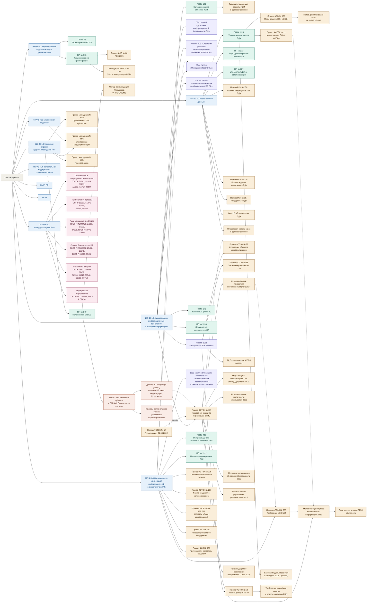

# Анализ безопасности автоматизированных систем (АБАС)

## Общее

**Направление:** государственная информационная система (ГИС)  
**Объект информатизации:** Единая медицинская информационно-аналитическая система субъекта РФ  
**Выполнил:** студент группы ИВТ-21-22 Туктин К.В.

## Система нормативно-правового регулирования в области анализа безопасности государственных информационных систем

Сведения об использовании ИИ

{Сгенерировано с помощью Claude (Anthropic, версия Claude Opus 5.5): «По дисциплине "Анализ безопасности автоматизированных систем" нужно глубоко изучить порядок проведения анализа безопасности некоторой системы. Каждый студент выбирает своё направление и объект информатизации в рамках этого направления и разрабатывает теорию, практику, которая поможет понять, как проводится анализ безопасности автоматизированной системы. Я в качестве направления для анализа безопасности выбрал государственную информационную систему, в качестве объекта информатизации я выбрал Единую медицинскую информационно-аналитическую систему субъекта РФ. В результате должен быть представлен набор расписанных тем, которые раскрывают весь порядок анализа безопасности рассматриваемого объекта информатизации. На первом самом важном этапе нужно подобрать набор/иерархию нормативно правовых актов и руководящих документов в РФ (Федеральные Законы, Постановления Правительства, Приказы, Методологические документы и так далее), которые регулируют и регламентируют порядок проведения анализа безопасности ГИС (государственной информационной системы - Единая медицинская информационно-аналитическая система субъекта РФ). На основе этой нормативно-правовой и методологической базы должны быть сформированы группы нормативно-правовых, регуляторных и методологических документов, из этих групп нужно будет сформировать темы. На этой нормативке будет строится теория и практика каждой отдельной темы. По моему Объекту информатизации сформируй такой набор нормативных, руководящих и методологических документов»}

---
 
### Уровень 0. Конституционная основа
 
| Документ | Что полезного для анализа безопасности ЕМИАС | Темы |
|---|---|---|
| Конституция РФ, ст. 23, 24, 41, 55 | Ст. 23 гарантирует неприкосновенность частной жизни, личную и семейную тайну. Ст. 24 запрещает сбор, хранение, использование и распространение информации о частной жизни без согласия лица. Ст. 41 закрепляет право на охрану здоровья. Ст. 55 ч. 3 допускает ограничение прав только федеральным законом. Отсюда два вывода для анализа. Во-первых, конфиденциальность сведений о пациентах — конституционная ценность, а не только требование ведомственных приказов. Во-вторых, доступность ЕМИАС тоже защищаемое свойство: её отказ напрямую затрагивает право на медицинскую помощь. Это обосновывает выбор негативных последствий в модели угроз. | Т1, Т3 |
 
---
 
### Уровень 1. Федеральные законы
 
#### Группа 1.1. Базовые законы об информации и её защите
 
| Документ | Что полезного для анализа безопасности ЕМИАС | Темы |
|---|---|---|
| 149-ФЗ «Об информации, информационных технологиях и о защите информации» | Ст. 2 даёт понятия «информационная система», «оператор ИС», «обладатель информации»; по ним в Т1 определяются роли (обладатель — региональный орган здравоохранения, оператор — как правило, МИАЦ). Ст. 5 и 9 вводят категории доступа и информацию ограниченного доступа, к которой относится врачебная тайна. Ст. 12.1 — основание реестра российского ПО. Ст. 13–14 определяют ГИС: создаётся на основании закона или решения органа власти, требования к её созданию и эксплуатации устанавливает Правительство (ПП № 676). Ключевая ст. 16: ч. 4 перечисляет обязанности оператора — предотвращать несанкционированный доступ, своевременно обнаруживать его, не допускать неблагоприятных последствий и воздействия на технические средства, обеспечивать незамедлительное восстановление информации, постоянно контролировать уровень защищённости, размещать базы данных в РФ. Этот перечень удобно использовать как набор целей безопасности, на соответствие которым оценивается ЕМИАС. Ч. 5 закрепляет, что требования о защите информации в ГИС устанавливают ФСТЭК и ФСБ, отсюда обязательность Приказа № 117 и приказов ФСБ. | Т1, Т4, Т6 |
| 152-ФЗ «О персональных данных» | Ст. 3 даёт понятия обработки, оператора, информационной системы ПДн. Ст. 5 задаёт принципы (соответствие целям, минимизация, точность, ограниченный срок хранения); по ним проверяется избыточность данных в подсистемах ЕМИАС. Ст. 10 относит сведения о здоровье к специальной категории; ч. 2 п. 4 разрешает их обработку без согласия в медико-профилактических целях лицами, обязанными хранить врачебную тайну. Это определяет законные потоки данных, а всё, что выходит за них (аналитика сторонними организациями, передача подрядчикам), требует отдельного основания. Ст. 18 ч. 5 — локализация баз ПДн граждан РФ. Ст. 18.1 — организационные меры оператора, включая оценку вреда и внутренний контроль. Ст. 19 ч. 2 перечисляет технические этапы обеспечения безопасности: определение угроз, применение мер и средств, прошедших оценку соответствия, оценку эффективности до ввода в эксплуатацию, учёт носителей, обнаружение несанкционированного доступа, восстановление, правила доступа, контроль. По сути это план анализа. Ч. 3–4 отсылают к ПП № 1119 и приказам ФСТЭК и ФСБ, ч. 5 — к отраслевым моделям угроз, ч. 12 обязывает взаимодействовать с ГосСОПКА. Ст. 21 ч. 3.1 обязывает уведомлять Роскомнадзор об утечке в течение 24 и 72 часов. | Т1, Т2, Т3, Т4, Т6 |
| 187-ФЗ «О безопасности критической информационной инфраструктуры РФ» | Ст. 2 относит здравоохранение к сферам КИИ, поэтому медорганизации и оператор ЕМИАС являются субъектами КИИ, а сама система — объектом КИИ. Ст. 7 устанавливает категорирование (три категории значимости) и обязанность направить сведения в ФСТЭК. Ст. 9 обязывает субъекта информировать ФСБ о компьютерных инцидентах, реагировать на них, обеспечивать доступ ФСБ к средствам обнаружения атак. Ст. 10 требует создать систему безопасности значимого объекта; ст. 11 — выполнять требования ФСТЭК (Приказы № 235, 239); ст. 12 — оценка безопасности КИИ силами ФСБ; ст. 13 — государственный контроль ФСТЭК, включая плановые проверки. Изменения 2025 г. (58-ФЗ) ввели типовые отраслевые объекты КИИ и дополнительные требования к применяемому ПО и ПАК (уточнить актуальную редакцию). Для анализа это значит, что ЕМИАС одновременно ГИС, ИСПДн и, при присвоении категории, значимый объект КИИ, и требования трёх режимов нужно сводить вместе. | Т1, Т2, Т4, Т6 |
| 63-ФЗ «Об электронной подписи» | Ст. 5–6 определяют виды подписи и условия равнозначности собственноручной; для медицинских документов применяется усиленная квалифицированная подпись (УКЭП) медработника и медорганизации. Ст. 10 обязывает владельцев обеспечивать конфиденциальность ключей и прекращать использование скомпрометированных. Ст. 11 задаёт условия признания УКЭП действительной, это важно для долговременной проверки подписей в архиве ЭМД. Ст. 12 требует средств ЭП, подтверждённых ФСБ. В модели угроз отсюда вытекают угрозы компрометации ключей, использования чужого токена (типичная проблема общих токенов в отделениях), подмены документа после подписания и непроверяемости подписи в будущем. | Т3, Т4 |
| 99-ФЗ «О лицензировании отдельных видов деятельности» | Ст. 12 включает в перечень лицензируемых видов деятельность с шифровальными средствами (ФСБ) и техническую защиту конфиденциальной информации (ФСТЭК). Для анализа важно проверить, кто и на каком основании выполняет работы по защите ЕМИАС. Подрядчики, проектирующие систему защиты и проводящие аттестацию, обязаны иметь лицензию. | Т4, Т5 |
| 162-ФЗ «О стандартизации в РФ» | Ст. 26 устанавливает, что национальные стандарты применяются добровольно, но становятся обязательными, если на них сослались в нормативном акте или договоре, например в ТЗ на систему защиты ЕМИАС. Это правовое обоснование использования ГОСТ Р в работе. Если в ТЗ указано «в соответствии с ГОСТ Р 51583-2014», выполнение стандарта проверяется как обязательное. | Т1, Т4 |
 
#### Группа 1.2. Отраслевые законы (здравоохранение)
 
| Документ | Что полезного для анализа безопасности ЕМИАС | Темы |
|---|---|---|
| 323-ФЗ «Об основах охраны здоровья граждан в РФ» | Ст. 13 определяет состав врачебной тайны: факт обращения, состояние здоровья, диагноз, иные сведения, полученные при обследовании и лечении. Ч. 4 содержит закрытый перечень случаев передачи без согласия: запросы следствия и суда, угроза распространения инфекций, контроль в системе ОМС, контроль качества медицинской помощи и др. По этому перечню в Т1 строится матрица допустимых информационных потоков, а любой поток вне её — признак нарушения или угрозы. Ст. 36.2 регулирует телемедицину. Ст. 91 вводит ГИС в сфере здравоохранения (ЕГИСЗ, ГИС субъектов, МИС медорганизаций) и требует обрабатывать в них ПДн с соблюдением врачебной тайны. Ст. 91.1 устанавливает, что ГИС субъектов обязаны предоставлять сведения в ЕГИСЗ. Отсюда граница ответственности: региональный оператор отвечает за свой сегмент и за защищённость канала до ЕГИСЗ. Ст. 92 — персонифицированный учёт. | Т1, Т3 |
| 326-ФЗ «Об обязательном медицинском страховании в РФ» | Глава о персонифицированном учёте в сфере ОМС определяет состав сведений о застрахованных и оказанной медицинской помощи, которые передаются в ТФОМС и страховые медорганизации (реестры счетов). Для анализа это внешний интерфейс ЕМИАС с особым профилем угроз. Здесь критична целостность, а не только конфиденциальность: подмена или искажение реестров ведёт к финансовому ущербу и мошенничеству с оплатой медицинской помощи. Это нужно отразить в негативных последствиях и сценариях модели угроз. | Т1, Т3 |
 
#### Группа 1.3. Ответственность
 
| Документ | Что полезного для анализа безопасности ЕМИАС | Темы |
|---|---|---|
| КоАП РФ, ст. 13.11, 13.12, 13.12.1, 13.14, 19.5, 19.7 | Ст. 13.11 — нарушения в области ПДн. С 30.05.2025 действуют части об утечках, в том числе специальных категорий ПДн, со значительными и оборотными штрафами. Ст. 13.12 — нарушение правил защиты информации, включая использование несертифицированных СЗИ и нарушение требований о защите информации. Ст. 13.12.1 — нарушение требований в области КИИ. Ст. 13.14 — разглашение информации ограниченного доступа лицом, получившим к ней доступ по службе; это прямая ответственность медработников. Ст. 19.5 — неисполнение предписаний ФСТЭК и Роскомнадзора; ст. 19.7 — непредставление сведений (например, о категорировании). В анализе эти составы используются для оценки ущерба оператору (экономические и репутационные последствия) и для формирования перечня контрольных точек, которые проверяют регуляторы. | Т3, Т6 |
| УК РФ, ст. 137, 272, 272.1, 273, 274, 274.1 | Ст. 137 — незаконное собирание и распространение сведений о частной жизни. Ст. 272 — неправомерный доступ к охраняемой компьютерной информации. Ст. 272.1 (с 2024 г.) — незаконные использование, передача, сбор и хранение компьютерной информации, содержащей ПДн, с квалифицирующими признаками для специальных категорий. Ст. 273 — вредоносные программы. Ст. 274 — нарушение правил эксплуатации средств хранения и обработки информации. Ст. 274.1 — неправомерное воздействие на КИИ. Для модели нарушителя это показывает правовые риски внутреннего нарушителя (продажа выгрузок из ЕМИАС, «пробив» данных пациентов) и сдерживающий фактор, который учитывается при оценке мотивации. | Т3, Т6 |
 
---
 
### Уровень 2. Акты Президента РФ
 
| Документ | Что полезного для анализа безопасности ЕМИАС | Темы |
|---|---|---|
| Указ № 646 от 05.12.2016 «Доктрина информационной безопасности РФ» | Определяет национальные интересы в информационной сфере и основные угрозы: целенаправленное воздействие на КИИ, использование ИТ в преступных целях, утечки информации, зависимость от иностранных технологий. Используется в теоретической части Т1 для обоснования актуальности, а в Т3 — для перечня внешних источников угроз высокого уровня: иностранные спецслужбы, преступные группы. | Т1, Т3 |
| Указ № 203 от 09.05.2017 «Стратегия развития информационного общества 2017–2030» | Закрепляет принципы обеспечения безопасности обработки ПДн, приоритета отечественных технологий и создания доверенной информационной среды; цифровизация здравоохранения названа одним из направлений. Даёт стратегическое обоснование требований импортозамещения и защиты медицинских данных. | Т1 |
| Указ № 31с от 15.01.2013 | Создаёт ГосСОПКА — государственную систему обнаружения, предупреждения и ликвидации последствий компьютерных атак на информационные ресурсы РФ. Текст ограниченного доступа. Значение для ЕМИАС: ресурсы системы должны быть охвачены мониторингом в рамках ГосСОПКА (через собственный, ведомственный или коммерческий центр), а инциденты передаются в НКЦКИ. | Т6 |
| Указ № 166 от 30.03.2022 | С 31.03.2022 заказчикам, являющимся субъектами КИИ, запрещено без согласования закупать иностранное ПО для значимых объектов КИИ, а с 01.01.2025 — использовать его на таких объектах. Для анализа ЕМИАС это означает инвентаризацию ПО по происхождению (ОС, СУБД, средства виртуализации, прикладное ПО, СЗИ). Кроме того, в модель угроз включаются угрозы прекращения поддержки и обновлений, а также недоступности лицензий. | Т3, Т4 |
| Указ № 250 от 01.05.2022 «О дополнительных мерах по обеспечению ИБ РФ» | Возлагает на руководителя персональную ответственность за ИБ, требует назначить заместителя, отвечающего за ИБ, и создать структурное подразделение по ИБ (типовые положения утверждены ПП № 1272 от 15.07.2022). С 01.01.2025 запрещает использовать СЗИ из недружественных государств. Предусматривает оценку защищённости, в том числе с участием ФСБ. Распространяется на органы власти субъектов, государственные учреждения в ряде статусов и субъекты КИИ. Охват оператора ЕМИАС нужно установить по его статусу. Для анализа даёт требования к организационной структуре ИБ оператора и к происхождению СЗИ. | Т4, Т6 |
| Указ № 1085 от 16.08.2004 «Вопросы Федеральной службы по техническому и экспортному контролю» | Утверждает Положение о ФСТЭК: регулятор устанавливает требования по технической защите информации, организует аттестацию и сертификацию, лицензирует ТЗКИ, осуществляет контроль в области безопасности ГИС и КИИ. Нужен, чтобы в Т1 обосновать полномочия ФСТЭК и юридическую силу её приказов и методических документов. | Т1, Т6 |
 
---
 
### Уровень 3. Постановления Правительства РФ
 
#### Группа 3.1. ГИС — общий порядок
 
| Документ | Что полезного для анализа безопасности ЕМИАС | Темы |
|---|---|---|
| ПП № 676 от 06.07.2015 | Требования к порядку создания, развития, ввода в эксплуатацию, эксплуатации и вывода из эксплуатации ГИС. Для анализа важно следующее. Защита информации обеспечивается на каждой стадии жизненного цикла. ТЗ на ГИС и модель угроз согласуются с ФСТЭК и ФСБ в части требований о защите информации. Ввод в эксплуатацию допускается только после аттестации по требованиям защиты информации. Технические средства ГИС размещаются на территории РФ. При выводе из эксплуатации обеспечивается защита и уничтожение информации. При модернизации ЕМИАС (новая подсистема, перенос в другой ЦОД) это постановление обязывает пересмотреть модель угроз и, как правило, провести повторную аттестацию. | Т1, Т4, Т5 |
| ПП № 1236 от 16.11.2015 | Устанавливает запрет на закупку иностранного ПО для государственных нужд при наличии российского аналога в едином реестре и порядок обоснования исключений. В анализе используется при проверке состава ПО ЕМИАС: есть ли каждый компонент в реестре российского ПО, есть ли обоснования для иностранных компонентов. | Т4 |
 
#### Группа 3.2. Здравоохранение
 
| Документ | Что полезного для анализа безопасности ЕМИАС | Темы |
|---|---|---|
| ПП № 140 от 09.02.2022 «О единой государственной информационной системе в сфере здравоохранения» | Положение о ЕГИСЗ описывает её подсистемы (федеральные регистры, реестр электронных медицинских документов, интегрированная электронная медицинская карта, НСИ и др.), участников, состав и сроки предоставления сведений, порядок доступа, способы взаимодействия (ЕСИА, СМЭВ, защищённая сеть передачи данных). Для анализа ЕМИАС это главный источник для описания внешних интерфейсов и границ доверия: какие данные, в каком составе, по какому каналу и с какой аутентификацией уходят из региональной системы в федеральную и на Госуслуги. Каждый такой интерфейс становится объектом воздействия и точкой входа в модели угроз. | Т1, Т3, Т4 |
 
#### Группа 3.3. Персональные данные
 
| Документ | Что полезного для анализа безопасности ЕМИАС | Темы |
|---|---|---|
| ПП № 1119 от 01.11.2012 | Вводит три типа актуальных угроз (связанных с недокументированными возможностями системного ПО, прикладного ПО или не связанных с ними) и четыре уровня защищенности ПДн. Для ЕМИАС (специальные категории ПДн, более 100 тыс. субъектов, не являющихся сотрудниками) получается УЗ-1 при актуальных угрозах 2-го типа и УЗ-2 при угрозах только 3-го типа. Обоснование типа угроз поэтому — ключевой и спорный момент Т2. Постановление также задаёт требования по уровням: режим помещений, сохранность носителей, перечень допущенных лиц, СЗИ, прошедшие оценку соответствия, назначение ответственного (УЗ-2), автоматическую регистрацию изменений полномочий и подразделение по защите (УЗ-1). Контроль выполнения требований — не реже одного раза в три года. | Т2, Т4, Т6 |
| ПП № 211 от 21.03.2012 | Перечень организационных мер по 152-ФЗ для операторов — государственных и муниципальных органов: ответственный, правила обработки, перечни должностей и обрабатываемых ПДн, типовые обязательства и формы согласий, правила внутреннего контроля, обезличивание. Напрямую применяется к органу управления здравоохранением субъекта. Для ГБУЗ «МИАЦ» как учреждения служит образцом состава организационных документов. При анализе по этому перечню проверяется полнота организационно-распорядительной документации. | Т4, Т6 |
| ПП № 687 от 15.09.2008 | Правила обработки ПДн без средств автоматизации: обособление ПДн на материальных носителях, раздельное хранение по целям, требования к типовым формам и журналам. Для ЕМИАС это бумажные документы, которые порождает система: распечатки медкарт, направлений, справок, выгрузки отчётов. Это канал утечки, который часто упускают в модели угроз. | Т3, Т4 |
 
#### Группа 3.4. КИИ
 
| Документ | Что полезного для анализа безопасности ЕМИАС | Темы |
|---|---|---|
| ПП № 127 от 08.02.2018 | Правила категорирования: создание комиссии, определение управленческих, технологических и других процессов, выявление критических процессов, составление перечня объектов КИИ, оценка масштаба возможных последствий компьютерных инцидентов по показателям значимости (социальная, политическая, экономическая, экологическая, значимость для обороны и безопасности), присвоение категории, пересмотр. Для ЕМИАС особенно важны показатели причинения ущерба жизни и здоровью (недоступность сведений о пациенте при экстренной помощи), отсутствия доступа к государственной услуге (запись к врачу, сервисы на Госуслугах) и нарушения функционирования органа власти. Практика Т2 — расчёт этих показателей на условных данных региона. | Т2 |
| ПП № 743 от 08.06.2019 | Правила подготовки и использования ресурсов единой сети электросвязи РФ для обеспечения функционирования значимых объектов КИИ (в первом ответе ошибочно указан № 452, правильно № 743). Устанавливает условия использования сетей связи значимыми объектами, включая ограничения, связанные с размещением оборудования и управлением из-за рубежа (детали уточнить по тексту). В анализе применяется к каналам связи между медорганизациями, ЦОД ЕМИАС и ЕГИСЗ. | Т2, Т4 |
| ПП № 1912 от 14.11.2023 | Порядок перехода субъектов КИИ на преимущественное применение доверенных программно-аппаратных комплексов на значимых объектах: критерии доверенности (российское происхождение, подтверждённое соответствие требованиям ФСТЭК и ФСБ), планы перехода и их согласование, сроки (уточнить). Для ЕМИАС — проверка серверного и сетевого оборудования и формирование плана импортозамещения как части требований к системе защиты. | Т4 |
 
#### Группа 3.5. Лицензирование
 
| Документ | Что полезного для анализа безопасности ЕМИАС | Темы |
|---|---|---|
| ПП № 79 от 03.02.2012 | Положение о лицензировании деятельности по ТЗКИ: перечень работ (контроль защищённости, проектирование, установка и настройка СЗИ, аттестационные испытания) и лицензионные требования к персоналу и контрольно-измерительному оборудованию. При анализе используется для проверки правомочности подрядчиков и для понимания, какие работы могут выполняться самим оператором. | Т4, Т5 |
| ПП № 313 от 16.04.2012 | Положение о лицензировании деятельности с шифровальными средствами: перечень работ (монтаж, установка, наладка, техническое обслуживание СКЗИ) и случаи, когда лицензия не требуется (в том числе эксплуатация для собственных нужд при определённых условиях). Для ЕМИАС — криптошлюзы и VPN-клиенты, которыми медорганизации подключаются к защищённой сети, и средства УКЭП. | Т4 |
 
---
 
### Уровень 4. Нормативные акты федеральных органов исполнительной власти
 
#### Группа 4.1. ФСТЭК России — защита информации в ГИС и ПДн
 
| Документ | Что полезного для анализа безопасности ЕМИАС | Темы |
|---|---|---|
| **Приказ № 117 от 11.04.2025** (действует с 01.03.2026) | Главный документ анализа. Распространяется на ГИС и иные ИС государственных органов, ГУП и государственных учреждений. Задаёт последовательность работ, которая определяет логику курса: формирование требований (классификация, определение угроз, определение требований), разработка системы защиты, её внедрение, аттестация и ввод в эксплуатацию, обеспечение защиты в ходе эксплуатации, обеспечение защиты при выводе из эксплуатации. Содержит порядок определения класса защищенности по уровню значимости информации и масштабу системы (для ЕМИАС — региональный масштаб), состав мер защиты и требования к контролю. По сравнению с Приказом № 17 расширены требования к поддержанию уровня защищённости в ходе эксплуатации и периодической оценке состояния защиты, к подрядчикам и удалённому доступу, появились положения о технологиях искусственного интеллекта (конкретные формулировки, классы и показатели сверить с текстом). | Т2, Т4, Т5, Т6 |
| Приказ № 17 от 11.02.2013 (утратил силу) | Нужен для сравнительного анализа и потому, что действующие аттестаты ЕМИАС могли быть выданы по нему. Содержит классификацию ГИС по уровню значимости (УЗ1–УЗ3) и масштабу (федеральный, региональный, объектовый) с итоговыми классами К1–К3, а также базовые наборы мер по группам: ИАФ (идентификация и аутентификация), УПД (управление доступом), ОПС (ограничение программной среды), ЗНИ (защита машинных носителей), РСБ (регистрация событий), АВЗ (антивирусная защита), СОВ (обнаружение вторжений), АНЗ (контроль защищённости), ОЦЛ (целостность), ОДТ (доступность), ЗСВ (виртуализация), ЗТС (технические средства), ЗИС (защита ИС и её средств), ИНЦ (инциденты), УКФ (управление конфигурацией). Эта систематика мер используется в Т4 для таблицы соответствия требований и средств. | Т1, Т2, Т4 |
| Приказ № 21 от 18.02.2013 | Состав и содержание мер обеспечения безопасности ПДн в ИСПДн с базовыми наборами по уровням защищенности (те же группы мер, что и для ГИС). Устанавливает процедуру, общую для всех приказов ФСТЭК: выбор базового набора, его адаптация, уточнение с учётом актуальных угроз, дополнение мерами из других актов, применение компенсирующих мер. Требует оценки эффективности мер не реже раза в три года. Для ЕМИАС применяется совместно с Приказом № 117: из двух наборов мер выбираются более строгие. | Т4, Т6 |
| Методический документ «Меры защиты информации в ГИС» от 11.02.2014 | Для каждой меры описывает её содержание, требования к реализации и усилению, а также базовое применение по классам. Это готовый чек-лист для проверки реализации мер при анализе ЕМИАС. Применимость при Приказе № 117 уточнить: возможна новая редакция. | Т4, Т5 |
 
#### Группа 4.2. ФСТЭК России — КИИ
 
| Документ | Что полезного для анализа безопасности ЕМИАС | Темы |
|---|---|---|
| Приказ № 239 от 25.12.2017 | Требования по обеспечению безопасности значимых объектов КИИ: порядок разработки требований, моделирования угроз, проектирования, внедрения и эксплуатации подсистемы безопасности. Содержит базовые наборы мер по категориям значимости, включая группы, которых нет в требованиях к ГИС: аудит безопасности, планирование, действия в нештатных ситуациях, информирование и обучение персонала. Содержит требования к прикладному ПО (безопасная разработка, испытания по выявлению уязвимостей) и к ограничению удалённого доступа и передачи данных разработчику. Если ЕМИАС получает категорию, этот приказ добавляет к требованиям ГИС меры, которые нужно свести в единую таблицу в Т4. | Т4, Т5 |
| Приказ № 235 от 21.12.2017 | Требования к созданию систем безопасности значимых объектов КИИ: состав сил обеспечения безопасности, квалификационные требования к специалистам, перечень организационно-распорядительных документов (политика, порядки, планы), периодический внутренний контроль. Используется для анализа организационной составляющей защиты ЕМИАС. | Т4, Т6 |
| Приказ № 236 от 22.12.2017 | Форма сведений о результатах категорирования: описание объекта, его взаимодействия с сетями, применяемые ОС и СЗИ, значения показателей значимости, категории нарушителей и возможные способы атак. Практическая часть Т2 — заполнение этой формы для ЕМИАС. | Т2 |
 
#### Группа 4.3. ФСТЭК России — оценка соответствия
 
| Документ | Что полезного для анализа безопасности ЕМИАС | Темы |
|---|---|---|
| Приказ № 77 от 29.04.2021 | Порядок аттестации объектов информатизации: подготовка исходных данных, разработка программы и методик аттестационных испытаний, проведение испытаний (анализ документов, проверка реализации мер, выявление уязвимостей), оформление протоколов, заключения и аттестата, повторная аттестация при изменениях. Для ЕМИАС особенно важна аттестация на основе типового сегмента: медорганизации подключаются однотипными АРМ, и аттестат распространяется на них без повторных полных испытаний. Практика Т5 — программа и методики аттестационных испытаний ЕМИАС. | Т5 |
| Приказ № 55 от 03.04.2018 | Положение о системе сертификации СЗИ: участники, порядок сертификации, маркировка, срок действия сертификатов, государственный реестр сертифицированных СЗИ. При анализе используется для проверки каждого СЗИ ЕМИАС: есть ли действующий сертификат и не закончилась ли техническая поддержка. | Т4, Т5 |
| Приказ № 76 от 02.06.2020 | Требования по безопасности информации к программным и программно-аппаратным средствам с шестью уровнями доверия: требования к разработке, испытаниям и поддержке, включая оперативное устранение уязвимостей. Установлено соответствие уровней доверия классам систем: 4-й уровень — для К1, УЗ-1 и 1-й категории КИИ, 5-й — для К2, УЗ-2 и 2-й категории, 6-й — для К3, УЗ-3 и 3-й категории. По этому соответствию в Т4 определяется требуемый уровень доверия СЗИ ЕМИАС. | Т4 |
| Требования и профили защиты к отдельным типам СЗИ | Требования ФСТЭК к межсетевым экранам (типы А–Д), системам обнаружения вторжений (уровня сети и узла), средствам антивирусной защиты, средствам доверенной загрузки, контроля съёмных носителей, операционным системам, СУБД, средствам виртуализации и контейнеризации. Каждый документ задаёт тип средства по месту применения и класс защиты. В Т4 по ним подбираются СЗИ для каждого компонента ЕМИАС: периметр ЦОД, веб-портал, серверы СУБД, АРМ в медорганизациях. | Т4 |
 
#### Группа 4.4. ФСТЭК России — методические документы (ядро практической части)
 
| Документ | Что полезного для анализа безопасности ЕМИАС | Темы |
|---|---|---|
| Методика оценки угроз безопасности информации от 05.02.2021 | Основной инструмент Т3. Последовательность: определение негативных последствий (ущерб физическим лицам, юридическим лицам и государству), объектов воздействия, источников угроз и нарушителей с уровнями возможностей Н1–Н4, способов реализации угроз и сценариев атак (тактики и техники из приложения). Для ЕМИАС типичны нарушители: преступные группы (шифровальщики, кража баз), внутренние пользователи (медработники с избыточными правами), администраторы, подрядчики и разработчики с удалённым доступом. Методика применима сразу к ГИС, ИСПДн и значимым объектам КИИ, поэтому позволяет построить единую модель угроз. | Т3 |
| Банк данных угроз безопасности информации (bdu.fstec.ru) | Содержит перечень угроз (УБИ.xxx) с описанием источников, объектов и последствий, базу уязвимостей (BDU:ГГГГ-NNNNN) с оценками CVSS и ссылками на CVE, а также сведения о тактиках и техниках атак. В Т3 используется как перечень угроз для отбора актуальных, в Т5 — для сопоставления найденных уязвимостей компонентов ЕМИАС, в том числе российского ПО, которого нет в зарубежных базах. | Т3, Т5 |
| Методика оценки уровня критичности уязвимостей от 28.10.2022 | Расчёт интегрального показателя критичности уязвимости по базовой оценке CVSS и характеристикам затронутого компонента (его роль и доступность из сети). Результат — уровень критичности (критический, высокий, средний, низкий), который определяет приоритет устранения. В Т5 по этой методике ранжируются уязвимости, найденные при сканировании ЕМИАС. | Т5 |
| Методика тестирования обновлений безопасности от 28.10.2022 | Порядок проверки обновлений перед установкой: подлинность источника и целостность, антивирусная проверка, поиск потенциально опасных функций. Особенно важна для обновлений иностранного ПО. В анализе ЕМИАС применяется при оценке процесса управления обновлениями и в модели угроз (угроза внедрения вредоносного кода через обновление). | Т5, Т6 |
| Руководство по организации процесса управления уязвимостями от 17.05.2023 | Описывает процесс: мониторинг уязвимостей и оценка их применимости, оценка критичности, определение способов и приоритетов устранения, устранение, контроль. Определяет роли участников. Используется для оценки зрелости процесса у оператора ЕМИАС и как шаблон регламента. | Т5, Т6 |
| Методика оценки показателя состояния технической защиты информации и обеспечения безопасности значимых объектов КИИ от 02.05.2024 | Количественная оценка защищённости (Кзи) по набору проверяемых параметров с весовыми коэффициентами, сгруппированных по направлениям: организационные меры, защита пользователей, защита информационной инфраструктуры, мониторинг и реагирование (пороговое значение и периодичность уточнить по тексту). Даёт практическую часть Т6 — расчёт Кзи для ЕМИАС на условных данных и интерпретацию результата. | Т6 |
| Рекомендации по безопасной настройке операционных систем Linux (2024) | Перечень параметров безопасной настройки: аутентификация и пароли, ограничение прав, параметры ядра, права на файлы и каталоги. Серверы ЕМИАС после импортозамещения обычно работают на отечественных дистрибутивах Linux, поэтому документ служит чек-листом при анализе конфигураций в Т5. | Т5 |
| Базовая модель угроз ПДн и Методика определения актуальных угроз ПДн (2008) | Историческая база: угрозы утечки по техническим каналам и несанкционированного доступа, расчёт актуальности через показатель исходной защищённости и вероятность реализации угрозы. В части определения угроз заменены методикой 2021 г. В теории Т3 полезны для сравнения вероятностного подхода 2008 г. и сценарного подхода 2021 г. | Т3 |
| Руководящие документы Гостехкомиссии (1992–2001): «Классификация АС», «СВТ», «Межсетевые экраны», «НДВ», СТР-К | Классические классификации: АС — 9 классов в трёх группах, СВТ — 7 классов, межсетевые экраны — 5 классов, контроль отсутствия НДВ — 4 уровня. СТР-К содержит меры защиты конфиденциальной информации, включая защиту от утечки по техническим каналам и требования к помещениям. В теории Т1 показывают эволюцию подходов, СТР-К частично применяется до сих пор. | Т1 |

 
#### Группа 4.5. ФСБ России — криптография и ГосСОПКА
 
| Документ | Что полезного для анализа безопасности ЕМИАС | Темы |
|---|---|---|
| Приказ № 378 от 10.07.2014 | Организационные и технические меры обеспечения безопасности ПДн с использованием СКЗИ по уровням защищенности: режим помещений с СКЗИ, учёт носителей, перечень допущенных лиц, выбор класса СКЗИ (КС1, КС2, КС3, КВ, КА) в зависимости от типа угроз и возможностей нарушителя. Для ЕМИАС применяется к защите каналов между медорганизациями, ЦОД и ЕГИСЗ, а также к средствам УКЭП. Практика Т4 — обоснование класса СКЗИ. | Т4 |
| Приказ № 66 от 09.02.2005 (ПКЗ-2005) | Положение о разработке, производстве, реализации и эксплуатации СКЗИ: эксплуатация в соответствии с правилами пользования, требования к встраиванию СКЗИ в прикладные системы. Нужен при анализе встраивания криптографии в ЕМИАС (подписание СЭМД, шифрование каналов). | Т4 |
| Инструкция ФАПСИ № 152 от 13.06.2001 | Порядок организации безопасности хранения, обработки и передачи информации ограниченного доступа с использованием СКЗИ: поэкземплярный учёт СКЗИ и ключевых документов, журналы, допуск пользователей, обращение с ключевыми носителями. Для ЕМИАС это основа проверки обращения с токенами УКЭП и ключами VPN во множестве медорганизаций. | Т4, Т6 |
| Методические рекомендации № 149/7/2/6-432 от 31.03.2015 | Порядок определения угроз безопасности ПДн, актуальных при использовании СКЗИ: обобщённые возможности источников атак и их соответствие классам СКЗИ. Применяется вместе с методикой ФСТЭК 2021 г. для криптографической части модели угроз ЕМИАС. | Т3, Т4 |
| Приказы № 366, 367, 368 от 24.07.2018 | № 366 — о Национальном координационном центре по компьютерным инцидентам. № 367 — перечень информации, которую субъекты КИИ представляют в ГосСОПКА. № 368 — порядок обмена информацией о компьютерных инцидентах. В Т6 определяют, какие сведения об инцидентах в ЕМИАС и по каким каналам передаются в НКЦКИ. | Т6 |
| Приказ № 282 от 19.06.2019 | Порядок информирования ФСБ о компьютерных инцидентах и реагирования на них. Для значимых объектов КИИ — уведомление не позднее 3 часов с момента обнаружения, для остальных объектов — 24 часов. Для значимых объектов требуется план реагирования. Практика Т6 — регламент реагирования на инциденты в ЕМИАС с учётом этих сроков. | Т6 |
| Приказ № 196 от 06.05.2019 | Требования к средствам ГосСОПКА: средства обнаружения атак, предупреждения и ликвидации их последствий, обмена информацией с НКЦКИ. Используется при выборе средств мониторинга для ЕМИАС. | Т4, Т6 |
 
#### Группа 4.6. Роскомнадзор — персональные данные
 
| Документ | Что полезного для анализа безопасности ЕМИАС | Темы |
|---|---|---|
| Приказ № 178 от 27.10.2022 | Требования к оценке вреда субъектам ПДн с тремя степенями (высокая, средняя, низкая) и оформлением акта оценки. Обработка специальных категорий ПДн, как правило, означает высокую степень вреда. Акт оценки вреда — обязательный документ оператора ЕМИАС и входные данные для определения негативных последствий в модели угроз. | Т3, Т4 |
| Приказ № 179 от 28.10.2022 | Требования к подтверждению уничтожения ПДн: акт об уничтожении, а при автоматизированной обработке — выгрузка из журнала регистрации событий. Для ЕМИАС применяется при истечении сроков хранения, выводе подсистем из эксплуатации, удалении тестовых копий баз. Наличие и полнота журналов — проверяемый пункт анализа. | Т4, Т6 |
| Приказ № 187 от 14.11.2022 | Порядок взаимодействия с Роскомнадзором при инцидентах с ПДн: первичное уведомление в течение 24 часов, дополнительное с результатами расследования в течение 72 часов. Взаимодействие с ГосСОПКА в этой части. В Т6 сроки включаются в регламент реагирования наряду со сроками ФСБ. | Т6 |
| Акты об обезличивании ПДн | Методы и требования к обезличиванию. В 2024–2025 гг. регулирование изменилось (новые положения 152-ФЗ об обезличенных данных), действующий акт уточнить. Для ЕМИАС важно для аналитической подсистемы и выгрузок медицинской статистики: если данные передаются для анализа, обезличивание снижает их критичность и меняет состав угроз. | Т3, Т4 |
 
#### Группа 4.7. Минздрав России — отраслевые требования
 
| Документ | Что полезного для анализа безопасности ЕМИАС | Темы |
|---|---|---|
| **Приказ № 911н от 24.12.2018** | Требования к ГИС в сфере здравоохранения субъектов РФ, МИС медорганизаций и ИС фармацевтических организаций. Перечисляет обязательные функции (подсистемы) региональной системы: ведение медицинских карт и интегрированной ЭМК, управление потоками пациентов и записью, лабораторные исследования, льготное лекарственное обеспечение, взаимодействие с ЕГИСЗ и другие. Этот перечень — основа описания состава ЕМИАС в Т1 и перечня объектов воздействия в Т3. Содержит также требования, касающиеся защиты информации, идентификации пользователей и использования ЭП (конкретные формулировки сверить с текстом). | Т1, Т3, Т4 |
| Приказ № 947н от 07.09.2020 | Порядок ведения медицинской документации в форме электронных документов: формирование ЭМД, подписание УКЭП медработника и (для ряда документов) медорганизации, регистрация в реестре ЭМД ЕГИСЗ, хранение, предоставление гражданину. Для анализа определяет требования к целостности, неотказуемости и долговременному хранению ЭМД. В модели угроз отсюда угрозы подделки и подмены документов, подписания от чужого имени, утраты возможности проверить подпись. | Т3, Т4 |
| Приказ № 965н от 30.11.2017 | Порядок оказания медицинской помощи с применением телемедицинских технологий: идентификация и аутентификация участников, использование ГИС в сфере здравоохранения, документирование консультаций. Для ЕМИАС с телемедицинским модулем это отдельный интерфейс с внешними участниками и собственным профилем угроз. | Т1, Т3 |
| Методические рекомендации Минздрава и ЦНИИОИЗ, ФРНСИ, структуры СЭМД | Описание интеграционных профилей, форматов структурированных ЭМД, единых справочников. Нужны для точного описания информационных потоков в Т1 и для анализа угроз на уровне интерфейсов: подмена справочных данных, внедрение некорректных или вредоносных данных через структуры обмена. | Т1, Т3 |
| Отраслевая модель угроз в здравоохранении | Модель угроз типовой медицинской информационной системы (Минздравсоцразвития, 2009) содержит описание типовой МИС и перечень угроз. Методически устарела (основана на подходе 2008 г.), но полезна как отраслевой ориентир и источник типовой архитектуры. Наличие более нового отраслевого акта по ч. 5 ст. 19 152-ФЗ уточнить. | Т3 |
| Типовые отраслевые объекты КИИ в здравоохранении | Перечни типовых объектов КИИ отрасли с заранее определёнными категориями, введённые изменениями 187-ФЗ 2025 г. Если региональная ГИС здравоохранения входит в перечень, это упрощает и предопределяет результат категорирования. Актуальность и содержание уточнить. | Т2 |
 
---
 
### Уровень 5. Национальные стандарты
 
#### Группа 5.1. Создание АС в защищённом исполнении
 
| Стандарт | Что полезного для анализа безопасности ЕМИАС | Темы |
|---|---|---|
| ГОСТ Р 51583-2014 | Порядок создания автоматизированных систем в защищённом исполнении: для каждой стадии (формирование требований, разработка, ввод в действие, сопровождение) перечислены работы по защите информации, включая предпроектное обследование, классификацию, моделирование угроз, разработку ТЗ на систему защиты, испытания и аттестацию. Удобная «рамка» для последовательности тем курса. | Т1, Т4 |
| ГОСТ Р 51624-2000 | Общие требования к АС в защищённом исполнении: принципы построения защиты, требования к документации и средствам. Используется в теоретической части. | Т4 |
| ГОСТ Р 59793-2021 | Стадии создания автоматизированных систем (заменил ГОСТ 34.601-90). Задаёт привязку работ по анализу безопасности к стадиям жизненного цикла ЕМИАС. | Т1, Т4 |
| ГОСТ 34.602-2020 | Состав и содержание ТЗ на создание АС, включая раздел требований к защите информации. Шаблон для практики Т4 (ТЗ на систему защиты ЕМИАС). | Т4 |
| ГОСТ Р 59792-2021 | Виды испытаний АС (автономные, комплексные, предварительные, опытная эксплуатация, приёмочные). Нужен для увязки испытаний системы защиты с аттестационными испытаниями. | Т5 |
| ГОСТ Р 59795-2021 | Требования к содержанию документов на АС. Используется при оформлении проектной и эксплуатационной документации системы защиты. | Т4 |
 
#### Группа 5.2. Терминология и угрозы
 
| Стандарт | Что полезного для анализа безопасности ЕМИАС | Темы |
|---|---|---|
| ГОСТ Р 50922-2006 | Основные термины защиты информации: объект защиты, угроза, уязвимость, несанкционированный доступ, эффективность защиты. Понятийный аппарат всей работы. | Т1 |
| ГОСТ Р 51275-2006 | Классификация факторов, воздействующих на информацию: объективные и субъективные, внутренние и внешние. Позволяет систематически перебрать источники угроз и не упустить непреднамеренные (ошибки персонала, сбои оборудования). | Т3 |
| ГОСТ Р 53114-2008 | Термины обеспечения ИБ в организации: политика ИБ, инцидент, риск, менеджмент ИБ. Используется при разработке политики ИБ оператора. | Т1, Т4 |
| ГОСТ Р 56545-2015, ГОСТ Р 56546-2015 | Правила описания уязвимостей (состав «паспорта» уязвимости) и их классификация по типу недостатка, области ПО и месту возникновения. В Т5 по ним оформляется перечень найденных уязвимостей ЕМИАС. | Т5 |
 
#### Группа 5.3. Риск-менеджмент и СМИБ
 
| Стандарт | Что полезного для анализа безопасности ЕМИАС | Темы |
|---|---|---|
| ГОСТ Р ИСО/МЭК 27001-2021 | Требования к системе менеджмента ИБ (цикл «планирование — реализация — проверка — улучшение») и перечень мер управления в приложении. Даёт процессную рамку для поддержания безопасности ЕМИАС в ходе эксплуатации. | Т4, Т6 |
| ГОСТ Р ИСО/МЭК 27002-2021 | Практическое руководство по мерам управления ИБ. Дополняет приказы ФСТЭК организационными мерами (управление активами, кадровая безопасность, взаимодействие с поставщиками). | Т4 |
| ГОСТ Р ИСО/МЭК 27005-2010 | Процесс менеджмента риска ИБ: установление контекста, идентификация, анализ и оценивание риска, обработка, принятие, мониторинг. Основа практики Т3 по оценке рисков. Проверить наличие более новой редакции. | Т3 |
| ГОСТ Р 58771-2019 | Каталог методов оценки риска (мозговой штурм, Дельфи, анализ видов и последствий отказов, дерево отказов, «галстук-бабочка», матрица последствий и вероятностей и др.) с указанием применимости. Помогает обосновать выбор метода оценки рисков ЕМИАС. | Т3 |
| ГОСТ Р ИСО 31000 | Общие принципы и руководство по менеджменту риска. Теоретическая база Т3. | Т3 |
 
#### Группа 5.4. Оценка безопасности ИТ
 
| Стандарт | Что полезного для анализа безопасности ЕМИАС | Темы |
|---|---|---|
| ГОСТ Р ИСО/МЭК 15408 (части 1–3) | «Общие критерии»: классы функциональных требований безопасности (аудит, криптография, защита данных, идентификация и аутентификация и др.) и требований доверия, понятия профиля защиты и задания по безопасности. Используется для понимания требований ФСТЭК к СЗИ и для формулировки требований к прикладному ПО ЕМИАС. | Т4 |
| ГОСТ Р ИСО/МЭК 18045-2013 | Методология оценки безопасности ИТ по «Общим критериям», включая анализ уязвимостей и тестирование. Методическая основа Т5. | Т5 |
| ГОСТ Р 56939-2024 | Процессы разработки безопасного ПО: моделирование угроз, статический и динамический анализ кода, фаззинг, управление заимствованными компонентами. Применяется, если региональная ЕМИАС разрабатывается или дорабатывается по заказу оператора; в Т5 — для оценки качества разработки. | Т4, Т5 |
| ГОСТ Р 58412-2019 | Угрозы безопасности информации на этапах разработки ПО. Дополняет модель угроз ЕМИАС угрозами со стороны разработчика и цепочки поставок. | Т3 |
 
#### Группа 5.5. Отдельные механизмы защиты
 
| Стандарт | Что полезного для анализа безопасности ЕМИАС | Темы |
|---|---|---|
| ГОСТ Р 58833-2020 | Идентификация и аутентификация: уровни доверия, факторы аутентификации, требования к процессам. Применяется к анализу входа медработников (пароль, токен с УКЭП, ЕСИА) и пациентов через порталы. | Т4, Т5 |
| ГОСТ Р 59383-2021 | Основы управления доступом: дискреционная, мандатная, ролевая и атрибутная модели. Для ЕМИАС характерна ролевая модель (врач, медсестра, регистратор, руководитель), дополненная атрибутами (прикрепление пациента к медорганизации, лечащий врач). В Т4 по стандарту анализируется матрица доступа. | Т4, Т5 |
| ГОСТ Р 59407-2021 | Базовая архитектура защиты персональных данных: роли, компоненты и меры обеспечения приватности. Используется для проверки архитектуры обработки ПДн в ЕМИАС. | Т4 |
| ГОСТ Р 56938-2016 | Защита информации при использовании технологий виртуализации: угрозы и меры для гипервизоров, виртуальных машин и сетей. ЦОД ЕМИАС, как правило, виртуализирован, поэтому стандарт нужен и в модели угроз, и в анализе конфигураций. | Т3, Т4 |
| ГОСТ Р 59547-2021 | Мониторинг ИБ: объекты, источники событий, организация процесса. Основа построения мониторинга ЕМИАС. | Т6 |
| ГОСТ Р 59548-2022 | Требования к составу регистрируемой информации о событиях безопасности по их типам. В Т5 и Т6 по нему проверяется, достаточно ли журналов ЕМИАС для расследования (кто, когда и чью медкарту открывал). | Т5, Т6 |
| ГОСТ Р 59709…59712-2022 | Серия стандартов по управлению компьютерными инцидентами: термины, организация деятельности, руководство по реагированию. Основа регламента реагирования в Т6. | Т6 |
 
#### Группа 5.6. Медицинская информатика
 
| Стандарт | Что полезного для анализа безопасности ЕМИАС | Темы |
|---|---|---|
| ГОСТ Р ИСО 27799 | Меры ГОСТ Р ИСО/МЭК 27002 в применении к информации о здоровье: идентификация пациентов, аудит доступа к медицинским записям, экстренный доступ к данным пациента с последующим разбором («разбить стекло»), защита при передаче. Добавляет к общим требованиям медицинскую специфику, которой нет в приказах ФСТЭК. Номер и год редакции уточнить. | Т3, Т4 |
| ГОСТ Р 52636-2006 | Электронная история болезни: общие положения, включая требования к конфиденциальности, аутентичности и сохранности записей. Используется для описания объекта и требований к целостности медицинских данных. | Т1, Т4 |
 
---
 
### Уровень 6. Региональные и локальные документы
 
| Документ | Что полезного для анализа безопасности ЕМИАС | Темы |
|---|---|---|
| Закон или постановление правительства субъекта о создании ЕМИАС и Положение о системе | Из документа извлекаются данные, без которых анализ невозможен: кто обладатель информации и кто оператор, кто участники (медорганизации, аптеки, ТФОМС), состав подсистем, порядок доступа, распределение обязанностей по защите информации. Это исходные данные для описания объекта в Т1 и для определения масштаба при классификации в Т2. | Т1, Т2 |
| Приказы регионального органа управления здравоохранением | Регламенты подключения медорганизаций (требования к АРМ, средствам защиты каналов, аттестации сегментов), порядок предоставления и прекращения доступа пользователям, регламенты эксплуатации. По ним анализируется, как требования доводятся до сотен точек подключения — обычно самого слабого звена системы. | Т1, Т4, Т6 |
| Документы оператора (как правило, ГБУЗ «МИАЦ») | Политика ИБ, акт классификации ГИС, акт определения УЗ ПДн, акт категорирования КИИ, акт оценки вреда, модель угроз, ТЗ на систему защиты, технический проект, эксплуатационная документация СЗИ, аттестат соответствия, регламенты реагирования и управления уязвимостями. Это одновременно объект проверки и результат анализа безопасности. В практической части каждой темы разрабатывается учебный образец соответствующего документа. | Т2–Т6 |

---

### Дерево нормативной базы

Сведения об использовании ИИ

{Сгенерировано с помощью Claude (Anthropic, версия Claude Opus 5.5): «Изобрази теперь всю ту нормативную базу, которую ты представил вначале в виде таблицы, в виде графа дерева»}

Стрелка означает, что дочерний документ издан во исполнение родительского или детализирует его применительно к ЕМИАС. Формально указы Президента не подчинены федеральным законам (и те и другие основаны на Конституции), поэтому связь «закон → указ» здесь тематическая. Пунктиром показаны дополнительные связи, когда документ опирается сразу на несколько актов.
 

### Как из групп формируются темы

Логика: каждая тема соответствует этапу анализа безопасности, и за ней закреплена группа документов.

1. **Нормативно-правовая база защиты ГИС в здравоохранении.** Группы 0, 1.1–1.3 и 2. Теория: иерархия актов, регуляторы (ФСТЭК, ФСБ, Роскомнадзор, Минздрав, Минцифры).
2. **ЕМИАС как объект информатизации: правовой статус, обследование и описание.** Группы 1.2, 3.2, 4.7 и 6. Практика: архитектура, подсистемы, внешние интерфейсы (ЕГИСЗ, ТФОМС, ЕПГУ, ЛИС, PACS), информационные потоки.
3. **Определение состава защищаемой информации и правовых режимов.** 152-ФЗ, 323-ФЗ, ПП № 1119. Практика: перечень сведений (врачебная тайна, специальные категории ПДн, биометрия).
4. **Классификация ГИС и определение уровня защищенности ПДн.** Приказ № 117 и ПП № 1119. Практика: акт классификации и акт определения УЗ.
5. **Категорирование ЕМИАС как объекта КИИ.** 187-ФЗ, ПП № 127, Приказ № 236. Практика: расчёт показателей значимости и сведения для ФСТЭК.
6. **Моделирование угроз и нарушителей.** Методика 2021 г., БДУ, рекомендации ФСБ 2015 г., Приказ Роскомнадзора № 178. Практика: модель угроз ЕМИАС.
7. **Формирование требований и набора мер защиты.** Приказы ФСТЭК № 117, 21, 239, Приказ ФСБ № 378. Практика: базовый набор, его адаптация, уточнение и дополнение, ТЗ на систему защиты.
8. **Выбор сертифицированных СЗИ и СКЗИ, импортозамещение.** Приказы № 55 и 76, ПКЗ-2005, Указы № 166 и 250, ПП № 1912. Практика: обоснование выбора средств.
9. **Анализ уязвимостей и защищённости.** Методические документы ФСТЭК 2022–2023 гг., ГОСТ Р 56545/56546. Практика: сканирование, оценка критичности, тестирование на проникновение.
10. **Оценка рисков ИБ.** ГОСТ Р ИСО/МЭК 27005, ГОСТ Р 58771. Практика: реестр рисков ЕМИАС.
11. **Защищённый юридически значимый электронный медицинский документооборот.** 63-ФЗ, Приказ № 947н, ПП № 140. Практика: анализ процесса подписания и передачи СЭМД в РЭМД.
12. **Мониторинг, управление инцидентами и взаимодействие с ГосСОПКА.** Приказы ФСБ № 282 и 368, Приказ Роскомнадзора № 187, ГОСТ Р 59547/59548/59709. Практика: регламент реагирования.
13. **Аттестация и ввод в эксплуатацию.** Приказ ФСТЭК № 77, ПП № 676, ГОСТ Р 59792. Практика: программа и методики аттестационных испытаний.
14. **Контроль защищённости в ходе эксплуатации и количественная оценка.** Приказ № 117 (раздел о контроле), Методика 2024 г. (показатель Кзи), государственный контроль и надзор, ответственность по КоАП и УК.

---

### Темы для раскрытия порядка анализа защищённости ЕМИАС

| Метка | Тема | Теоретическая часть | Практическая часть | Результат | 
|---|---|---|---|---|
| **Т1** | ЕМИАС как объект защиты | Иерархия нормативных актов в области защиты информации, система регуляторов и их полномочия (ФСТЭК, ФСБ, Роскомнадзор, Минздрав). Эволюция подходов от РД Гостехкомиссии до Приказа № 117. Правовой статус ЕМИАС: ГИС субъекта в сфере здравоохранения, ИСПДн и потенциальный объект КИИ одновременно. Роли: обладатель информации, оператор, участники. Правовые режимы обрабатываемой информации: врачебная тайна, специальные категории ПДн. Законные основания передачи данных без согласия пациента. | Обследование условной ЕМИАС: состав подсистем по Приказу № 911н, архитектура (ЦОД, сеть передачи данных, АРМ медорганизаций, порталы), внешние интерфейсы (ЕГИСЗ, ТФОМС, Госуслуги, лаборатории). Построение схемы информационных потоков и матрицы допустимых потоков по ст. 13 323-ФЗ. Перечень защищаемой информации. | Паспорт объекта информатизации, схема информационных потоков, перечень защищаемой информации |
| **Т2** | Классификация ГИС, оценка уровня защищенности ПДн и категорирование КИИ | Три параллельные процедуры, определяющие требования к ЕМИАС. Классификация ГИС по уровню значимости информации и масштабу (Приказ № 117). Определение типа актуальных угроз и уровня защищенности ПДн (ПП № 1119), спорный вопрос выбора между угрозами 2-го и 3-го типа. Категорирование: комиссия, критические процессы, показатели значимости (ПП № 127), типовые отраслевые объекты КИИ. Как результаты трёх процедур сочетаются между собой и почему итоговые требования определяются наиболее строгим из режимов. | Классификация ЕМИАС на условных данных региона. Определение УЗ ПДн с обоснованием типа угроз. Выявление критических процессов (запись к врачу, ведение ЭМК, экстренный доступ к данным) и расчёт показателей значимости. Заполнение формы сведений о категорировании. | Акт классификации ГИС, акт определения УЗ ПДн, акт категорирования и сведения для ФСТЭК | 
| **Т3** | Моделирование угроз и оценка рисков | Сценарный подход Методики ФСТЭК 2021 г. в сравнении с вероятностным подходом 2008 г. Негативные последствия для пациентов, оператора и государства. Объекты воздействия, виды нарушителей и уровни их возможностей (Н1–Н4), способы и сценарии атак. Медицинская специфика: шифровальщики, недобросовестные медработники, «пробив» данных пациентов, подмена реестров ОМС, подделка ЭМД. Угрозы при использовании СКЗИ. Оценка вреда субъектам ПДн. Методы оценки и обработки рисков ИБ. | Модель угроз ЕМИАС по Методике 2021 г. с использованием БДУ ФСТЭК: перечень последствий, объектов, нарушителей, сценариев и актуальных угроз. Акт оценки вреда. Реестр рисков с выбором метода оценки по ГОСТ Р 58771. | Модель угроз и нарушителя, акт оценки вреда, реестр рисков | 
| **Т4** | Формирование требований и проектирование системы защиты | Порядок формирования требований: базовый набор мер, его адаптация, уточнение по модели угроз, дополнение мерами из других актов, компенсирующие меры. Сведение требований ГИС, ИСПДн и КИИ в единый набор. Уровни доверия и классы СЗИ, выбор класса СКЗИ. Импортозамещение ПО, СЗИ и оборудования. Защищённый юридически значимый электронный медицинский документооборот: УКЭП, подписание СЭМД, регистрация в РЭМД, обращение с ключевыми носителями. Организационная структура ИБ оператора и состав организационно-распорядительных документов. | Сводная таблица мер защиты для ЕМИАС по группам (ИАФ, УПД, РСБ, АНЗ и др.) с указанием реализующих средств. Обоснование выбора сертифицированных СЗИ и класса СКЗИ для каждого компонента. Разработка раздела ТЗ на систему защиты по ГОСТ 34.602. Анализ процесса подписания и передачи СЭМД. | ТЗ на систему защиты информации, таблица соответствия мер и средств, схема защищённого обмена СЭМД | 
| **Т5** | Анализ уязвимостей, защищённости и аттестация | Методы анализа защищённости: инструментальное сканирование, анализ конфигураций, тестирование на проникновение, анализ исходного кода. Описание и классификация уязвимостей, оценка их критичности по методике ФСТЭК. Тестирование обновлений безопасности. Порядок аттестации: исходные данные, программа и методики испытаний, протоколы, заключение, аттестат. Аттестация на основе типового сегмента применительно к АРМ медорганизаций. Ввод ГИС в эксплуатацию и повторная аттестация при изменениях. | Анализ уязвимостей условного сегмента ЕМИАС: сопоставление с БДУ, расчёт критичности, проверка конфигурации серверов по рекомендациям ФСТЭК для Linux. Разработка программы и методик аттестационных испытаний. | Отчёт об анализе уязвимостей, программа и методики аттестационных испытаний | 
| **Т6** | Эксплуатация ЕМИАС: мониторинг, инциденты, контроль | Поддержание защищённости в ходе эксплуатации: мониторинг событий ИБ, управление уязвимостями и обновлениями. Реагирование на компьютерные инциденты и взаимодействие с ГосСОПКА (НКЦКИ). Сроки уведомлений: 3 или 24 часа для ФСБ, 24 и 72 часа для Роскомнадзора при утечке ПДн. Периодический контроль и количественная оценка защищённости (показатель Кзи). Уничтожение ПДн и его подтверждение. Государственный контроль ФСТЭК и Роскомнадзора, административная и уголовная ответственность. | Регламент реагирования на инциденты в ЕМИАС с учётом сроков ФСБ и Роскомнадзора. Проверка достаточности журналов для расследования (кто и чью медкарту открывал). Расчёт Кзи на условных данных. План контрольных мероприятий. | Регламент реагирования на инциденты, расчёт показателя Кзи, план контрольных мероприятий | 

