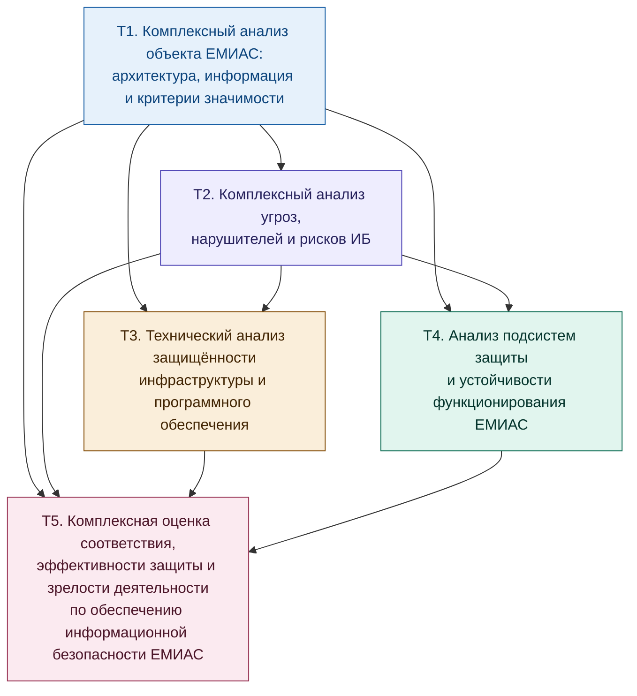

Я бы сократил исходные 14 тем до 6 укрупнённых тем. В разделах А–Г прежние темы объединяются по общему предмету анализа. В разделе Д сохраняются две отдельные темы: оценка соответствия и эффективности защиты, а также оценка зрелости деятельности по технической защите информации. Такое разделение оправдано тем, что эти процедуры имеют разные цели и результаты.

Новая тема посвящена методическому документу ФСТЭК России от 7 августа 2026 года. Он действительно существует и устанавливает порядок оценки уровня зрелости деятельности по защите информации в информационных системах и обеспечению безопасности значимых объектов КИИ. Методика предусматривает определение текущего и целевого уровней зрелости по направлениям деятельности, выявление недостатков и подготовку мероприятий по совершенствованию защиты. [Текст методики в КонсультантПлюс](https://www.consultant.ru/document/cons_doc_LAW_541543/?utm_source=chatgpt.com) · [Описание методики в Гарант](https://base.garant.ru/414732273/?utm_source=chatgpt.com).&#x20;

[image](https://www.google.com/s2/favicons?domain=https://www.consultant.ru\&sz=32)

КонсультантРФ+1

# Задание 2. Подбор и описание структуры тем

## Метки тем

Темы выделены не по стадиям жизненного цикла, а по областям анализа безопасности ЕМИАС. Каждая тема объединяет взаимосвязанные направления анализа, имеет собственный предмет исследования, методы и результаты. Темы применяются при создании, модернизации и эксплуатации системы в зависимости от поставленных задач и доступных исходных данных.

| Метка | Область анализа безопасности ЕМИАС                                                                   | Раздел                             |
| ----- | ---------------------------------------------------------------------------------------------------- | ---------------------------------- |
| Т1    | Комплексный анализ объекта ЕМИАС: архитектура, информация и критерии значимости                      | А. Объект и критерии анализа       |
| Т2    | Комплексный анализ угроз, нарушителей и рисков информационной безопасности                           | Б. Анализ угроз и рисков           |
| Т3    | Технический анализ защищённости инфраструктуры и программного обеспечения                            | В. Технический анализ защищённости |
| Т4    | Анализ подсистем защиты и устойчивости функционирования ЕМИАС                                        | Г. Анализ подсистем защиты         |
| Т5    | Оценка соответствия и эффективности системы защиты информации                                        | Д. Интегральная оценка             |
| Т6    | Оценка зрелости деятельности по технической защите информации по методике ФСТЭК России от 07.08.2026 | Д. Интегральная оценка             |

Принцип объединения. В Т1 объединены методологический, архитектурный анализ и анализ значимости информации; в Т2 — анализ угроз и нарушителей, а также оценка рисков; в Т3 — анализ уязвимостей, тестирование на проникновение и анализ безопасности программного обеспечения; в Т4 — анализ механизмов доступа, криптографической защиты, технических каналов утечки, событий безопасности, инцидентов и доступности. В разделе Д выделены две темы: Т5 отвечает на вопрос, соответствует ли система установленным требованиям и насколько результативны реализованные меры, а Т6 — насколько зрелыми являются процессы организации и управления деятельностью по защите информации.

## Как из групп документов формируются темы

Логика распределения основана на том, какие вопросы позволяют исследовать документы из нормативного перечня. Один документ может относиться к нескольким темам, если регулирует разные стороны безопасности. Отнесение документа к теме само по себе не означает, что он обязателен для ЕМИАС: применимость определяется статусом системы, её назначением, обрабатываемой информацией и конкретными нормативными требованиями.

### Раздел А. Объект и критерии анализа

Т1. Комплексный анализ объекта ЕМИАС: архитектура, информация и критерии значимости.

Объединяет группы 0, 1.1, 1.2, 1.3, 3.2, 3.3, 3.4, 4.1, 4.2, 4.4, 4.7, 4.8, 5.1 и 5.8 исходного перечня.

Опорные документы: Федеральные законы № 149-ФЗ, № 152-ФЗ, № 323-ФЗ, № 326-ФЗ и № 187-ФЗ при наличии оснований для его применения; постановления Правительства РФ № 140 и № 1119; приказ ФСТЭК России № 117; приказ Минздрава России № 911н; ГОСТ Р 59853, ГОСТ Р 51583, ГОСТ 34.602, ГОСТ Р 59795, ГОСТ Р ИСО/ТС 18308.

Тема объединяет определение объекта исследования, описание состава и границ ЕМИАС, анализ информационных ресурсов и потоков, определение критических процессов, а также установление критериев, по которым далее оценивается защищённость системы.

### Раздел Б. Анализ угроз и рисков

Т2. Комплексный анализ угроз, нарушителей и рисков информационной безопасности.

Объединяет группы 4.4, 4.6, 4.8, 5.2, 5.4, 5.5 и 5.6, а также положения нормативных документов об ответственности за нарушения в сфере информационной безопасности.

Опорные документы: Методика оценки угроз безопасности информации ФСТЭК России от 05.02.2021; Банк данных угроз безопасности информации ФСТЭК России; ГОСТ Р 51275; ГОСТ Р 58412; ГОСТ Р 56938; ГОСТ Р ИСО/МЭК 27005; ГОСТ Р ИСО 31000; ГОСТ Р 58771; УК РФ.

Тема объединяет выявление возможных нарушителей и сценариев атак, определение актуальных угроз, оценку вероятности и тяжести последствий, а также формирование реестра рисков и определение приоритетов их обработки.

### Раздел В. Технический анализ защищённости

Т3. Технический анализ защищённости инфраструктуры и программного обеспечения.

Объединяет группы 4.3, 4.5, 5.3, 5.4 и 5.6, а также применимые документы о лицензировании работ по технической защите информации и проведении испытаний.

Опорные документы: ГОСТ Р 56545, ГОСТ Р 56546, ГОСТ Р 56939-2024, ГОСТ Р 71207-2024, ГОСТ Р 58412, ГОСТ Р ИСО/МЭК 18045, ГОСТ Р ИСО/МЭК 27033-1; применимые методические документы ФСТЭК России по анализу защищённости, оценке критичности уязвимостей и тестированию на проникновение.

Тема объединяет проверку конфигураций и сетевой архитектуры, поиск и оценку уязвимостей, тестирование на проникновение, анализ безопасности ПО и оценку доверия к компонентам системы.

### Раздел Г. Анализ подсистем защиты

Т4. Анализ подсистем защиты и устойчивости функционирования ЕМИАС.

Объединяет группы 4.3, 4.6, 4.7, 5.4, 5.6 и 5.7, а также документы, устанавливающие требования к доступу, криптографической защите, регистрации событий, реагированию на инциденты и обеспечению непрерывности работы.

Опорные документы: Федеральные законы № 63-ФЗ, № 152-ФЗ и № 323-ФЗ; постановления Правительства РФ № 140, № 1119 и № 313; применимые приказы ФСТЭК России и ФСБ России; ГОСТ Р 58833, ГОСТ Р 59383, ГОСТ Р 59453, ГОСТ Р 51275, ГОСТ Р 53113.1, ГОСТ Р 53113.2, ГОСТ Р 59547, ГОСТ Р 59548, ГОСТ Р ИСО 27789, ГОСТ Р ИСО 22301.

Тема объединяет анализ фактической работы механизмов защиты, выявление недостатков в разграничении доступа и обращении с ключами, оценку регистрации событий и реагирования на инциденты, а также проверку готовности системы к отказам и восстановлению.

### Раздел Д. Интегральная оценка

Т5. Оценка соответствия и эффективности системы защиты информации.

Объединяет группу 1.3, группы 3.1, 4.1–4.4 и 5.3, 5.5 исходного перечня, а также документы оператора ЕМИАС, необходимые для подтверждения выполнения требований.

Опорные документы: применимые положения Федеральных законов № 149-ФЗ, № 152-ФЗ и № 187-ФЗ; постановления Правительства РФ № 1119, № 675 и № 676; приказы ФСТЭК России № 21, № 77 и другие применимые нормативные документы; ГОСТ Р ИСО/МЭК ТО 19791, ГОСТ Р 56045, ГОСТ Р ИСО/МЭК 27007, ГОСТ Р ИСО 19011.

Тема объединяет сопоставление результатов анализа с обязательными требованиями, выявление несоответствий, обобщение результатов технических проверок и оценку результативности реализованных мер. Аттестация, аудит и оценка эффективности мер рассматриваются как различные процедуры, которые нельзя автоматически отождествлять друг с другом.

Т6. Оценка зрелости деятельности по технической защите информации по методике ФСТЭК России от 07.08.2026.

Новая тема посвящена методическому документу ФСТЭК России «Методика оценки уровня зрелости деятельности в области технической защиты информации в информационных системах и обеспечения безопасности значимых объектов критической информационной инфраструктуры Российской Федерации», утверждённому 7 августа 2026 года. [Текст методики](https://www.consultant.ru/document/cons_doc_LAW_541543/?utm_source=chatgpt.com).&#x20;

[image](https://www.google.com/s2/favicons?domain=https://www.consultant.ru\&sz=32)

КонсультантРФ+1

Тема рассматривает оценку качества организации и управления защитой информации, определение текущих и целевых уровней зрелости по направлениям деятельности, выявление недостатков и подготовку плана совершенствования процессов защиты. Методика применяется в пределах установленной ею области применения; факт отнесения системы к ЕМИАС сам по себе не означает, что она является значимым объектом КИИ.

## Схема взаимосвязей между темами

Связи показывают, какие результаты могут использоваться в других областях анализа. Они не означают строгую последовательность стадий: например, анализ подсистем защиты можно проводить параллельно с техническим анализом, а оценка зрелости может использовать результаты проверок, документы оператора и сведения о фактически выполняемых процессах.

---

## Темы для раскрытия порядка анализа безопасности ЕМИАС

| Метка | Тема                                                                                                 | Теоретическая часть (знания)                                                                                                                                                                                                                                                                                                                                                                                                                                                                                                                                                                                                                                                                                                                                               | Практическая часть (умения)                                                                                                                                                                                                                                                                                                                                                                                                                                                                                                    | Результат                                                                                                                                                                                                                                                |
| ----- | ---------------------------------------------------------------------------------------------------- | -------------------------------------------------------------------------------------------------------------------------------------------------------------------------------------------------------------------------------------------------------------------------------------------------------------------------------------------------------------------------------------------------------------------------------------------------------------------------------------------------------------------------------------------------------------------------------------------------------------------------------------------------------------------------------------------------------------------------------------------------------------------------- | ------------------------------------------------------------------------------------------------------------------------------------------------------------------------------------------------------------------------------------------------------------------------------------------------------------------------------------------------------------------------------------------------------------------------------------------------------------------------------------------------------------------------------ | -------------------------------------------------------------------------------------------------------------------------------------------------------------------------------------------------------------------------------------------------------- |
| Т1    | Комплексный анализ объекта ЕМИАС: архитектура, информация и критерии значимости                      | Понятие автоматизированной системы и системы в защищённом исполнении. ЕМИАС как объект исследования: состав, границы, информационные ресурсы, участники и интеграционные связи. Виды анализируемых активов: медицинские данные, программное обеспечение, технические средства, каналы связи, персонал и процессы. Критерии значимости информации и критичности процессов. Различия между классификацией ГИС, определением уровня защищённости ИСПДн и категорированием объектов КИИ. Требования к защите информации и порядок определения применимых нормативных документов. Способы описания архитектуры, границ доверия и информационных потоков.                                                                                                                        | Определить границы условной ЕМИАС, состав её компонентов и основные интеграционные связи. Построить схему архитектуры и диаграмму потоков информации. Сформировать реестр активов, определить критичные процессы и категории обрабатываемой информации. Разграничить применимые требования законодательства и методические рекомендации. На условных исходных данных обосновать классификационные решения, отдельно проверяя основания для каждого режима защиты.                                                              | Описание объекта исследования, схема архитектуры и информационных потоков, реестр активов, перечень критичных процессов, реестр применимых требований, обоснование классификационных решений.                                                            |
| Т2    | Комплексный анализ угроз, нарушителей и рисков информационной безопасности                           | Понятия угрозы, уязвимости, нарушителя, сценария реализации угрозы и риска. Методический подход к выявлению актуальных угроз и формированию модели нарушителя. Источники сведений об угрозах, способы определения объектов воздействия и возможностей нарушителей. Особенности угроз для медицинских систем: несанкционированный просмотр медицинских карт, утечки данных, шифрование информации, подмена медицинских записей, компрометация подрядчиков и интеграционных интерфейсов. Отличие определения актуальности угрозы от оценки риска. Методы определения вероятности и тяжести последствий, принципы обработки и приоритизации рисков.                                                                                                                           | Сформировать модель угроз и модель нарушителя для условной ЕМИАС с опорой на исходные данные и БДУ ФСТЭК России. Разработать сценарии атак для медицинской карты, портала записи и интеграционного шлюза. Составить реестр рисков, оценить их по выбранной методике, обосновать приоритеты обработки и определить меры снижения остаточного риска.                                                                                                                                                                             | Модель угроз, модель нарушителя, перечень сценариев атак, реестр рисков, план обработки рисков.                                                                                                                                                          |
| Т3    | Технический анализ защищённости инфраструктуры и программного обеспечения                            | Методы инструментального и экспертного анализа защищённости. Поиск, классификация и оценка критичности уязвимостей. Анализ конфигураций операционных систем, серверов, сетевого оборудования и средств защиты. Принципы сегментации сети, настройки межсетевого экранирования и контроля сетевых взаимодействий. Назначение и ограничения сканирования уязвимостей и тестирования на проникновение. Модели тестирования «чёрный ящик», «серый ящик» и «белый ящик». Анализ безопасности ПО, статический анализ кода, контроль обновлений и оценка доверия к компонентам и цепочке поставок. Правовые и организационные условия проведения испытаний, требования к согласованию области и границ проверки.                                                                  | Провести анализ защищённости учебного сегмента ЕМИАС. Выполнить сканирование уязвимостей, сопоставить результаты с доступными базами данных, проверить конфигурации и правила сетевого взаимодействия. На учебном стенде провести согласованное тестирование на проникновение по сценариям из модели угроз. Выполнить анализ учебного фрагмента кода и проверить сведения о компонентах ПО, поддержке и сертификатах, когда это применимо. Сформировать план устранения недостатков и проверить результат повторным контролем. | Отчёт об анализе защищённости, реестр уязвимостей, отчёт о тестировании на проникновение, заключение об анализе ПО и доверии к компонентам, план устранения выявленных недостатков.                                                                      |
| Т4    | Анализ подсистем защиты и устойчивости функционирования ЕМИАС                                        | Принципы идентификации, аутентификации, разграничения доступа и управления привилегиями. Ролевая модель доступа в медицинской организации, правовые основания доступа к сведениям о пациенте и особенности экстренного доступа. Назначение криптографической защиты и электронной подписи, правила обращения с ключевыми носителями и юридическая значимость электронных медицинских документов. Технические и скрытые каналы утечки информации и критерии определения их актуальности. Регистрация и анализ событий, мониторинг безопасности, расследование инцидентов и применимые требования к уведомлению уполномоченных органов. Доступность, резервирование, восстановление после сбоев и атак, анализ единичных точек отказа и непрерывности медицинских процессов. | Построить матрицу доступа для основных ролей ЕМИАС и проверить её на избыточные права. Проанализировать условный процесс подписания и передачи электронных медицинских документов. Оценить актуальность технических каналов утечки с учётом условий размещения системы. Составить перечень событий, необходимых для расследования инцидентов, и проверить достаточность журналов на типовых сценариях. Проанализировать резервное копирование, восстановление и устойчивость ключевых процессов к отказам и шифровальщикам.    | Матрица доступа, схема криптографической защиты и электронного документооборота, обоснование актуальности каналов утечки, перечень событий безопасности, рекомендации по реагированию на инциденты, перечень точек отказа и требования к восстановлению. |
| Т5    | Оценка соответствия и эффективности системы защиты информации                                        | Назначение и различия между аттестацией, аудитом, оценкой реализации мер защиты и оценкой фактической эффективности. Принципы формирования критериев соответствия на основании применимых обязательных требований. Методы сопоставления результатов технических проверок и анализа процессов с реестром требований. Понятия несоответствия, компенсирующей меры и остаточного риска. Назначение итогового отчёта и плана устранения нарушений. Ограничения оценки: наличие документов само по себе не подтверждает эффективную реализацию мер.                                                                                                                                                                                                                             | Сопоставить результаты Т1–Т4 с реестром требований. Для каждого требования зафиксировать основание применимости, способ проверки, подтверждающие материалы и выявленное несоответствие. Отделить формальные недостатки документации от недостатков технической реализации. Подготовить сводную оценку, определить приоритеты устранения и сформировать программу последующей проверки.                                                                                                                                         | Матрица соответствия требованиям, отчёт об оценке эффективности защиты, перечень несоответствий с обоснованием, план корректирующих мероприятий, исходные материалы для аттестационных испытаний при необходимости.                                      |
| Т6    | Оценка зрелости деятельности по технической защите информации по методике ФСТЭК России от 07.08.2026 | Назначение методики и область её применения. Различия между проверкой соответствия отдельным требованиям и оценкой зрелости деятельности в целом. Понятия текущего и целевого уровня зрелости, направлений деятельности, профиля зрелости и плана совершенствования. Подход к сбору подтверждающих сведений: организационные документы, результаты проверок, отчётность, записи о выполненных мероприятиях и данные инструментального контроля. Порядок определения текущих и целевых показателей, сопоставления полученных значений и документирования выводов по методике.                                                                                                                                                                                               | На условных данных об организации, обеспечивающей эксплуатацию ЕМИАС, определить применимые направления оценки. Собрать подтверждения фактического выполнения требований, оценить текущую зрелость по направлениям и установить целевые значения с учётом области применения методики и характеристик системы. Сопоставить текущие и целевые значения, выявить направления, требующие улучшения, определить приоритеты и оформить план повышения зрелости.                                                                     | Отчёт об оценке зрелости, профиль текущих и целевых уровней зрелости, перечень выявленных недостатков, план мероприятий по совершенствованию деятельности по защите информации.                                                                          |

## Различие между Т5 и Т6

Эти темы следует оставить отдельными, поскольку они отвечают на разные исследовательские вопросы.

| Критерий           | Т5. Оценка соответствия и эффективности                                     | Т6. Оценка зрелости деятельности                                                             |
| ------------------ | --------------------------------------------------------------------------- | -------------------------------------------------------------------------------------------- |
| Основной вопрос    | Выполняются ли применимые требования и насколько результативны меры защиты? | Насколько системно, управляемо и качественно организована деятельность по защите информации? |
| Объект оценки      | Требования, меры защиты, техническая реализация и подтверждающие материалы  | Организация процессов и направления деятельности по защите информации                        |
| Основной результат | Выводы о соответствии, эффективности и выявленных недостатках               | Профиль зрелости, сопоставление текущих и целевых уровней, направления улучшения             |
| Основной подход    | Проверка требований и доказательств их выполнения                           | Оценка зрелости деятельности и планомерное совершенствование процессов                       |

Особенность новой методики. В Т6 следует изучать именно методику ФСТЭК России от 07.08.2026, а не ограничиваться упоминанием её в перечне источников. При этом уровни зрелости нельзя автоматически приравнивать к классу защищённости ГИС, уровню защищённости ИСПДн, категории значимости объекта КИИ или результату аттестации: это разные характеристики и процедуры оценки.&#x20;

[image](https://www.google.com/s2/favicons?domain=https://base.garant.ru\&sz=32)

ГАРАНТ

Предложенная структура сокращает первоначальные 14 тем до 6, сохраняет пять предметных разделов и добавляет самостоятельную тему по методике оценки зрелости. При окончательном оформлении необходимо отдельно сверить реквизиты и применимость перечисленных актов, а также не указывать категорирование ЕМИАС как объекта КИИ без подтверждения соответствующих оснований.
