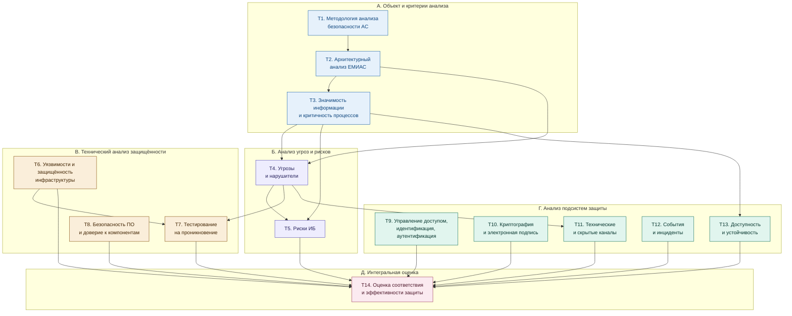

# Задание 2.  Подбор и описание структуры тем

### Метки тем

Темы выделены не по стадиям жизненного цикла, а по областям анализа безопасности. Каждая область анализа имеет свой объект, свои методы и свой результат и применяется к ЕМИАС независимо от того, создаётся система, модернизируется или эксплуатируется. Подробно темы раскрыты в конце документа.

| Метка | Область анализа безопасности ЕМИАС | Раздел |
|---|---|---|
| **Т1** | Методология анализа безопасности АС и система критериев | А. Объект и критерии анализа |
| **Т2** | Архитектурный анализ: состав, границы, информационные потоки | А. Объект и критерии анализа |
| **Т3** | Анализ значимости информации и критичности процессов | А. Объект и критерии анализа |
| **Т4** | Анализ угроз и нарушителей | Б. Анализ угроз и рисков |
| **Т5** | Анализ и оценка рисков ИБ | Б. Анализ угроз и рисков |
| **Т6** | Анализ уязвимостей и защищённости инфраструктуры | В. Технический анализ защищённости |
| **Т7** | Тестирование на проникновение | В. Технический анализ защищённости |
| **Т8** | Анализ безопасности ПО и доверия к компонентам | В. Технический анализ защищённости |
| **Т9** | Анализ управления доступом, идентификации и аутентификации | Г. Анализ подсистем защиты |
| **Т10** | Анализ криптографической защиты и юридической значимости ЭМД | Г. Анализ подсистем защиты |
| **Т11** | Анализ защищённости от утечки по техническим и скрытым каналам | Г. Анализ подсистем защиты |
| **Т12** | Анализ событий безопасности и компьютерных инцидентов | Г. Анализ подсистем защиты |
| **Т13** | Анализ доступности и устойчивости функционирования | Г. Анализ подсистем защиты |
| **Т14** | Оценка соответствия и эффективности защиты | Д. Интегральная оценка |

---
### Как из групп формируются темы

Логика: каждая тема — отдельная область анализа безопасности со своим объектом, методом и результатом, и за ней закреплены группы документов. Темы объединены в пять разделов по характеру анализа, а не по стадиям жизненного цикла: одна и та же область (например, анализ уязвимостей или анализ управления доступом) применяется к ЕМИАС и при создании, и при модернизации, и при эксплуатации.

**Раздел А. Объект и критерии анализа** — что анализируем и с чем сравниваем.

1. **Т1. Методология анализа безопасности АС и система критериев.** Группы 0, 1.1, 1.3, 2, 4.1 (Приказы № 117 и 17 для сравнения), 4.4 (РД Гостехкомиссии), 5.1, 5.2, 5.3. Опорные документы: ГОСТ Р 59853, ГОСТ Р 51583, ГОСТ Р ИСО/МЭК ТО 19791, ГОСТ Р ИСО/МЭК 15408, ГОСТ Р 54581–54583, 162-ФЗ, Указ № 1085.
2. **Т2. Архитектурный анализ ЕМИАС.** Группы 1.2, 3.2, 3.3 (ПП № 687), 4.8, 5.1, 5.8 и 6. Опорные документы: 323-ФЗ, 326-ФЗ, ПП № 140, Приказ № 911н, ГОСТ 34.602, ГОСТ Р 59795, ГОСТ Р ИСО/ТС 18308.
3. **Т3. Анализ значимости информации и критичности процессов.** Группы 3.3 (ПП № 1119), 3.4, 4.2 (Приказ № 236), 4.7 (Приказ № 178), 4.8 (перечень типовых ОКИИ). Опорные документы: Приказ № 117 (классификация), ПП № 1119, 187-ФЗ, ПП № 127, Распоряжение № 360-р, ГОСТ Р ИСО/ТО 27809.

**Раздел Б. Анализ угроз и рисков** — что может произойти и насколько это опасно.

4. **Т4. Анализ угроз и нарушителей.** Группы 4.4 (Методика 2021, БДУ, модель 2008), 4.6 (рекомендации ФСБ 2015), 4.8 (отраслевая модель), 5.2, 5.4 (ГОСТ Р 58412), 5.6 (ГОСТ Р 56938), а также УК РФ для модели нарушителя.
5. **Т5. Анализ и оценка рисков ИБ.** Группы 1.3 (КоАП), 4.7 (Приказ № 178), 5.5, 5.8 (ГОСТ Р ИСО 27799). Опорные документы: ГОСТ Р ИСО/МЭК 27005, ГОСТ Р ИСО 31000, ГОСТ Р 58771.

**Раздел В. Технический анализ защищённости** — какие слабые места реально существуют.

6. **Т6. Анализ уязвимостей и защищённости инфраструктуры.** Группы 4.3 (профили МЭ и СОВ), 4.5, 5.4 (ГОСТ Р 56545/56546), 5.6 (ГОСТ Р 56938, ГОСТ Р ИСО/МЭК 27033-1), ПП № 743. Опорные документы: Методика анализа защищенности 2025, Методика оценки критичности уязвимостей 2025, Руководство по управлению уязвимостями 2023.
7. **Т7. Тестирование на проникновение.** Группы 4.5 (Методика испытаний методами тестирования на проникновение 2025), 4.3 (Приказ № 77), 5.3 (ГОСТ Р ИСО/МЭК 18045), 1.3 (УК РФ как правовая рамка), 3.5 (ПП № 79).
8. **Т8. Анализ безопасности ПО и доверия к компонентам.** Группы 2 (Указы № 166, 250), 3.1 (ПП № 1236), 3.4 (ПП № 1912), 4.3, 4.5 (методика НДВ, тестирование обновлений), 5.3, 5.4. Опорные документы: Приказы ФСТЭК № 55 и 76, ГОСТ Р 56939-2024, ГОСТ Р 71207-2024.

**Раздел Г. Анализ подсистем защиты** — как работают отдельные механизмы.

9. **Т9. Анализ управления доступом, идентификации и аутентификации.** 323-ФЗ (ст. 13), ПП № 140 (ЕСИА), ПП № 211, ПП № 1119, МД ФСТЭК 2026, Приказ № 76, группы 5.4 (ГОСТ Р 59453), 5.6 (ГОСТ Р 58833, 59383, 59407), 5.8 (ГОСТ Р ИСО 27799).
10. **Т10. Анализ криптографической защиты и юридической значимости ЭМД.** 63-ФЗ, ПП № 313, группа 4.6 (Приказы ФСБ № 378, 66, Инструкция № 152, рекомендации 2015), Приказ № 947н, ГОСТ Р 34.10–34.13, ГОСТ Р ИСО 17090-4.
11. **Т11. Анализ защищённости от утечки по техническим и скрытым каналам.** 152-ФЗ (ст. 19), 323-ФЗ (ст. 13), ПП № 79, СТР-К, ГОСТ Р 51275, ГОСТ Р 53113.1/53113.2.
12. **Т12. Анализ событий безопасности и компьютерных инцидентов.** Указ № 31с, 187-ФЗ (ст. 9), группа 4.6 (Приказы ФСБ № 196, 282, 366–368), группа 4.7 (Приказы РКН № 179, 187), группа 5.7, ГОСТ Р ИСО 27789.
13. **Т13. Анализ доступности и устойчивости функционирования.** Конституция (ст. 41), 149-ФЗ (ст. 16), Указ № 166, ПП № 127 и 743, Приказ № 239 (действия в нештатных ситуациях), ГОСТ Р ИСО 22301, ГОСТ Р 58771, ГОСТ Р 52863.

**Раздел Д. Интегральная оценка** — соответствует ли ЕМИАС требованиям и насколько эффективна защита в целом.

14. **Т14. Оценка соответствия и эффективности защиты.** Группы 1.3, 3.1 (ПП № 675, 676), 4.1, 4.2, 4.3 (Приказ № 77), 4.4 (методики Кзи и Узи), 5.3 (ГОСТ Р ИСО/МЭК ТО 19791), 5.5 (ГОСТ Р 56045, ГОСТ Р ИСО/МЭК 27007, ГОСТ Р ИСО 19011) и документы оператора (уровень 6).

Связи между областями анализа показывают, результаты какой темы служат исходными данными для другой. Это не последовательность стадий: например, анализ уязвимостей (Т6) и анализ журналов (Т12) могут выполняться независимо и в любом порядке, а их результаты сводятся в интегральной оценке (Т14).

---

### Темы для раскрытия порядка анализа безопасности ЕМИАС

| Метка | Тема | Теоретическая часть | Практическая часть | Результат |
|---|---|---|---|---|
| **Т1** | Методология анализа безопасности АС и система критериев | Понятие автоматизированной системы (ГОСТ Р 59853) и АС в защищённом исполнении (ГОСТ Р 51583, 51624): объект анализа включает не только ПО и технические средства, но и персонал и процессы. Анализ безопасности как совокупность областей: архитектурный анализ, анализ значимости, угроз, рисков, уязвимостей, тестирование на проникновение, анализ ПО, анализ подсистем защиты, интегральная оценка. Разница между оценкой продукта (ГОСТ Р ИСО/МЭК 15408, 18045) и оценкой действующей АС в среде эксплуатации (ГОСТ Р ИСО/МЭК ТО 19791): объект оценки, домены безопасности, включение сертифицированных продуктов. Способы получения доверия (ГОСТ Р 54581–54583). Иерархия источников критериев: Конституция, законы, акты Правительства, приказы и методики регуляторов, стандарты; юридическая сила методических документов ФСТЭК и стандартов (п. 31 Приказа № 117, ст. 26 162-ФЗ). Регуляторы и их полномочия (ФСТЭК, ФСБ, Роскомнадзор, Минздрав, Минцифры). Эволюция подходов от РД Гостехкомиссии к Приказу № 17 и Приказу № 117. ЕМИАС как ГИС, ИСПДн и объект КИИ одновременно. | Построение реестра применимых требований к ЕМИАС: норма, суть требования, к какому элементу системы относится, каким видом анализа проверяется. Декомпозиция ЕМИАС на домены безопасности по ГОСТ Р ИСО/МЭК ТО 19791 (ЦОД, сеть передачи данных, АРМ медорганизаций, порталы для граждан, интеграционные шлюзы к ЕГИСЗ и ТФОМС). Выбор областей анализа для каждого домена. | Реестр применимых требований, схема доменов безопасности, программа анализа безопасности ЕМИАС |
| **Т2** | Архитектурный анализ ЕМИАС: состав, границы, информационные потоки | Состав региональной ГИС в сфере здравоохранения по Приказу № 911н; связи с ЕГИСЗ (ПП № 140, ст. 91.1 323-ФЗ), ТФОМС (326-ФЗ), ЕСИА и Госуслугами, лабораторными и радиологическими системами, телемедициной (Приказ № 965н). Источники исходных данных: нормативный акт о создании системы, ТЗ (ГОСТ 34.602), проектная и эксплуатационная документация (ГОСТ Р 59795), предпроектное обследование (ГОСТ Р 51583). Модели описания: схема архитектуры, диаграмма информационных потоков, границы доверия, реестр активов. Правовая допустимость потоков: ст. 13 323-ФЗ, ст. 10 152-ФЗ, принцип минимизации. Потоки, которые часто упускают: бумажные носители (ПП № 687), обезличенные выгрузки для аналитики, доступ подрядчиков. Требования к архитектуре медицинской записи (ГОСТ Р ИСО/ТС 18308, ГОСТ Р 52636). | Обследование условной ЕМИАС: схема архитектуры, реестр активов, диаграмма информационных потоков с границами доверия. Построение матрицы допустимых потоков по ст. 13 323-ФЗ и выявление потоков, не имеющих правового основания. Фиксация границ ответственности оператора (свой сегмент и канал до ЕГИСЗ). | Паспорт объекта, реестр активов, схема потоков с границами доверия, матрица допустимых потоков |
| **Т3** | Анализ значимости информации и критичности процессов | Три процедуры, определяющие требуемый уровень защиты. Классификация ГИС по уровню значимости информации и масштабу (Приказ № 117). Определение типа актуальных угроз и уровня защищенности ПДн (ПП № 1119), спорный выбор между угрозами 2-го и 3-го типа. Категорирование: типовые отраслевые объекты (187-ФЗ в ред. 58-ФЗ, Распоряжение № 360-р), комиссия, критические процессы, показатели значимости (ПП № 127 в ред. ПП № 1762), отраслевые особенности для здравоохранения (проект). Оценка вреда субъектам ПДн (Приказ РКН № 178). Медицинская специфика: вред жизни и здоровью при недоступности или искажении данных (ГОСТ Р ИСО/ТО 27809). Как результаты сводятся и почему итог определяется наиболее строгим режимом; как значимость определяет требуемые уровни доверия СЗИ (Приказ № 76) и целевые уровни зрелости. | Определение класса ЕМИАС и УЗ ПДн на условных данных региона с обоснованием типа угроз. Сопоставление подсистем с позициями перечня типовых объектов КИИ. Выявление критических процессов (запись к врачу, ведение ЭМК, лекарственное обеспечение, экстренный доступ к данным пациента) и расчёт показателей значимости. Заполнение формы по Приказу № 236. Акт оценки вреда. | Акт классификации ГИС, акт определения УЗ ПДн, сведения о категорировании, акт оценки вреда, сводная таблица требуемых уровней защиты |
| **Т4** | Анализ угроз и нарушителей | Сценарный подход Методики ФСТЭК 2021 г. в сравнении с вероятностным подходом 2008 г. Негативные последствия для пациентов, оператора и государства. Объекты воздействия, виды нарушителей и уровни их возможностей (Н1–Н4), способы и сценарии атак по тактикам и техникам БДУ. Систематический перебор источников по ГОСТ Р 51275. Угрозы при использовании СКЗИ (рекомендации ФСБ 2015 г.), угрозы виртуализации (ГОСТ Р 56938) и разработки ПО (ГОСТ Р 58412). Медицинская специфика: шифровальщики, недобросовестные медработники с избыточными правами, «пробив» данных пациентов, подрядчики с удалённым доступом, подмена реестров ОМС, подделка ЭМД, атаки через интеграционные интерфейсы и справочники. Мотивация и правовые риски внутреннего нарушителя (УК РФ). | Модель угроз ЕМИАС по Методике 2021 г. с использованием БДУ ФСТЭК: перечень негативных последствий, объектов воздействия, нарушителей и их возможностей, сценариев атак и актуальных угроз. Детализированные сценарии для трёх–пяти ключевых объектов (ЭМК, портал записи, интеграционный шлюз, АРМ медорганизации). | Модель угроз и модель нарушителя, набор сценариев атак |
| **Т5** | Анализ и оценка рисков ИБ | Отличие определения актуальных угроз (вывод «актуальна или нет») от оценки риска (уровень с учётом вероятности и тяжести последствий). Процесс менеджмента риска по ГОСТ Р ИСО/МЭК 27005 и ГОСТ Р ИСО 31000, место оценки рисков в СМИБ (ГОСТ Р ИСО/МЭК 27001). Методы оценки по ГОСТ Р 58771: матрица последствий и вероятностей, «галстук-бабочка», анализ видов и последствий отказов. Оценка ущерба: вред пациентам, штрафы по КоАП, репутационный и финансовый ущерб. Медицинская специфика рисков по ГОСТ Р ИСО 27799. Использование результатов оценки рисков для приоритизации мер и устранения уязвимостей. | Реестр рисков ЕМИАС: идентификация рисков по модели угроз, оценка по матрице, выбор способа обработки, оценка остаточного риска. Обоснование выбранного метода оценки по ГОСТ Р 58771. | Реестр рисков, план обработки рисков |
| **Т6** | Анализ уязвимостей и защищённости инфраструктуры | Методика анализа защищенности ИС (ФСТЭК, 2025): внешний и внутренний анализ, работа от имени привилегированного пользователя, выборка однотипных АРМ, этапы «первичный анализ — устранение — повторный контроль», требования к исполнителю и средствам. Описание и классификация уязвимостей (ГОСТ Р 56545, 56546), БДУ, оценка критичности по методике 2025 г., процесс управления уязвимостями (2023) и тестирование обновлений (2022). Анализ конфигураций (рекомендации ФСТЭК по Linux). Анализ сетевой архитектуры и сегментации (ГОСТ Р ИСО/МЭК 27033-1, требования Приказа № 117 к сети и удалённому доступу), размещение МЭ и СОВ по профилям защиты, виртуализация (ГОСТ Р 56938), каналы связи с медорганизациями (ПП № 743). | Анализ условного сегмента ЕМИАС (ЦОД и типовой АРМ медорганизации): инструментальное сканирование, сопоставление с БДУ, расчёт критичности, проверка конфигурации серверов, анализ сегментации и правил межсетевого экранирования. План устранения с приоритетами и повторный контроль. | Отчёт об анализе защищённости, реестр уязвимостей с оценкой критичности, план устранения |
| **Т7** | Тестирование на проникновение | Место пентеста среди методов анализа: в отличие от сканирования он подтверждает эксплуатируемость уязвимостей и выявляет цепочки атак. Методика испытаний СЗИ ИС методами тестирования на проникновение (ФСТЭК, 2025): область применения при аттестации и контроле, последовательность работ. Методология анализа уязвимостей и потенциала нападения (ГОСТ Р ИСО/МЭК 18045). Модели «чёрного», «серого» и «белого ящика», связь сценариев пентеста с моделью угроз (Т4). Правовые рамки: лицензия ТЗКИ (ПП № 79), договор и согласованные границы работ, ст. 272–274.1 УК РФ. Особенности медицинской системы: недопустимость воздействий, нарушающих оказание медицинской помощи, проведение на стенде или в согласованные окна (ГОСТ Р 59792). | Программа и методика тестирования на проникновение для портала записи и интеграционного шлюза ЕМИАС: цели, границы, сценарии из модели угроз, критерии остановки, формат отчёта. Проведение тестирования на учебном стенде. | Программа тестирования на проникновение, отчёт с подтверждёнными векторами атак и рекомендациями |
| **Т8** | Анализ безопасности ПО и доверия к компонентам | Доверие к средствам защиты: сертификация (Приказ № 55), уровни доверия и их связь с классом системы (Приказы № 76 и 117), профили защиты и задания по безопасности (ГОСТ Р ИСО/МЭК 15408, ТО 15446). Анализ безопасности прикладного ПО ЕМИАС: процессы разработки безопасного ПО (ГОСТ Р 56939-2024), статический анализ и критические ошибки (ГОСТ Р 71207-2024), угрозы на этапах разработки (ГОСТ Р 58412), требования Приказа № 239 к прикладному ПО, методика выявления уязвимостей и НДВ. Происхождение и цепочка поставок: Указы № 166 и 250, ПП № 1236 и 1912, реестр российского ПО, угрозы через обновления. Безопасность пациента при использовании медицинского ПО (ГОСТ Р ИСО/ТО 27809). | Инвентаризация компонентов ЕМИАС с проверкой сертификатов, уровня доверия, сроков поддержки и происхождения. Анализ процесса разработки подрядчика по чек-листу ГОСТ Р 56939. Статический анализ учебного фрагмента кода интеграционного модуля. | Реестр компонентов с оценкой доверия, заключение о процессе разработки, перечень несоответствий |
| **Т9** | Анализ управления доступом, идентификации и аутентификации | Модели управления доступом (ГОСТ Р 59383): дискреционная, мандатная, ролевая, атрибутная. Формальные модели управления доступом и их верификация (ГОСТ Р 59453). Уровни доверия аутентификации и факторы (ГОСТ Р 58833). Меры идентификации и управления доступом по методическому документу ФСТЭК 2026 г. Медицинская специфика: ролевая модель с атрибутами (прикрепление, лечащий врач), правовые основания доступа (ст. 13 323-ФЗ), экстренный доступ «разбить стекло» с последующим разбором (ГОСТ Р ИСО 27799), общие учётные записи и токены в отделениях, доступ пациентов через ЕСИА (ПП № 140), привилегированный доступ администраторов и подрядчиков. | Матрица доступа для ролей ЕМИАС и сравнение её с фактическими правами. Поиск избыточных прав и «мёртвых» учётных записей. Анализ процессов предоставления и отзыва доступа по региональным регламентам. Оценка достаточности аутентификации для разных категорий пользователей. | Матрица доступа, перечень нарушений принципа минимальных привилегий, рекомендации по модели доступа |
| **Т10** | Анализ криптографической защиты и юридической значимости ЭМД | Правовая основа ЭП (63-ФЗ), порядок ведения медицинской документации в электронном виде (Приказ № 947н), реестр ЭМД ЕГИСЗ (ПП № 140). Выбор класса СКЗИ (Приказ ФСБ № 378, рекомендации 2015 г.), встраивание СКЗИ (ПКЗ-2005), учёт СКЗИ и ключевых документов (Инструкция № 152), лицензирование (ПП № 313). Российские криптоалгоритмы (ГОСТ Р 34.10-2012, 34.11-2012, ГОСТ 34.12-2018, 34.13-2018). Долговременная подпись медицинских документов (ГОСТ Р ИСО 17090-4). Типичные нарушения: общий токен на отделение, подписание чужой подписью, утрата возможности проверить подпись в архиве. | Анализ процесса подписания и передачи СЭМД в РЭМД: где создаётся подпись, как проверяется, как хранится. Обоснование класса СКЗИ для каналов «медорганизация — ЦОД — ЕГИСЗ». Проверка организации учёта ключевых носителей в условной медорганизации. | Схема защищённого электронного документооборота, обоснование классов СКЗИ, перечень нарушений обращения с ключами |
| **Т11** | Анализ защищённости от утечки по техническим и скрытым каналам | Классификация технических каналов (ГОСТ Р 51275): побочные электромагнитные излучения и наводки, акустический, виброакустический, видовой. Требования СТР-К. Когда эти каналы актуальны для ЕМИАС: обязанность определить угрозы (ст. 19 152-ФЗ) и обоснование их актуальности или неактуальности в модели угроз. Медицинская специфика: видовой канал (экраны и табло в регистратуре, мониторы в кабинетах — разглашение врачебной тайны по ст. 13 323-ФЗ), акустический канал (обсуждение диагноза). Скрытые каналы в АС (ГОСТ Р 53113.1, 53113.2): классификация, оценка опасности, меры. Лицензия на контроль защищённости от утечки по техническим каналам (ПП № 79). | Обследование условных регистратуры и кабинета врача по видовому и акустическому каналам. Обоснование актуальности или неактуальности ПЭМИН для ЦОД и АРМ. Анализ возможных скрытых каналов в интеграционном обмене. | Акт обследования помещений, обоснование актуальности технических каналов, перечень мер |
| **Т12** | Анализ событий безопасности и компьютерных инцидентов | Мониторинг ИБ (ГОСТ Р 59547) и состав регистрируемой информации (ГОСТ Р 59548). Журналы аудита электронной медицинской карты (ГОСТ Р ИСО 27789). Анализ журналов как метод выявления внутреннего нарушителя: кто, когда и на каком основании открывал медкарту. Управление инцидентами (ГОСТ Р 59709–59712). ГосСОПКА: Указ № 31с, ст. 9 187-ФЗ, Приказы ФСБ № 196, 282, 366–368. Сроки уведомлений: 3 или 24 часа для ФСБ, 24 и 72 часа для Роскомнадзора при утечке ПДн (Приказ № 187). Журналы как подтверждение уничтожения ПДн (Приказ № 179). | Проверка достаточности журналов ЕМИАС для расследования по ГОСТ Р 59548 и ГОСТ Р ИСО 27789. Правила корреляции для типовых медицинских сценариев: массовый просмотр карт, доступ к карте известного пациента, просмотр карт не прикреплённых пациентов, ночные выгрузки. Регламент реагирования с учётом сроков ФСБ и Роскомнадзора. | Перечень регистрируемых событий, набор правил корреляции, регламент реагирования на инциденты |
| **Т13** | Анализ доступности и устойчивости функционирования | Доступность как конституционно значимое свойство медицинской ГИС (ст. 41 Конституции) и обязанность незамедлительного восстановления информации (ст. 16 149-ФЗ, ст. 19 152-ФЗ). Анализ воздействия на деятельность и непрерывность (ГОСТ Р ИСО 22301): допустимое время простоя, целевые время и точка восстановления. Методы анализа отказов (ГОСТ Р 58771: анализ видов и последствий отказов, дерево отказов). Резервирование, резервное копирование, действия в нештатных ситуациях (Приказ № 239). Зависимости: каналы связи (ПП № 743), поставщики и обновления (Указ № 166). Устойчивость к силовым электромагнитным воздействиям (ГОСТ Р 52863). Шифровальщик как главный сценарий нарушения доступности. | Анализ воздействия на деятельность для ключевых процессов ЕМИАС с оценкой допустимого простоя. Поиск единичных точек отказа в ЦОД и сети. Проверка плана резервного копирования и восстановления на сценарии атаки шифровальщика. | Таблица анализа воздействия на деятельность, перечень единичных точек отказа, требования к резервированию и плану восстановления |
| **Т14** | Оценка соответствия и эффективности защиты | Формы интегральной оценки и их различие: аттестация (Приказ № 77, ПП № 676), оценка эффективности мер для ИСПДн (Приказ № 21, ПП № 1119), количественная оценка состояния защиты Кзи (методика 2025 г.) и уровня зрелости Узи (методика 2026 г.) с отчётностью во ФСТЭК, аудит (ГОСТ Р 56045, ГОСТ Р ИСО/МЭК 27007, ГОСТ Р ИСО 19011), оценка АС как целого (ГОСТ Р ИСО/МЭК ТО 19791). Внешний контроль: ПП № 675, государственный контроль ФСТЭК и Роскомнадзора, оценка безопасности ФСБ (ст. 12 187-ФЗ, Указ № 250). Разница между «соответствует требованиям» и «эффективно защищено». Переходные положения при смене Приказа № 17 на № 117. Ответственность по КоАП и УК. | Сведение результатов Т6–Т13 в таблицу соответствия требованиям реестра из Т1 (gap-анализ). Проверка реализации мер по методическому документу ФСТЭК 2026 г. на выборке. Расчёт Кзи и Узи для условной ЕМИАС. Разработка программы и методик аттестационных испытаний. | Отчёт о соответствии, расчёт Кзи и Узи, программа и методики аттестационных испытаний, план устранения несоответствий |
