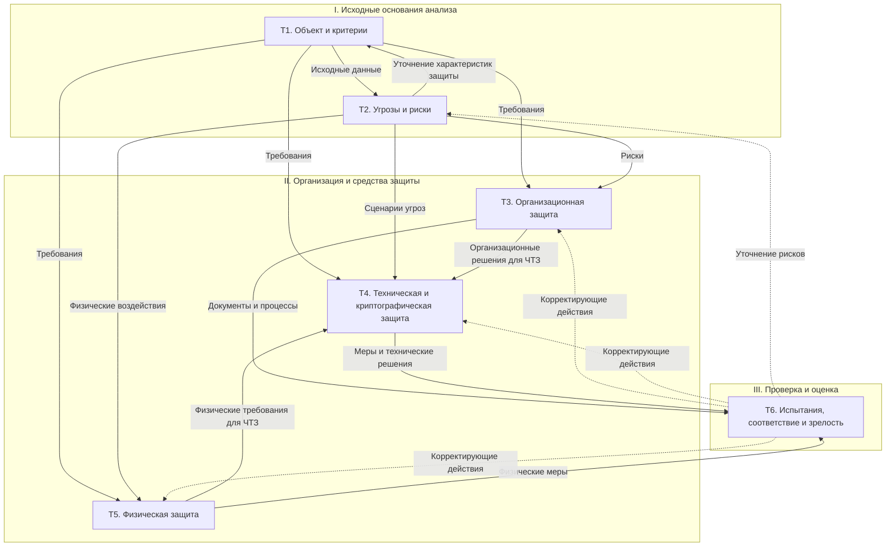
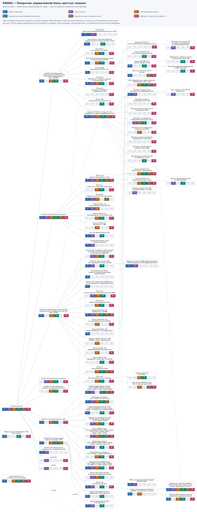

# Задание 2. Подбор и описание структуры тем анализа безопасности ЕМИАС

**Дисциплина:** анализ безопасности автоматизированных систем.  
**Направление:** государственная информационная система — ГИС.  
**Объект информатизации:** Единая медицинская информационно-аналитическая система субъекта РФ — ЕМИАС субъекта РФ.  
**Выполнил:** студент группы ИВТ-21-22 Туктин К.В.

## 1. Цель и организация работы

### 1.1. Цель

Освоить порядок анализа безопасности ЕМИАС: установить границы объекта и применимые требования, определить угрозы и риски, проанализировать организационные, технические и физические меры защиты, получить свидетельства их выполнения и сформировать обоснованное заключение о состоянии защиты и зрелости деятельности по её обеспечению.

### 1.2. Принцип построения структуры

Темы объединены по предмету исследования. Они не являются стадиями жизненного цикла ЕМИАС и могут применяться при её создании, модернизации и эксплуатации.

| Раздел | Тема | Основной вопрос |
|---|---|---|
| **I. Исходные основания анализа безопасности** | **Т1. Методологические основы анализа безопасности ЕМИАС: описание объекта и формирование критериев** | Что исследуется и какие требования применимы? |
| **I. Исходные основания анализа безопасности** | **Т2. Моделирование угроз и оценка рисков безопасности информации ЕМИАС** | Какие нарушения возможны и к каким последствиям они приведут? |
| **II. Анализ организации и средств защиты информации** | **Т3. Организационная защита информации ЕМИАС: анализ процессов и обоснование мер** | Как организована деятельность по защите и какие изменения необходимы? |
| **II. Анализ организации и средств защиты информации** | **Т4. Техническая и криптографическая защита информации ЕМИАС: анализ архитектуры и обоснование решений** | Какие технические механизмы необходимы и обеспечивают ли выбранные решения покрытие требований и угроз? |
| **II. Анализ организации и средств защиты информации** | **Т5. Физическая защита инфраструктуры ЕМИАС и защита от утечки по техническим каналам** | Какие условия физического доступа, воздействия и утечки необходимо учитывать? |
| **III. Проверка и оценка результатов обеспечения безопасности** | **Т6. Комплексная проверка и оценка безопасности ЕМИАС и зрелости деятельности по её обеспечению** | Какие выводы подтверждаются результатами проверок и другими свидетельствами? |

### 1.3. Разграничение содержания тем

| Тема | Собственный результат | Граница рассмотрения |
|---|---|---|
| **Т1** | Описание объекта и система критериев | Устанавливаются требования; выводы об их фактическом выполнении формируются в Т6. |
| **Т2** | Модель угроз и реестр рисков | Обосновываются сценарии; инструментальная проверка возможности их реализации проводится в Т6. |
| **Т3** | Анализ организационных процессов и предложения по их изменению | Рассматриваются полномочия, процедуры и документы. Фактическое исполнение проверяется в Т6. |
| **Т4** | Обоснованный набор мер, технические решения и ЧТЗ | Анализируются функции и совместимость механизмов. Испытания и документальное подтверждение соответствия выполняются в Т6. |
| **Т5** | Анализ физической среды и обоснование мер | Рассматриваются помещения, носители и инженерные зависимости. Результаты анализа планов не подменяют натурное обследование и измерения. |
| **Т6** | Протоколы, оценки и итоговое заключение | Используются материалы Т1–Т5; их разработка заново не повторяется. |

---

## 2. Общая учебная модель и исходные данные

### 2.1. Состав объекта

Учебная ЕМИАС включает:

- региональный ЦОД с прикладными серверами, СУБД и средствами виртуализации;
- типовой сегмент медицинской организации: АРМ врача, регистратора и администратора;
- портал записи на приём;
- интеграционный шлюз;
- взаимодействие с ЕГИСЗ и ТФОМС;
- средства защиты, журналирования и резервного копирования;
- помещения, инженерное обеспечение, носители информации;
- персонал оператора, медицинских организаций и подрядчиков.

В учебном стенде используются синтетические медицинские данные. Внешние взаимодействия моделируются локальными сервисами или описываются документально.

### 2.2. Единые условия применения требований

Для сквозного учебного варианта принимается, что:

1. ЕМИАС является региональной ГИС.
2. В системе обрабатываются персональные данные, включая сведения о здоровье.
3. Для изучения требований КИИ рассматривается вариант ЕМИАС, являющейся значимым объектом КИИ. Это **учебное условие**, а не вывод о любой региональной медицинской системе.
4. Конкретные класс защищённости ГИС, уровень защищённости ПДн и категория значимости обосновываются на едином наборе исходных данных.
5. Условия должны быть согласованы: если расчёт не подтверждает принятый значимый статус, необходимо пересмотреть учебные исходные данные или выделить отдельный вариант задания. Подгонка расчёта под заранее выбранную категорию не допускается.

### 2.3. Исходное и предлагаемое состояния

В работе различаются:

- **С0 — исходное состояние:** фактически заданные в учебной модели компоненты, настройки, документы и процедуры;
- **С1 — предлагаемое состояние:** изменения, обоснованные результатами анализа;
- **С2 — проверенное состояние стенда:** реализованные изменения, выполнение которых подтверждено испытаниями.

Проект регламента относится к С1. Свидетельства его исполнения должны представляться отдельно. Испытания С2 не подтверждают автоматически безопасность всей региональной ЕМИАС.

### 2.4. Состав исходного учебного комплекта

| Группа данных | Содержание | Использование |
|---|---|---|
| Описание объекта | Функции, участники, данные, компоненты, помещения, внешние взаимодействия | Т1–Т5 |
| Классификационные данные | Масштаб, последствия нарушений, состав и объём ПДн, показатели категорирования | Т1, Т2 |
| Технические материалы | Схема сети, версии ПО, настройки, правила доступа, параметры копирования | Т4, Т6 |
| Организационные документы | Политики, регламенты, приказы, распределение ответственности | Т3, Т6 |
| Свидетельства деятельности | Учебные заявки, журналы, протоколы, записи об обновлениях, обучении и инцидентах | Т6 |
| Материалы физического обследования | План помещений, размещение оборудования, зоны доступа, инженерные зависимости | Т5, Т6 |
| Учебный стенд | Сервер, клиентские роли, тестовый модуль, журналирование, резервная копия | Т6 |

Если необходимые сведения отсутствуют, они оформляются как допущения или как запрос дополнительных данных. Созданные студентом свидетельства обозначаются как **синтетические учебные материалы**.

---

## 3. Нормативная прослеживаемость и порядок выполнения

### 3.1. Использование документов задания 1

Документы используются с указанием их роли:

- обязательное требование при подтверждённой применимости;
- методический источник;
- дополнительный критерий из стандарта;
- исторический или сравнительный материал.

Наличие документа в перечне не означает обязательность всех его положений для ЕМИАС. Для стандартов отдельно указывается основание применения: нормативная отсылка, договор, техническое задание либо учебный методический выбор.

Исторические документы и проекты актов не используются как действующие обязательные критерии.

### 3.2. Единая матрица прослеживаемости

| Документ, редакция и положение | Основание применения | Требование или методическое положение | Тема и задание | Результат | Способ проверки |
|---|---|---|---|---|---|
| … | … | … | … | … | … |

Для каждого документа из задания 1 указывается один из статусов:

1. Используется для формирования требования.
2. Используется как методический источник.
3. Рассматривается только в теории.
4. Неприменим к принятой модели — с обоснованием.
5. Требует уточнения статуса или содержания.

До уточнения документа из пятой группы на его основе не формулируется окончательный вывод о соответствии.

### 3.3. Порядок выполнения взаимозависимых заданий

Нумерация заданий определяет их принадлежность теме. Фактический порядок учитывает зависимости:

1. Подготовить описание объекта и предварительные критерии в Т1.
2. Выполнить моделирование угроз и оценку последствий в Т2.
3. Уточнить классификационные решения Т1.
4. Проанализировать организационную, техническую и физическую защиту в Т3–Т5.
5. Согласовать итоговый набор мер, матрицу реализации и ЧТЗ.
6. Выполнить проверки и оценки в Т6.
7. Уточнить риски и предложения по защите на основании результатов испытаний.

---

# Раздел I. Исходные основания анализа безопасности

## Т1. Методологические основы анализа безопасности ЕМИАС: описание объекта и формирование критериев

### Теоретическая часть — знания

**П1.1. Понятия и границы анализа.**  
Автоматизированная система, информационная система, объект информатизации, объект защиты и объект оценки. Персонал, процессы, данные, программные и технические средства, помещения и обеспечивающая инфраструктура как составляющие объекта.

**П1.2. Методология анализа безопасности.**  
Описание объекта, формирование критериев, моделирование угроз, получение свидетельств и оценивание результатов. Достаточность и воспроизводимость доказательств. Различие предположения, проектного решения и подтверждённого факта.

**П1.3. Оценка продукта и действующей системы.**  
Профиль защиты, задание по безопасности, требования доверия. Оценка АС в среде эксплуатации и декомпозиция на домены. Ограничения переноса результатов сертификации отдельного компонента на систему в целом.

**П1.4. Архитектура и информационные потоки.**  
Центральные и территориальные компоненты, пользователи, внешние интерфейсы, границы доверия и ответственности. Медицинские документы, аналитические выгрузки, тестовые копии и бумажные носители.

**П1.5. Применимые требования.**  
Правовой статус системы и оператора. Различия нормативных требований, методических положений, договорных обязательств и дополнительных критериев из стандартов.

**П1.6. Требуемые характеристики защиты.**  
Классификация ГИС, определение уровня защищённости ПДн и категорирование КИИ. Самостоятельность этих процедур. Зависимость решений от исходных данных и результатов анализа угроз.

### Нормативная и методическая основа

| Документы | Назначение в теме | Задания |
|---|---|---|
| 149-ФЗ; региональный акт о создании ЕМИАС и положение о системе | Определение статуса, участников и границ ответственности | 1.1–1.3 |
| 152-ФЗ; 323-ФЗ; 326-ФЗ; ПП № 140 | Определение состава данных и оснований информационного взаимодействия | 1.1–1.3 |
| Приказ ФСТЭК № 117; ПП № 1119 | Формирование применимых критериев и характеристик защиты | 1.3–1.4 |
| 187-ФЗ; ПП № 127; применимые документы по категорированию | Исследование требований КИИ и обоснование категории учебного объекта | 1.4 |
| ГОСТ Р 59853; ГОСТ 34.602; ГОСТ Р 59795 | Понятийный аппарат и источники описания АС | 1.1–1.3 |
| ГОСТ Р ИСО/МЭК ТО 19791; серия ГОСТ Р ИСО/МЭК 15408 | Разграничение оценки системы и продукта | 1.1, 1.3 |

Конкретные положения и редакции фиксируются в реестре задания 1.3.

### Практическая часть — умения

| Обучающийся научится | Проверяющее задание |
|---|---|
| Устанавливать границы объекта и обследования | 1.1 |
| Описывать активы, архитектуру, потоки и ответственность | 1.1–1.2 |
| Обосновывать применимость документов и требований | 1.3 |
| Формулировать проверяемые критерии | 1.3 |
| Обосновывать и уточнять классификационные решения | 1.4 |

### Практические задания

**Задание 1.1. Составить паспорт учебной ЕМИАС и реестр активов.**

Описать назначение системы, участников, категории пользователей, данные, компоненты, помещения и внешние взаимодействия. Для каждого актива указать владельца или ответственного, размещение и выполняемую функцию.

Зафиксировать исходное состояние С0, границы стенда, допущения и отсутствующие сведения.

**Результат:** паспорт объекта и реестр активов.  
**Критерий выполнения:** каждый компонент учебной модели включён в описание либо обоснованно исключён из области анализа.

**Задание 1.2. Построить архитектурную схему и диаграмму информационных потоков.**

Для потоков указать источник, получателя, состав данных, назначение, способ передачи и границу ответственности. Отдельно отразить доступ подрядчиков, резервные копии, выгрузки и бумажные документы.

Составить матрицу ответственности за компоненты и интерфейсы.

**Результат:** схемы, реестр потоков и матрица ответственности.  
**Критерий выполнения:** отсутствуют неописанные взаимодействия между компонентами, включёнными в паспорт.

**Задание 1.3. Сформировать реестр применимых требований.**

Для документов задания 1 установить статус использования. Для применимых требований указать конкретное положение, основание применения, затрагиваемый объект и ожидаемое свидетельство выполнения.

**Результат:** реестр требований и матрица нормативной прослеживаемости.  
**Критерий выполнения:** каждое требование имеет источник и критерий проверки; непроверенные ссылки обозначены явно.

**Задание 1.4. Обосновать требуемые характеристики защиты.**

На согласованных исходных данных определить класс ГИС, уровень защищённости ПДн и категорию значимости учебного объекта КИИ. Недостающие сведения оформить как запрос.

После выполнения задания 2.5 проверить и при необходимости уточнить решения.

**Результат:** учебные классификационные документы с расчётами и обоснованиями.  
**Критерий выполнения:** решения согласованы с паспортом, последствиями нарушений и моделью угроз; результаты разных процедур не подменяют друг друга.

---

## Т2. Моделирование угроз и оценка рисков безопасности информации ЕМИАС

### Теоретическая часть — знания

**П2.1. Угрозы и условия их реализации.**  
Источники угроз, нарушители, объекты воздействия, уязвимости, способы и последствия. Различие предполагаемого условия сценария и подтверждённого технического недостатка.

**П2.2. Модель нарушителя.**  
Внешние пользователи, медицинский персонал, администраторы, подрядчики и разработчики. Их доступ, возможности, цели и ограничения.

**П2.3. Разработка модели угроз.**  
Последовательность определения последствий, объектов воздействия, источников, способов и сценариев. Использование БДУ ФСТЭК. Обоснование актуальности и полноты рассмотрения.

**П2.4. Медицинская специфика.**  
Разглашение врачебной тайны, искажение медицинских записей, задержка помощи, подмена реестров ОМС, недоступность сервисов и утрата ЭМД.

**П2.5. Риски и непрерывность.**  
Идентификация, анализ, оценивание и обработка рисков. Шкалы последствий и вероятности, неопределённость оценок. Допустимый перерыв, целевое время восстановления и допустимая потеря данных.

**П2.6. Документирование и актуализация.**  
Структура модели угроз как документа, исходные данные, допущения, история изменений и основания пересмотра. Связь модели угроз с реестром рисков и последующими испытаниями.

### Нормативная и методическая основа

| Документы | Назначение в теме | Задания |
|---|---|---|
| Методика оценки угроз ФСТЭК от 05.02.2021; БДУ ФСТЭК | Моделирование угроз и обоснование актуальности | 2.1, 2.2, 2.5 |
| 152-ФЗ; 323-ФЗ; Приказ Роскомнадзора № 178 | Учёт последствий для субъектов ПДн и врачебной тайны | 2.2–2.5 |
| ГОСТ Р ИСО/МЭК 27005; ГОСТ Р ИСО 31000; ГОСТ Р 58771 | Выбор и применение метода оценки рисков | 2.3 |
| ГОСТ Р ИСО 22301 | Анализ воздействия нарушений на деятельность | 2.4 |
| ГОСТ Р ИСО 27799; ГОСТ Р ИСО/ТО 27809 | Учёт медицинской специфики последствий | 2.2–2.4 |
| Применимые методические документы ФСБ по угрозам при использовании СКЗИ | Криптографическая часть моделирования | 2.2, 2.5 |

### Практическая часть — умения

| Обучающийся научится | Проверяющее задание |
|---|---|
| Обосновывать характеристики нарушителей | 2.1 |
| Разрабатывать сценарии и обосновывать актуальность угроз | 2.2, 2.5 |
| Оценивать риски и объяснять ограничения оценок | 2.3 |
| Определять требования к восстановлению | 2.4 |
| Оформлять и проверять полноту модели угроз | 2.5 |

### Практические задания

**Задание 2.1. Разработать модель нарушителя.**

Рассмотреть не менее четырёх категорий нарушителей. Указать доступ, возможности, цели, ограничения и затрагиваемые компоненты. Количество категорий определяется составом участников, а не только минимальным числом задания.

**Результат:** модель нарушителя.  
**Критерий выполнения:** категории согласованы с ролями и взаимодействиями из Т1.

**Задание 2.2. Сформировать перечень угроз и подробно разработать пять сценариев.**

Рассмотреть угрозы для всех основных групп активов. Для каждого решения об актуальности указать обоснование.

Подробно раскрыть пять сценариев: разглашение медицинских данных, изменение записи, компрометацию удалённого доступа, нарушение интеграционного обмена и атаку шифровальщика.

**Результат:** перечень рассмотренных угроз и пять детализированных сценариев.  
**Критерий выполнения:** пять сценариев обозначены как подробная выборка; полнота перечня угроз обоснована отдельно.

**Задание 2.3. Составить реестр рисков.**

Задать шкалы и критерии оценивания. Для рисков указать причины, последствия, существующие меры, оценку, владельца и способ обработки.

После задания 2.5 согласовать реестр с итоговой моделью угроз. После Т6 уточнить оценки по полученным свидетельствам.

**Результат:** реестр рисков и план обработки.  
**Критерий выполнения:** оценки объяснимы; прогнозируемый остаточный риск отделён от оценки, подтверждённой испытаниями.

**Задание 2.4. Выполнить анализ воздействия нарушения работы ЕМИАС.**

Для трёх медицинских процессов определить последствия простоя и потери данных. Учесть временные способы продолжения работы и зависимости от внешних сервисов.

**Результат:** таблица воздействия и требований к восстановлению.  
**Критерий выполнения:** целевые показатели восстановления имеют содержательное обоснование.

**Задание 2.5. Разработать проект документа «Модель угроз безопасности информации ЕМИАС».**

Объединить исходные сведения, модель нарушителя, перечень угроз и сценарии. Включить область действия, последствия, объекты воздействия, решения об актуальности, допущения и порядок актуализации.

**Результат:** целостный проект модели угроз с приложениями.  
**Критерий выполнения:** прослеживается связь «последствие — объект — нарушитель — сценарий — угроза»; документ согласован с Т1 и заданиями 2.3–2.4.

---

# Раздел II. Анализ организации и средств защиты информации

## Т3. Организационная защита информации ЕМИАС: анализ процессов и обоснование мер

### Теоретическая часть — знания

**П3.1. Управление защитой.**  
Ответственность руководства, ИБ, ИТ-службы, владельцев процессов и пользователей. Разделение полномочий, контроль и конфликт обязанностей.

**П3.2. Организационно-распорядительная документация.**  
Политики, приказы, регламенты, инструкции, планы и журналы. Нормативное основание документа, его согласование, утверждение и актуализация. Различие наличия документа и выполнения процедуры.

**П3.3. Персонал и доступ.**  
Приём, перевод, увольнение, пересмотр полномочий, обучение, обязательства конфиденциальности, экстренный доступ и его последующий разбор.

**П3.4. Изменения и уязвимости.**  
Выявление, регистрация, приоритизация, согласование обновлений, обработка исключений, устранение и контроль. Ответственность за решения и сохранение записей.

**П3.5. Инциденты и непрерывность.**  
Эскалация, сохранение свидетельств, внешнее информирование, восстановление и разбор причин. Распределение ответственности при отказах.

**П3.6. Подрядчики и криптографическая защита.**  
Условия доступа и сопровождения, безопасная разработка, обновления и завершение договора. Допуск к работе с ключами, учёт носителей и действия при компрометации.

### Нормативная и методическая основа

| Документы | Назначение в теме | Задания |
|---|---|---|
| 152-ФЗ; применимые организационные положения Приказа № 117 | Определение обязанностей и организационных процедур | 3.1–3.5 |
| Приказ ФСТЭК № 235 — для значимого объекта КИИ | Организация сил, документов и деятельности по обеспечению безопасности | 3.1, 3.5 |
| ПП № 211 — при применимости к соответствующему оператору | Определение организационных мер и документации | 3.5 |
| Руководство ФСТЭК по управлению уязвимостями от 17.05.2023 | Распределение функций и организация процесса | 3.1, 3.4, 3.5 |
| ГОСТ Р 56939; стандарты управления инцидентами | Требования к разработчику и организации реагирования | 3.3–3.4 |
| Применимые акты ФСБ и Роскомнадзора об инцидентах и использовании СКЗИ | Установление процедур уведомления и обращения с ключами | 3.1, 3.3, 3.5 |

### Практическая часть — умения

| Обучающийся научится | Проверяющее задание |
|---|---|
| Выявлять пробелы в распределении ответственности | 3.1 |
| Анализировать и совершенствовать процедуры доступа | 3.2 |
| Организовывать реагирование и взаимодействие участников | 3.3 |
| Формулировать проверяемые требования к подрядчикам | 3.4 |
| Обосновывать состав ОРД и подтверждающих записей | 3.5 |

### Практические задания

**Задание 3.1. Проанализировать распределение ответственности.**

На основе С0 составить матрицу функций по доступу, обновлениям, инцидентам, ключам и резервным копиям. Выявить функции без ответственного и конфликты полномочий. Предложить изменения.

**Результат:** исходная и предлагаемая матрицы ответственности.  
**Критерий выполнения:** для каждой функции определены исполнитель, лицо, принимающее решение, и контроль.

**Задание 3.2. Проанализировать и доработать регламент управления учётными записями.**

Проверить полноту предоставления, изменения, пересмотра и отзыва прав. Учесть подрядчиков и экстренный доступ. Разработать недостающие положения и формы записей.

**Результат:** перечень недостатков и проект регламента.  
**Критерий выполнения:** каждое изменение связано с требованием или выявленным риском.

**Задание 3.3. Разработать организационный сценарий реагирования.**

Для утечки или шифрования данных определить решения, участников, порядок эскалации, сохранения свидетельств и восстановления. Указать, как устанавливаются применимые обязанности и сроки внешнего информирования.

**Результат:** план реагирования и формы фиксации действий.  
**Критерий выполнения:** отсутствуют этапы без ответственного; определены условия завершения и разбора инцидента.

**Задание 3.4. Подготовить требования к подрядчику.**

Проанализировать сопровождение интеграционного модуля. Определить требования к доступу, обработке данных, безопасной разработке, обновлениям, устранению недостатков и прекращению обслуживания.

**Результат:** перечень требований и подтверждающих материалов.  
**Критерий выполнения:** выполнение каждого требования может быть проверено.

**Задание 3.5. Сформировать обоснованный перечень ОРД.**

Выполнить после 3.1, до окончательного оформления 3.2–3.4. Для каждого документа указать основание, назначение, содержание, разработчика, утверждающего и основания пересмотра.

Разграничить прямо предусмотренные документы и предложенные формы организации выполнения требований.

**Результат:** перечень ОРД и матрица «требование — документ — процесс — ответственный».  
**Критерий выполнения:** нормативные основания конкретны; объединение вопросов в одном документе обосновано; записи о выполнении процедур определены отдельно.

---

## Т4. Техническая и криптографическая защита информации ЕМИАС: анализ архитектуры и обоснование решений

### Теоретическая часть — знания

**П4.1. Архитектура защиты.**  
Сетевые зоны, границы доверия, административные и интеграционные взаимодействия. Связь угроз, защитных функций и средств реализации.

**П4.2. Идентификация и доступ.**  
Ролевые и атрибутные модели, минимальные привилегии, разделение обязанностей, сервисные и привилегированные учётные записи. Условия экстренного доступа.

**П4.3. Защита инфраструктуры и ПО.**  
Конфигурации ОС и СУБД, виртуализация, защита АРМ, программная среда, секреты и зависимости. Условия безопасного обновления.

**П4.4. Доверие к компонентам.**  
Сертификация, уровни доверия, условия эксплуатации, поддержка и происхождение. Различие документа о соответствии и фактической безопасности конфигурации.

**П4.5. Мониторинг, доступность и скрытые каналы.**  
Источники событий, синхронизация времени, защита журналов, корреляция. Резервирование, копирование, восстановление и противодействие отказу в обслуживании. Скрытые каналы программного и сетевого обмена.

**П4.6. Криптографическая защита.**  
СКЗИ, защищённые каналы, подпись ЭМД, управление ключами, проверка подписей и долговременное хранение. Требования к условиям применения выбранных средств.

**П4.7. Формирование набора мер.**  
Определение исходных наборов там, где они предусмотрены; адаптация, уточнение и дополнение. Различие исключаемых, дополнительных и компенсирующих мер. Совместное выполнение применимых требований и подтверждение достаточности компенсаций.

**П4.8. Разработка технических требований.**  
Назначение ТЗ и ЧТЗ. Однозначность, проверяемость и прослеживаемость требований. Состав работ, обеспечивающая инфраструктура, взаимодействия, документация и приёмка.

### Нормативная и методическая основа

| Документы | Назначение в теме | Задания |
|---|---|---|
| Приказы ФСТЭК № 117, № 21, № 239 — в применимой части; документы о составе мер | Формирование и согласование набора мер | 4.1–4.8 |
| Приказы ФСТЭК № 55 и № 76; требования и профили защиты СЗИ | Критерии выбора и доверия к средствам | 4.5, 4.7 |
| Применимые документы ФСБ; 63-ФЗ | Обоснование криптографической защиты и электронного документооборота | 4.3, 4.6–4.8 |
| Стандарты доступа, сетевой безопасности, виртуализации и безопасного ПО | Анализ технических решений | 4.1–4.5 |
| ГОСТ Р ИСО 27789; стандарты мониторинга | Требования к медицинскому аудиту и журналированию | 4.4 |
| ГОСТ 34.602; ГОСТ Р 59795; пункт 10 требований № 239 для принятого варианта КИИ | Состав и проверяемость требований ЧТЗ | 4.8 |

### Практическая часть — умения

| Обучающийся научится | Проверяющее задание |
|---|---|
| Анализировать архитектуру и размещение средств | 4.1 |
| Формировать согласованную модель доступа | 4.2 |
| Обосновывать криптографические решения | 4.3 |
| Определять требования к мониторингу и восстановлению | 4.4 |
| Формировать критерии доверия к компонентам | 4.5 |
| Адаптировать и дополнять меры, обосновывать исключения и компенсации | 4.6 |
| Сопоставлять меры со средствами и выявлять непокрытые функции | 4.7 |
| Разрабатывать проверяемые требования ЧТЗ | 4.8 |

### Практические задания

**Задание 4.1. Проанализировать архитектуру технической защиты.**

Сопоставить схему С0 с требованиями и угрозами. Выявить необоснованные взаимодействия, недостатки сегментации и администрирования. Подготовить схему С1.

**Результат:** две схемы и перечень обоснованных изменений.  
**Критерий выполнения:** каждое изменение связано с требованием, угрозой или выявленной зависимостью.

**Задание 4.2. Составить модель доступа.**

Для врача, регистратора, администратора и подрядчика определить объекты, операции и условия доступа. Сравнить модель с заданными правами С0. Предусмотреть экстренный доступ.

**Результат:** матрица доступа и перечень расхождений.  
**Критерий выполнения:** предусмотрены как разрешённые, так и запрещённые действия для последующих тестов.

**Задание 4.3. Описать защищённый электронный документооборот.**

Проанализировать формирование, подписание, передачу, проверку и хранение ЭМД. Определить размещение ключей, контроль целостности, действия при компрометации и условия последующей проверки подписи.

**Результат:** схема и требования к криптографическим функциям.  
**Критерий выполнения:** для каждой функции определены компонент, входные данные, результат и способ проверки.

**Задание 4.4. Сформировать требования к мониторингу и восстановлению.**

Определить события для расследования доступа к картам и правила обнаружения подозрительной активности. Проанализировать копирование и восстановление по показателям задания 2.4.

**Результат:** требования к журналированию, правила обнаружения, схема резервирования и копирования.  
**Критерий выполнения:** задан состав событий; показатели восстановления измеримы; резервное копирование не представлено как защита от всех угроз.

**Задание 4.5. Составить реестр компонентов и критериев доверия.**

Указать назначение, версию, поддержку, условия эксплуатации и необходимые подтверждения. Выявить сведения, подлежащие проверке в Т6.

**Результат:** реестр компонентов и перечень проверок.  
**Критерий выполнения:** требования к каждому компоненту обусловлены его функцией и местом применения.

**Задание 4.6. Сформировать и обосновать набор мер защиты.**

Выполнить в два прохода: предварительно перед детальной проработкой решений и окончательно после согласования Т3–Т5.

1. Установить применимость требований № 117, № 21 и № 239.
2. Определить исходный состав мер и предусмотренные базовые наборы.
3. Выполнить допустимую адаптацию.
4. Отдельно обосновать исключаемые меры.
5. Определить дополнительные меры.
6. При наличии оснований разработать компенсирующие меры.
7. Проверить покрытие актуальных угроз и применимых требований.

**Результат:** исходный и итоговый наборы, перечни изменений и матрица покрытия.  
**Критерий выполнения:** исключение, дополнение и компенсация не смешиваются; необеспеченные требования обозначены явно; для компенсаций установлен способ проверки.

**Задание 4.7. Сопоставить меры со средствами реализации.**

Для каждой меры указать объект применения, механизм, необходимые настройки, организационные действия и ограничения.

Использовать обозначения ОС, СЗИ от НСД, АВЗ, СРК, МЭ, СОВ, SIEM, СКЗИ и организационных мер. При необходимости добавить средства СУБД, приложения и физической защиты.

**Результат:** матрица «мера — средство — функция — настройка — ограничение».  
**Критерий выполнения:** наличие продукта не считается доказательством реализации меры; совместные функции и непокрытые требования объяснены.

**Задание 4.8. Разработать проект ЧТЗ на создание или совершенствование подсистемы безопасности ЕМИАС.**

Выполнить после согласования организационных, технических и физических решений. Использовать статус объекта, установленный в Т1.

Включить:

- цель и задачи;
- характеристики и категорию объекта;
- нормативные основания;
- объекты защиты;
- требования к организационным и техническим мерам;
- этапы работ;
- требования к программным и программно-аппаратным средствам;
- требования к обеспечивающей инфраструктуре;
- требования к взаимодействиям;
- состав документации;
- порядок контроля и приёмки.

**Результат:** проект ЧТЗ и таблица прослеживаемости требований.  
**Критерий выполнения:** требования однозначны, проверяемы и связаны с результатами анализа; проект не противоречит решениям Т1–Т5.

---

## Т5. Физическая защита инфраструктуры ЕМИАС и защита от утечки по техническим каналам

### Теоретическая часть — знания

**П5.1. Физические границы.**  
Помещения, серверные, рабочие места, зоны посетителей и хранения носителей. Связь физических зон с размещением активов.

**П5.2. Физический доступ.**  
Допуск, сопровождение, доступ к стойкам, портам и носителям. Перемещение, ремонт и обслуживание оборудования.

**П5.3. Носители и остаточная информация.**  
Учёт, хранение, транспортирование, вывод из эксплуатации и предотвращение восстановления данных.

**П5.4. Инженерные зависимости.**  
Питание, охлаждение, пожар, затопление и повреждение линий. Единичные точки отказа и связь с требованиями к непрерывности.

**П5.5. Технические каналы утечки.**  
Визуальные, акустические, виброакустические и электромагнитные условия распространения информации. Источник, среда и возможность перехвата.

**П5.6. Границы обследования.**  
Различие анализа планов, натурного обследования и специальных измерений. Обоснование необходимости измерений и ограничений вывода.

### Нормативная и методическая основа

| Документы | Назначение в теме | Задания |
|---|---|---|
| Применимые положения ПП № 1119 и требований ФСТЭК к мерам защиты | Требования к помещениям, оборудованию и носителям | 5.1–5.3 |
| 323-ФЗ | Учёт конфиденциальности медицинских сведений | 5.2 |
| Применимые документы по технической защите, включая СТР-К при установленном основании использования | Обоснование мер против технических каналов | 5.2, 5.4 |
| ГОСТ Р 51275 | Систематизация факторов воздействия | 5.2–5.4 |
| ГОСТ Р 58771; документы о непрерывности | Анализ инженерных отказов | 5.3 |
| Требования к физическим условиям эксплуатации выбранных СЗИ и СКЗИ | Учёт ограничений размещения и доступа | 5.1–5.4 |

### Практическая часть — умения

| Обучающийся научится | Проверяющее задание |
|---|---|
| Выделять зоны и пути физического доступа | 5.1 |
| Выявлять условия наблюдения и утечки | 5.2 |
| Анализировать инженерные зависимости | 5.3 |
| Обосновывать физические меры и потребность в измерениях | 5.1–5.4 |
| Указывать границы достоверности обследования | 5.4 |

### Практические задания

**Задание 5.1. Подготовить схему физического зонирования.**

Отразить серверную, регистратуру, кабинет врача и хранение носителей. Указать маршруты посетителей, персонала и подрядчиков. Выявить нежелательные пересечения.

**Результат:** схема зон и предложения по доступу.  
**Критерий выполнения:** защищаемые активы связаны с зонами и правилами допуска.

**Задание 5.2. Проанализировать размещение рабочих мест.**

Рассмотреть обзор экранов, доступ к распечаткам, возможность слышать разговоры и доступ к носителям. Предложить изменения.

**Результат:** ведомость условий утечки и мер.  
**Критерий выполнения:** для каждого замечания указаны источник информации, возможный получатель и условия доступа.

**Задание 5.3. Проанализировать инженерные зависимости ЦОД.**

Рассмотреть отказ питания, охлаждения и линии связи. Определить затрагиваемые активы, последствия и меры.

**Результат:** схема зависимостей и перечень единичных точек отказа.  
**Критерий выполнения:** меры согласованы с требованиями к восстановлению из Т2 и техническими решениями Т4.

**Задание 5.4. Подготовить задание на специальное обследование.**

Для предполагаемых технических каналов указать недостающие сведения, необходимые измерения и ожидаемые результаты.

**Результат:** программа обследования и перечень ограничений.  
**Критерий выполнения:** отсутствие измерений не трактуется как доказательство отсутствия канала; результаты анализа плана не выдаются за натурные измерения.

---

# Раздел III. Проверка и оценка результатов обеспечения безопасности

## Т6. Комплексная проверка и оценка безопасности ЕМИАС и зрелости деятельности по её обеспечению

### Теоретическая часть — знания

**П6.1. Организация проверок.**  
Цели, область, выборка, полномочия, ограничения, критерии остановки и сохранение результатов. Различия учебных испытаний, внутреннего контроля и аттестации.

**П6.2. Свидетельства.**  
Документы, интервью, наблюдение, обследование, функциональные испытания и инструментальные данные. Воспроизводимость, достоверность и прослеживаемость.

**П6.3. Уязвимости и ПО.**  
Сканирование, анализ конфигураций, статический, динамический и композиционный анализ. Ложные срабатывания, применимость, критичность и повторный контроль.

**П6.4. Сценарные испытания и пентест.**  
Модель доступа проверяющего, границы воздействия, сценарии и критерии успеха. Неудачная эксплуатация не доказывает отсутствия уязвимости.

**П6.5. Испытания мер.**  
Проверки доступа, подписи, журналирования, обнаружения событий и восстановления. Оценка организационных и физических мер.

**П6.6. Соответствие и эффективность.**  
Сопоставление свидетельств с критериями. Подтверждённое выполнение, несоответствие, неприменимость и недостаточность данных. Ограничения обобщённых показателей.

**П6.7. Зрелость деятельности.**  
Методика ФСТЭК от 07.08.2026: применимые направления, исходные сведения, требования к уровням, текущие и целевые значения, профиль и отчёт. Различие учебной выборки и полной области оценки.

**П6.8. Корректирующие действия.**  
Устранение причин, приоритеты, ответственные, повторное тестирование и уточнение рисков.

### Нормативная и методическая основа

| Документы | Назначение в теме | Задания |
|---|---|---|
| Приказ ФСТЭК № 77; применимые требования № 117, № 21, № 239 | Критерии оценки и учебное планирование испытаний | 6.1, 6.6 |
| Методика анализа защищённости ИС от 25.11.2025; методика оценки критичности уязвимостей от 30.06.2025 | Технические проверки и приоритизация недостатков | 6.2 |
| ГОСТ Р 56545, ГОСТ Р 56546; ГОСТ Р 71207; ГОСТ Р 56939 | Описание уязвимостей и исследование ПО | 6.2–6.3 |
| ГОСТ Р ИСО/МЭК 18045; доступные применимые методические документы по пентесту | Построение ограниченных сценарных испытаний | 6.4 |
| ГОСТ Р 56045; стандарты аудита; ГОСТ Р ИСО 27789 | Методы оценки мер и анализ медицинского аудита | 6.1, 6.4–6.6 |
| Методика оценки показателя состояния технической защиты от 11.11.2025 | Учебный расчёт состояния защиты | 6.6 |
| Методика оценки зрелости ФСТЭК от 07.08.2026 | Оценка направлений деятельности | 6.7 |

Перед применением методик указываются доступный текст, редакция, область применения и ограничения. Недоступный документ не считается использованным только на основании его названия.

### Практическая часть — умения

| Обучающийся научится | Проверяющее задание |
|---|---|
| Разрабатывать проверяемые тестовые случаи и выбирать свидетельства | 6.1 |
| Выявлять и подтверждать технические недостатки | 6.2–6.4 |
| Оценивать критичность и проверять устранение | 6.2, 6.8 |
| Исследовать программный модуль | 6.3 |
| Проверять доступ, подпись, журналирование и восстановление | 6.4 |
| Оценивать организационные и физические свидетельства | 6.5 |
| Формировать выводы о соответствии и состоянии защиты | 6.6 |
| Оценивать зрелость в установленной области | 6.7 |
| Оформлять ограничения и план улучшений | 6.8 |

### Практические задания

**Задание 6.1. Разработать единую программу проверок.**

Для каждого выбранного требования указать объект, метод, исходные условия, действия, ожидаемый результат и доказательство. Обосновать выборку и перечислить непроверяемые положения.

**Результат:** программа и тестовые случаи.  
**Критерий выполнения:** каждый тест связан с реестром требований, мерой или сценарием угроз.

**Задание 6.2. Провести техническое обследование стенда.**

Выполнить сканирование и анализ конфигураций сервера и АРМ. Проверить применимость сообщений, оценить критичность подтверждённых недостатков.

**Результат:** протокол и реестр уязвимостей.  
**Критерий выполнения:** подтверждённые уязвимости отделены от неподтверждённых сообщений; сохранены условия воспроизведения.

**Задание 6.3. Исследовать учебный программный модуль.**

Провести статический анализ и анализ зависимостей. Для одного выбранного недостатка выполнить динамическую проверку поведения.

**Результат:** отчёт исследования ПО.  
**Критерий выполнения:** сообщение анализатора сопоставлено с кодом, условиями возникновения и наблюдаемым результатом.

**Задание 6.4. Провести функциональные и сценарные испытания.**

Выполнить:

- разрешённую и запрещённую операции доступа;
- проверку регистрации и обнаружения события;
- проверку подписи исходного и изменённого тестового документа;
- восстановление данных с измерением времени и объёма потери;
- один ограниченный сценарий тестирования на проникновение на стенде.

Для сценария пентеста определить исходные права, границы, разрешённые действия, критерии успеха и остановки. Если сценарий не выполнен, результат обозначить как подготовленную программу, а не отчёт о проведённом пентесте.

**Результат:** протоколы функциональных испытаний и отчёт по ограниченному сценарию.  
**Критерий выполнения:** фактический результат каждого теста сопоставлен с ожидаемым; область вывода ограничена стендом.

**Задание 6.5. Проверить организационные и физические меры.**

Исследовать учебную выборку заявок, записей об обновлениях, действиях с ключами и контроле доступа. Сопоставить документы с подтверждениями выполнения.

По плану или доступному макету помещений проверить физические критерии. Обозначить, какие выводы требуют натурного обследования.

**Результат:** ведомость проверок и недостаточности свидетельств.  
**Критерий выполнения:** проект документа не используется как доказательство регулярного исполнения процесса.

**Задание 6.6. Сформировать матрицу соответствия и выполнить учебный расчёт состояния защиты.**

Для каждого проверенного требования указать источник, свидетельство, вывод и ограничение. Подготовить фрагмент программы и методик аттестационных испытаний.

Расчёт состояния защиты выполнить по идентифицированной методике с указанием исходных данных. Если полный набор данных отсутствует, представить демонстрационный расчёт и не выдавать его за показатель всей ЕМИАС.

**Результат:** матрица соответствия, фрагмент программы испытаний и расчётная таблица.  
**Критерий выполнения:** объём заключения не превышает область подтверждённых данных.

**Задание 6.7. Выполнить учебную оценку зрелости деятельности.**

Сначала определить все применимые направления и обосновать неприменимые. Затем выбрать направления для учебной проработки, например управление уязвимостями, привилегированным доступом и мониторинг.

Для выбранных направлений:

1. Собрать документы и свидетельства деятельности.
2. Оценить выполнение критериев методики.
3. Определить текущие и целевые уровни.
4. Построить профиль.
5. Сформировать предложения по улучшению.

**Результат:** отчёт, таблицы свидетельств и профиль зрелости выбранных направлений.  
**Критерий выполнения:** учебная выборка не представлена как полная оценка оператора. Итоговый показатель всей деятельности рассчитывается только при достаточном охвате применимой области.

**Задание 6.8. Выполнить корректирующее действие и подготовить итоговое заключение.**

Устранить не менее одного подтверждённого недостатка стенда. Повторить соответствующий тест и сравнить результаты до и после изменения.

Обобщить остальные недостатки, определить приоритеты и ответственных. Уточнить риски из Т2.

**Результат:** протокол повторного контроля, итоговое заключение и план улучшений.  
**Критерий выполнения:** исправление подтверждено испытанием; сохраняющиеся ограничения и непроверенные положения явно указаны.

---

## 4. Схема связей разделов и тем

Обозначения **П1.1–П6.8** относятся к теоретическим подтемам. Номера **заданий 1.1–6.8** относятся к практической работе и не отождествляются с номерами подтем.

---

## 5. Итоговый комплект результатов

| Тема | Представляемые материалы |
|---|---|
| **Т1** | Паспорт, реестр активов, архитектура, потоки, ответственность, реестр требований и классификационные обоснования |
| **Т2** | Модель угроз и нарушителя, сценарии, реестр рисков, план обработки и требования к восстановлению |
| **Т3** | Анализ ответственности и процедур, проекты регламентов, требования к подрядчику, перечень ОРД |
| **Т4** | Анализ технической архитектуры, модель доступа, криптографическая схема, требования к мониторингу и копированию, набор мер, матрица реализации и ЧТЗ |
| **Т5** | Физическое зонирование, условия утечки, инженерные зависимости, меры и задание на обследование |
| **Т6** | Программа проверок, протоколы, реестр уязвимостей, матрица соответствия, расчётные материалы, профиль зрелости, повторный контроль и заключение |

## 6. Критерии проверки выполнения работы

| Критерий | Подтверждение в результатах |
|---|---|
| **Покрытие нормативной базы** | Для каждого документа задания 1 установлен статус использования; применимые требования связаны с темами, заданиями и результатами |
| **Обоснованность тем** | Каждая тема имеет собственный предмет, результат и границы; предложения по защите основаны на анализе |
| **Соответствие объекту** | Все решения относятся к компонентам, данным, процессам и помещениям из паспорта ЕМИАС |
| **Последовательность** | Исходные данные согласованы; изменения классификации, угроз и мер отражены в связанных материалах |
| **Связь знаний и умений** | Каждое заявленное умение проверяется конкретным заданием; специальные методы обеспечены теоретической подготовкой |
| **Конкретность** | Требования, меры, действия и ожидаемые результаты сформулированы проверяемо |
| **Нормативная корректность** | Указаны положения и редакции, подтверждена применимость, обязательные требования отделены от дополнительных критериев |
| **Доказательность** | Выводы опираются на свидетельства; предположения, проекты и факты различаются |
| **Структура** | Представлены разделы, темы, знания, умения, нормативные основания, задания, результаты и критерии выполнения |
| **Ограничения оценки** | Учебные расчёты, выборки и испытания стенда не представлены как полноценная аттестация или оценка всей действующей ЕМИАС |

**Итоговый результат работы** — обоснованное заключение о безопасности принятой учебной модели ЕМИАС, содержащее подтверждённые результаты, выявленные недостатки, границы достоверности и проверяемый план совершенствования защиты.

## Покрытие нормативной и методической базы темами работы

Соответствие тем задания 2 нормативной и методической базе задания 1 представлено на рисунке. Схема сохраняет все 84 блока и 99 связей исходного дерева. На неё нанесены цветные метки тем, в которых используются соответствующие документы.

### Условные обозначения

| Метка | Цвет | Тема |
|---|---|---|
| **Т1** | Синий | Методологические основы анализа безопасности ЕМИАС. Описание объекта и формирование критериев |
| **Т2** | Фиолетовый | Моделирование угроз и оценка рисков безопасности информации ЕМИАС |
| **Т3** | Оранжевый | Организационная защита информации ЕМИАС. Анализ процессов и обоснование мер |
| **Т4** | Бирюзовый | Техническая и криптографическая защита информации ЕМИАС. Анализ архитектуры и обоснование решений |
| **Т5** | Коричневый | Физическая защита инфраструктуры ЕМИАС и защита от утечки по техническим каналам |
| **Т6** | Малиновый | Комплексная проверка и оценка безопасности ЕМИАС и зрелости деятельности по её обеспечению |

### Принцип сопоставления

Цветная метка внутри блока обозначает использование документа в соответствующей теме. Несколько цветных меток показывают межтематическое применение документа; все такие метки равноправны. Серые метки не обозначают дополнительную тему. Цвета отражают тематическую принадлежность, а не юридическую силу документов.

Пересечение тем обусловлено различными задачами анализа: один источник может задавать исходные требования в Т1, использоваться при обосновании угроз в Т2, выборе организационных, технических и физических мер в Т3–Т5 и проверке выполнения требований в Т6. Это не требует повторного изложения одного и того же материала: в каждой теме рассматривается свой аспект документа.

| Область анализа | Роль нормативной и методической базы |
|---|---|
| **Объект и критерии — Т1** | Определение границ ЕМИАС, правовых режимов информации, применимости требований и требуемых характеристик защиты |
| **Угрозы и риски — Т2** | Обоснование негативных последствий, сценариев угроз, оценки рисков и требований к восстановлению медицинских процессов |
| **Организационная защита — Т3** | Анализ ответственности, регламентов, управления доступом, подрядчиками, изменениями и инцидентами |
| **Техническая защита — Т4** | Обоснование защитных функций, состава мер, архитектуры защиты, применения СКЗИ, электронной подписи, мониторинга и резервного копирования |
| **Физическая защита — Т5** | Анализ доступа к помещениям, оборудованию и носителям, инженерных зависимостей и условий образования технических каналов утечки |
| **Проверка и оценка — Т6** | Формирование критериев испытаний, получение свидетельств, оценка соответствия, эффективности мер и зрелости деятельности по обеспечению безопасности |

### Границы интерпретации схемы

Схема показывает охват источников темами работы. Полнота проверки конкретных требований подтверждается отдельно реестром требований и матрицей «источник — требование — тема — практическое задание — свидетельство выполнения».

В блоках, объединяющих несколько ГОСТов, указано объединение тем отдельных стандартов. Это не означает, что каждый стандарт внутри группы применяется во всех отмеченных темах.

Нормативные правовые акты, методические документы, стандарты, региональные и локальные документы сохраняют различный статус и основания применения. Исторические документы используются для сопоставления подходов, проекты — для рассмотрения предполагаемых изменений; они не подменяют действующие обязательные требования. Применимость документов по КИИ и иных специальных требований обосновывается для выбранной учебной модели ЕМИАС.

Наименования документов, пометки об их статусе и связи воспроизведены из дерева задания 1. Само тематическое сопоставление не является проверкой актуальности редакций. Рёбра сохраняют связи исходной схемы и не во всех случаях означают прямое юридическое подчинение документов.
