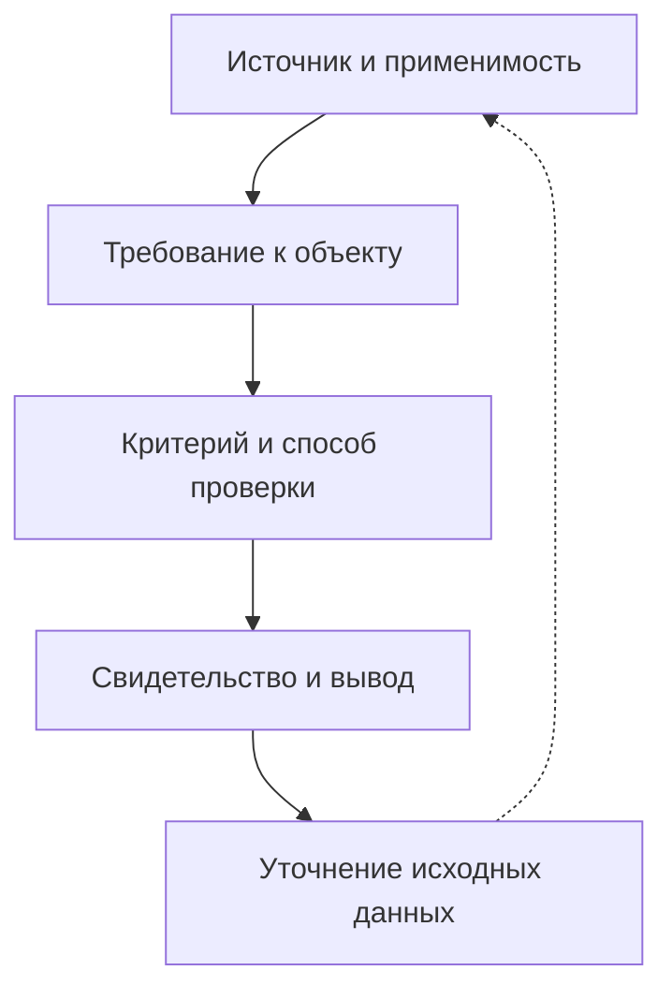
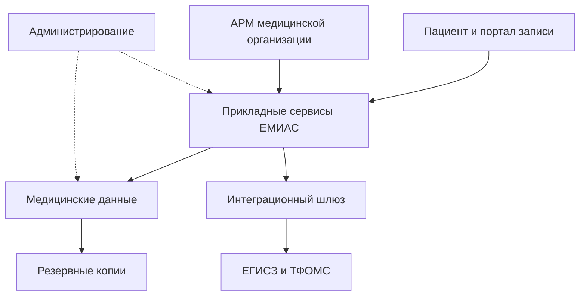

# Задание 3. Лекция

**Дисциплина:** анализ безопасности автоматизированных систем.  
**Направление:** государственная информационная система — ГИС.  
**Объект информатизации:** Единая медицинская информационно-аналитическая система субъекта РФ — ЕМИАС субъекта РФ.  
**Выполнил:** студент группы ИВТ-21-22 Туктин К.В.

---

Сведения об использовании ИИ

{Хорошо. Это задание можно считать выполненным. Теперь забудем про темы моего напарника и снова вспомним о том, о чём была моя программа анализа безопасности ЕМИАС. Для напоминания можешь повторно изучить файлы "lab1.md" и "lab2.md". В новом задании нужно взять одну тему и подробно, полноценно, в соответствии с выбранной нормативной базой (только той её частью, что касается выбранной темы), установленными знаниями и умениями расписать полностью всю теорию, то есть лекционную часть выбранной темы, так, чтобы она покрывало всё, что мы говорили о данной теме. Я решил выбрать для простоты самую первую тему: "Методологические основы анализа безопасности ЕМИАС: описание объекта и формирование критериев". 
Теоретическая часть — знания
П1.1. Понятия и границы анализа.
П1.2. Методология анализа безопасности.
П1.3. Оценка продукта и действующей системы.
П1.4. Архитектура и информационные потоки.
П1.5. Применимые требования.
П1.6. Требуемые характеристики защиты.
Нормативная база:
Конституция РФ
152-ФЗ "О персональных данных"
149-ФЗ "Об информации, информационных технологиях и о защите информации"
187-ФЗ «О безопасности критической информационной инфраструктуры РФ»
162-ФЗ «О стандартизации в РФ»
323-ФЗ «Об основах охраны здоровья граждан в РФ»
326-ФЗ «Об обязательном медицинском страховании в РФ»
Указ № 646 от 05.12.2016 «Доктрина информационной безопасности РФ»
Указ № 203 от 09.05.2017 «Стратегия развития информационного общества 2017–2030»
Указ № 250 от 01.05.2022 «О дополнительных мерах по обеспечению ИБ РФ»
Указ № 1085 от 16.08.2004 «Вопросы Федеральной службы по техническому и экспортному контролю»
ПП № 676 от 06.07.2015
ПП № 140 от 09.02.2022 «О единой государственной информационной системе в сфере здравоохранения»
ПП № 1119 от 01.11.2012
ПП № 687 от 15.09.2008
ПП № 127 от 08.02.2018 (в ред. ПП № 1762 от 07.11.2025)
Распоряжение № 360-р от 26.02.2026
Проект ПП «Об утверждении отраслевых особенностей категорирования объектов КИИ в сфере здравоохранения» (Минздрав, 04.07.2025)
Приказ № 117 от 11.04.2025 (действует с 01.03.2026; изменения — Приказ № 137 от 08.05.2026)
Методический документ «Меры защиты информации в ГИС» от 11.02.2014
Приказ № 239 от 25.12.2017
Приказ № 236 от 22.12.2017
Приказ № 76 от 02.06.2020
Методика оценки угроз безопасности информации от 05.02.2021
Руководящие документы Гостехкомиссии (1992–2001): «Классификация АС», «СВТ», «Межсетевые экраны», «НДВ», СТР-К
Приказ № 178 от 27.10.2022
Акты об обезличивании ПДн
Приказ № 911н от 24.12.2018
Приказ № 965н от 30.11.2017
Методические рекомендации Минздрава и ЦНИИОИЗ, ФРНСИ, структуры СЭМД
Отраслевая модель угроз в здравоохранении
Перечень типовых отраслевых объектов КИИ сферы здравоохранения (Минздрав, ФСТЭК) и Методические рекомендации по категорированию объектов КИИ сферы здравоохранения (версия 1.0, 05.04.2021)
ГОСТ Р 59853-2021
ГОСТ Р 59793-2021
ГОСТ 34.602-2020
ГОСТ Р 59795-2021
ГОСТ Р 51624-2000
ГОСТ Р 51275-2006
ГОСТ Р 53114-2008
ГОСТ Р ИСО/МЭК ТО 19791-2008 «Оценка безопасности автоматизированных систем»
ГОСТ Р ИСО/МЭК 15408 (части 1–3)
ГОСТ Р 54581-2011, ГОСТ Р 54582-2011, ГОСТ Р 54583-2011
ГОСТ Р 59407-2021
ГОСТ Р ИСО/ТО 27809-2009
ГОСТ Р ИСО/ТС 18308-2008, ГОСТ Р 52636-2006, ГОСТ Р 53395-2009
Приказы регионального органа управления здравоохранением
Документы оператора (как правило, ГБУЗ «МИАЦ»)
В результате прочтения лекции, которую нужно сформировать, обучающийся должен иметь представления о том, как выполняются следующие умения:
| Обучающийся научится | Проверяющее задание |
|---|---|
| Устанавливать границы объекта и обследования | 1.1 |
| Описывать активы, архитектуру, потоки и ответственность | 1.1–1.2 |
| Обосновывать применимость документов и требований | 1.3 |
| Формулировать проверяемые критерии | 1.3 |
| Обосновывать и уточнять классификационные решения | 1.4 |

В общем и целом всё должно быть в соответствии с тем, как мы с тобой расписали общую структуру курса в документах "lab1.md" и "lab2.md", но для выбранной темы}

---

# Тема 1. Методологические основы анализа безопасности ЕМИАС: описание объекта и формирование критериев

## Введение. Что необходимо установить до проверки безопасности

Представим, что проверяющему предоставили сервер медицинской системы и предложили сделать вывод: «ЕМИАС защищена». На сервере установлены средства защиты, пользователи входят по паролю, резервные копии создаются. Однако этих сведений недостаточно даже для постановки задачи. Неизвестно, какие медицинские организации подключены, где находятся копии данных, кто разрешает доступ подрядчикам, какие функции прекращаются при отказе сервера и на основании каких требований должна оцениваться защита.

Первая тема посвящена устранению такой неопределённости. Её основной вопрос: **какую систему, в каких границах, на каких основаниях и по каким критериям мы анализируем?** Результат — согласованное описание объекта и требований. Он позволяет последующим темам работать с одним объектом, а не с разными представлениями о нём.

Разглашение медицинской записи затрагивает частную жизнь пациента; ошибочная запись способна повлиять на лечебное решение; недоступность сведений может задержать помощь. Поэтому нельзя ограничиваться конфиденциальностью. Необходимо рассматривать целостность, доступность, связь записи с пациентом и автором, возможность установить, кто и на каком основании работал с информацией.

Рассматриваемая тема не является только предпроектной стадией: описание объекта и критериев повторно используется при модернизации, изменении состава участников, переносе инфраструктуры и проверке действующей системы. Стадии жизненного цикла помогают определить состав документов, но не заменяют структуру анализа.

| Пункт | Основной вопрос | Подготавливаемое умение |
|---|---|---|
| П1.1 | Что входит в объект и что будет обследовано? | Устанавливать границы объекта и обследования |
| П1.2 | Как получить проверяемый вывод? | Различать исходные сведения, предположения, критерии и свидетельства |
| П1.3 | Что подтверждает оценка продукта и чего она не подтверждает для системы? | Учитывать границы оценки и условия применения компонентов |
| П1.4 | Из чего состоит ЕМИАС и как перемещается информация? | Описывать активы, архитектуру, потоки и ответственность |
| П1.5 | Почему требование относится к определённой части ЕМИАС? | Обосновывать применимость документов и формулировать критерии |
| П1.6 | Как определяются класс ГИС, уровень защищённости ПДн и категория КИИ? | Обосновывать и уточнять классификационные решения |

### Сквозные условия

Основные сокращения: **ПДн** — персональные данные; **ИСПДн** — информационная система персональных данных; **КИИ** — критическая информационная инфраструктура; **СЗИ** — средство защиты информации; **ЦОД** — центр обработки данных; **АРМ** — автоматизированное рабочее место; **СУБД** — система управления базами данных; **ЕГИСЗ** — Единая государственная информационная система в сфере здравоохранения; **ТФОМС** — территориальный фонд обязательного медицинского страхования; **МИАЦ** — медицинский информационно-аналитический центр; **ФРНСИ** — федеральный реестр нормативно-справочной информации; **СЭМД** — структурированный электронный медицинский документ.

Рассматривается условная региональная ЕМИАС: ЦОД с прикладными серверами, СУБД и виртуализацией; сегмент медицинской организации с АРМ врача, регистратора и администратора; портал записи; интеграционный шлюз; взаимодействие с ЕГИСЗ и ТФОМС; средства защиты, журналирования и резервного копирования. В анализ включаются помещения, инженерное обеспечение, носители, персонал и подрядчики.

Регион и реальная организация-оператор не заданы. Наименование «МИАЦ» является примером возможного оператора. Роли подтверждаются региональным актом и документами конкретной системы. На стенде медицинские данные синтетические, внешние сервисы имитируются локально.

Для сквозного варианта курса принято учебное условие: ЕМИАС рассматривается как значимый объект КИИ. Конкретная категория требует обоснования. Нельзя произвольно назначить категорию, а затем подбирать последствия. Если исходные данные не подтверждают значимость, необходимо явно изменить учебный сценарий либо рассмотреть вариант без категории.

Обозначения **[Н01]–[Н43]** отсылают к перечню нормативной и методической основы в конце лекции, **[И01]–[И20]** — к электронным источникам. Примеры, числовые значения и предлагаемые формулировки критериев являются учебными, если прямо не указано нормативное основание.

Исторические документы и проект акта из исходного перечня сохранены в рассмотрении, но не представлены как действующие обязательные требования. Документ о мерах защиты ГИС 2014 г. заменён документом 2026 г.; приказ Минздрава № 965н заменён приказом № 193н. Изменения приказа ФСТЭК № 117 применяются с учётом даты вступления каждого положения в силу. Подробнее — П1.5.

---

## П1.1. Понятия и границы анализа

### 1.1. Автоматизированная и информационная системы

**Информационная система** в смысле 149-ФЗ объединяет информацию в базах данных и обеспечивающие её обработку информационные технологии и технические средства. Определение помогает установить данные, приложения и технические компоненты, а также лицо, осуществляющее эксплуатацию. [Н03]

**Автоматизированная система** рассматривается с учётом совместной работы персонала и средств автоматизации, выполняющих установленные функции. Такой подход закреплён понятийным аппаратом ГОСТ Р 59853-2021. Действия администратора, регистратора, врача и специалиста сопровождения нельзя считать внешними по отношению к безопасности только потому, что они не являются программным кодом. [Н29; И14]

Приложение может правильно реализовывать разграничение доступа. Но если сотрудники используют общую учётную запись, становится невозможно надёжно связать действие с конкретным лицом. Проблема возникает на стыке механизма и организации работы. Поэтому ЕМИАС анализируется как совокупность людей, процессов, данных и средств их обработки.

Различие определений не требует двух несвязанных описаний. Юридический статус ГИС устанавливается по законодательству об информации, а методическая модель АС помогает полно учитывать среду эксплуатации.

### 1.2. Объект информатизации, защиты и оценки

**Объект информатизации** в этой работе — рассматриваемая совокупность информационных ресурсов, средств и систем обработки, помещений и условий выполнения функций. Его описание раскрывает техническую, организационную и физическую среду обращения информации.

**Объект защиты** — то, в отношении чего требуется обеспечить свойства безопасности или предотвратить недопустимые воздействия. Это медицинские сведения, учётные данные, программные компоненты, оборудование, носители и обеспечиваемые ими процессы. Нужно указывать защищаемое свойство: резервная копия требует не только конфиденциальности, но также целостности и пригодности к восстановлению.

**Объект оценки** — определённая система, её часть или продукт, для которых задаются требования и собираются свидетельства. Им может быть вся ЕМИАС, интеграционный сегмент или конкретная версия приложения. Границы устанавливаются явно. [Н29, Н35–Н36]

Сервер БД входит в объект информатизации, является объектом защиты и может быть отдельным объектом обследования. Однако проверка этого сервера не равна оценке всей ЕМИАС.

### 1.3. Активы и свойства безопасности

Активом удобно называть то, что имеет ценность для выполнения функций и поэтому учитывается при анализе. Это методическое понятие инвентаризации. Активом бывает не только устройство, но и информационный ресурс, процесс или обеспечивающая зависимость.

| Группа | Примеры | Значение для анализа |
|---|---|---|
| Информационные активы | Медицинские записи, расписания, реестры ОМС, журналы | Разглашение, искажение и потеря имеют разные последствия |
| Программные компоненты | Приложение, СУБД, ОС, интеграционный модуль | Ошибка или компрометация влияет на обработку |
| Технические средства | Серверы, АРМ, сеть, хранилища | Обеспечивают доступность и защитные функции |
| Средства идентификации | Учётные записи, роли, ключи, служебные секреты | Позволяют действовать от имени пользователя или сервиса |
| Процессы | Назначение прав, сопровождение, исправление записей | Определяют использование технических механизмов |
| Среда | Помещения, питание, охлаждение, носители | Создаёт условия работы, отказа, доступа или утечки |

**Конфиденциальность** означает ограничение доступа установленными полномочиями. **Целостность** связана с недопущением неправомерного изменения или уничтожения. **Доступность** — с возможностью получить информацию и использовать функцию тогда, когда это разрешено и требуется.

Медицинская достоверность и техническая целостность различаются. Запись может не изменяться после сохранения, но изначально относиться к другому пациенту или содержать ошибочную единицу измерения. Анализ ИБ не заменяет клиническую экспертизу, однако должен учитывать идентификацию пациента, происхождение данных, историю исправлений и условия распространения ошибки. Медицинские стандарты связывают такие свойства с безопасностью использования электронной записи и ПО. [Н39–Н40]

### 1.4. Четыре вида границ

**Функциональные границы** показывают процессы ЕМИАС. **Технические** — её компоненты и соединения. **Организационные** — участников и ответственность. **Границы обследования** — части и состояния системы, фактически доступные проверяющему.

Они могут не совпадать. Канал провайдера влияет на ЕМИАС, хотя не принадлежит оператору. Медорганизация управляет АРМ, с которого осуществляется доступ к региональным ресурсам. ЕГИСЗ находится вне контроля регионального оператора, но интерфейс обмена входит в анализ.

Исключение внешнего объекта из прямой проверки не исключает его влияния. Описывают интерфейс, ответственную сторону, требуемые подтверждения и неопределённость. Формулировку «ЕГИСЗ не обследуется» необходимо дополнить: локальный шлюз, состав сообщений и обработка ответов рассматриваются в заданной области.

| Элемент | Обследование на стенде | Ограничение вывода |
|---|---|---|
| Прикладной сервер и БД | Непосредственно | Для заданной версии и настроек |
| Типовой АРМ | Один экземпляр | Одинаковость всех рабочих мест региона не доказана |
| ЕГИСЗ | Локальный макет интерфейса | Защищённость внешней системы не оценена |
| Канал провайдера | Точка подключения и документы | Сеть провайдера целиком не проверена |
| Помещение ЦОД | Учебный план | План не заменяет натурное обследование |
| Компьютер подрядчика | В разрешённой области | Неизвестная конфигурация оформляется как недостающие данные |

### 1.5. Как устанавливают границы

Начинают с функции, а не с IP-адресов. Выясняют, кто её инициирует, какие данные использует, где они обрабатываются, какие люди и компоненты участвуют, где появляются результаты и копии. Затем прослеживают администрирование, обновление, копирование, выгрузку, печать и удаление.

Функциональное описание сопоставляют с региональным положением, ТЗ, схемами, договорами и фактическими сведениями. Если схема не содержит сервера копирования, но он указан в регламенте, описание необходимо уточнить. Разногласия между источниками не скрывают.

Границы фиксируют в паспорте: включённые компоненты, внешние зависимости, исключения с обоснованием, версия состояния и разрешённые действия. В реестре активов указывают идентификатор, назначение, размещение, ответственного, данные и зависимости. Подробные настройки относятся к Т4 и Т6.

При выгрузке медицинских записей в таблицу файл покидает БД, но остаётся защищаемой информацией. Если он попадает на АРМ аналитика или в заявку подрядчику, эти места должны отражаться в модели потоков. Нельзя закончить описание на сервере только потому, что выгрузка является штатной функцией.

**Связь с заданием 1.1:** паспорт и реестр должны охватывать каждый компонент учебной модели либо содержать обоснование его исключения из непосредственного обследования.

---

## П1.2. Методология анализа безопасности

### 2.1. Предмет анализа

В рамках курса анализ безопасности — обоснованное исследование объекта, условий его функционирования, угроз, требований и свидетельств для выявления недостатков и подготовки выводов о защите. Это рабочее методическое определение, а не замена специальным определениям НПА.

Сначала выясняют устройство системы, затем применимые требования и возможные нарушения, выбирают способы проверки и сопоставляют результаты с критериями. Сканирование уязвимостей является одним из методов получения сведений. Оно не устанавливает законность обработки, распределение ответственности и фактическое исполнение всех процедур.

**Соответствие** показывает выполнение установленного требования. **Эффективность** — достижение защитного результата в рассматриваемых условиях. **Риск** характеризует возможные неблагоприятные последствия и условия их возникновения. Формально оформленная процедура может не исполняться; работающая мера может не покрывать существенную угрозу; отсутствие найденной уязвимости не доказывает отсутствие риска.

### 2.2. Логическая последовательность

| Действие | Исследуемый вопрос | Результат |
|---|---|---|
| Описание объекта | Функции, состав, данные, участники, связи | Паспорт и схемы, Т1 |
| Формирование критериев | Источники и условия применения | Реестр требований, Т1 |
| Определение угроз и последствий | Возможные нарушения и воздействие | Модель угроз и риски, Т2 |
| Анализ защиты | Организационные, технические, физические решения | Обоснование мер, Т3–Т5 |
| Получение свидетельств | Документы, настройки, наблюдения, испытания | Протоколы, Т6 |
| Оценка результатов | Соответствие, эффективность, ограничения | Заключение, Т6 |
| Уточнение решений | Новые факты и подтверждённые недостатки | Возврат к исходным материалам |

Это логика исследования, а не однократный линейный процесс. Новая интеграция меняет границы, новое назначение обработки — требования, уточнённые последствия — классификацию. Паспорт, модель угроз и критерии должны иметь версии и согласованные исходные данные.

Методика оценки угроз ФСТЭК от 05.02.2021 используется здесь для понимания связи описания объекта с последствиями, объектами воздействия и моделированием. Полная разработка сценариев относится к Т2. Отраслевая модель служит источником типовых сведений, но не заменяет модель конкретной ЕМИАС. [Н24, Н27]

### 2.3. Факт, предположение и проект

В lab2.md разделены **С0 — исходное состояние**, **С1 — предлагаемые изменения**, **С2 — реализованные и проверенные изменения стенда**. Проект регламента относится к С1; доказательства исполнения представляются отдельно.

| Сведение | Что оно подтверждает |
|---|---|
| В ТЗ предусмотрено ежедневное копирование | Требование к системе |
| В настройках задано ежедневное задание | Наличие настройки в определённый момент |
| Журнал содержит успешные завершения | Выполнение операций по данным журнала за выбранные даты |
| Данные восстановлены и сверены | Пригодность проверенной копии в условиях испытания |
| Администратор говорит: «Восстанавливается всегда» | Мнение участника, требующее подтверждения |

Допущение допустимо как явно заданное условие учебной задачи. Для него указывают содержание, причину, затрагиваемые выводы и способ подтверждения. Правдоподобный вымысел не становится фактом из-за включения в паспорт.

### 2.4. Свидетельства и достаточность

Свидетельствами служат документы, конфигурации, журналы, интервью, наблюдения и протоколы. Значение зависит от вопроса: приказ подтверждает назначение ответственного, но не исполнение всех обязанностей; снимок настройки характеризует момент и может не отражать исключения.

Свидетельство должно относиться к критерию, иметь идентифицируемый источник и дату, быть достоверным и достаточно подробным для повторного анализа. **Воспроизводимость** означает возможность получить сопоставимый результат по тем же исходным данным и описанному методу.

Достаточность определяется охватом критерия, а не числом приложений. Для проверки отзыва прав полезно связать кадровое основание, заявку, выполненное действие и фактическую невозможность доступа. Одна заявка подтверждает только часть цепочки.

В Т1 не требуется собирать все эксплуатационные доказательства. Здесь определяют, **какие свидетельства потребуются в последующем**. Без этого реестр требований остаётся перечнем деклараций.

### 2.5. Требование, критерий, метод и результат

Требование выражает необходимое свойство или действие. Критерий задаёт условие признания требования выполненным. Метод описывает, как установить это условие. Свидетельство фиксирует полученные данные.

Из общей обязанности предотвращать неправомерный доступ нельзя сразу получить ответ «выполнено». Для учебного регистратора конкретизация может выглядеть так: «Роль регистратора не позволяет изменять клиническое заключение». Затем задают разрешённую и запрещённую операции и ожидаемые результаты. Это учебное преобразование общей нормы в проверяемое условие, а не цитата из закона.

Удобная формула критерия: **при заданных условиях определённый субъект выполняет действие над объектом; система или процесс обеспечивает наблюдаемый результат, подтверждаемый установленными данными**.

Критерий не обязательно числовой. Акт должен содержать установленный состав сведений; интерфейс должен иметь ответственную сторону; запрещённое действие должно отклоняться. Значение «100 %» бессодержательно, если не определены выборка и способ подсчёта.

### 2.6. Прослеживаемость и ограничения

Прослеживаемость позволяет пройти от основания требования до объекта, критерия, свидетельства и вывода. Она обнаруживает как непроверенные требования, так и выводы без основания.

Если данных недостаточно, корректен вывод «выполнение не подтверждено в установленной области». Это не всегда означает нарушение. Отсутствие обязательного документа является одним случаем; отсутствие предоставленной проверяющему копии — другим. Их нужно различать.

Выборка также ограничивает вывод. Проверка одного АРМ характеризует этот АРМ; перенос результата требует подтверждения одинаковости существенных условий. Испытания синтетического стенда не являются аттестацией реальной региональной системы.

**Связь с заданием 1.3:** для каждого требования указываются критерий, объект и ожидаемое свидетельство; предполагаемое и доказанное выполнение разделяются.

---

## П1.3. Оценка продукта и действующей системы

### 3.1. Ограничения оценки компонента

Продукт обладает определёнными функциями в установленных условиях. Действующая ЕМИАС объединяет продукты, персонал, процессы, помещения и внешние связи. Между свойством компонента и безопасностью системы находится его конкретное применение.

Сертифицированный межсетевой экран поддерживает фильтрацию, но ошибочно открывающий административный сервис набор правил остаётся недостатком системы. Сертифицированная ОС не определяет законность передачи медицинской выгрузки подрядчику. Сертифицированная СУБД не гарантирует правильности ролей приложения.

Используя результат оценки, устанавливают идентификацию и версию продукта, состав, оценённые функции, условия эксплуатации и ограничения. Затем сопоставляют их с применением в ЕМИАС. Сертификат является свидетельством с определённой областью действия.

### 3.2. Общая модель «Общих критериев»

Серия ГОСТ Р ИСО/МЭК 15408 описывает модель оценки безопасности ИТ. Для лекции используются 15408-1-2012 — общая модель, 15408-2-2013 — функциональные компоненты, 15408-3-2013 — компоненты доверия. Конкретные части и годы фиксируются, чтобы не смешивать редакции. [Н36; И15]

**Объект оценки** — определённый продукт или совокупность средств с документацией, для которых устанавливаются требования. **Среда эксплуатации** — внешние по отношению к объекту условия и средства, от которых зависит достижение целей.

**Профиль защиты** выражает потребности безопасности для типа объектов независимо от конкретной реализации. **Задание по безопасности** относится к конкретному объекту: определяет границы, проблему безопасности, цели, требования и сведения о реализации.

Проблема безопасности описывается через угрозы, организационные политики и предположения о среде. Затем формулируются цели для самого объекта и для среды, а из целей выводятся функциональные требования и требования доверия. Например, для продукта разграничения доступа предполагается, что среда правильно идентифицирует работника. Если в ЕМИАС несколько людей пользуются одной записью, это предположение нарушено: положительная оценка продукта не закрывает недостаток эксплуатации.

Задание по безопасности нельзя отождествлять с техническим заданием по ГОСТ 34.602. Они различаются назначением. В Т1 необходимо понимать их роль и извлекать ограничения оценки; разработка полного профиля защиты в задания 1.1–1.4 не входит.

### 3.3. Функции и доверие

Функциональные требования отвечают на вопрос: **что делает объект для безопасности?** Например, идентифицирует пользователя, ограничивает операции, регистрирует события.

Требования доверия отвечают на вопрос: **на чём основана уверенность в правильной реализации и проверке этих функций?** Существенны проектные материалы, документация, испытания и анализ уязвимостей.

Для ЕМИАС требование ограничить изменение заключения описывает функцию. Испытания ролей и анализ способов обхода дают свидетельства её реализации. Подробная документация без нужной функции недостаточна, как и заявление о функции без доказательств.

Уровни доверия по приказу ФСТЭК № 76 относятся к специальной регуляторной системе. Их нельзя автоматически считать эквивалентами оценочных уровней доверия «Общих критериев». Они также не равны классу ГИС, уровню защищённости ПДн и категории КИИ. [Н23]

### 3.4. Система в среде эксплуатации и домены безопасности

ГОСТ Р ИСО/МЭК ТО 19791-2008 распространяет рассмотрение на действующую АС и её среду, позволяет учитывать оценённые продукты при оценке целого и использовать декомпозицию на домены безопасности. [Н35; И16]

**Домен безопасности** — выделенная для анализа часть с согласованными правилами, функциями и ответственностью. Он не обязательно совпадает с подсетью или зданием. Сетевая граница пригодна, если отражает реальные правила и зависимости.

| Возможный домен | Предмет оценки | Общие зависимости |
|---|---|---|
| Центральная обработка | Приложения, БД, управление данными | Идентификация, сеть, копирование |
| Рабочие места | Пользовательский доступ и локальная обработка | Центральные сервисы и полномочия |
| Интеграция | Шлюз, сообщения, внешние интерфейсы | Источники данных и внешние участники |
| Администрирование | Привилегированные действия | Все управляемые компоненты |
| Восстановление | Копии и возврат данных | Хранилище, ключи, персонал |

Это учебная декомпозиция, а не обязательный перечень из стандарта. Её проверяют на отсутствие функций без ответственности и неописанных связей.

Защищённость частей отдельно не подтверждает защищённости их соединений. Центральное приложение может проверять права, но шлюз — передавать все запросы от одной привилегированной записи. На границе ограничения теряются. Поэтому оценивают совместную работу и допущения, которые один домен предъявляет другому.

### 3.5. Основания доверия

ГОСТ Р 54581, 54582 и 54583 рассматривают получение обоснованной уверенности различными методами, включая исследование продукта, процессов и условий применения. [Н37]

Практические вопросы: что подтверждено, каким методом, для какой версии, при каких предположениях и с какими ограничениями? Известный изготовитель, открытый код, сертификат и положительный опыт дают разные сведения. Ни один признак отдельно не подтверждает все свойства безопасности.

В Т1 формируются требования к материалам, подтверждающим пригодность компонента. Проверка сертификата, настроек и условий применения выполняется в Т4 и Т6. Недостающие материалы фиксируются как запрос.

**Связь с заданием 1.3:** критерии всей ЕМИАС охватывают взаимодействия и среду; результаты оценки продуктов используются в подтверждённых границах.

---

## П1.4. Архитектура и информационные потоки

### 4.1. Какие представления архитектуры нужны аналитику

Архитектура для анализа безопасности — описание существенных компонентов, их функций, связей и условий совместной работы. Одна сетевая схема не отвечает на все вопросы. Аналитику нужны несколько согласованных представлений.

**Функциональное представление** показывает, какие задачи решаются: запись на приём, ведение медицинской записи, формирование направлений, обмен с внешними системами. **Информационное** описывает данные, места хранения, преобразования и передачи. **Техническое** — приложения, серверы, сеть, виртуализацию и хранилища. **Организационное** — участников, права, решения и ответственность. **Физическое** — помещения, размещение оборудования и инженерные зависимости.

Каждое представление отвечает на свой вопрос. Техническая схема показывает сервер шлюза, но не объясняет, какие медицинские сведения он передаёт и на каком основании. Регламент обмена описывает назначение, но может не показывать фактический маршрут через промежуточный сервис.

ГОСТ 34.602-2020 помогает извлекать требования из ТЗ; ГОСТ Р 59795-2021 — ориентироваться в содержании документации на АС; ГОСТ Р 59793-2021 — учитывать стадию создания и доступность документов. В проекте существуют предполагаемые решения, в эксплуатации дополнительно нужны сведения о фактической реализации и изменениях. [Н30–Н32]

### 4.2. Центральные и территориальные компоненты

В ЦОД могут размещаться прикладные сервисы, БД, средства виртуализации, службы управления доступом, журналирование и копирование. В медорганизациях находятся рабочие места и локальная инфраструктура. Портал и шлюз образуют интерфейсы с пользователями и внешними системами.

Такое разделение не гарантирует одинаковых правил во всех сегментах. Врач может работать через браузер или терминальный доступ; подрядчик — через отдельный канал; сервисная учётная запись — обращаться к БД без интерактивного входа. Все эти пути необходимо установить.

Ниже показаны функциональные связи учебной модели. Схема не задаёт физическое размещение, протоколы или готовую защищённую архитектуру.

Для реального обследования эту схему дополняют версиями компонентов, точками подключения, направлениями обмена, управляющими связями, границами ответственности и источниками сведений. Не следует предполагать, что показанная прямая стрелка означает прямое сетевое соединение: обмен может проходить через посредника.

### 4.3. Медицинская запись как информационный объект

Медицинская запись — не просто текстовый файл. Для её корректной интерпретации существенны принадлежность пациенту, автор, время, медицинский контекст, версия, использованные справочники и связи с другими записями.

Например, значение лабораторного показателя без единицы измерения и идентификации исследования может быть неправильно понято. Исправление заключения без сохранения истории затрудняет установление того, какими сведениями располагал врач в момент принятия решения. Ошибка связывания пациента способна сохранить техническую целостность сообщения, но нарушить смысловую корректность результата.

ГОСТ Р ИСО/ТС 18308-2008, ГОСТ Р 52636-2006 и ГОСТ Р 53395-2009 используются как методические основания описания медицинской информации, её архитектуры и связей. Они не заменяют конкретных требований законодательства к доступу и обмену. [Н40]

ФРНСИ и структуры СЭМД помогают определить смысл кодов и состав передаваемых документов. В реестре фиксируют версию справочника или структуры, используемую в исследуемом обмене. Иначе документ может соответствовать одной версии, а проверяться по другой. Открытая публикация формата сообщения не означает общедоступности содержащихся в нём медицинских данных. [Н42]

### 4.4. Что должно быть известно о потоке

Информационный поток — передача или преобразование определённых данных между источником и получателем. Важно описывать не только сетевой трафик, но и создание копий, печать, ручной перенос и доступ к данным без их формальной выгрузки.

Для потока устанавливают:

1. Источник и получателя, включая соответствующие организации.
2. Состав данных и категорию доступа.
3. Цель, правовое основание и условие запуска.
4. Способ передачи и промежуточные компоненты.
5. Места временного и постоянного хранения.
6. Границы полномочий и ответственности.
7. Необходимые свойства и подтверждения успешного обмена.

| Поток | Состав и назначение | Что важно установить в Т1 |
|---|---|---|
| АРМ врача → приложение | Обращение к карте, внесение медицинской записи | Пациент, роль, допустимые действия, история изменений |
| Портал → сервис записи | Идентификационные сведения и параметры записи | Минимально необходимый состав; отделение от доступа к полной карте |
| ЕМИАС → ЕГИСЗ | Предусмотренные документы или сведения | Участник обмена, основание, формат, маршрут, подтверждение приёма |
| ЕМИАС → ТФОМС | Сведения для предусмотренных процессов ОМС | Состав реестра, полномочия, контроль ошибок и исправлений |
| БД → хранилище копий | Копия защищаемых данных | Размещение, ответственный, доступ, условия восстановления |
| ЕМИАС → аналитик | Выборка для определённой цели | Основание, минимизация, статус обезличивания, дальнейшее использование |
| ЕМИАС → подрядчик | Диагностика, фрагмент журнала или данные для сопровождения | Наличие ПДн, поручение и ограничения обработки, удалённый доступ |
| Приложение → принтер | Выписка или иной бумажный документ | Получатель, место выдачи, обращение с оставшимися экземплярами |

ТФОМС не следует автоматически изображать получателем всей медицинской карты. Факт участия в ОМС не отменяет необходимости установить конкретный состав и основание передачи. Аналогично подключение к ЕГИСЗ не означает, что любой участник получает доступ ко всем региональным данным. [Н06–Н07, Н13]

### 4.5. Границы доверия

Граница доверия возникает там, где меняются условия, на которых принимаются данные, идентификация или полномочия. Это может быть переход от рабочего места к серверу, от пользовательского запроса к привилегированной сервисной операции, от регионального шлюза к внешнему получателю.

Через границу нельзя без проверки переносить предположение «источник уже надёжно проверен». Например, идентификатор пациента в сообщении ещё не подтверждает, что отправитель вправе работать с этим пациентом. Успешная аутентификация пользователя не означает право на все операции.

ГОСТ Р 59407-2021 помогает рассматривать архитектуру обработки ПДн с учётом ролей, целей и взаимодействий. Для Т1 практический вывод состоит в необходимости совместно описывать данные и полномочия, а не строить схему защиты отдельно от обработки. [Н38]

### 4.6. Ответственность участников

Следует различать обладателя информации, оператора ИС, оператора ПДн, медицинскую организацию — участника, лицо, обрабатывающее данные по поручению, и поставщика инфраструктуры. В одном лице могут совмещаться несколько ролей, но это устанавливается документально. [Н02–Н03]

Назначение МИАЦ техническим оператором не доказывает автоматически, что только он определяет все цели обработки ПДн. Медорганизация может самостоятельно определять часть целей и способов обработки. Подрядчик становится лицом, действующим по поручению, при наличии соответствующих отношений, а не просто из-за слова «подрядчик».

| Объект или действие | Что требуется определить | Подтверждающие документы |
|---|---|---|
| Состав региональных данных | Кто устанавливает назначение и состав | Акт о системе, положение, отраслевые основания |
| Эксплуатация ЦОД | Кто обслуживает и принимает решения об изменениях | Полномочия оператора, эксплуатационные документы |
| Доступ врача | Кто подтверждает служебную необходимость и кто технически выдаёт права | Регламент, заявка, распределение обязанностей |
| Интерфейс ЕГИСЗ | Кто отвечает за отправку, качество и исправление сведений | Порядок взаимодействия и соглашения |
| Сопровождение подрядчиком | Кто допускает, ограничивает и контролирует действия | Договор, поручение обработки, регламент доступа |
| Резервная копия | Кто отвечает за создание, хранение и проверку восстановления | Назначения, регламент и записи исполнения |

### 4.7. Полнота описания

Готовое описание проверяют в двух направлениях. Для каждой функции должны быть найдены данные, компоненты и ответственные. Для каждого компонента — понятна его функция и связи. Необъяснимый сервер или поток является признаком неполноты инвентаризации.

Отдельно проверяют «неосновные» копии: тестовые БД, файлы выгрузок, диагностические журналы, почтовые вложения и распечатки. Наименование «тестовая база» не изменяет правовой режим реальных сведений. В учебной работе используются синтетические данные, но модель должна объяснять, как учитывались бы реальные копии.

**Связь с заданиями 1.1–1.2:** паспорт, реестр активов, архитектурная схема, реестр потоков и матрица ответственности должны описывать один и тот же объект.

---

## П1.5. Применимые требования

### 5.1. От перечня документов к системе критериев

Перечень нормативных актов показывает потенциальные источники, но ещё не является системой требований. Применимость устанавливается для конкретного положения, объекта, участника, операции и даты. Один документ может содержать как непосредственно относящиеся к ЕМИАС нормы, так и положения об иных объектах.

Для каждого требования нужно ответить: кто обязан его выполнить, при каком условии, в отношении чего, какое действие или свойство требуется и каким результатом выполнение подтверждается.

Нельзя считать, что все ГОСТы обязательны только потому, что они перечислены в lab1.md. Нельзя считать проект постановления действующим правилом. Нельзя переносить из регионального акта другого субъекта полномочия на учебную ЕМИАС без обозначения такого заимствования как примера.

### 5.2. Конституционная и законодательная основа

Статьи 23 и 24 Конституции РФ связывают обработку сведений о человеке с защитой частной жизни; статья 41 — с правом на охрану здоровья; статья 55 — с условиями допустимого ограничения прав федеральным законом. Для анализа это задаёт ценности, но не готовый технический профиль настройки ЕМИАС. Законные основания обработки рассматриваются по специальному законодательству. Нельзя выводить из конституционного положения, что всякая медицинская обработка допустима исключительно по отдельному согласию. [Н01]

**149-ФЗ** определяет информационную систему, её оператора, категории доступа, ГИС и защиту информации. Статьи 13–14 используются для установления статуса системы, статья 16 — для определения обязанностей и направлений защиты. При анализе фиксируется действующая на дату оценки редакция, поскольку изменения могут затрагивать круг систем и участников. [Н03; И01]

**152-ФЗ** применяется в связи с обработкой информации о прямо или косвенно определяемом физическом лице. Для Т1 особенно важны определения статьи 3, принципы статьи 5, основания статьи 6, специальные категории статьи 10, организационные обязанности статьи 18.1 и безопасность по статье 19. Сведения о здоровье относятся к специальной категории. Однако конкретный набор данных необходимо описать: карта пациента, сведения сотрудника, публичный справочник и технический журнал имеют разные состав и назначение. [Н02; И02]

**323-ФЗ** определяет врачебную тайну и отраслевую основу информационных систем здравоохранения. Статья 13 охватывает не только диагноз, но и факт обращения за медицинской помощью и другие сведения, полученные при обследовании и лечении. Статьи 91–91.1 связывают отраслевые системы и ЕГИСЗ. Поэтому передача списка посещений тоже требует анализа режима, даже если диагнозы не передаются. [Н06; И03]

**326-ФЗ** обосновывает процессы персонифицированного учёта и обмена в ОМС. Для ЕМИАС это основание выделить соответствующие потоки, наборы данных и участников. Оно не предоставляет неопределённого права передавать любую медицинскую информацию любому получателю. [Н07; И04]

### 5.3. Законность обработки и безопасность обработки

Эти вопросы проверяются отдельно. **Законность** означает наличие правового основания, соответствие цели и допустимость конкретных действий. **Безопасность** — обеспечение требуемой защиты при выполнении этих действий.

Зашифрованная передача без надлежащего основания не становится законной. Законное основание, в свою очередь, не отменяет обязанностей защищать сведения.

При анализе медицинского потока сопоставляют цель, состав данных, получателя, его роль и основание обработки. Исключение для обработки специальных категорий в медицинских целях нельзя распространять на любого подрядчика: необходимо проверить условия соответствующей нормы и статус участника. Техническое сопровождение не равно оказанию медицинской помощи.

Особенно внимательно рассматривают вторичные цели: аналитику, исследование, обучение моделей, тестирование и демонстрацию системы. Данные, законно полученные для лечения, нельзя автоматически использовать для произвольной новой цели. В Т1 фиксируется основание и граница использования; подробный организационный порядок рассматривается в Т3.

### 5.4. Одновременное действие режимов

Региональная ЕМИАС может одновременно быть ГИС, ИСПДн и объектом КИИ. Эти характеристики описывают разные основания регулирования.

| Режим | Что устанавливается | Главный вопрос Т1 |
|---|---|---|
| ГИС | Создание и назначение системы по соответствующим правовым основаниям | Кто создал систему, кто оператор, каковы функции и класс защиты? |
| ИСПДн | Обработка ПДн с использованием информационных технологий и средств | Какие данные и субъекты, какие угрозы и уровень защищённости? |
| КИИ | Принадлежность объекта субъекту КИИ и его функции в установленной сфере | Подлежит ли объект категорированию и каковы последствия инцидента? |
| Врачебная тайна | Ограничение доступа к медицинским сведениям | Кто и на каком основании вправе получать и передавать сведения? |

Режимы не выбирают по принципу «один из трёх». Требования сопоставляют, учитывая специальные правила их совместного применения. Совпадающие защитные функции могут реализовываться общим решением, но нормативные основания и доказательства сохраняются раздельно. В Т1 формируется система требований; сведение требований в состав мер выполняется в Т4.

### 5.5. Роль указов и органов регулирования

Указ № 646 утверждает Доктрину информационной безопасности, а № 203 — Стратегию развития информационного общества. Они объясняют связь защиты информации с интересами личности, общества и государства, доступностью информационных ресурсов и развитием цифрового взаимодействия. Из стратегического положения нельзя самостоятельно выводить точную длину пароля или класс конкретной ЕМИАС. [Н08–Н09]

Указ № 250 содержит адресные требования к организации обеспечения ИБ и ответственности. В Т1 проверяют попадание участника в круг адресатов и наличие документов о распределении функций. Подробный анализ исполнения относится к Т3 и Т6. [Н10]

Указ № 1085 устанавливает положение о ФСТЭК России и её полномочия. Он объясняет происхождение обязательных требований по технической защите и соответствующих методических документов. При этом полномочия по криптографической защите, надзору за ПДн и отраслевому взаимодействию не следует приписывать одному ведомству. [Н11]

В реестре требований поэтому фиксируют не только название органа, но и предмет регулирования: техническая защита, криптография, права субъектов ПДн или организация медицинского обмена.

### 5.6. ГИС и отраслевые документы как источники описания

ПП № 676 определяет требования к созданию, развитию, вводу, эксплуатации, выводу ГИС и дальнейшему хранению данных. В Т1 оно используется для установления правовых оснований системы, ответственных участников, документов и решений, относящихся к рассматриваемому состоянию. Следует учитывать изменения ПП № 813 от 01.07.2026, вступившие в силу 01.09.2026. [Н12; И05]

Нельзя объявлять все проектные документы фактическим описанием эксплуатации. Если после ввода добавлен модуль, но проектная схема не обновлена, необходима сверка с актами изменений и текущим состоянием. Нельзя также автоматически утверждать, что любое изменение требует одного и того же объёма повторных процедур: решение зависит от изменения и применимых положений.

ПП № 140 регулирует ЕГИСЗ, а приказ Минздрава № 911н — требования к региональным ГИС здравоохранения, МИС медицинских организаций и системам фармацевтических организаций. Для Т1 они дают отраслевой контекст: назначение, участников, взаимодействия и обрабатываемые сведения. Региональная ЕМИАС не тождественна федеральной ЕГИСЗ. [Н13, Н42; И06]

ФРНСИ, структуры СЭМД и рекомендации Минздрава/ЦНИИОИЗ конкретизируют информационные модели и взаимодействия. Чтобы превратить их положения в критерий, устанавливают конкретный документ, версию, интерфейс и основание применения. Формулировка «соответствует всем рекомендациям Минздрава» непроверяема.

Региональное положение о ЕМИАС, приказы органа здравоохранения и документы оператора должны согласовать юридические роли и технические функции. Именно из них извлекаются сведения, которые невозможно достоверно получить из федерального закона: конкретный оператор, состав участников, подсистемы, порядок подключения и местное распределение ответственности. [Н43]

### 5.7. Неавтоматизированные операции и обезличивание

ПП № 687 относится к особенностям обработки ПДн без использования средств автоматизации. При анализе важен характер операции, а не только носитель. Само нахождение данных в информационной системе не определяет автоматически режим всех последующих действий. Для распечатки, ручного журнала или выдачи бумажной выписки устанавливают условия доступа, хранения и действий с конкретными данными. [Н15; И13]

Обезличивание также требует отдельного анализа. Замена ФИО внутренним кодом не доказывает невозможности установить человека: могут сохраниться таблица соответствия, редкий диагноз, адрес, дата рождения или сочетание событий. По 152-ФЗ обезличивание связано с невозможностью определить принадлежность данных без дополнительной информации. Это не автоматическое разрешение на любое дальнейшее использование.

В группе актов об обезличивании для обычного соответствующего контура учитывается приказ Роскомнадзора № 140 от 19.06.2025 с его областью применения; специальные случаи, исключённые из неё, рассматриваются по отдельным основаниям. В Т1 достаточно установить цель, состав, метод, наличие дополнительной информации и режим результата. Проектирование и проверка самого метода выходят за пределы этой темы. [Н41; И18]

### 5.8. Стандарты, договоры и обязательность

По 162-ФЗ применение документов национальной системы стандартизации в общем случае основано на добровольности, с предусмотренными законом исключениями. Если обязательный акт отсылает к определённому положению стандарта, применимость устанавливается в пределах этой отсылки. Если стандарт включён в договор или ТЗ, появляется соответствующее договорное или проектное обязательство. Это не означает превращения всего стандарта в общеобязательный НПА. [Н05; И12]

| Вид основания | Как использовать | Пример |
|---|---|---|
| Обязательное нормативное | Выполнение требуется при установленной применимости | Определение класса по приказу № 117 |
| Нормативная отсылка | Учитывается объём и условие отсылки | Требование акта применить определённый документ |
| Договорное или ТЗ | Проверяется обязательство соответствующего участника | Согласованный состав документации |
| Методическое | Обосновывает способ анализа | Декомпозиция АС по ГОСТ Р ИСО/МЭК ТО 19791 |
| Учебное дополнительное | Явно обозначается как выбранный критерий | Поле «источник подтверждения» в паспорте |
| Историческое | Используется для понимания прежних решений | Старая классификация АС |
| Проект | Показывает возможное изменение регулирования | Проект отраслевых особенностей категорирования |

ГОСТ Р 51624-2000 рассматривается как источник общего подхода к АС в защищённом исполнении в применимой части. ГОСТ Р 51275-2006 помогает не ограничивать анализ преднамеренными действиями: учитывать внутренние и внешние, объективные и субъективные факторы. ГОСТ Р 53114-2008 поддерживает единый понятийный аппарат организационного обеспечения ИБ. Их использование не заменяет специальных правил класса ГИС, УЗ ПДн и категории КИИ. [Н33–Н34]

### 5.9. Исторические документы, проекты и изменения

| Документ исходного перечня | Корректное использование в лекции |
|---|---|
| Методический документ «Меры защиты информации в ГИС» от 11.02.2014 | Исторический материал. По п. 1.7 документа ФСТЭК от 12.04.2026 прежние положения не применяются. Подробный современный состав мер относится к Т4 |
| Приказ Минздрава № 965н от 30.11.2017 | Историческая основа телемедицины. С 01.09.2025 заменён приказом № 193н от 11.04.2025. Телемедицинские потоки рассматриваются, если включены в объект |
| Проект отраслевых особенностей категорирования здравоохранения от 04.07.2025 | Не используется как действующий обязательный критерий. В доступных проверенных источниках принятие именно этого проекта не подтверждено |
| РД Гостехкомиссии 1992–2001 гг. и СТР-К | Не единый документ с единым статусом. Проверяют точное название, редакцию и основание применения каждого; используют для анализа старых решений и терминологии |
| Приказ № 117 с изменениями № 137 | Учитывают вступившие в силу положения: основная часть изменений — с 01.09.2026, п. 7 приложения к № 137 — с 01.03.2027 |
| ПП № 127 и старые отраслевые рекомендации 2021 г. | Приоритет имеют действующие правила с изменениями № 1762 и перечень № 360-р; рекомендации не заменяют новые обязательные положения |

Источники уточнений: [И07–И11], [И19–И20]. Неподтверждённое принятие проекта не равнозначно доказанному отсутствию любых иных отраслевых актов: перед реальным категорированием требуется проверить актуальное регулирование. В учебной лекции алгоритм строится на подтверждённых общих правилах.

Старые обозначения класса АС, категории ПДн или уровня контроля недекларированных возможностей нельзя механически переводить в современные обозначения по совпадению цифр. Если в документации есть старый акт, выясняют, какое основание действовало при его составлении и какое решение необходимо по текущим требованиям.

### 5.10. Алгоритм установления применимости

Для каждого документа выполняется последовательная проверка.

**Идентификация:** устанавливаются орган, дата, номер, название, редакция и дата вступления нужного положения в силу. По одному номеру документ не определяется: например, номер 140 используется разными органами и в разные годы.

**Предмет:** выясняется, что регулируется — система, обработка, продукт, субъект деятельности или определённый вид взаимодействия.

**Условие:** проверяется наличие признака в ЕМИАС: региональная ГИС, обработка здоровья, конкретный статус КИИ, телемедицина, неавтоматизированная операция.

**Адресат:** определяется обязанное лицо. Нельзя автоматически переносить обязанность разработчика или внешнего оператора на регионального технического администратора.

**Конкретизация:** выделяются нужные положения, объекты и ожидаемые результаты. Общее название документа не заменяет ссылку на норму.

**Фиксация:** записываются решение, доказательства применимости и неопределённости. При нехватке данных используется статус «применимость требует уточнения», а не необоснованное «не применимо».

### 5.11. Преобразование требований в критерии

| Основание | Требование на уровне объекта | Учебная конкретизация критерия | Ожидаемое свидетельство |
|---|---|---|---|
| 152-ФЗ, ст. 5 | Соответствие состава данных цели | Для каждого поля выгрузки указаны цель и необходимость | Спецификация выгрузки и обоснование состава |
| 323-ФЗ, ст. 13; 152-ФЗ, ст. 6 и 10 | Допустимость передачи медицинских сведений | Для каждого внешнего потока определены получатель, цель и основание | Реестр потоков и документы взаимодействия |
| 149-ФЗ, ст. 16 | Предотвращение неправомерного доступа | Регистратор не изменяет клиническое заключение по учебной модели ролей | Матрица доступа и будущий протокол теста |
| Приказ № 117, приложение | Обоснование класса | Акт содержит исходные данные о значимости, масштабе и выводе | Акт с расчётной таблицей и источниками |
| ПП № 1119, пп. 6–12 | Обоснование УЗ ПДн | Вид данных, количество субъектов и тип угроз прослеживаются до вывода | Описание обработки, модель угроз, акт УЗ |
| ПП № 127, пп. 3–7, 16–18 | Обоснование категорирования | Объект сопоставлен с типом; показатели оценены; результат оформлен | Материалы комиссии, расчёты, сведения по установленной форме |
| ГОСТ Р 59795 и ТЗ, если принят соответствующий критерий | Согласованность описания системы | Все узлы и потоки паспорта отражены в актуальных схемах | Комплект документации одной версии |

Третья колонка содержит **предлагаемые учебные способы проверки**, а не дословные требования указанных актов. Например, запрет регистратору изменять заключение выводится из принятой модели его функций, а не из буквальной формулировки статьи 16.

Минимальные поля реестра: идентификатор требования; источник и положение; статус применения; условие и доказательство применимости; обязанное лицо; объект; содержание; критерий; ожидаемое свидетельство; открытый вопрос. При изменении исходных данных реестр актуализируется.

**Связь с заданием 1.3:** результатом является обоснованный реестр, позволяющий объяснить не только включение, но и исключение каждого источника из обязательных критериев.

---

## П1.6. Требуемые характеристики защиты

### 6.1. Три самостоятельных решения

Класс защищённости ГИС, уровень защищённости ПДн и категория значимости объекта КИИ отвечают на разные вопросы. Все три решения могут относиться к одной ЕМИАС, но принимаются по собственным исходным данным и правилам.

| Процедура | Что оценивается | Исходные данные | Результат |
|---|---|---|---|
| Классификация ГИС | Значимость информации и масштаб системы | Последствия нарушения конфиденциальности, целостности и доступности; назначение и территориальный масштаб | К1, К2 или К3 |
| Определение УЗ ПДн | Условия обработки ПДн и актуальные типы угроз | Категории ПДн, количество и принадлежность субъектов, тип угроз | УЗ-ПДн 1, 2, 3 или 4 |
| Категорирование КИИ | Масштаб возможных последствий компьютерного инцидента | Субъект и объект КИИ, типовой объект, показатели и их значения | I, II, III категория либо отсутствие необходимости присвоения категории |

В приказе № 117 обозначение «УЗ» используется для **уровня значимости информации**, а в сфере ПДн похожее сокращение обычно используют для **уровня защищённости**. В лекции во избежание смешения применяются обозначения **УЗн** и **УЗ-ПДн** соответственно. Это поясняющие обозначения; в официальных документах сохраняют установленную терминологию.

Первая позиция в каждой из этих шкал соответствует более высоким требованиям, но совпадение числа ничего не доказывает. К1 не означает УЗ-ПДн 1 и не влечёт автоматически I категорию КИИ.

### 6.2. Классификация ГИС: значение информации

По приложению к приказу ФСТЭК № 117 класс зависит от уровня значимости обрабатываемой информации и масштаба ИС. Сначала определяют последствия нарушения каждого свойства, а затем используют нормативную таблицу. [Н19; И07]

Для каждого вида информации рассматривают три вопроса:

- Что произойдёт при неправомерном доступе или раскрытии?
- Что произойдёт при неправомерном изменении либо уничтожении?
- Что произойдёт при блокировании доступа?

Степени возможного ущерба характеризуются в приложении следующим образом: высокая связана с существенными негативными последствиями и/или невозможностью выполнять возложенные функции; средняя — с умеренными последствиями и/или невозможностью выполнять хотя бы одну функцию; низкая — с незначительными последствиями, снижением эффективности либо необходимостью дополнительных сил и средств. При выборе используют именно нормативное описание, а не произвольную шкалу риска.

УЗн 1 устанавливают, если хотя бы по одному свойству ущерб высокий. УЗн 2 — если есть средний и нет высокого. УЗн 3 — если по всем свойствам ущерб низкий. Для нескольких видов информации учитывают наиболее высокий результат. Для информации с установленной пометкой «для служебного пользования» приложение предусматривает отдельное правило УЗ 1; нельзя при этом объявлять любую врачебную тайну информацией ДСП только из-за ограничения доступа.

**Пример.** По учебному описанию искажение критически важных медицинских сведений способно вызвать существенные негативные последствия. Если это обосновано медицинским сценарием и функциями системы, для целостности принимается высокая степень ущерба. Уже это приводит к УЗн 1. Само слово «медицинская», без анализа последствий, такого обоснования не заменяет.

### 6.3. Масштаб и таблица класса ГИС

Масштаб устанавливается по задачам системы. Федеральный охватывает задачи на территории РФ или двух и более субъектов; региональный — одного субъекта; объектовый — объекта или объектов одного государственного органа, муниципального образования либо организации.

Количество серверов не является самостоятельным показателем масштаба. Обмен с федеральной ЕГИСЗ также не превращает региональную ЕМИАС в федеральную систему: необходимо оценивать назначение самой классифицируемой системы.

Таблица соответствует приложению к приказу № 117:

| Уровень значимости информации | Федеральный масштаб | Региональный масштаб | Объектовый масштаб |
|---|---|---|---|
| УЗн 1 — высокий | К1 | К1 | К1 |
| УЗн 2 — средний | К1 | К2 | К2 |
| УЗн 3 — низкий | К2 | К3 | К3 |

Для учебной ЕМИАС при региональном масштабе и обоснованном УЗн 1 получается **К1**. При иных обоснованных последствиях региональная система может получить иной класс; универсального класса для всех ЕМИАС нет.

Допускается раздельная классификация сегментов при выполнении установленных условий. Но сегмент нельзя выделять лишь для искусственного снижения требований. Нужно обосновать границу, данные и зависимости. Для общей инфраструктуры учитывается требование, чтобы её класс не был ниже классов размещённых систем в смысле строгости защиты. Например, инфраструктуру класса К3 нельзя считать достаточной основой для системы К1 только из-за отдельного виртуального сервера.

Результат оформляют актом: наименование системы и сегментов, уровень значимости, масштаб, класс. К обоснованию прилагают таблицу последствий и источники данных. Изменение масштаба или значимости требует пересмотра решения.

### 6.4. УЗ ПДн: какие данные нужны

ПП № 1119 использует категории ПДн, тип актуальных угроз, количество субъектов и признак их принадлежности к сотрудникам оператора. Для ЕМИАС необходимо учитывать, что пациенты в общем случае не являются сотрудниками оператора, а сведения об их здоровье — специальные категории. [Н14; И08]

Считать нужно **субъектов**, а не число записей, посещений или пользователей приложения. Один пациент может иметь множество документов. При наличии нескольких подсистем важно определить фактическую область обработки и избежать ошибочного дробления единого массива ради более низкого уровня.

Общедоступность в специальном контексте ПП № 1119 нельзя выводить только из появления сведений в интернете. Данные из утечки не становятся свободно используемыми. Изображение пациента также не автоматически является биометрическими ПДн: значение имеет использование физиологических или биологических характеристик для установления личности в соответствующем правовом смысле. Для основной учебной модели достаточно установленной обработки сведений о здоровье.

### 6.5. Типы актуальных угроз

ПП № 1119 различает:

- **1-й тип:** угрозы, связанные с недокументированными или недекларированными возможностями системного ПО.
- **2-й тип:** угрозы, связанные с такими возможностями прикладного ПО.
- **3-й тип:** угрозы, не связанные с указанными возможностями системного и прикладного ПО.

Это не классификация «внешний нарушитель — внутренний нарушитель» и не шкала от слабой атаки к сильной. Недекларированная возможность и обычная уязвимость также не тождественны.

Тип нельзя произвольно выбрать по желаемому уровню защиты. Наличие сертификата отдельного средства не доказывает отсутствие всех угроз 1-го или 2-го типа во всей системе. Обосновываются состав ПО, условия его создания и сопровождения, возможности нарушителей и актуальность соответствующих сценариев. Эти сведения связаны с Т2, а часть фактов уточняется при анализе компонентов.

До завершения моделирования в Т1 допустимо подготовить варианты вывода: «Если обоснованы только угрозы 3-го типа, требуется такой уровень; если установлена актуальность угроз 2-го типа — другой». Это честнее окончательного акта на неподтверждённой предпосылке.

### 6.6. Определение уровня для медицинских данных

Для специальных категорий ПДн существенны следующие сочетания из пп. 9–11 ПП № 1119:

| Условие обработки специальных категорий | Тип 1 | Тип 2 | Тип 3 |
|---|---|---|---|
| Более 100 000 субъектов, не являющихся сотрудниками оператора | УЗ-ПДн 1 | УЗ-ПДн 1 | УЗ-ПДн 2 |
| Менее 100 000 субъектов, не являющихся сотрудниками оператора | УЗ-ПДн 1 | УЗ-ПДн 2 | УЗ-ПДн 3 |
| ПДн сотрудников оператора в соответствующем случае | УЗ-ПДн 1 | УЗ-ПДн 2 | УЗ-ПДн 3 |

Таблица намеренно ограничена специальными категориями, характерными для выбранной ЕМИАС. Для иных сочетаний применяются соответствующие положения пп. 9–12. При нескольких основаниях учитывается требование более высокого уровня.

В тексте постановления использованы формулировки «более чем» и «менее чем» 100 000. Граничное значение ровно 100 000 нельзя незаметно подменять знаком «не более»: такой случай требует отдельного правового уточнения. Учебный пример ниже выбран вне этой границы.

**Пример.** В ЕМИАС обрабатываются сведения о здоровье 350 000 пациентов, не являющихся сотрудниками оператора. По заданным результатам моделирования актуальны угрозы 3-го типа, а актуальность 1-го и 2-го типов не установлена на основании оформленного анализа. Получается **УЗ-ПДн 2**. Если после Т2 актуальными признаются угрозы 2-го типа, решение меняется на **УЗ-ПДн 1**.

В акте или учебном обосновании фиксируют границы ИСПДн, состав данных, количество и категории субъектов, результат определения типов угроз, применённый пункт и вывод. Подробный выбор состава мер в этой лекции не выполняется: он относится к Т4.

### 6.7. КИИ: субъект, объект и значимый объект

По 187-ФЗ необходимо различать **субъекта КИИ** — соответствующее лицо, которому на законном основании принадлежат объекты в предусмотренной сфере, **объект КИИ** — соответствующую ИС, сеть или АСУ, и **значимый объект КИИ**, которому присвоена категория и который включён в установленный реестр. [Н04; И09]

Здравоохранение является одной из сфер закона. Но запись «организация медицинская» не заменяет установления принадлежности конкретной системы, её назначения и функций. Для региональной ЕМИАС анализируют правовой статус оператора и участника, правовое основание владения или использования, соответствие типу объекта.

Распоряжение № 360-р от 26.02.2026 содержит в разделе здравоохранения ЕГИСЗ и государственные информационные системы здравоохранения субъектов РФ. Для ЕМИАС это прямое основание сопоставить её назначение с типовым отраслевым объектом. **Включение типа в перечень означает необходимость рассмотреть соответствующее категорирование, но не присваивает автоматически I, II или III категорию каждой конкретной системе.** [Н17; И10]

Следует также избегать противоположной ошибки: отсутствие привычного названия подсистемы в собственном перечне организации не доказывает неприменимость КИИ. Сопоставляют функции и признаки, а не только торговое название.

### 6.8. Действующий подход к категорированию

ПП № 127 с изменениями № 1762 связывает категорирование с выявлением объектов, соответствующих типовым отраслевым объектам, оценкой последствий и решением о категории. Поэтому старые учебные схемы и рекомендации 2021 г. необходимо читать с учётом изменившегося регулирования. [Н16, Н28; И11]

Для понимания процедуры достаточно следующего алгоритма.

1. **Определить субъекта и объект.** Установить принадлежность, функции, архитектуру и границы.
2. **Обеспечить работу комиссии.** Включить компетенции по деятельности организации, эксплуатации, ИБ и оценке последствий.
3. **Сопоставить с типовым объектом.** Зафиксировать соответствующие признаки и документ.
4. **Собрать исходные данные.** Назначение, зависимости, сведения о возможных инцидентах и последствиях, показатели деятельности.
5. **Определить применимость показателей.** Неиспользуемые показатели обоснованно исключить, а не оставлять без объяснения.
6. **Рассчитать последствия и сравнить с порогами.** Для каждого применимого показателя использовать установленную величину и единицу измерения.
7. **Выбрать наиболее высокую категорию из полученных.** Если ни один показатель не достигает предусмотренных значений, оформить отсутствие необходимости присвоения категории.
8. **Оформить акт и сведения.** Использовать правила ПП № 127 и действующую форму по приказу № 236.
9. **Актуализировать результат.** Учитывать изменения данных, функций, зависимостей и установленные основания пересмотра.

В лекции не вводится отдельная обязательная стадия по старому перечню «критических процессов» вместо текущего выявления типовых объектов. Однако содержательный анализ медицинских процессов остаётся необходимым: без него нельзя оценить последствия.

### 6.9. Последствия для здравоохранения

Показатели ПП № 127 охватывают социальную, политическую, экономическую, экологическую значимость и значение для обороны, безопасности и правопорядка. В здравоохранении особенно важна связь с жизнью и здоровьем, но нельзя заранее игнорировать остальные применимые показатели.

Пример порогов для показателя причинения ущерба жизни и здоровью людей:

| Возможное количество пострадавших | Категория по этому показателю |
|---|---|
| От 1 до 50 включительно | III |
| Более 50 до 500 включительно | II |
| Более 500 | I |

Это **количество людей, которым может быть причинён соответствующий ущерб вследствие инцидента**, а не общее население региона, число карт или записей на приём. Источник и расчёт величины должны быть обоснованы медицинской деятельностью, зависимостью помощи от системы и условиями нарушения.

При рассмотрении недоступности государственной услуги сначала устанавливают, действительно ли рассматриваемая функция относится к соответствующей услуге и каков её регламент. В таблице ПП № 127 есть пороги максимального допустимого времени недоступности: свыше 12 до 24 часов — III категория; свыше 6 до 12 — II; не более 6 — I. Это отдельный показатель, а не универсальное правило, по которому любой медицинский сервис с желаемым восстановлением за два часа получает I категорию.

Для экономических показателей нужны предусмотренные нормативом величины. Общая экспертная оценка «потери большие» непригодна. Для политического показателя необходимо обосновать нарушение функций соответствующего органа, а не автоматически приравнивать сбой любой подведомственной системы к прекращению его работы.

Категория определяется возможными последствиями по установленным правилам. Её нельзя уменьшать умножением ущерба на субъективную вероятность атаки. Также нельзя без расчёта считать резервную копию доказательством нулевого ущерба: ещё неизвестны время восстановления, доступность копии при инциденте и возможность продолжать медицинский процесс.

### 6.10. Учебный пример категории и оформление

Предположим, **в учебных исходных данных** медицинскими экспертными оценками обосновано: определённый компьютерный инцидент способен причинить вред здоровью 20 пациентов. Расчёты по остальным применимым показателям не дают более высокой категории; неприменимые показатели обоснованы отдельно.

Число 20 находится в диапазоне от 1 до 50, поэтому по данному показателю получается III категория. При указанных дополнительных условиях итог — **III категория**. Если позднее иной показатель даёт II категорию, итог меняется на II: берётся наиболее высокая значимость, а не среднее арифметическое.

Число 20 не предлагается как результат оценки реальной ЕМИАС. Оно показывает способ перехода от подтверждённых исходных данных к порогу. Без обоснования последствий числовой пример не превращается в акт категорирования.

По ПП № 127 решение оформляется актом комиссии, подписывается её членами и утверждается руководителем субъекта. Сведения о результате направляются по установленной процедуре, в общем случае в течение 10 рабочих дней со дня утверждения акта. Приказ № 236 задаёт форму сведений; он не является самостоятельной методикой расчёта категории. Для реальной подачи используется действующая редакция формы. [Н16, Н22]

Приказ № 239 определяет требования безопасности значимых объектов и становится источником последующего анализа защиты при соответствующем статусе. Он не подменяет ПП № 127 при определении категории. [Н21]

### 6.11. Четыре оценки последствий, которые нельзя смешивать

| Оценка | Чьи интересы и что рассматривается | Что не следует из результата |
|---|---|---|
| Значимость информации для класса ГИС | Последствия нарушения свойств информации и функций | Не устанавливается автоматически УЗ ПДн |
| Вред субъектам ПДн по приказу РКН № 178 | Возможный вред человеку при нарушении законодательства о ПДн | Не назначается автоматически категория КИИ |
| Последствия для КИИ | Масштаб инцидента по нормативным показателям | Не вычисляется уровень риска умножением на вероятность |
| Риск в Т2 | Сценарии, последствия, вероятность или иная выбранная модель оценки | Не заменяются обязательные классификационные процедуры |

Приказ РКН № 178 связан с оценкой вреда субъекту ПДн, предусмотренной организационными обязанностями оператора. В Т1 нужно понять место этой оценки и необходимые данные; подробное рассмотрение относится к Т2–Т3. Недопустима запись «вред высокий, следовательно УЗ-1», если не применены условия ПП № 1119. [Н26]

ГОСТ Р ИСО/ТО 27809-2009 помогает объяснить, почему последствия работы медицинского ПО рассматриваются с точки зрения безопасности пациента. Он не устанавливает вместо ПП № 127 российские пороги категорий и не заменяет врачебного обоснования причинной связи. [Н39]

### 6.12. Уточнение после моделирования угроз

В Т1 предварительно описывают данные, последствия и применимые правила. В Т2 исследуют сценарии и характеристики нарушителей. Затем проверяют, не изменились ли:

- границы и состав объекта;
- обоснование типов угроз ПДн;
- последствия нарушения свойств информации;
- число затрагиваемых людей и другие показатели КИИ;
- существенные внешние зависимости.

Если изменилось основание, классификационный документ пересматривается. Не нужно менять результат только ради совпадения с ранее заявленным учебным условием. Если значимый статус не подтверждается, корректируется сценарий явно либо оформляется другой вариант задачи.

В дальнейшем новые сведения из Т4 и Т6 тоже могут потребовать возврата. Например, обнаруженная общая служба управления меняет представление о независимости сегментов, а фактическая невозможность восстановления — представление о последствиях отказа.

### 6.13. Итог сквозного примера

При принятых **учебных**, а не установленных для реального региона данных получаются следующие независимые результаты:

| Решение | Исходная предпосылка | Результат | Что ещё необходимо |
|---|---|---|---|
| Класс ГИС | Региональный масштаб; обоснован высокий ущерб по целостности | К1 | Таблица по видам информации и свойствам, акт |
| УЗ ПДн | Здоровье 350 000 пациентов; обоснованы угрозы 3-го типа | УЗ-ПДн 2 | Описание обработки и подтверждение вывода модели угроз |
| Категория КИИ | Возможный вред 20 людям; остальные показатели не выше | III категория | Расчёты комиссии, акт, сведения по форме, предусмотренные действия по реестру |

Числа различаются, и это нормально: оцениваются разные признаки. К1 может сочетаться с УЗ-ПДн 2 и III категорией. Совместимость определяется обоснованностью исходных данных и выполнением соответствующих требований, а не одинаковостью обозначений.

**Связь с заданием 1.4:** обучающийся способен подготовить три самостоятельных обоснования, указать источники исходных данных, запросить недостающие сведения и повторно проверить решения после задания 2.5.

---

## 7. Как теория превращается в результаты заданий 1.1–1.4

### 7.1. Согласованный комплект первой темы

Документы первой темы не должны существовать независимо. Актив из паспорта появляется на архитектурной схеме; его данные — в реестре потоков; ответственный — в матрице ответственности; применимые нормы — в реестре требований; последствия — в классификационном обосновании.

| Задание | Последовательность рассуждения | Проверяемый результат |
|---|---|---|
| 1.1 | Назначение → функции → участники → данные → компоненты и среда → границы | Паспорт и реестр активов с состоянием С0 и допущениями |
| 1.2 | Функция → источник → преобразование → получатель → копии → ответственность | Архитектура, потоки и матрица ответственности |
| 1.3 | Документ → редакция → условие → адресат → требование → критерий → свидетельство | Реестр применимых требований и прослеживаемость |
| 1.4 | Единые исходные данные → три процедуры → отдельные выводы → согласование с Т2 | Обоснованные классификационные документы |

### 7.2. Минимальный пример связанного описания

Возьмём выгрузку реестра ОМС. В паспорте указано, что ЕМИАС обеспечивает соответствующий обмен с ТФОМС. В активы включены исходные сведения, модуль формирования, файл выгрузки и хранилище временных файлов. В потоке зафиксированы цель, состав, получатель и маршрут.

В матрице ответственности определено, кто формирует сведения, кто подтверждает корректность и кто обеспечивает техническую отправку. В реестре требований отдельно отражены правовое основание, допустимый состав, ограничение доступа и целостность.

Учебный критерий может быть сформулирован так: «Выгрузка содержит только предусмотренные согласованной спецификацией поля; создание и получение доступны установленным ролям; контрольный экземпляр связан с источником и моментом формирования». Свидетельствами в последующих темах станут спецификация, настройки и протокол проверки. На этапе Т1 это ещё критерий и план подтверждения, а не вывод о выполнении.

Если обнаруживается копирование выгрузки в личное хранилище сотрудника, необходимо дополнить поток и описание размещения. Нельзя оставить первоначальный вывод о границах без изменений.

### 7.3. Типовые ошибки

| Ошибка | Почему вывод неверен | Правильное действие |
|---|---|---|
| Объектом считают только приложение | Не учтены люди, копии, инфраструктура и внешние связи | Описать функциональную и эксплуатационную среду |
| ЦОД приравнивают ко всей ЕМИАС | Территориальные компоненты и участники исчезают из анализа | Установить полные границы и выборку обследования |
| Любая медорганизация объявляется значимым объектом | Смешаны субъект, объект и результат категорирования | Установить принадлежность, тип и показатели |
| Для всех ЕМИАС назначают один класс | Не исследованы последствия и масштаб | Применить нормативную таблицу к конкретным данным |
| Выбирают тип угроз по желаемому УЗ | Результат подменяет исходное обоснование | Уточнить модель угроз и пересчитать |
| Ссылаются на документ без положения | Непонятно проверяемое обязательство | Выделить норму, условие и адресата |
| ГОСТ объявляют обязательным целиком | Не установлено основание применения | Указать отсылку, договор, ТЗ или методический выбор |
| Сертификат СЗИ считается доказательством защиты ЕМИАС | Не проверены условия эксплуатации и взаимодействия | Установить границы свидетельства и критерии системы |
| Проект или отменённый акт используют как норму | Критерий не имеет заявленного статуса | Сохранить как исторический материал, актуализировать основание |
| Документ С1 выдают за исполнение С2 | Проектное решение не подтверждает деятельность | Разделить требование, реализацию и доказательство |

### 7.4. Контроль понимания

| Вопрос | Что должен раскрыть ответ |
|---|---|
| Почему персонал включается в анализ АС? | Функция выполняется совместно людьми и средствами автоматизации; организационная ошибка меняет защитный результат |
| Чем граница объекта отличается от границы обследования? | Объект может быть шире доступной выборки; внешние зависимости учитываются без прямого обследования |
| Какова разница между фактом и проектным решением? | Нужны разные статусы и свидетельства, согласованные с С0–С2 |
| Почему сертификат компонента недостаточен? | Он ограничен продуктом, версией, функциями и условиями, не охватывает автоматически всю систему |
| Как из общей нормы получить критерий? | Определить адресата, объект, действие, условия, ожидаемый результат и доказательство |
| Почему медицинская выгрузка требует отдельного описания? | Возникают дополнительные экземпляры, получатели, цели и места хранения |
| Чем различаются УЗн и УЗ-ПДн? | Первый участвует в классификации ГИС, второй определяется по правилам обработки ПДн |
| Почему включение типа в № 360-р не задаёт категорию? | Категория зависит от последствий конкретного объекта и нормативных порогов |
| Когда решение Т1 уточняется? | После модели угроз и при изменении функций, данных, масштаба, зависимостей и подтверждённых последствий |

---

## 8. Нормативная и методическая основа: покрытие выбранного перечня

В таблице сохранены все документы и группы, указанные для выбранной темы. Объём рассмотрения ограничен исходными основаниями анализа; детальные настройки, полный состав мер, испытания и расчёты зрелости относятся к другим темам курса. Уточнения и замены исторических документов включены только там, где они необходимы для правильного использования исходного перечня.

| Код | Документ или группа | Использование в первой теме | Статус и граница |
|---|---|---|---|
| Н01 | Конституция РФ, ст. 23, 24, 41, 55 | Права человека, частная жизнь и охрана здоровья; П1.1, П1.5 | Конституционное основание; не самостоятельный технический профиль защиты |
| Н02 | 152-ФЗ от 27.07.2006 «О персональных данных» | Определения, принципы, цели, основания, здоровье как специальная категория, безопасность; П1.1, П1.4–П1.6 | Применимые нормы обязательны; [И02] |
| Н03 | 149-ФЗ от 27.07.2006 «Об информации, информационных технологиях и о защите информации» | Статус ИС/ГИС, роли, доступ, обязанности по защите; П1.1, П1.5 | Применимые нормы обязательны; [И01] |
| Н04 | 187-ФЗ от 26.07.2017 «О безопасности критической информационной инфраструктуры РФ» | Субъект, объект, значимый объект, основания категорирования; П1.5–П1.6 | Применяется по установленным признакам; [И09] |
| Н05 | 162-ФЗ от 29.06.2015 «О стандартизации в РФ» | Основания использования стандартов как критериев; П1.5 | Различаются нормативная обязательность, договор и методический выбор; [И12] |
| Н06 | 323-ФЗ от 21.11.2011 «Об основах охраны здоровья граждан в РФ» | Врачебная тайна; ИС здравоохранения и ЕГИСЗ; П1.1, П1.4–П1.5 | В первую очередь ст. 13, 91–91.1; [И03] |
| Н07 | 326-ФЗ от 29.11.2010 «Об обязательном медицинском страховании в РФ» | Назначение потоков ОМС и защита соответствующих сведений; П1.4–П1.5 | По включённым функциям и участникам; ст. 44 и связанные положения; [И04] |
| Н08 | Указ Президента № 646 от 05.12.2016 | Доктрина: интересы личности, общества и государства; П1.5 | Стратегическая основа, без выведения произвольных технических параметров |
| Н09 | Указ Президента № 203 от 09.05.2017 | Стратегия информационного общества 2017–2030; П1.5 | Контекст цифрового взаимодействия и доступности информации |
| Н10 | Указ Президента № 250 от 01.05.2022 | Адресаты требований и организация ответственности за ИБ; П1.4–П1.5 | Проверяется статус участника; подробное исполнение — Т3 и Т6 |
| Н11 | Указ Президента № 1085 от 16.08.2004 | Полномочия ФСТЭК; происхождение регуляторных требований; П1.5 | Не заменяет конкретные требования приказов |
| Н12 | ПП № 676 от 06.07.2015, с учётом изменений № 813 от 01.07.2026 | Основания создания и эксплуатации ГИС, документы и ответственные; П1.2, П1.4–П1.5 | Изменения учитываются по дате действия; [И05] |
| Н13 | ПП № 140 от 09.02.2022 «О единой государственной информационной системе в сфере здравоохранения» | Внешнее взаимодействие с ЕГИСЗ, участники и сведения; П1.4–П1.5 | Региональная ЕМИАС и ЕГИСЗ не отождествляются; [И06] |
| Н14 | ПП № 1119 от 01.11.2012 | Типы угроз, категории ПДн и уровень защищённости; П1.6 | Пп. 6–12 для рассматриваемых сочетаний; [И08] |
| Н15 | ПП № 687 от 15.09.2008 | Неавтоматизированные операции и обращение с носителями; П1.4–П1.5 | Определяется по характеру операции; [И13] |
| Н16 | ПП № 127 от 08.02.2018 в редакции изменений № 1762 от 07.11.2025 | Действующая последовательность категорирования, показатели, оформление; П1.6 | Основа расчётов, а не старый учебный шаблон; [И11] |
| Н17 | Распоряжение Правительства № 360-р от 26.02.2026 | Сопоставление ЕМИАС с типовым отраслевым объектом; П1.5–П1.6 | Перечень не назначает конкретную категорию; [И10] |
| Н18 | Проект ПП об отраслевых особенностях категорирования КИИ здравоохранения, Минздрав, 04.07.2025 | Понимание роли отраслевых особенностей; П1.5–П1.6 | Проект не используется как обязательное правило; принятие именно этого проекта не подтверждено |
| Н19 | Приказ ФСТЭК № 117 от 11.04.2025; изменения № 137 от 08.05.2026 | Область требований и классификация ИС; П1.5–П1.6 | Применяется действующая на дату часть редакции; приложение о классе; [И07], [И19] |
| Н20 | Методический документ «Меры защиты информации в ГИС» от 11.02.2014 | Понимание исторических решений; П1.5 | Исторический. Современная замена — документ от 12.04.2026; [И20]. Детализация мер — Т4 |
| Н21 | Приказ ФСТЭК № 239 от 25.12.2017 | Связь значимого статуса КИИ с требованиями безопасности; П1.5–П1.6 | Не методика присвоения категории; состав мер подробно — Т4 |
| Н22 | Приказ ФСТЭК № 236 от 22.12.2017 | Форма сведений о результатах категорирования; П1.6 | Используется действующая редакция; не подменяет расчёт по ПП № 127 |
| Н23 | Приказ ФСТЭК № 76 от 02.06.2020 | Уровни доверия к средствам и различие шкал; П1.3 | Не тождественен классам ГИС и оценочным уровням Common Criteria |
| Н24 | Методика оценки угроз безопасности информации ФСТЭК от 05.02.2021 | Связь исходных данных, последствий и моделирования; П1.2, П1.6 | Полная модель угроз разрабатывается в Т2 |
| Н25 | РД Гостехкомиссии 1992–2001 гг.: «Классификация АС», «СВТ», «Межсетевые экраны», «НДВ»; СТР-К | Исторические классификации, ограничения переноса старых решений; П1.3, П1.5–П1.6 | Статус и применимость проверяются отдельно для каждого документа; группа не объявляется целиком действующей или отменённой |
| Н26 | Приказ Роскомнадзора № 178 от 27.10.2022 | Различие оценки вреда субъекту и классификаций; П1.6 | В Т1 — место оценки и исходные данные; подробности — Т2–Т3; [И17] |
| Н27 | Отраслевая модель угроз в здравоохранении | Источник типовых последствий и объектов; П1.2, П1.6 | Не заменяет модель ЕМИАС; конкретная версия должна быть идентифицирована |
| Н28 | Перечень типовых отраслевых ОКИИ здравоохранения и рекомендации по категорированию, версия 1.0 от 05.04.2021 | Отраслевая интерпретация функций и последствий; П1.6 | Сопоставляются с действующими ПП № 127 и перечнем № 360-р; не заменяют их |
| Н29 | ГОСТ Р 59853-2021 | Термины АС; включение персонала и средств автоматизации; П1.1 | Методический понятийный аппарат; [И14] |
| Н30 | ГОСТ Р 59793-2021 | Стадии создания АС и доступность исходных документов; П1.2, П1.4 | Не превращает темы курса в стадии жизненного цикла |
| Н31 | ГОСТ 34.602-2020 | ТЗ как источник назначения, состава и требований; П1.3–П1.5 | ТЗ не равно заданию по безопасности Common Criteria |
| Н32 | ГОСТ Р 59795-2021 | Содержание документации на АС; П1.4–П1.5 | Наличие документа и актуальность его описания проверяются отдельно |
| Н33 | ГОСТ Р 51624-2000 | Общий подход к АС в защищённом исполнении; П1.1, П1.5 | Методическое использование применимой части; специальные действующие нормы имеют самостоятельное основание |
| Н34 | ГОСТ Р 51275-2006; ГОСТ Р 53114-2008 | Факторы воздействия и терминология организационного обеспечения ИБ; П1.1–П1.2, П1.5 | Основа полноты описания среды, не методика назначения класса или категории |
| Н35 | ГОСТ Р ИСО/МЭК ТО 19791-2008 | Оценка АС в среде эксплуатации, домены и композиция; П1.1, П1.3 | Методическая основа; [И16] |
| Н36 | ГОСТ Р ИСО/МЭК 15408-1-2012, 15408-2-2013, 15408-3-2013 | Объект оценки, профиль защиты, задание по безопасности, функции и доверие; П1.3 | Не заменяет российские процедуры классификации; [И15] |
| Н37 | ГОСТ Р 54581-2011, ГОСТ Р 54582-2011, ГОСТ Р 54583-2011 | Обзор, методы и анализ методов доверия; П1.3 | Обоснование уверенности, пределы свидетельств |
| Н38 | ГОСТ Р 59407-2021 | Архитектура защиты ПДн, роли и взаимодействия; П1.4 | Методический критерий архитектурного анализа |
| Н39 | ГОСТ Р ИСО/ТО 27809-2009 | Связь использования медицинского ПО с безопасностью пациента; П1.1, П1.6 | Не заменяет расчёты КИИ или медицинскую экспертизу |
| Н40 | ГОСТ Р ИСО/ТС 18308-2008; ГОСТ Р 52636-2006; ГОСТ Р 53395-2009 | Архитектура электронной записи, история болезни и информатизация здоровья; П1.1, П1.4 | Методические требования к описанию смысла, связей и свойств данных |
| Н41 | Акты об обезличивании ПДн; в соответствующей области — приказ РКН № 140 от 19.06.2025 | Статус аналитических и тестовых массивов; П1.4–П1.5 | Учитывается область применения; простое удаление ФИО недостаточно; [И18] |
| Н42 | Приказ Минздрава № 911н от 24.12.2018; № 965н от 30.11.2017; рекомендации Минздрава/ЦНИИОИЗ, ФРНСИ, структуры СЭМД | Функции региональной системы, медицинские интерфейсы и данные; П1.4–П1.5 | № 911н — отраслевые требования; № 965н — исторический, заменён № 193н; для рекомендаций фиксируются название и версия; [И06], [И19] |
| Н43 | Региональный акт о ЕМИАС, приказы органа здравоохранения, документы оператора (например, МИАЦ) | Конкретные роли, участники, состав, обязанности и исходные решения; П1.1, П1.4–П1.6 | Регион не задан: реквизиты не выдумываются, в учебном комплекте фиксируются допущения и запросы |

## 9. Электронные источники для проверки ключевых положений

Ссылки ниже предназначены для идентификации и чтения документов. Если приведена публикация текста в справочной системе, она используется как копия первичного нормативного документа. Карточка стандарта подтверждает его идентификацию и область; полный текст необходимо использовать при ссылке на конкретный пункт. Дата обращения — 18.11.2026.

| Код | Источник и используемые положения |
|---|---|
| И01 | [149-ФЗ, статья 16](https://www.consultant.ru/document/cons_doc_LAW_61798/0e9ec16b786dcbdaaa7f44abfc4a15e601d5be22/): направления и обязанности по защите информации |
| И02 | [152-ФЗ, текст на сайте Минтруда](https://mintrud.gov.ru/docs/laws/130): определения, принципы, специальные категории и безопасность; для применения конкретной нормы учитывается редакция на дату оценки |
| И03 | [323-ФЗ, текст закона](https://meganorm.ru/mega_doc/FZ_upd_01052026/federalnyj-zakon/0/federalnyy_zakon_ot_21_11_2011_N_323-fz_red_ot_25_04_2026_ob.html): врачебная тайна и информационные системы здравоохранения |
| И04 | [326-ФЗ, статья 44](https://www.consultant.ru/document/cons_doc_LAW_107289/738da62240a2f39c000c4a55b3c5c650d2eb9e22/): персонифицированный учёт ОМС |
| И05 | [ПП № 676](https://base.garant.ru/71120998/); [изменения № 813 от 01.07.2026](https://www.base.spinform.ru/show_doc.fwx?rgn=176307): документы и участники жизненного цикла ГИС |
| И06 | [ПП № 140](https://www.consultant.ru/document/cons_doc_LAW_409253/); [приказ № 911н](https://base.garant.ru/72217630/): ЕГИСЗ и региональные системы здравоохранения |
| И07 | [Приказ ФСТЭК № 117, текст с изменениями](https://www.kontur-extern.ru/info/normativ/document/1/508188-prikaz-fstek-rf-ot-11-04-2025-n-117): приложение о классификации, таблицы 1–2, оформление решения |
| И08 | [ПП № 1119, текст документа](https://rostr.net/documents/po-obrabotke-personalnykh-dannykh-i-informatsii/postanovlenie-pravitelstva-o-rf-ot-01-11/); [копия на сайте НМИЦ онкологии](https://www.ronc.ru/upload/iblock/96b/yrbqxba5dcrkh05w9stszvyaxwcoufpp/Postanovlenie-Pravitelstva-RF-ot-1-noyabrya-2012-g-N-1119.pdf): типы угроз и условия определения УЗ |
| И09 | [187-ФЗ от 26.07.2017](https://www.consultant.ru/document/cons_doc_LAW_220885/): определения и категорирование; [официальная первоначальная публикация](https://publication.pravo.gov.ru/document/view/0001201707260023) |
| И10 | [Распоряжение № 360-р](https://base.garant.ru/413764774/): раздел о здравоохранении и типовые объекты |
| И11 | [ПП № 127 в редакции от 07.11.2025](https://rags.ru/documents/dop_documents/5/gost_79123/0/posta.html): правила и показатели категорирования |
| И12 | [162-ФЗ, статья 26](https://www.consultant.ru/document/cons_doc_LAW_181810/0b41c80a4b380c5845a29b37afa6f49390738b18/): применение документов стандартизации |
| И13 | [ПП № 687 в редакции от 18.01.2025](https://www.kontur-extern.ru/info/normativ/document/1/487351-postanovlenie-pravitelstva-rf-ot-15-09-2008-n-687): неавтоматизированная обработка |
| И14 | [ГОСТ Р 59853-2021, Росстандарт](https://protect.gost.ru/gost/details/c297b6ac-7468-4c76-bdb1-21dd1b700873): понятийный аппарат АС |
| И15 | Росстандарт: [ГОСТ Р ИСО/МЭК 15408-1-2012](https://protect.gost.ru/gost/details/d8d02856-0bd5-43fd-a01e-aa99ea361702), [15408-2-2013](https://protect.gost.ru/gost/details/202e8605-326e-4417-a979-abf7a2878a52), [15408-3-2013](https://protect.gost.ru/gost/details/5abff96a-179f-4819-8e30-9f8efdf4311e) |
| И16 | [ГОСТ Р ИСО/МЭК ТО 19791-2008, Росстандарт](https://protect.gost.ru/gost/details/e3f6dcae-e6d9-4d4d-9d56-ddd1ed54c98a); [текст стандарта](https://meganorm.ru/mega_doc/norm/gost-r_gosudarstvennyj-standart/4/gost_r_iso_mek_to_19791-2008_natsionalnyy_standart.html): среда и домены |
| И17 | [Приказ Роскомнадзора № 178](https://www.garant.ru/products/ipo/prime/doc/405721227/): оценка вреда субъектам ПДн |
| И18 | [Приказ Роскомнадзора № 140 от 19.06.2025](https://www.consultant.ru/document/cons_doc_LAW_511184/): требования и методы обезличивания в установленной области |
| И19 | [Приказ ФСТЭК № 137](https://base.garant.ru/414739103/): разные даты действия изменений; [приказ Минздрава № 193н](https://dgp140.mos.ru/global_ruffe_tech/docs/193nmz2025.pdf): замена приказа № 965н |
| И20 | [Методический документ ФСТЭК от 12.04.2026](https://base.garant.ru/414070697/): п. 1.7 о неприменении положений документа 2014 г. |

Дополнительные первичные документы и карточки для методического чтения:

- [Указ № 646](https://www.consultant.ru/document/cons_doc_LAW_208191/), [Указ № 203](https://base.garant.ru/71670570/), [Указ № 250](https://www.consultant.ru/document/cons_doc_LAW_416198/).
- [ГОСТ Р 59407-2021, Росстандарт](https://protect.gost.ru/gost/details/78383406-9a51-452c-9551-10ab25fff84e).
- [ГОСТ Р ИСО/ТО 27809-2009, текст](https://files.stroyinf.ru/Data/498/49892.pdf).
- [ГОСТ Р 51624-2000, текст](https://www.kontur-extern.ru/info/normativ/document/9/219511-zashchita-informatsii-avtomatizirovannye-sistemy-v-zashchishchennom-ispolnenii-gost-r).

Группы «отраслевая модель угроз», «рекомендации Минздрава/ЦНИИОИЗ», «региональные документы» не имеют в исходном задании полного набора реквизитов. Поэтому лекция объясняет их назначение, но не приписывает им вымышленные пункты. В задании 1.3 эти записи должны быть раскрыты до конкретных документов и редакций.

## 10. Проверка покрытия программы Т1

| Требование программы | Где раскрыто | Что обучающийся должен уметь объяснить |
|---|---|---|
| П1.1. Понятия и границы | Раздел 1 | Отличить ИС и АС, объект защиты и оценки; определить состав и ограничения обследования |
| П1.2. Методология | Раздел 2 | Выстроить исследование; различить С0–С2, критерий, свидетельство и вывод |
| П1.3. Продукт и система | Раздел 3 | Объяснить профиль защиты, задание по безопасности, доверие и пределы сертификата |
| П1.4. Архитектура и потоки | Раздел 4 | Проследить медицинские данные, копии, интерфейсы и ответственность |
| П1.5. Применимые требования | Раздел 5 | Установить статус источника и сформулировать проверяемый критерий |
| П1.6. Характеристики защиты | Раздел 6 | Раздельно обосновать класс ГИС, УЗ ПДн, категорию КИИ и основания пересмотра |
| Устанавливать границы | Пп. 1.4–1.5, 7.1 | Подготовить паспорт без необоснованных исключений |
| Описывать активы, потоки и ответственность | Пп. 1.3, 4.1–4.7, 7.2 | Согласовать реестры и схемы |
| Обосновывать применимость | Пп. 5.1–5.10; раздел 8 | Указать условие, адресата, положение и доказательство применимости |
| Формулировать критерии | Пп. 2.5–2.6, 5.11, 7.2 | Связать требование с наблюдаемым результатом и свидетельством |
| Обосновывать и уточнять классификацию | Пп. 6.1–6.13 | Применить три разных алгоритма и вернуться к решениям после Т2 |

Результат освоения темы — способность подготовить согласованное описание ЕМИАС и систему критериев, на которых затем строятся моделирование угроз, анализ мер и комплексная проверка. Наличие такого описания ещё не доказывает защищённости системы: оно делает последующие выводы обоснованными и проверяемыми.

