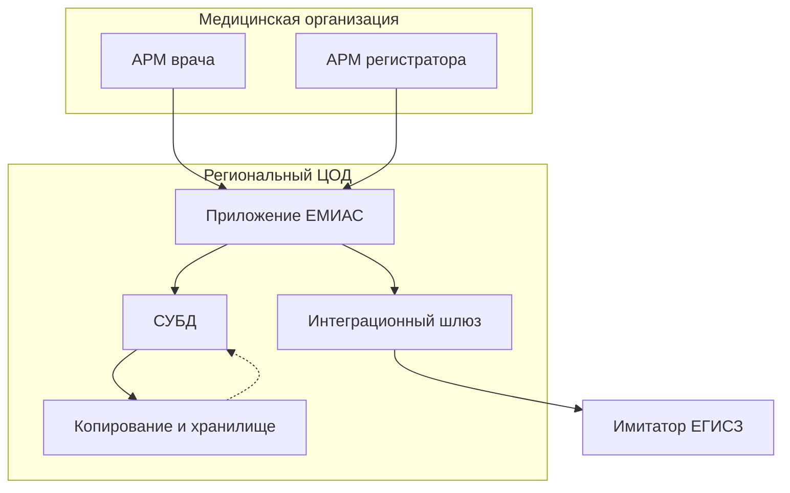

# Задание 4. Методические указания к практическим заданиям 

**Дисциплина:** анализ безопасности автоматизированных систем.  
**Направление:** государственная информационная система.  
**Объект:** Единая медицинская информационно-аналитическая система субъекта РФ.  
**Характер работы:** документальный анализ заданной модели, сведения о реальном регионе и реальные медицинские данные не используются.
**Выполнил:** студент группы ИВТ-21-22, Туктин К.В.
**Тема 1:** "Методологические основы анализа безопасности ЕМИАС: описание объекта и формирование критериев"

---

Сведения об использовании ИИ

{Теперь для этой темы нужно подробно расписать методический материал для выполнения практических заданий. Для напоминания - в ходе фомирования перечня тем для первой темы "Методологические основы анализа безопасности ЕМИАС: описание объекта и формирование критериев":
### Практические задания

**Задание 1.1. Составить паспорт учебной ЕМИАС и реестр активов.**

Описать назначение системы, участников, категории пользователей, данные, компоненты, помещения и внешние взаимодействия. Для каждого актива указать владельца или ответственного, размещение и выполняемую функцию.

Зафиксировать исходное состояние С0, границы стенда, допущения и отсутствующие сведения.

**Результат:** паспорт объекта и реестр активов.  
**Критерий выполнения:** каждый компонент учебной модели включён в описание либо обоснованно исключён из области анализа.

**Задание 1.2. Построить архитектурную схему и диаграмму информационных потоков.**

Для потоков указать источник, получателя, состав данных, назначение, способ передачи и границу ответственности. Отдельно отразить доступ подрядчиков, резервные копии, выгрузки и бумажные документы.

Составить матрицу ответственности за компоненты и интерфейсы.

**Результат:** схемы, реестр потоков и матрица ответственности.  
**Критерий выполнения:** отсутствуют неописанные взаимодействия между компонентами, включёнными в паспорт.

**Задание 1.3. Сформировать реестр применимых требований.**

Для документов задания 1 установить статус использования. Для применимых требований указать конкретное положение, основание применения, затрагиваемый объект и ожидаемое свидетельство выполнения.

**Результат:** реестр требований и матрица нормативной прослеживаемости.  
**Критерий выполнения:** каждое требование имеет источник и критерий проверки; непроверенные ссылки обозначены явно.

**Задание 1.4. Обосновать требуемые характеристики защиты.**

На согласованных исходных данных определить класс ГИС, уровень защищённости ПДн и категорию значимости учебного объекта КИИ. Недостающие сведения оформить как запрос.

После выполнения задания 2.5 проверить и при необходимости уточнить решения.

**Результат:** учебные классификационные документы с расчётами и обоснованиями.  
**Критерий выполнения:** решения согласованы с паспортом, последствиями нарушений и моделью угроз; результаты разных процедур не подменяют друг друга.

При этом необходимо сделать так, чтобы для выполнения практических заданий было достаточно теоретического материала (знаний и умений), расписанных в лекции в файле "Lecture_T1_EMIAS.md". В конце нужно сфомировать таблицу соответствия: для какого задания какой раздел лекции нужно изучить}

---

## 1. Назначение и организация практической работы

### 1.1. Что должно получиться

Практическая работа превращает знания из лекции в согласованный комплект исходных материалов для последующих тем курса. По нему другой обучающийся должен понять, какую ЕМИАС анализируют, какие сведения о ней известны, где проходят границы ответственности, какие требования применимы и как обоснованы требуемые характеристики защиты.

| Задание | Основной вопрос | Обязательный результат |
|---|---|---|
| 1.1 | Что представляет собой объект и какая его часть обследуется? | Паспорт, реестр активов, описание С0 и границ, перечень допущений и запросов |
| 1.2 | Как связаны компоненты и куда перемещается информация? | Архитектурная схема, диаграмма потоков, реестр потоков, матрица ответственности |
| 1.3 | На каком основании и по каким критериям оценивать объект? | Статусы документов, реестр требований, матрица нормативной прослеживаемости |
| 1.4 | Какие характеристики защиты следуют из исходных данных? | Три самостоятельных обоснования: класс ГИС, уровень защищённости ПДн, категория КИИ; журнал последующего пересмотра |

Для выполнения достаточно лекции, настоящих указаний, lab1.md и lab2.md. Текстовый редактор и любой способ построения читаемых схем являются достаточными средствами. Развёртывание серверов, сканирование, эксплуатация уязвимостей и испытания средств защиты в Т1 не требуются. Они не должны становиться условием успешного выполнения этих заданий.

Работа с нормативным документом здесь означает идентификацию положения и применение разобранного в лекции правила. Самостоятельно разрабатывать медицинскую модель последствий или проводить экспертизу неизвестного программного продукта не требуется: необходимые исходные оценки заданы ниже. Если для нормативной ссылки нет полного проверенного текста, обучающийся отмечает ограничение и оформляет запрос.

### 1.2. Порядок выполнения и возврат к результатам

1. Прочитать сквозные условия и разделы П1.1–П1.2 лекции.
2. На данных раздела 2 настоящих указаний выполнить задание 1.1.
3. Используя один и тот же реестр активов, выполнить задание 1.2. Выявленные новые активы и пробелы вернуть в паспорт.
4. Выполнить задание 1.3, связывая требования с активами, потоками и ответственными.
5. Выполнить задание 1.4. Условия, зависящие от будущей модели угроз, оставить явно предварительными.
6. После задания 2.5 сопоставить модель угроз с исходными предпосылками и оформить пересмотр по разделу 6.6 этих указаний.

Первичная сдача Т1 не предполагает наличия результата задания 2.5. В комплекте должны быть предварительное обоснование, список зависимых решений и подготовленная форма пересмотра.

### 1.3. Единые правила записи

Каждый документ получает название, автора, дату, номер версии и указание состояния объекта. Для первой сдачи можно использовать обозначение **«ЕМИАС-У, С0, версия 1.0»**.

| Обозначение | Значение | Правило использования |
|---|---|---|
| С0 | Заданное исходное состояние | Включает только сведения исходного комплекта и явно принятые условия |
| С1 | Предлагаемое состояние | Описание предложений по изменению С0; наличие проекта ещё не подтверждает реализацию |
| С2 | Реализованное и проверенное состояние стенда | Появляется после соответствующих работ и испытаний; в Т1 не устанавливается |
| УД | Учебные исходные данные | Заданы в настоящем материале; подтверждают описание модели, но не факты о реальной ЕМИАС |
| ДП | Допущение обучающегося | Явно указаны причина, влияние и необходимость согласования |
| ЗП | Запрос сведений | Указаны адресат, недостающие данные, затронутые результаты и способ закрытия вопроса |

Для связей удобно применять устойчивые идентификаторы: **А-01** — актив; **Д-01** — набор данных; **П-01** — помещение; **У-01** — участник; **Ф-01** — поток; **ТР-01** — требование; **КР-01** — критерий; **СВ-01** — ожидаемое свидетельство. Это учебные обозначения, а не обязательные коды регулятора.

Нельзя превращать отсутствие сведений в отрицательный факт. Запись «сертификат не предоставлен» не означает «сертификата нет». Запись «процедура резервного копирования задана» не означает «восстановление успешно проверено».

### 1.4. Общий порядок оценивания

Ниже предлагается **учебная шкала оценивания**, которую преподаватель может согласовать с принятой в дисциплине системой. Каждое задание оценивается отдельно: 10 критериев по 0–2 балла, максимум **20 баллов**.

- **2 балла** — выполнено условие второй колонки таблицы.
- **1 балл** — выполнено условие третьей колонки: результат есть, но требует указанного уточнения.
- **0 баллов** — результат отсутствует, не позволяет проверить соответствующий вывод либо содержит принципиальную ошибку по этому критерию.

| Сумма за задание | Оценка при отсутствии критических ошибок |
|---|---|
| 18–20 баллов | «Отлично» |
| 15–17 баллов | «Хорошо» |
| 12–14 баллов | «Удовлетворительно» |
| 0–11 баллов | «Неудовлетворительно»: требуется доработка |

**Условие зачёта каждого задания:** не менее 12 баллов и отсутствие критических ошибок, перечисленных после его таблицы. При критической ошибке задание возвращается на доработку независимо от суммы; после исправления оценивается повторно. Баллы одного задания не компенсируют незачёт другого.

Если исходные сведения действительно не предоставлены, полный балл за соответствующий критерий допускается при выполнении доступной части работы и наличии точного запроса: что неизвестно, кому адресован вопрос, какой вывод ограничен и как он будет завершён. Неизвестный факт нельзя подменять вымышленным. Пропуск уже заданных сведений не считается обоснованной неопределённостью.

Один и тот же недостаток учитывается в основной относящейся к нему строке; повторное снижение по другой строке допускается только при самостоятельном недостатке другого результата. Оцениваются содержание, обоснованность и проверяемость; декоративное оформление схем и количество страниц дополнительных баллов не дают.

## 2. Единый комплект учебных исходных данных

### 2.1. Карточка УД-01. Назначение, масштаб и границы модели

Система **«ЕМИАС-У»** обеспечивает ведение медицинской документации, запись пациентов, обмен медицинскими сведениями и подготовку данных ОМС в пределах одного условного субъекта РФ.

Учебным условием установлено, что система является региональной ГИС. Реальные реквизиты акта о её создании не заданы: в паспорте используется ссылка «УД-01; региональный акт подлежит получению», а не вымышленный номер постановления.

ЕМИАС-У обслуживает несколько медицинских организаций региона. В учебном комплекте подробно описан **один типовой сегмент медицинской организации**. Описание этого сегмента не подтверждает одинаковость настройки всех остальных организаций.

В объект документального анализа входят центральная инфраструктура, медицинские данные, типовой сегмент, процессы эксплуатации, помещения и интерфейсы. В учебный стенд входят локальные представления этих компонентов и имитаторы внешних сервисов. Реальные ЕГИСЗ, ТФОМС, оборудование поставщика связи и рабочая инфраструктура подрядчика не обследуются непосредственно; учитываются их интерфейсы и зависимости от них.

Телемедицинский модуль, биометрическая идентификация, обработка государственной тайны и трансграничная передача в данном варианте **не заданы**. Для телемедицины принят явный предел области: функция не включена в учебную ЕМИАС. Для других неизвестных характеристик нельзя делать вывод об их отсутствии в реальной системе.

### 2.2. Карточка УД-02. Участники и роли

| Код | Участник | Роль в учебной модели | Что нельзя автоматически выводить из роли |
|---|---|---|---|
| У-01 | Региональный орган управления здравоохранением | Организует функционирование региональной ГИС, определяет её назначение и требования к региональному информационному взаимодействию | Не означает, что все технические действия выполняются его сотрудниками |
| У-02 | Условный МИАЦ | Оператор технической эксплуатации ЕМИАС и ЦОД; обеспечивает центральные сервисы, администрирование, сопровождение | Не означает, что он является единственным оператором ПДн для всех целей обработки |
| У-03 | Медицинская организация | Организует медицинскую помощь, отвечает за создаваемые медицинские записи и локальный сегмент; определяет полномочия своих работников | Не означает владение внешней ЕГИСЗ или всем региональным каналом связи |
| У-04 | Подрядчик сопровождения | Обслуживает интеграционный модуль по заданию У-02; удалённый доступ предоставляется к выделенному узлу сопровождения | Не получает самостоятельное право использовать медицинские данные для собственных целей |
| У-05 | Внешние операторы ЕГИСЗ и ТФОМС | Принимают и обрабатывают сведения в пределах своих функций | Их внутренние меры защиты не считаются обследованными в Т1 |
| У-06 | Пациент | Использует портал записи и получает предусмотренные документы | Не получает доступ ко всем сведениям региональной базы |

Для задания распределение обязанностей по техническим компонентам задаётся карточкой УД-03. Правовые роли по обработке ПДн уточняются **по целям и операциям**, а не только по названию учреждения. Для лечебной деятельности оператором ПДн в модели выступает У-03; для технической обработки по её поручению У-02 рассматривается как обрабатывающее лицо. Конкретные поручения и основания региональной обработки должны быть запрошены. Эта учебная схема не заменяет правовую квалификацию реального взаимодействия.

Категории пользователей: врач, регистратор, администратор медицинской организации, администратор центральной инфраструктуры, специалист ИБ, специалист подрядчика, пациент. Врач создаёт и использует клинические записи; регистратор организует запись и уточняет необходимые регистрационные сведения. Право регистратора изменять клиническое заключение в модели не предусмотрено.

### 2.3. Карточка УД-03. Состав и размещение

Таблица является исходным перечнем. Обучающийся должен преобразовать его в реестр активов: присвоить идентификаторы, раскрыть функции, данные, зависимости и границы анализа.

| Группа | Заданный состав | Размещение | Ответственный за эксплуатацию в модели |
|---|---|---|---|
| Вычислительная инфраструктура | Узел виртуализации, прикладной сервер ЕМИАС, сервер СУБД и хранилище | Региональный ЦОД, П-01 | У-02 |
| Внешние интерфейсы | Портал записи; интеграционный шлюз для ЕГИСЗ и ТФОМС | Отдельные логические зоны ЦОД | У-02; медицинский состав отправляемых сведений согласует У-03 |
| Администрирование | АРМ центрального администратора; выделенный узел удалённого сопровождения | Административная зона ЦОД | У-02 |
| Защита и эксплуатационные сервисы | Межсетевое разграничение, механизм идентификации, антивирусная защита, сбор журналов, сервис резервного копирования, хранилище копий | Центральная инфраструктура; необходимые агенты на серверах и АРМ | У-02; за агенты на АРМ отвечает У-03 |
| Типовой сегмент медицинской организации | АРМ врача, регистратора и администратора; локальное сетевое оборудование; общий принтер | Кабинет врача П-02, регистратура П-03, служебное помещение П-04 | У-03 |
| Носители и бумажные материалы | Бумажные медицинские документы, распечатки, съёмный носитель для учтённой служебной выгрузки | П-02–П-04; шкаф хранения в П-04 | У-03 |
| Инженерное обеспечение | Электропитание, резервное питание, охлаждение, линии связи | П-01 и помещения медицинской организации | У-02 в ЦОД; У-03 на своей площадке |
| Внешняя среда | ЕГИСЗ, ТФОМС, оператор связи, рабочее место подрядчика, устройство пациента | За пределами непосредственного обследования | Соответствующий внешний участник; региональная сторона отвечает за свой интерфейс |
| Организационная среда | Персонал, обслуживание, предоставление доступа, ведение документов, информационный обмен | У-01–У-04 | По распределению функций УД-02 |

Наличие сервиса в этой таблице означает только его включение в С0. Эффективность межсетевого разграничения, корректность настроек, периодичность копирования, полнота журналов и действительность сертификатов не подтверждены.

**Не заданы:** версии ПО и СЗИ; номера и области действия сертификатов; точная адресация; состав договоров; фактические параметры каналов; утверждённые сроки хранения; результаты испытаний. Запрашиваются только сведения, необходимые для конкретного решения Т1. Параметры, нужные прежде всего для Т4 или Т6, можно отметить как отложенные.

### 2.4. Карточка УД-04. Информация и операции

| Код | Набор данных | Основное содержание и назначение | Особенности описания |
|---|---|---|---|
| Д-01 | Идентификационные и регистрационные сведения пациента | Учебные ФИО, дата рождения, идентификатор пациента, контакты, сведения полиса; связывание записи с человеком | Указать, какие поля нужны конкретной операции |
| Д-02 | Медицинские сведения | Жалобы, диагнозы, результаты исследований, назначения, сведения об аллергиях; оказание помощи и ведение документации | Сведения о здоровье — специальные категории ПДн; действует режим врачебной тайны |
| Д-03 | Сведения о записи | Пациент, специалист, время, статус записи | Состав не должен автоматически повторять всю медицинскую карту |
| Д-04 | Сведения ОМС | Учёт оказанной помощи, идентификаторы и сведения, необходимые для обмена с ТФОМС | Фактическая структура обмена подлежит подтверждению |
| Д-05 | Учётные записи и журналы | Идентификаторы работников, роли, события работы с системой | Возможны ПДн сотрудников; журналы могут содержать сведения о пациентах |
| Д-06 | Копии и выгрузки | Резервные копии Д-01–Д-05, служебные выгрузки и распечатки | Новая форма или место хранения не отменяют режим исходной информации |
| Д-07 | Агрегированная аналитика | Сводные показатели без индивидуальных записей | Само название «аналитика» не доказывает обезличивание; состав и возможность идентификации анализируются отдельно |

Для классификационного примера ЕМИАС-У обрабатывает сведения о здоровье **350 000 различных пациентов, не являющихся сотрудниками оператора**, а также учётные данные работников. Это объём **моделируемой системы**. Небольшое число синтетических строк в локальном стенде не заменяет его.

Медицинские записи, учётные записи, копии и журналы рассматриваются раздельно. Один пациент может присутствовать в нескольких наборах; повторение записей не увеличивает число различных субъектов.

### 2.5. Карточка УД-05. Заданные взаимодействия

| Код связи | Описание взаимодействия для дальнейшего разложения на потоки |
|---|---|
| В-01 | АРМ врача и регистратора обращаются к приложению ЕМИАС; приложение возвращает сведения в пределах пользовательской функции |
| В-02 | Приложение читает и изменяет данные СУБД; СУБД возвращает результаты |
| В-03 | Пациент обращается к порталу; портал передаёт запрос записи приложению и возвращает подтверждение |
| В-04 | Приложение передаёт предусмотренные медицинские документы шлюзу; шлюз передаёт их в имитатор ЕГИСЗ и получает квитанции |
| В-05 | Шлюз передаёт сведения ОМС в имитатор ТФОМС и получает результаты обработки |
| В-06 | АРМ администраторов взаимодействуют с управляемыми компонентами в пределах своих площадок и предоставленных функций |
| В-07 | Подрядчик подключается к узлу сопровождения; с него выполняются действия с интеграционным модулем; предусмотрена передача пакета обновления |
| В-08 | Серверы, шлюз, средства защиты и АРМ направляют эксплуатационные события в сервис журналирования |
| В-09 | Сервис копирования получает данные и конфигурации, записывает копии в хранилище; предусмотрен отдельный путь возврата данных при восстановлении |
| В-10 | Уполномоченный работник формирует служебную выгрузку и переносит её на учтённый носитель; внешняя отправка этой выгрузки не задана |
| В-11 | Медицинский работник печатает документ, забирает его у принтера, помещает в место хранения либо выдаёт пациенту |
| В-12 | На АРМ вводятся сведения с бумажного документа; исходный бумажный экземпляр сохраняется в установленном для него месте |
| В-13 | Региональному органу передаются агрегированные показатели; условия отсутствия идентификации в них требуют подтверждения |

Способ передачи, заданный на уровне модели: пользовательские обращения — веб-интерфейс; межсерверный обмен — программный интерфейс; обновления и выгрузки — передача файлов; бумажные документы и съёмный носитель — физическое перемещение. Конкретный протокол, его защищённость и параметры СКЗИ не заданы. Если обучающийся предлагает TLS, VPN или иной механизм, это предложение С1, пока оно не принято как отдельное учебное условие С0.

### 2.6. Карточка УД-06. Сведения для классификационных решений

Эта карточка предоставляет исходные оценки, а не готовые акты. Их происхождение в работе обозначается «синтетическая учебная оценка по УД-06». Студент применяет изученные правила, проверяет согласованность и формулирует ограничения.

| Блок | Исходное условие | Ограничение использования |
|---|---|---|
| Масштаб ГИС | Задачи ЕМИАС-У выполняются в пределах одного субъекта РФ | Обмен с ЕГИСЗ не расширяет назначение самой ЕМИАС до федерального масштаба |
| Целостность Д-02 | Искажение клинически значимых сведений может привести к существенным негативным последствиям для пациентов и выполнения медицинских функций | Учебная экспертная оценка высокой степени ущерба; конкретный сценарий уточняется в Т2 |
| Конфиденциальность Д-01–Д-02 | Раскрытие медицинских сведений нарушает права пациентов; в учебной оценке последствия признаны существенными | Использовать как заданное обоснование, а не правило «любые медицинские данные всегда дают один класс» |
| Доступность Д-01–Д-04 | Сбой временно нарушает ведение документации, запись и обмен; в описанном режиме часть работы продолжается по временной процедуре | Для учебной таблицы принята средняя степень ущерба; уточнение зависит от сценариев отказа |
| ПДн | Специальные категории; 350 000 пациентов, не являющихся сотрудниками оператора | Не путать объём моделируемой системы с объёмом учебной базы |
| Тип угроз ПДн | Для первичного расчёта **условно принят 3-й тип** | До задания 2.5 это допущение, а не доказанная неактуальность угроз 1-го и 2-го типов |
| Субъект и объект КИИ | Условный МИАЦ — российское юридическое лицо, эксплуатирующее ЕМИАС на законном основании в сфере здравоохранения; система сопоставляется с типом региональной ГИС здравоохранения | Правовые основания и соответствие типу в реальном случае подтверждаются документами |
| Последствие для жизни и здоровья | При заданном инциденте затрагиваются две непересекающиеся группы пациентов: 12 и 8 человек; учебная медицинская оценка связывает нарушение работы с возможным вредом их здоровью | Это число потенциально пострадавших, а не число карт, обращений или жителей |
| Остальные показатели КИИ | Для вычислительного примера выдано учебное экспертное заключение: остальные применимые показатели не дают категорию выше III; неприменимость остальных должна быть обоснована в полном заключении | Полные первичные расчёты не предоставлены: итог допускается только условный; их получение включается в запрос |
| Телемедицина | Функция отсутствует в границах данного учебного варианта | Не переносить вывод на любую МИС или ЕМИАС |

По прочим наборам данных последствия должны быть кратко рассмотрены самим студентом на основе их назначения: например, изменение учётных записей способно повлиять на доступ к медицинским сведениям. Не требуется изобретать неизвестные статистические показатели. Если степень ущерба без них не определяется, это отмечается; уже заданный высокий ущерб по Д-02 позволяет получить верхний уровень значимости, не скрывая пробелы в остальных оценках.

Условная категория КИИ по данному комплекту не равна завершённому категорированию реального объекта. Для полноты учебной работы необходимо показать правило выбора категории, зависимость от полного перечня показателей и запросить отсутствующие расчёты. Одного вычисления по числу пострадавших для безусловного итогового акта недостаточно.

## 3. Задание 1.1. Паспорт учебной ЕМИАС и реестр активов

### 3.1. Цель, подготовка и входные данные

**Цель:** зафиксировать объект, область непосредственного обследования и исходное состояние, чтобы последующие схемы и требования относились к одному составу ЕМИАС.

Перед выполнением изучите в лекции разделы 1.1–1.5, 2.3–2.4, 3.1 и 3.4, 4.1–4.3, 4.6–4.7. Используйте карточки УД-01–УД-06.

### 3.2. Порядок выполнения

**Шаг 1. Определите назначение.** Напишите один абзац с функциями и пользователями системы. Назначение «обрабатывать информацию» недостаточно: укажите ведение медицинской документации, запись, обмен и ОМС. Укажите региональный масштаб и учебный характер модели.

**Шаг 2. Разведите понятия.** Отдельно назовите:

- информационную систему как данные, технологии и технические средства их обработки;
- автоматизированную систему с персоналом и процессами;
- объект защиты: информацию и связанные с её безопасностью ресурсы;
- объект оценки: конкретный состав и состояние, для которых формируются выводы.

Например, объект защиты включает медицинские сведения и их копии; объект оценки Т1 включает документальное описание ЕМИАС-У С0. Эти формулировки не должны ограничивать анализ одним сервером.

**Шаг 3. Установите четыре границы.** Опишите логическую, физическую, организационную границы системы и границу обследования. Укажите, что включено непосредственно, что учитывается как внешняя зависимость и что исключено с объяснением причины.

**Шаг 4. Опишите участников и пользователей.** Перенесите роли УД-02 в паспорт. Различайте организацию, отвечающую за компонент, человека с пользовательской ролью и правовой статус оператора ПДн.

**Шаг 5. Составьте реестр активов.** Пройдите по всем строкам УД-03, наборам УД-04 и организационным процессам УД-02. Выделяйте самостоятельную строку, если различаются функция, ответственный, размещение или режим данных.

**Шаг 6. Зафиксируйте состояние С0.** Укажите, что известно о компонентах, документах и процедурах. Не дописывайте «настроено безопасно», «сертифицировано» или «копии защищены» без исходных сведений.

**Шаг 7. Оформите неизвестные сведения.** Для каждого существенного пробела определите влияние на последующие решения и подготовьте запрос. Допущение допустимо для учебного продолжения, но не должно выдаваться за полученный ответ.

**Шаг 8. Проверьте покрытие модели.** Каждая строка исходного состава должна ссылаться хотя бы на одну запись паспорта или активов либо иметь обоснованное решение о внешней границе/исключении.

### 3.3. Шаблон паспорта

| Поле | Что записать |
|---|---|
| Название, версия, состояние | ЕМИАС-У; версия комплекта; С0; дата описания |
| Назначение и функции | Конкретные медицинские и обеспечивающие процессы |
| Статус и основание создания | Региональная ГИС по УД-01; какие реальные документы потребовались бы |
| Участники и роли | У-01–У-06; оператор системы, участники обработки, внешние стороны |
| Категории пользователей | Функции и пределы действий каждой роли |
| Информационные ресурсы | Д-01–Д-07; медицинские сведения, копии, журналы, документы |
| Центральные компоненты | Ссылки на реестр активов |
| Типовой сегмент | АРМ, сеть, печать, носители и обслуживающий персонал |
| Помещения и инженерная среда | П-01–П-04, питание, охлаждение, связь |
| Внешние взаимодействия | ЕГИСЗ, ТФОМС, подрядчик, пациент, региональный орган |
| Границы системы | Логическая, физическая и организационная |
| Границы обследования | Что анализируется документально; что представлено на стенде; внешние ограничения |
| Состояние защиты по исходным данным | Только наличие заданных функций; неизвестные параметры отдельно |
| Допущения и открытые вопросы | Ссылки ДП и ЗП с влиянием на выводы |
| Источники | Карточки УД, lab1.md, lab2.md и подтверждённые документы при их наличии |

**Пример формулировки границы:** «Обследуется описание центральной ЕМИАС и одного типового сегмента медицинской организации. Взаимодействие с ЕГИСЗ учитывается до согласованного интерфейса передачи и получения квитанции; внутренние средства ЕГИСЗ не исследуются. На стенде внешний сервис заменён имитатором».

### 3.4. Шаблон реестра активов и пример

| ID | Актив и тип | Функция / данные | Размещение | Владелец или ответственный; основание | Связи и зависимости | Включение в анализ | Источник / неизвестное |
|---|---|---|---|---|---|---|---|
| А-01 | База медицинских записей; информационный актив | Хранение Д-01 и Д-02 | СУБД в П-01 | У-03 отвечает за создаваемые записи; У-02 — за техническое хранение, УД-02–03 | Приложение, СУБД, копирование | Включена | УД-03–04; точная структура не задана |
| А-02 | Сервер СУБД; программно-технический актив | Обработка запросов к А-01 | Виртуальная среда П-01 | У-02, УД-03 | Виртуализация, хранилище, питание | Включён документально | Версия и конфигурация — ЗП-01 |
| А-03 | Внешняя ЕГИСЗ; связанная система | Приём документов, возврат квитанций | Внешняя площадка | Внешний оператор; региональная сторона — У-02 | Интеграционный шлюз | Учитывается интерфейс; внутренняя инфраструктура вне обследования | УД-05, В-04 |
| … | … | … | … | … | … | … | … |

Эти строки показывают способ заполнения. Студент завершает реестр самостоятельно. Базу данных, сервер СУБД и его виртуальную машину можно связать иерархией; нельзя потерять различие между информацией и средством её обработки.

Для однотипных АРМ допустима групповая запись с количеством, общими свойствами и явным пределом обобщения. Если количество не задано, укажите «один типовой экземпляр в стенде; количество в региональной системе не установлено».

Персонал удобно учитывать через группы ролей и связанные процессы, не составляя списков реальных работников. Для помещения указываются находящиеся в нём активы и ответственная организация.

### 3.5. Шаблоны границ, допущений и запросов

| Элемент | Отношение к объекту | Способ рассмотрения | Причина и ограничение |
|---|---|---|---|
| Сервер СУБД | Внутренний компонент | Описание, зависимости и критерии | Фактическая конфигурация не проверяется |
| Оператор связи | Внешняя зависимость | Точки подключения, сторона ответственности, запрос условий обслуживания | Внутренняя сеть поставщика вне обследования |
| Телемедицинский модуль | Вне учебного состава | Не рассматривается | Не включён в УД-01 |
| … | … | … | … |

| ID | Недостающее сведение или допущение | Кому адресован запрос | Для чего нужно | Временное решение | Условие закрытия |
|---|---|---|---|---|---|
| ЗП-01 | Версия СУБД и описание размещения | У-02 | Уточнение состава и будущая проверка компонента | Фиксируется функция без утверждения о доверии | Получен перечень ПО и схема размещения |
| ЗП-02 | Поручение обработки ПДн и роли участников | У-01–У-03 | Применимость требований к конкретному лицу | Правовая роль указана условно по УД-02 | Получен документ с целями, операциями и обязанностями |
| ДП-01 | Для первичного расчёта принят 3-й тип угроз ПДн | Учебное согласование | Предварительное решение задания 1.4 | Допущение до задания 2.5 | Вывод модели угроз подтверждает или изменяет предпосылку |
| … | … | … | … | … | … |

### 3.6. Самопроверка и сдача

| Контрольный вопрос | Признак выполнения |
|---|---|
| Все компоненты модели учтены? | У каждой строки УД-03 есть ссылка на реестр или обоснованную границу |
| Учтены не только серверы? | Есть данные, люди/роли, процессы, помещения, инженерные ресурсы и носители |
| Можно определить ответственность? | У каждого актива указан ответственный либо конкретный запрос |
| Система и стенд различены? | Объём моделируемой региональной системы не заменён одним АРМ и тестовой базой |
| С0 отделено от предложений? | Будущие настройки и регламенты не обозначены действующими |
| Ограничения явны? | Пробелы в данных связаны с решениями, которые они ограничивают |

**Сдаётся:** паспорт, реестр активов, таблица границ, перечень допущений и запросов. Неполнота исходных сведений допустима при её явном отражении; необъяснённое выпадение компонента — основание для доработки.

### 3.7. Критерии оценивания задания 1.1

**Максимум — 20 баллов.** Для каждого критерия выберите 2, 1 или 0 баллов по правилам раздела 1.4 настоящих указаний. В последнюю колонку проверяющий заносит балл и при необходимости замечание.

| Критерий | 2 балла — полное выполнение | 1 балл — частичное выполнение | Балл / замечание |
|---|---|---|---|
| 1. Назначение и функции | Названы функции ЕМИАС, пользователи, региональный масштаб и учебный статус; описание соответствует УД-01 | Назначение понятно, но отдельные функции или признаки масштаба раскрыты неполно | — |
| 2. Участники и пользовательские роли | Участники УД-02 учтены; технические, медицинские и правовые роли различены; неизвестные полномочия запрошены | Основные участники названы, но отдельные функции или границы полномочий требуют уточнения | — |
| 3. Информационные ресурсы | Учтены Д-01–Д-07, их назначение и особенности; копии и журналы не потеряны | Ресурсы перечислены, но назначение или особенности части наборов раскрыты неполно | — |
| 4. Состав активов | Все группы УД-03 отражены в реестре либо имеют обоснованное решение о границе анализа | Основные группы учтены, но есть отдельные необъяснённые пропуски или чрезмерно укрупнённые записи | — |
| 5. Размещение и зависимости | Для активов указаны площадки/помещения и существенные зависимости; инженерная среда учтена | Размещение в целом понятно, но отдельные помещения или зависимости не указаны | — |
| 6. Границы объекта и обследования | Различены логическая, физическая, организационная границы и область обследования; внешние интерфейсы сохранены | Область понятна, но один вид границ или предел рассмотрения внешнего участника описан недостаточно | — |
| 7. Содержание реестра активов | Активы имеют устойчивые ID, тип, функцию/данные и ссылки на связанные записи; информация отделена от средств обработки | Реестр пригоден для продолжения работы, но отдельные поля или связи отсутствуют | — |
| 8. Ответственность за активы | Для каждого актива указан владелец или ответственный с основанием; пробелы оформлены адресными запросами | Ответственность за основные активы ясна, но для отдельных записей основание или полномочия не раскрыты | — |
| 9. Состояние С0 и неопределённости | С0, предложения, допущения и отсутствующие сведения разделены; влияние неизвестного на выводы указано | Состояние в целом зафиксировано, но отдельное допущение или запрос не имеет объяснения влияния | — |
| 10. Согласованность и полнота паспорта | Паспорт, активы и таблица границ согласованы; покрытие исходного состава проверяется по ссылкам | Документы в целом согласованы, но есть отдельные расхождения названий, ID или версий | — |
| **Итого** | **Максимум 20 баллов** | | **… / 20** |

**Критические ошибки, требующие доработки:**

- Отсутствует паспорт или реестр активов, поэтому невозможно установить состав объекта.
- Границы не установлены либо региональная ЕМИАС без объяснения подменена одним локальным сервером/АРМ.
- Предложенные меры или вымышленные сведения представлены как подтверждённое состояние С0 и используются для выводов.

**Порог зачёта:** 12 баллов при отсутствии перечисленных критических ошибок; шкала отметок приведена в разделе 1.4 настоящих указаний.

## 4. Задание 1.2. Архитектура, информационные потоки и ответственность

### 4.1. Цель, подготовка и входные данные

**Цель:** показать состав системы в связях и установить путь каждого заданного вида информации, включая копии и операции вне основной базы.

Изучите разделы 1.4–1.5, 2.6, 3.4, 4.1–4.7 и 7.2 лекции. Используйте паспорт, реестр активов и карточку УД-05. Если при построении схем обнаружен отсутствующий актив, сначала дополните реестр задания 1.1.

**Архитектурная схема** отвечает на вопрос «какие компоненты где расположены и как связаны». **Диаграмма информационных потоков** отвечает на вопрос «какая информация, откуда, куда и для какой операции передаётся». Одна линия связи на архитектурной схеме может соответствовать нескольким потокам с разными данными, направлениями и основаниями.

### 4.2. Порядок выполнения

**Шаг 1. Выберите уровни представления.** Подготовьте обзорную архитектурную схему и диаграмму потоков. Если одна схема становится нечитаемой, выделите центральную часть, сегмент медицинской организации и внешние обмены в отдельные фрагменты. Между фрагментами должны сохраняться одинаковые обозначения.

**Шаг 2. Разместите компоненты.** Покажите ЦОД, типовой сегмент, внешние системы и рабочее место подрядчика. Внутри ЦОД обозначьте пользовательские сервисы, обработку и хранение, администрирование, журналирование и копирование. Логические зоны не следует выдавать за реально настроенные сетевые сегменты: их фактическое разделение неизвестно.

**Шаг 3. Покажите зависимости.** Укажите связи приложения с СУБД, виртуализацией, хранилищем, сетевой и инженерной инфраструктурой. Питание и охлаждение можно вынести на отдельный слой. Это зависимости доступности, а не потоки медицинских данных.

**Шаг 4. Разложите УД-05 на направленные потоки.** Например, связь с внешней системой включает передачу документа и обратную квитанцию. Укажите оба направления или одну явно двунаправленную строку с отдельным описанием состава каждого направления. Команда администрирования и передача файла обновления также могут быть разными потоками.

**Шаг 5. Опишите каждый поток в реестре.** Сначала запишите источник, получателя, данные и цель; затем способ передачи, границу и ответственных. Не присваивайте потоку статус «защищён», если известен только факт передачи.

**Шаг 6. Добавьте пути копий и материальных носителей.** Отдельно покажите создание резервной копии и восстановление, формирование выгрузки, перенос носителя, печать, получение распечатки и ввод данных с бумаги. Принтер и шкаф хранения не заменяют участников этих операций.

**Шаг 7. Составьте матрицу ответственности.** Для каждого компонента и интерфейса определите исполнителя, принимающего решение и контролирующего. При внешнем обмене укажите обе стороны и место передачи ответственности.

**Шаг 8. Выполните взаимную сверку.** Каждая стрелка должна иметь запись в реестре; каждый информационный поток — стрелку или явно обозначенный фрагмент; каждый узел — актив или участника из паспорта. Расхождения устраняются во всех документах, а не только на рисунке.

### 4.3. Правила изображения

Используйте прямоугольники для компонентов и участников, стрелки для направлений, рамки для границ. Сложная нотация не требуется. Легенда должна объяснять используемые обозначения и отличать информационную передачу от технической зависимости.

В подписи схемы укажите: объект, С0, версию, степень детализации и ограничение области. Не помещайте на схему неподтверждённые IP-адреса, названия коммерческих продуктов или обозначения сертификатов.

Ниже — **фрагмент архитектурного представления**, показывающий допустимый уровень детализации. Он не заменяет полную схему, поскольку в нём не раскрыты портал, администрирование, бумажные операции и все сервисы.

В этом фрагменте сплошные линии показывают основные связи обработки и обмена, пунктир — отдельный путь восстановления из копии. Рамки показывают площадки, но сами по себе не доказывают настроенное сетевое разделение. При использовании фрагмента обозначьте границы ответственности и добавьте идентификаторы активов из собственного реестра.

### 4.4. Реестр информационных потоков

| ID | Источник → получатель | Состав данных | Цель / операция | Способ передачи | Граница и ответственные стороны | Основание / вопрос | Связь со схемой |
|---|---|---|---|---|---|---|---|
| Ф-01 | АРМ врача → приложение | Идентификатор пациента, вводимая клиническая запись | Ведение медицинской документации | Веб-интерфейс; параметры канала не заданы | У-03 отвечает за действия пользователя и АРМ; У-02 — за центральный интерфейс | УД-05, В-01; правовые основания — задание 1.3 | Фрагмент «медицинская организация — ЦОД» |
| Ф-02 | Приложение → АРМ врача | Запрошенная запись, результат сохранения | Предоставление сведений для оказания помощи | Ответ веб-интерфейса | Та же граница; отдельное направление | УД-05, В-01 | Тот же фрагмент |
| Ф-03 | Шлюз → имитатор ЕГИСЗ | Медицинский документ в заданной структуре | Регламентированный информационный обмен | Программный интерфейс; версия формата уточняется | У-02 — отправка; внешний оператор — приём; ответственность У-03 за медицинское содержание сохраняется | УД-05, В-04; спецификация и регламент — запрос | Фрагмент внешнего обмена |
| Ф-04 | Имитатор ЕГИСЗ → шлюз | Квитанция обработки, код ошибки | Подтверждение результата передачи | Ответ программного интерфейса | Внешняя сторона → У-02 | УД-05, В-04 | Фрагмент внешнего обмена |
| Ф-05 | Принтер → работник → шкаф хранения | Бумажный медицинский документ | Хранение документа после печати | Физическое перемещение | Внутри У-03; от общего устройства к ограниченному хранению | УД-05, В-11; порядок выдачи уточняется | Фрагмент бумажных операций |
| … | … | … | … | … | … | … | … |

Если в одной строке указан путь через посредника, каждый его участок должен быть понятен. При изменении данных, адресата или ответственности разделите путь на несколько строк.

**Как заполнить графу «состав данных».** Запись «ПДн» слишком общая. Для записи на приём укажите идентификатор пациента, выбранного специалиста, дату и время; диагнозы добавляются только при обоснованной необходимости. Для резервной копии укажите, какие наборы и конфигурации включены. Для журнала — хотя бы идентификатор пользователя, объект обращения и результат операции, если эти поля заданы; неизвестный состав пометьте запросом.

**Как заполнить графу «граница».** Например: «АРМ У-03 → центральный сервис У-02; собственник транспортной сети не установлен, условия предоставления связи запрошены». Нельзя приписывать МИАЦ весь канал только потому, что он принимает данные.

**Как описывать подрядчика.** Покажите его рабочее место, узел сопровождения, целевой интеграционный компонент, команды и обновления. Не рисуйте прямой доступ к СУБД, если он не задан. Возможный доступ к данным при сопровождении оформите как вопрос, а не как установленное право.

### 4.5. Матрица ответственности

Это функциональная матрица учебного анализа. Она показывает, кто действует, кто разрешает действие и кто проверяет результат. Должности и подразделения могут быть условными; не требуется вводить дополнительную методологию управления проектами.

| Компонент / интерфейс | Исполнитель | Кто принимает решение | Кто контролирует | Граница или подтверждающий документ |
|---|---|---|---|---|
| Центральный сервер СУБД | Администратор У-02 | Ответственный за эксплуатацию У-02 | Ответственный за ИБ У-02 | Положение об эксплуатации; конкретные реквизиты не заданы |
| АРМ врача | Локальный администратор У-03; врач как пользователь | Руководитель/уполномоченный У-03 в пределах своих функций | Ответственный за ИБ У-03 | Центральная служба У-02 не отвечает автоматически за физическое обращение с АРМ |
| Доступ подрядчика к узлу сопровождения | У-02 предоставляет доступ; У-04 выполняет согласованные работы | Уполномоченный У-02; при затрагивании данных — согласование с соответствующим участником обработки | Ответственный за ИБ У-02 | Поручение, договор, заявка; отсутствие документов отмечается |
| Отправка в ЕГИСЗ | У-02 обеспечивает техническую передачу; У-03 формирует медицинское содержание | Уполномоченные соответствующих участников | Контроль доставки — У-02; контроль содержания — У-03 | Интерфейс и квитанция; распределение должно подтверждаться регламентом |
| Бумажная выдача документа | Уполномоченный работник У-03 | Уполномоченный У-03 | Ответственный за процесс в У-03 | Регламент выдачи и хранения |
| … | … | … | … | … |

Таблица содержит пример распределения по учебным условиям. Если полномочие не задано, укажите «требует назначения/подтверждения» и запрос. Не объединяйте ответственность за достоверность медицинской записи и техническую доступность сервера в одну неопределённую роль «администратор».

### 4.6. Проверка полноты взаимодействий

Используйте контрольную таблицу. В последней колонке своего отчёта укажите конкретные идентификаторы потоков.

| Что проверить | Ожидаемое отражение |
|---|---|
| Пользовательские операции | Ввод, запрос и получение результата |
| Работа приложения и СУБД | Чтение/изменение и возврат результата |
| Портал | Запрос пациента, обработка записи и подтверждение |
| ЕГИСЗ и ТФОМС | Передаваемые сведения, ответы, ошибки |
| Администрирование | Источник, управляемый компонент, команды |
| Подрядчик | Путь доступа, целевой узел, обновления, ограничения |
| Журналирование | Источники, получатель, заданный или неизвестный состав |
| Резервные копии | Источник, создание, хранилище, отдельный путь восстановления |
| Выгрузки | Формирование, место хранения, носитель и разрешённый получатель |
| Бумажные документы | Печать, выдача/хранение, ввод с бумаги |
| Агрегированные сведения | Получатель, состав, вопрос об идентифицируемости |
| Инженерные зависимости | Отмечены отдельно от информационных потоков |

Критерий «нет неописанных взаимодействий» означает отсутствие пропусков **в заданной модели**, а не обязанность нарисовать связь между каждой парой активов. Нельзя объявлять модель исчерпывающей для реальной ЕМИАС без обследования.

**Сдаётся:** две согласованные схемы или комплект их фрагментов, реестр потоков, матрица ответственности, дополненные активы и запросы. Файлы схем должны быть читаемы без устного объяснения автора.

### 4.7. Критерии оценивания задания 1.2

**Максимум — 20 баллов.** Для каждого критерия выберите 2, 1 или 0 баллов по правилам раздела 1.4 настоящих указаний. В последнюю колонку проверяющий заносит балл и при необходимости замечание.

| Критерий | 2 балла — полное выполнение | 1 балл — частичное выполнение | Балл / замечание |
|---|---|---|---|
| 1. Покрытие архитектуры | На схемах учтены компоненты паспорта, центральная и территориальная части, внешние участники и сервисы | Архитектура понятна, но отдельный компонент или сервис не отражён | — |
| 2. Размещение и границы | Площадки, логические зоны и границы ответственности понятны; внешняя инфраструктура отделена от обследуемой | Основные границы показаны, но отдельный переход или зона не имеет пояснения | — |
| 3. Различение представлений | Архитектура показывает компоненты и связи, диаграмма потоков — передачу данных; легенда различает зависимости и обмен | Оба представления есть, но часть обозначений смешана или недостаточно пояснена | — |
| 4. Покрытие заданных взаимодействий | В-01–В-13 раскрыты; направления, ответы и квитанции учтены там, где заданы | Большинство взаимодействий раскрыто, но есть отдельные пропуски направления или обратного ответа | — |
| 5. Описание потоков | У каждого потока определены источник, получатель, состав данных, цель и способ передачи либо точный запрос | Потоки идентифицируются, но отдельные поля заполнены слишком общо или пропущены | — |
| 6. Подрядчик и администрирование | Показаны исходные точки доступа, промежуточный узел, цели, команды и передача обновлений; незаданные права не приписаны | Доступ отражён, но его путь, целевой компонент или операции раскрыты неполно | — |
| 7. Копии, выгрузки и бумага | Раздельно отражены копирование и восстановление, выгрузки/носители, печать, выдача/хранение и ввод с бумаги | Основные операции отражены, но один путь или этап обращения с экземпляром данных пропущен | — |
| 8. Ответственность за интерфейсы | Для каждого пересечения границы указаны участвующие стороны, их функции и место передачи ответственности | Стороны названы, но распределение функций по отдельному интерфейсу неоднозначно | — |
| 9. Матрица ответственности | Для компонентов и интерфейсов указаны исполнитель, принимающий решение и контролирующий; неизвестные назначения запрошены | Матрица есть, но отдельные функции или основания распределения не раскрыты | — |
| 10. Взаимная сверка схем и реестров | Каждый узел сопоставлен с активом/участником, каждая стрелка — с потоком; реестр не содержит потерянных взаимодействий | Есть единичные ошибки ID, подписей или ссылок, не меняющие понимание общей модели | — |
| **Итого** | **Максимум 20 баллов** | | **… / 20** |

**Критические ошибки, требующие доработки:**

- Отсутствует архитектурное представление или представление информационных потоков; их содержание нельзя восстановить по представленным материалам.
- Не представлена целиком хотя бы одна обязательная группа взаимодействий: доступ подрядчика, резервное копирование, выгрузки или бумажные документы.
- Схемы и паспорт описывают существенно разный состав объекта, либо отсутствует матрица ответственности.

**Порог зачёта:** 12 баллов при отсутствии перечисленных критических ошибок; шкала отметок приведена в разделе 1.4 настоящих указаний.

## 5. Задание 1.3. Реестр применимых требований и нормативная прослеживаемость

### 5.1. Цель, подготовка и граница работы

**Цель:** объяснить, почему документ и конкретное требование относятся к данному объекту, кто обязан его выполнять и по какому признаку это можно будет проверить.

Изучите разделы 2.4–2.6, 3.1–3.5, 5.1–5.11, разделы 6.1 и 8–9 лекции. Входные материалы: lab1.md, результаты 1.1–1.2 и учебные условия.

Работа ведётся на двух уровнях:

1. **Учёт источников:** каждый документ исходного перечня получает статус и указание места в курсе.
2. **Раскрытие требований Т1:** положения, необходимые для описания объекта, определения применимости и характеристик защиты, превращаются в проверяемые критерии.

Подробные требования к настройкам, построению системы защиты, инцидентам, испытаниям и зрелости раскрываются в последующих темах. Их перенос в соответствующую тему не равен признанию документа неприменимым.

### 5.2. Статусы источников

У статуса есть три независимые составляющие. Их нельзя заменять одним словом «актуален».

| Составляющая | Возможные значения | Пример |
|---|---|---|
| Состояние документа на дату среза | Действующая норма; исторический документ; проект; статус не подтверждён | Проект отраслевых особенностей не используется как вступивший в силу акт |
| Роль для объекта | Обязательный при подтверждённом условии; методический; дополнительный учебный/договорный; неприменимый при заданных границах; требует уточнения | ГОСТ выбран как методическая основа описания, а не объявлен обязательным целиком |
| Место в работе | Раскрывается в Т1; используется как контекст; передаётся в Т2–Т6 | Методика угроз поддерживает исходные данные Т1, полная модель составляется в Т2 |

Отдельно фиксируется **проверенность ссылки**: прочитан полный текст нужной редакции; использовано изложение лекции; реквизиты/пункт не подтверждены. Изложение лекции позволяет выполнить учебное упражнение, но не должно быть помечено как самостоятельная проверка полного текста акта.

### 5.3. Порядок выполнения

**Шаг 1. Зафиксируйте дату среза и корпус.** Укажите ноябрь 2026 г., источник lab1.md и связь с нормативной таблицей раздела 8 лекции. При наличии в lab1.md групповых записей сохраните группу в обзоре, но раскройте конкретный документ перед ссылкой на его пункт.

**Шаг 2. Идентифицируйте документы.** Запишите орган, вид, дату, номер, название и применяемую редакцию. Для изменения важна дата вступления конкретного положения в силу. Например, изменения приказа № 117 нельзя применять в ноябре 2026 г. только по дате подписания изменяющего приказа: в лекции указаны положения с разными датами действия.

**Шаг 3. Установите признаки применимости.** Сопоставьте документ с фактом из паспорта: региональная ГИС; обработка здоровья; бумажные операции; внешний медицинский обмен; заданный вариант КИИ. Укажите адресата нормы.

**Шаг 4. Выделите конкретное положение.** Используйте проверенный текст или нормативные опоры раздела 5.5 ниже. Название закона без статьи, приложение без нужного положения или ссылка на группу ГОСТ не являются конкретным источником требования.

**Шаг 5. Сформулируйте требование к объекту.** Отделите содержание нормы от своей учебной конкретизации. Если критерий добавлен по методическому выбору, назовите это основание.

**Шаг 6. Сформулируйте проверяемый критерий.** Назовите объект, условие и наблюдаемый результат. По критерию должны различаться «выполнено», «не выполнено» и «сведений недостаточно».

**Шаг 7. Назначьте способ проверки и ожидаемое свидетельство.** Укажите, какой документ, запись или будущий протокол нужен. В Т1 проверяется полнота описания и обоснования, а фактическая реализация технических мер проверяется позднее.

**Шаг 8. Соберите матрицу связей.** Проследите цепочку «источник → требование → объект/поток → критерий → свидетельство → задание». Для неизвестных реквизитов создайте запрос. Не заполняйте их предположительными номерами.

### 5.4. Карта разбора нормативного перечня Т1

Коды Н01–Н43 соответствуют группам раздела 8 лекции. Таблица задаёт **маршрут разбора**, а окончательный статус студент обосновывает применительно к С0. Наличие группы в таблице не означает обязательность всех её документов.

| Группы лекции | Источники | Как использовать в задании 1.3 |
|---|---|---|
| Н01 | Конституция РФ | Основания охраны частной жизни и информации; не выводить технические настройки непосредственно из общей конституционной нормы |
| Н02–Н03 | 152-ФЗ; 149-ФЗ | Данные, цели, участники, статус ИС, защита; раскрыть конкретные положения |
| Н04 | 187-ФЗ | Признаки субъекта/объекта, отдельность категорирования; связать с 1.4 |
| Н05 | 162-ФЗ | Обосновать роль стандартов и наличие конкретного основания их применения |
| Н06–Н07 | 323-ФЗ; 326-ФЗ | Медицинские сведения, врачебная тайна, обмен и ОМС |
| Н08–Н11 | Указы № 646, 203, 250, 1085 | Разделить стратегический контекст, полномочия регулятора и применимые организационные обязанности |
| Н12–Н13 | ПП № 676; ПП № 140 | Состав документов ГИС, участники и отраслевое взаимодействие; необходимые конкретные положения уточнять по тексту |
| Н14–Н15 | ПП № 1119; ПП № 687 | Автоматизированная и неавтоматизированная обработка; бумажный носитель оценивать вместе с операцией |
| Н16–Н17 | ПП № 127 с изменениями; распоряжение № 360-р | Тип объекта, показатели и порядок категорирования; не заменять оценку наличием системы в перечне |
| Н18 | Проект отраслевых особенностей категорирования в здравоохранении | По данным лекции — проект; без подтверждения принятия не вводить обязательные критерии |
| Н19 | Приказ ФСТЭК № 117 и изменения № 137 | Область требований и классификация; учитывать вступление отдельных положений в силу |
| Н20 | Методический документ о мерах 2014 г. | Учесть исторический статус, описанный в лекции; не использовать прежний набор как действующую обязательную основу |
| Н21–Н22 | Приказы ФСТЭК № 239, 236 | Различить требования защиты значимого объекта и форму сведений о категорировании |
| Н23 | Приказ ФСТЭК № 76 | Понять пределы доверия к компоненту; конкретный набор требований к СЗИ раскрывается в Т4 |
| Н24 | Методика оценки угроз от 05.02.2021 | Исходные данные и связь с будущей моделью; полное применение — Т2 |
| Н25 | РД Гостехкомиссии и СТР-К | Не присваивать группе единый статус; уточнять конкретный документ, область и основание использования |
| Н26 | Приказ РКН № 178 | Различать оценку вреда субъекту и три решения 1.4; подробная оценка — Т2–Т3 |
| Н27 | Отраслевая модель угроз | Запросить реквизиты, версию и область; до получения — непроверенная ссылка |
| Н28 | Отраслевой перечень и рекомендации по категорированию 2021 г. | Методический/исторический контекст; сопоставить с нормативным порядком среза |
| Н29–Н32 | ГОСТ Р 59853, ГОСТ Р 59793, ГОСТ 34.602, ГОСТ Р 59795 | Понятия, документы и описание АС; в Т1 не требовать полного ТЗ вместо паспорта |
| Н33–Н34 | ГОСТ Р 51624, ГОСТ Р 51275, ГОСТ Р 53114 | Границы объекта, факторы воздействия и понятия; выбранные критерии пометить методическими |
| Н35–Н37 | ГОСТ Р ИСО/МЭК ТО 19791; серия 15408; ГОСТ Р 54581–54583 | Продукт, действующая система, домены и свидетельства; не утверждать сертификацию всей ЕМИАС по сертификату продукта |
| Н38 | ГОСТ Р 59407 | Методическая опора для архитектуры защиты ПДн, описания ролей и взаимодействий в Т1; реализация решений — Т4 |
| Н39–Н40 | ГОСТ Р ИСО/ТО 27809; ГОСТ Р ИСО/ТС 18308; ГОСТ Р 52636, 53395 | Медицинское назначение, сведения и последствия; не заменять ими российские пороги классификации |
| Н41 | Акты об обезличивании | Идентифицировать конкретный акт и применимость к операции; удаление ФИО само по себе не даёт вывода об обезличивании |
| Н42 | Приказ № 911н; документы о телемедицине; рекомендации, ФРНСИ и СЭМД | Учитывать замену № 965н, указанную в лекции; телемедицина вне модели; для форматов нужны версии спецификаций |
| Н43 | Региональные акты и документы оператора | Запросить реквизиты; учебные роли не выдавать за утверждённые реальные полномочия |

Для документов lab1.md, не вошедших в нормативную часть лекции Т1, добавьте строки с объяснением: «положения подробно раскрываются в Т3/Т4/Т5/Т6; в Т1 учитывается наличие соответствующего процесса или компонента». Если содержание документа неизвестно, используйте «требует уточнения», а не придумывайте распределение.

### 5.5. Нормативные опоры для обязательного учебного разбора

Ниже приведены **смысловые ориентиры**, соответствующие лекции. Это не цитаты и не полный перечень обязанностей оператора. Они позволяют выполнить основное упражнение без самостоятельного освоения новых юридических тем.

| Код опоры | Источник и положение | Что нужно преобразовать в учебный критерий | Связанный материал лекции |
|---|---|---|---|
| НО-01 | 152-ФЗ, ст. 5, в том числе положения о соответствии содержания и объёма ПДн целям обработки | Для набора/выгрузки определены цель и необходимость включаемых данных | 5.3, 5.11 |
| НО-02 | 152-ФЗ, ст. 6 и 10; 323-ФЗ, ст. 13 | Для медицинского внешнего обмена определены получатель, цель, правовое основание и ограничения передачи | 4.4, 5.2–5.3, 5.11 |
| НО-03 | 152-ФЗ, ст. 6, ч. 3 | При обработке по поручению определены участники, операции и документальное основание поручения | 4.6, 5.3, 5.10 |
| НО-04 | 149-ФЗ, ст. 16 | Требование защиты от неправомерного доступа преобразуется в критерий с учётом заданных пользовательских функций | 2.5, 5.11 |
| НО-05 | Приложение к требованиям приказа ФСТЭК № 117, пп. 1–11; для таблицы класса — п. 7, для оформления — п. 10, для пересмотра — п. 11 | Связь видов информации, последствий, значимости, масштаба и класса; документирование и пересмотр результата | 6.2–6.3 |
| НО-06 | Требования ПП № 1119, пп. 6–12; для исходного примера — п. 10, подп. «е» | Уровень ПДн обоснован категорией данных, числом субъектов, отношением к сотрудникам и типом угроз | 6.4–6.6 |
| НО-07 | Правила ПП № 127, пп. 3–7, 16–18; перечень показателей, раздел I, показатель 1 | Объект сопоставлен с типом, последствия сравниваются с нормативными показателями, итог зависит от всех применимых показателей | 6.7–6.10 |
| НО-08 | Учебное требование настоящего задания; методическая опора — разделы 4.7 и 7.1 лекции | Паспорт, схемы и реестры используют один состав, идентификаторы и версию С0 | 2.6, 4.7, 7.1 |

При детализации правового основания передачи НО-02 недостаточно написать только «152-ФЗ». Нужно установить применимое условие статьи и источник сведений о цели и участниках. Если данных нет, корректный результат — открытый вопрос, ожидаемый документ и **предварительная** запись требования. Наличие медицинской функции само по себе не разрешает любую передачу.

НО-04 не означает, что закон буквально устанавливает права регистратора в этой ЕМИАС. Пример запрета изменения клинического заключения является учебной конкретизацией общего требования и функций УД-02.

Для обязательного учебного результата раскройте НО-01–НО-08. При добавлении других требований соблюдайте тот же уровень точности. Число строк может быть больше восьми: одна опора может порождать несколько критериев. Полнота этой учебной выборки не означает полного аудита законодательства для реальной системы.

### 5.6. Формы таблиц

Чтобы избежать слишком широкой таблицы, сведения можно разделить на три связанные формы.

**Форма А. Учёт документов**

| ID источника | Документ, редакция, положение | Статус на дату среза / проверенность ссылки | Признак применения и адресат | Роль и место в курсе | Ограничение / запрос |
|---|---|---|---|---|---|
| Н14 | ПП № 1119, п. 10 «е» | Использовано изложение и ссылка из лекции; полную проверку указывает студент | Здоровье 350 000 пациентов; соответствующий оператор ПДн | Нормативное основание при выполнении условий; Т1.4 | Тип угроз предварителен |
| Н18 | Проект отраслевых особенностей | Принятие не подтверждено в исходном материале | Возможная связь со здравоохранением | Контекст, не обязательный критерий | Получить сведения о принятии и вступлении в силу |
| … | … | … | … | … | … |

**Форма Б. Реестр требований**

| ID | Источник и конкретное положение | Содержание и статус требования | Основание применения | Объект / поток | Обязанное лицо | Открытый вопрос |
|---|---|---|---|---|---|---|
| ТР-01 | НО-01: 152-ФЗ, ст. 5 | Состав ПДн должен соответствовать цели обработки; нормативное требование | Служебная выгрузка содержит ПДн | Д-06; соответствующий Ф-ID | Участник, определяющий цель и состав обработки | Не получена спецификация выгрузки |
| ТР-02 | НО-05: приложение к № 117 | Обосновать и оформить класс; нормативное основание для учебной ГИС | УД-01 и УД-06 | ЕМИАС-У в границах паспорта | Оператор/обладатель информации по применимому распределению | Реальные акты о полномочиях не заданы |
| ТР-03 | НО-08: настоящее учебное задание | Обеспечить согласованность описания; учебное требование | Комплект Т1 состоит из взаимосвязанных материалов | Паспорт, схемы, реестры | Автор учебной работы | — |
| … | … | … | … | … | … | … |

**Форма В. Критерии и прослеживаемость**

| ID требования → критерия | Проверяемое условие | Метод проверки | Ожидаемое свидетельство | Где формируется / проверяется | Состояние свидетельства |
|---|---|---|---|---|---|
| ТР-01 → КР-01 | Каждое поле выгрузки имеет назначение; избыточные поля выделены для исключения | Сопоставить поля и заявленную цель | СВ-01: спецификация с обоснованием состава | Описание — Т1; проверка реализации — Т6 | Ожидается; отсутствие спецификации не скрывается |
| ТР-02 → КР-02 | Видны исходные последствия, значимость, масштаб и применение таблицы класса | Проверить расчёт и ссылки | СВ-02: учебный акт и таблица последствий | Т1.4; уточнение после Т2.5 | Проект учебного документа |
| ТР-03 → КР-03 | У каждого узла схемы есть актив/участник; у каждой стрелки — поток | Взаимная сверка идентификаторов | СВ-03: согласованные схемы и реестры одной версии | Т1.1–1.2 | Может быть проверено уже при сдаче |
| … | … | … | … | … | … |

Форма В является матрицей нормативной прослеживаемости вместе с формой Б. При необходимости для преподавателя добавляется обзор «документ → ТР-ID → КР-ID». Одного перечня законов под схемой недостаточно.

### 5.7. Как получить хороший критерий

Используйте конструкцию: **«для объекта X при условии Y наблюдается результат Z; подтверждение — E»**.

| Непроверяемая формулировка | Исправленная формулировка для Т1 | Предел вывода |
|---|---|---|
| «Данные надёжно защищены» | Для каждого внешнего потока названы данные, получатель, цель, основание и граница ответственности | Проверена полнота описания; защищённость канала ещё не проверена |
| «Все права настроены правильно» | В учебной матрице регистратору не предоставлена операция изменения клинического заключения | Настройки и выполнение запрета проверяются позднее |
| «Установлены сертифицированные средства» | Для выбранного компонента запрошены версия, подтверждающий документ, область и условия его действия | Без материалов нельзя ни подтвердить, ни опровергнуть соответствие |
| «КИИ имеет III категорию» | Известные показатели сопоставлены с порогами; отсутствие показателя выше III обосновано либо явно оставлено условием | По неполным расчётам допускается только условное заключение |

Различайте **доказательство применимости** и **свидетельство выполнения**. Наличие Д-02 подтверждает, что нужно рассмотреть требования к сведениям о здоровье. Оно не подтверждает выполнение мер защиты этих сведений.

Для свидетельств используйте статусы: «имеется в учебном комплекте», «подготовлен учебный проект», «ожидается», «требуется фактическая проверка». Не присваивайте готовность по факту записи названия документа в реестре.

### 5.8. Самопроверка и сдача

| Проверка | Условие успешного выполнения |
|---|---|
| Учёт источников | Ни один документ исходного перечня не исчез без статуса или указания дальнейшей темы |
| Применимость | Для требования указан факт/условие из паспорта, а также адресат |
| Точность | Есть конкретная статья/пункт или явная отметка о непроверенной ссылке |
| Обязательность | Проекты, стандарты, методические и локальные документы не объявлены одинаково обязательными |
| Проверяемость | У каждого требования есть критерий, метод и ожидаемое свидетельство |
| Граница вывода | Перечень критериев не назван подтверждением соответствия ЕМИАС |
| Покрытие учебного ядра | Разобраны НО-01–НО-08; пробелы оформлены запросами |

**Сдаётся:** таблица статусов документов, реестр требований, матрица критериев/прослеживаемости, список непроверенных ссылок и запросов. Ссылка с явным ограничением допустима; вымышленное подтверждение её действительности — ошибка.

### 5.9. Критерии оценивания задания 1.3

**Максимум — 20 баллов.** Для каждого критерия выберите 2, 1 или 0 баллов по правилам раздела 1.4 настоящих указаний. В последнюю колонку проверяющий заносит балл и при необходимости замечание.

| Критерий | 2 балла — полное выполнение | 1 балл — частичное выполнение | Балл / замечание |
|---|---|---|---|
| 1. Учёт нормативного корпуса | Документы исходного перечня имеют статус и место в курсе; подробно раскрываемая часть Т1 выделена | Большинство источников учтено, но отдельные документы пропущены или не распределены | — |
| 2. Идентификация и дата среза | Указаны реквизиты, используемая редакция и дата среза; неизвестные редакции и ссылки помечены | Источники идентифицируются, но отдельные реквизиты или сведения о редакции неполны | — |
| 3. Различение статусов источников | Отделены обязательные, условно применимые, методические, учебные, исторические документы и проекты | Основные статусы различены, но по отдельному источнику роль требует уточнения | — |
| 4. Обоснование применимости | Для требования указаны признак из паспорта, условие применения и обязанное лицо | Связь с объектом понятна, но отдельное условие или адресат не раскрыты | — |
| 5. Точность нормативной ссылки | Есть конкретное положение; при недостатке текста обозначены проверенность, ограничение и запрос; обязательные опоры НО-01–НО-08 разобраны | Преобладают точные ссылки, но отдельная запись излишне общая или её проверенность не обозначена | — |
| 6. Формулировка требования | Ясно, что требуется от объекта; содержание нормы отделено от учебной конкретизации и дополнительного критерия | Требования в целом понятны, но отдельные формулировки смешивают норму и выбранный способ реализации | — |
| 7. Проверяемость критериев | Для каждого требования определены объект, условие и наблюдаемый результат; возможен однозначный вывод или признание недостатка данных | Большинство критериев проверяемо, но отдельные содержат неопределённые слова без признаков проверки | — |
| 8. Метод и свидетельство | Названы способ проверки, ожидаемый материал, этап его получения и статус; проект не выдан за подтверждённое выполнение | Свидетельства перечислены, но для отдельных записей неясны метод, этап или состояние | — |
| 9. Нормативная прослеживаемость | Прослеживается цепочка «источник — требование — объект/поток — критерий — свидетельство» с устойчивыми ID | Цепочка построена, но отдельные связи отсутствуют или неоднозначны | — |
| 10. Неопределённости и пределы вывода | Непроверенные положения, неизвестные роли и недостающие документы явно отмечены; Т1 не выдана за полный аудит соответствия | Ограничения указаны, но отдельный вопрос не связан с выводом или адресатом запроса | — |
| **Итого** | **Максимум 20 баллов** | | **… / 20** |

**Критические ошибки, требующие доработки:**

- Вместо реестра требований представлен только список НПА без содержания требований и проверяемых критериев.
- Вымышленные положения или неподтверждённые реквизиты представлены как проверенные и используются для обязательных выводов.
- Проект либо исторический документ ошибочно применён как действующее обязательное основание; учебный критерий выдан за дословную обязанность НПА.
- Ожидаемый документ или проект объявлен доказательством фактического выполнения требования.

**Порог зачёта:** 12 баллов при отсутствии перечисленных критических ошибок; шкала отметок приведена в разделе 1.4 настоящих указаний.

## 6. Задание 1.4. Обоснование требуемых характеристик защиты

### 6.1. Цель, подготовка и готовность исходных данных

**Цель:** получить три самостоятельных, воспроизводимых решения и показать, какие из них зависят от уточнения модели угроз.

Изучите разделы 5.4, 5.9–5.11, 6.1–6.13 и 7.3 лекции. Используйте паспорт, реестры активов/потоков/требований и УД-06. Не выводите все характеристики из одного числа или одного названия «медицинская система».

| Решение | Основной источник правил | Необходимые исходные данные | Что не заменяет решение |
|---|---|---|---|
| Класс ГИС | Приложение к требованиям приказа ФСТЭК № 117 | Виды информации, последствия нарушения конфиденциальности, целостности и доступности, значимость, масштаб | УЗ ПДн, категория КИИ, сертификат СЗИ |
| Уровень защищённости ПДн | ПП № 1119 | Категории ПДн, количество различных субъектов, отношение к сотрудникам, тип актуальных угроз | Класс ГИС, число серверов, оценка вреда по приказу РКН № 178 |
| Категория значимости КИИ | 187-ФЗ, ПП № 127 и применимые документы о типах объектов | Признаки субъекта и объекта, соответствие типу, значения показателей последствий | Вероятность атаки, общее число пациентов, желаемое время восстановления |

Перед расчётом заполните ведомость готовности:

| Исходное сведение | Источник | Состояние | Как влияет на решение |
|---|---|---|---|
| Границы и региональный масштаб | Паспорт, УД-01 | Задано в учебном варианте | Можно применять региональную колонку |
| Виды данных и последствия | Д-01–Д-07, УД-06 | Часть оценок задана, остальные объясняются или запрашиваются | Высокое последствие по Д-02 определяет верхнюю значимость; прочие оценки всё равно отражаются |
| Количество пациентов | УД-04 | Задано: 350 000 различных субъектов | Выбирается условие более 100 000 |
| Тип угроз | ДП-01 | Предварительный | Результат ПДн условный до Т2.5 |
| Вред здоровью | УД-06 | Учебная экспертная оценка | Возможен расчёт одного показателя КИИ |
| Остальные показатели КИИ | УД-06 | Выдан общий учебный вывод; расчётные приложения отсутствуют | Безусловное подтверждение итоговой категории ограничено; нужен запрос |
| … | … | … | … |

Если меняется учебный вариант, изменения согласуются и фиксируются в паспорте до расчёта. Не следует менять число субъектов или последствия только для получения желаемого класса.

### 6.2. Часть А. Класс защищённости ГИС

#### Порядок выполнения

1. **Уточните объект классификации.** Назовите ЕМИАС-У и её границы. В основном варианте классифицируется система целиком; раздельная классификация сегментов специально не задана.
2. **Составьте перечень видов информации.** Используйте Д-01–Д-07. Объединять наборы допустимо только при одинаковых последствиях и понятном обосновании.
3. **Для каждого вида рассмотрите три свойства.** Опишите последствия разглашения, неправомерного изменения/уничтожения и блокирования доступа. Записывайте последствия для деятельности и участников, а не только техническое событие.
4. **Соотнесите последствия со степенью ущерба.** Применяйте описания высокой, средней и низкой степени из раздела 6.2 лекции и приложения к № 117. Не заменяйте их баллами вероятности.
5. **Определите значимость.** Высокий ущерб хотя бы по одному свойству означает УЗн 1; средний при отсутствии высокого — УЗн 2; низкий по всем — УЗн 3. При нескольких видах информации учитывается наиболее высокий результат.
6. **Определите масштаб.** Обоснуйте его задачами системы. Для УД-01 используется региональный масштаб.
7. **Примените таблицу класса.** Покажите конкретную строку и колонку.
8. **Оформите учебный акт.** Приложите последствия, источники, ограничения и основания для пересмотра.

Обозначение **УЗн** здесь специально отличает значимость информации для ГИС от **УЗ-ПДн**. В нормативном тексте могут применяться другие сокращения; в работе расшифруйте свои.

#### Таблица последствий

| Вид информации | Нарушение конфиденциальности: последствие и степень | Нарушение целостности: последствие и степень | Нарушение доступности: последствие и степень | Источник / неопределённость | Значимость |
|---|---|---|---|---|---|
| Д-02: медицинские сведения | Существенные последствия раскрытия сведений; высокая по УД-06 | Искажение клинически значимых сведений с существенными последствиями; высокая по УД-06 | Нарушение части процессов при временном продолжении работы; средняя по УД-06 | Синтетическая экспертная оценка; сценарии уточняются в Т2 | УЗн 1 |
| Д-05: учётные записи и журналы | Определить с учётом содержащихся идентификаторов и возможных медицинских сведений | Рассмотреть изменение полномочий и утрату достоверности записей | Рассмотреть недоступность входа и сведений о действиях | Состав журналов уточняется запросом | Обосновать или обозначить ограничение |
| Остальные наборы | … | … | … | … | … |

Не следует присваивать всем строкам «низкую» степень только потому, что уже найдена высокая по Д-02. Полнота анализа и итоговый класс — разные вопросы.

#### Применяемая таблица

| Значимость информации | Федеральный масштаб | Региональный масштаб | Объектовый масштаб |
|---|---|---|---|
| УЗн 1 | К1 | К1 | К1 |
| УЗн 2 | К1 | К2 | К2 |
| УЗн 3 | К2 | К3 | К3 |

**Разобранный переход для УД-06:** высокая степень ущерба по целостности Д-02 → УЗн 1; задачи в пределах одного субъекта → региональный масштаб; соответствующая ячейка таблицы → **К1**.

Это проверочный пример правила, а не универсальное назначение К1 всем медицинским системам. Весь отчёт не может состоять только из этого перехода: должны быть видны границы, таблица последствий, источники и ограничения.

При наличии информации с пометкой ДСП применяется отдельное правило приложения. В исходном варианте такая пометка не задана. Врачебную тайну нельзя автоматически объявить ДСП.

#### Шаблон учебного акта классификации

| Раздел | Содержание |
|---|---|
| Идентификация | «Учебный проект акта классификации ЕМИАС-У»; версия и С0 |
| Объект | Назначение, состав, границы, ссылки на паспорт и схему |
| Нормативное основание | № 117, действующие для среза положения приложения |
| Исходные данные | Д-01–Д-07, таблица последствий, источники |
| Определение значимости | Последовательное объяснение выбора |
| Определение масштаба | Задачи системы и территория |
| Результат | Строка/колонка нормативной таблицы, класс |
| Общая инфраструктура и сегменты | Зависимости от общей среды; раздельная классификация не подменяется разделением на рисунке |
| Ограничения | Неизвестные сведения и учебный статус оценок |
| Пересмотр | Изменение границ, функций, видов информации или последствий; уточнение в Т2 |

Для реальной системы акт оформляется и утверждается уполномоченным лицом по установленному порядку. В учебной работе не проставляются вымышленные реальные подписи, номера приказов и печати.

### 6.3. Часть Б. Уровень защищённости персональных данных

#### Порядок выполнения

1. **Опишите обработки и данные.** Укажите цели, наборы, участников и то, что медицинские сведения относятся к специальным категориям.
2. **Установите количество субъектов.** Для основного набора — 350 000 различных пациентов, не являющихся сотрудниками оператора. Данные работников учитываются отдельно.
3. **Проверьте иные категории.** В данном варианте биометрическая идентификация не задана; публичная доступность портала не делает все обрабатываемые им сведения общедоступными.
4. **Разберите типы угроз.** Тип 1 связан с недокументированными возможностями системного ПО, тип 2 — прикладного ПО, тип 3 — с угрозами, не связанными с такими возможностями.
5. **Установите статус исходной предпосылки.** В Т1 примените ДП-01 о 3-м типе и явно назовите его предварительным. Отсутствие найденных сведений об НДВ не доказывает неактуальность угроз типов 1–2.
6. **Выберите конкретное условие ПП № 1119.** Для основной комбинации используется п. 10, подп. «е».
7. **Проверьте остальные обработки.** Если они требуют более высокого уровня в том же объекте, нельзя оставить только результат по выбранному удобному набору. Для данных работников покажите, меняют ли они общий вывод.
8. **Оформите отдельное решение.** Укажите входные признаки, норму, результат, неопределённость и условие возврата после 2.5.

#### Таблица исходных признаков

| Признак | Значение основного варианта | Источник | Статус |
|---|---|---|---|
| Категория | Сведения о здоровье, специальные категории ПДн | Д-02, УД-04 | Задано |
| Число пациентов | 350 000 различных субъектов | УД-04 | Задано |
| Отношение к сотрудникам | Указанные пациенты не являются сотрудниками оператора | УД-04 | Задано |
| Тип актуальных угроз | Для предварительного расчёта — 3-й | УД-06, ДП-01 | Требует проверки по Т2.5 |
| Остальные обработки | Учётные сведения сотрудников и эксплуатационные журналы | Д-05 | Состав журналов уточняется |
| Итоговое условие | Специальные категории, более 100 000 субъектов, не являющихся сотрудниками оператора, угрозы 3-го типа | ПП № 1119, п. 10 «е» | Применимо при подтверждении типа угроз |

#### Проверочный пример и чувствительность результата

| Изменение при неизменных специальных категориях и количестве более 100 000 субъектов, не являющихся сотрудниками оператора | Следствие по ПП № 1119 |
|---|---|
| Подтверждён 3-й тип | УЗ-ПДн 2, п. 10 «е» |
| Установлены угрозы 2-го типа | УЗ-ПДн 1, п. 9 «б» |
| Установлены угрозы 1-го типа | УЗ-ПДн 1, п. 9 «а» |

**Формулировка результата Т1:** «При исходной учебной предпосылке об актуальности угроз 3-го типа для Д-02 определяется УЗ-ПДн 2. Решение предварительное в части обоснования типа угроз; после задания 2.5 оно проверяется по результатам модели угроз».

Нельзя заменить её формулировкой «УЗ-ПДн 2 доказан, потому что система защищена межсетевым экраном». Наличие средства не определяет тип угроз и не отменяет нормативные условия.

#### Шаблон отдельного обоснования

| Раздел | Содержание |
|---|---|
| Объект и границы обработки | Ссылка на паспорт, наборы данных и участников |
| Цели, категории и объём | Отдельно пациенты и сотрудники; метод исключения двойного счёта |
| Признаки угроз | Тип, основание и статус; ссылка на ДП-01 или модель Т2.5 |
| Применение нормы | Пункт/подпункт ПП № 1119, сопоставление каждого признака |
| Результат | Уровень и область его действия |
| Другие обработки | Почему они не требуют более высокого уровня либо как меняют результат |
| Неопределённости | Вопросы и запросы; что пока нельзя утверждать |
| Пересмотр | Какие сведения модели угроз или паспорта изменят решение |

### 6.4. Часть В. Категория значимости учебного объекта КИИ

#### Порядок выполнения

**Шаг 1. Проверьте признаки субъекта.** По УД-06 укажите российское юридическое лицо, сферу здравоохранения и законное основание эксплуатации. Для реального случая перечислите подтверждающие документы; в учебном не придумывайте их реквизиты.

**Шаг 2. Определите объект и тип.** Назовите конкретную ЕМИАС в границах паспорта и сопоставьте её функции с типом из применимого перечня. Нельзя категорировать только сервер СУБД, если исходно анализируется система и последствия её функционирования.

**Шаг 3. Перечислите группы показателей.** Рассмотрите социальную, политическую, экономическую, экологическую значимость и значение для обороны, безопасности и правопорядка. Для каждого применимого показателя нужны значение и основание; для неприменимого — объяснение; для неизвестного — запрос. Запись «неизвестно» не равна «неприменимо».

**Шаг 4. Рассчитайте заданный показатель вреда здоровью.** По УД-06 группы не пересекаются, поэтому число потенциально пострадавших равно 12 + 8 = 20 человек. Если группы пересекаются, необходимо считать различных людей, исключая повторное включение.

**Шаг 5. Сопоставьте с порогом.** Для показателя причинения ущерба жизни и здоровью применяется таблица раздела 6.9 лекции. Число 20 относится к III категории по данному показателю.

**Шаг 6. Проверьте остальные показатели.** В исходных данных есть учебное экспертное условие, что остальные не выше III. Его можно использовать для условного вычислительного результата; полнота и обоснованность остальных расчётов не считаются проверенными.

**Шаг 7. Выберите наиболее высокую категорию.** Если хотя бы один показатель даёт II, итог не может остаться III. Категории не усредняются, а ущерб не умножается на вероятность атаки для уменьшения обязательного результата.

**Шаг 8. Оформите проект заключения и запросов.** Свяжите расчёт с паспортом, приложите таблицу показателей и укажите ограничение. Опишите требуемые материалы для реального акта и представления сведений.

#### Таблица показателя вреда жизни и здоровью

| Возможное число пострадавших | Категория по показателю |
|---|---|
| От 1 до 50 включительно | III |
| Более 50 до 500 включительно | II |
| Более 500 | I |

**Учебный расчёт:** 12 + 8 = 20; 1 ≤ 20 ≤ 50 → **III категория по показателю вреда жизни и здоровью**.

**Условный итог:** при подтверждении, что остальные применимые показатели не требуют более высокой категории, итоговая категория — **III**. При отсутствии такого подтверждения окончательный вывод остаётся открытым. Для этого комплекта полным учебным ответом служит условное заключение вместе с запросом остальных расчётов.

#### Рабочая ведомость показателей и запросов

| Показатель / группа | Исходные сведения | Что можно заключить сейчас | Что получить для завершения |
|---|---|---|---|
| Вред жизни и здоровью | Две непересекающиеся группы 12 и 8 человек; УД-06 | 20 человек; III по показателю | Для реального случая — медицинское обоснование причинной связи, состава групп и сценария |
| Другие социальные показатели | Детальные сведения не предоставлены | Само медицинское назначение не позволяет ни исключить, ни подтвердить все показатели | Сведения о нарушаемых функциях, территории, затрагиваемых лицах и применимых услугах |
| Недоступность государственной услуги, если применимо | Правовой статус конкретной функции и её регламент не заданы | Нельзя назначить категорию по желаемому времени восстановления портала | Наименование услуги, основание её оказания, регламент и нормативно значимый показатель времени |
| Политическая значимость | Есть только общее учебное заключение | Требуется подтверждение применимости и оценки | Какие полномочия органа зависят от ЕМИАС и в какой степени нарушаются |
| Экономическая значимость | Первичные величины не даны | Число карт не заменяет расчёт экономического показателя | Расчёт по применимым нормативным величинам и его источники |
| Экологическая значимость | Отдельные сведения не даны | Не делать автоматического вывода «0» | Обоснование наличия/отсутствия соответствующих последствий |
| Оборона, безопасность и правопорядок | Отдельные сведения не даны | Применимость уточняется | Описание поддерживаемых функций либо обоснованное исключение |
| Итог по всем показателям | Условие УД-06: остальные не выше III | Условная III; полная проверка не выполнена | Полная ведомость применимости и расчётные материалы |

Эта таблица служит учебным инструментом постановки вопросов. Она **не заменяет полный нормативный перечень показателей или установленную форму сведений**. Для реального категорирования нужен разбор каждого показателя из действующего перечня. В рамках Т1 студент демонстрирует понимание этого требования и не имитирует отсутствующие экспертные расчёты.

#### Шаблон учебного документа

| Раздел | Что включить |
|---|---|
| Заголовок | «Учебный проект обоснования категории значимости ЕМИАС-У» |
| Субъект и объект | Признаки, функции, границы, правовое основание по учебным условиям |
| Соответствие типу | Выбранный тип, функциональное сопоставление, нормативный источник |
| Исходные данные | Перечень экспертных условий, источники и недостающие материалы |
| Таблица показателей | Применимость, значения, пороги, получаемые категории, обоснования |
| Расчёт заданного показателя | 12 + 8, отсутствие двойного счёта, сопоставление с порогом |
| Итог | Правило выбора наиболее высокой категории; условность по неполным данным |
| Требуемое оформление | Для реального объекта — решение комиссии, акт и сведения по действующей форме; в учебном документе это перечень необходимых материалов |
| Запросы | Кому и какие данные направить для проверки остальных показателей |
| Пересмотр | Изменение состава, назначения, зависимостей или последствий по результатам Т2.5 |

Приказ ФСТЭК № 236 рассматривается как источник формы сведений, а № 239 — как источник требований безопасности значимых объектов. Ни один из них не подменяет расчёт по ПП № 127. Учебный акт не означает включения объекта в государственный реестр значимых объектов КИИ.

### 6.5. Согласование трёх решений

Сведите результаты в таблицу, сохраняя разные основания и ограничения.

| Характеристика | Результат основного учебного примера | Основание | Ограничение / условие |
|---|---|---|---|
| Класс ГИС | К1 | Высокая степень ущерба по Д-02, УЗн 1, региональный масштаб | Оценки последствий заданы учебно; таблица других данных и ограничения должны быть оформлены |
| УЗ ПДн | Предварительно УЗ-ПДн 2 | Специальные категории, 350 000 пациентов, не являющихся сотрудниками оператора, условно 3-й тип | Проверка типа угроз после задания 2.5 |
| Категория КИИ | III по рассчитанному показателю; условно III по объекту | 20 потенциально пострадавших; остальные показатели по учебному условию не выше | Требуются полная ведомость и расчёты остальных показателей |

Числа К1, УЗ-ПДн 2 и III не обязаны совпадать. Согласованность означает общие границы и исходные факты, корректное применение самостоятельных правил и отсутствие противоречий.

Примеры противоречий, которые нужно исправить:

- в паспорте учитываются 350 000 пациентов, а уровень ПДн рассчитан по 50 тестовым записям;
- интерфейс ЕГИСЗ исключён из обследования, после чего потеря соответствующего обмена вообще не учтена в последствиях;
- для класса ГИС последствия признаны существенными, а в категорировании КИИ указано «медицинских последствий нет» без объяснения различий показателей и сценариев;
- расчёт основан на резервировании, которого в С0 нет, а оно только предложено в С1;
- отсутствие сведений по одному показателю КИИ оформлено как нулевое значение.

Высокая степень ущерба для классификации ГИС сама по себе не задаёт конкретное число пострадавших для КИИ. Различие результатов не является противоречием, если объяснены разные признаки и исходные сценарии.

### 6.6. Возврат после задания 2.5

После разработки проекта модели угроз откройте три документа 1.4 и проверьте каждую исходную предпосылку. Сам факт завершения модели не означает автоматического подтверждения прежних решений.

| Что сопоставить | Где было зафиксировано | Что искать в модели угроз |
|---|---|---|
| Границы и объекты воздействия | Паспорт, активы, схемы | Новые компоненты, общие службы, внешние зависимости |
| Состав и обработку данных | Д-01–Д-07, потоки | Неучтённые копии, выгрузки, журналы, операции подрядчика |
| Последствия | Таблица класса и ведомость КИИ | Изменение тяжести, масштаба и состава затрагиваемых людей |
| Типы угроз ПДн | ДП-01, обоснование УЗ | Аргументированный вывод об актуальности соответствующих типов |
| Возможность продолжения работы | УД-06 и допущения | Зависимости временного процесса от тех же повреждённых ресурсов |
| Статус требований | Реестр 1.3 | Новые условия применения и изменившиеся адресаты/объекты |

**Форма журнала пересмотра**

| ID решения | Исходная предпосылка | Новое сведение и ссылка на Т2.5 | Влияние | Действие и новая версия | Статус |
|---|---|---|---|---|---|
| УЗ-ПДн | Условно 3-й тип | Пример: обоснована актуальность угроз 2-го типа | Для исходных специальных категорий >100 000 меняется требуемый уровень | Перерасчёт по п. 9 «б», УЗ-ПДн 1; обновление реестра требований | Пример порядка, не фактический результат Т2.5 |
| Категория КИИ | 20 пострадавших | Пример: обоснованы 80 различных потенциально пострадавших | По показателю получается II | Пересмотр итоговой категории с проверкой остальных показателей | Пример порядка |
| Класс ГИС | УЗн 1, региональный масштаб | Новые данные не меняют значимость и масштаб | К1 сохраняется | Запись о проверке оснований; без искусственной смены результата | Заполнить после модели |
| … | … | … | … | … | … |

Если решение не меняется, всё равно запишите, какие основания проверены и почему сохранён результат. Если модель не даёт необходимого ответа, сохраните запрос и условный статус. Старую версию не стирайте: должна быть видна причина изменения.

### 6.7. Самопроверка и сдача

| Проверка | Признак выполнения |
|---|---|
| Процедуры разделены | Три документа или три ясно отделённых части с собственными источниками |
| Числа воспроизводимы | Видно происхождение значений и применение правила/порога |
| Объект один | Совпадают название, С0, границы, данные и участники |
| Неизвестное не скрыто | Есть адресные запросы и условные формулировки |
| КИИ рассмотрена шире одного показателя | Остальные показатели не объявлены нулевыми без оснований |
| Тип угроз не выдуман | ДП-01 назван предпосылкой; предусмотрена проверка в Т2.5 |
| Пересмотр подготовлен | Есть перечень зависимых решений и форма журнала |
| Учебный статус ясен | Нет утверждений о реальной аттестации, регистрации или утверждении актов |

**Сдаётся:** учебный акт класса ГИС, обоснование УЗ ПДн, проект обоснования категории КИИ, расчётные таблицы, сводная таблица решений, запросы и форма пересмотра. После Т2.5 добавляется заполненный журнал пересмотра.

### 6.8. Критерии оценивания задания 1.4

**Максимум — 20 баллов.** Для каждого критерия выберите 2, 1 или 0 баллов по правилам раздела 1.4 настоящих указаний. В последнюю колонку проверяющий заносит балл и при необходимости замечание.

| Критерий | 2 балла — полное выполнение | 1 балл — частичное выполнение | Балл / замечание |
|---|---|---|---|
| 1. Единство объекта и исходных данных | Все три решения относятся к одним границам и С0; значения связаны с паспортом и УД | Объект в целом один, но отдельные ссылки, параметры или границы требуют уточнения | — |
| 2. Последствия для класса ГИС | Рассмотрены конфиденциальность, целостность и доступность по видам информации; степени ущерба обоснованы или ограничены запросами | Таблица есть, но отдельные последствия объяснены поверхностно либо не прослеживаются до данных | — |
| 3. Вывод о классе ГИС | Значимость, масштаб и применение таблицы показаны последовательно; результат воспроизводим | Класс получен верно, но объяснение одного шага или ссылка на исходное условие неполны | — |
| 4. Исходные признаки ПДн | Указаны категории, число различных субъектов, отношение к сотрудникам и другие обработки; объём стенда не подменяет систему | Основные признаки есть, но отдельная обработка или способ учёта субъектов не пояснены | — |
| 5. Вывод об УЗ ПДн | Показано конкретное условие ПП № 1119, тип угроз и его статус; предварительность по ДП-01 сохранена | Уровень получен верно, но связь одного признака с нормой или условность результата раскрыты неполно | — |
| 6. Применимость категорирования КИИ | Различены субъект, объект и значимый статус; объект сопоставлен с типом; неизвестные правовые основания запрошены | Применимость в целом обоснована, но отдельный признак субъекта, объекта или типа не раскрыт | — |
| 7. Расчёт показателя КИИ | Показаны источник чисел, исключение двойного счёта, вычисление и сопоставление с нормативным порогом | Расчёт верен, но происхождение величины или объяснение одного перехода неполны | — |
| 8. Полнота и итог категорирования | Остальные группы показателей рассмотрены или оформлены запросами; применено правило наивысшей категории; условный итог не выдан за окончательный | Другие показатели отмечены, но отдельное обоснование, запрос или условие итогового вывода неполны | — |
| 9. Оформление самостоятельных решений | Подготовлены три отдельные части/документа с основаниями, расчётами, результатами, ограничениями и сводной проверкой согласованности | Решения разделены, но отдельный элемент оформления или сводной проверки отсутствует | — |
| 10. Запросы и последующий пересмотр | Запросы адресны; выделены предпосылки для проверки по Т2.5 и подготовлена форма пересмотра; после Т2.5 журнал заполнен | Неизвестные сведения и возврат к Т2.5 отмечены, но влияние запроса или порядок обновления раскрыты неполно | — |
| **Итого** | **Максимум 20 баллов** | | **… / 20** |

**Критические ошибки, требующие доработки:**

- Одна из трёх самостоятельных процедур отсутствует либо подменена результатом другой процедуры.
- Класс, уровень или категория назначены без применения соответствующего правила; существенная ошибка расчёта или выбора условия меняет результат.
- Категория КИИ по одному показателю объявлена окончательной без проверки остальных показателей и без ограничения вывода.
- Предварительный тип угроз выдан за доказанный, а отсутствующие исходные сведения — за установленные факты.

**Порог зачёта:** 12 баллов при отсутствии перечисленных критических ошибок; шкала отметок приведена в разделе 1.4 настоящих указаний.

**Особенность первичной сдачи:** до выполнения задания 2.5 для полного балла по критерию 10 достаточно адресных запросов, перечня проверяемых предпосылок и подготовленной формы пересмотра. Заполненный результатами моделирования журнал на этом этапе не требуется. После задания 2.5 оценивается фактическая проверка предпосылок и обновление документов; сохранение прежнего решения при достаточном обосновании также является полным выполнением.

Корректный условный вывод по неполным данным УД-06 может получить полный балл. Само совпадение итоговых обозначений с примером из лекции без обоснования полного балла не даёт.

## 7. Комплект сдачи и итоговая проверка

### 7.1. Рекомендуемая структура отчёта

Можно оформить один Markdown-файл с приложениями или четыре файла по заданиям. Во всех частях используются одна версия С0 и одни идентификаторы.

| Часть отчёта | Содержание |
|---|---|
| Титульные сведения | Тема, автор, дата, вариант, версия, состояние объекта |
| 1.1 | Паспорт, активы, границы, исходные сведения, допущения и запросы |
| 1.2 | Архитектура, потоки, ответственность, сверка полноты |
| 1.3 | Учёт документов, требования, критерии, свидетельства, прослеживаемость |
| 1.4 | Три обоснования с расчётами и ограничениями |
| Сквозные приложения | Общий список запросов, словарь обозначений, журнал изменений |
| Дополнение после Т2.5 | Проверка предпосылок и журнал пересмотра решений |

Полный переписанный текст законов, всей лекции или готовых конфигураций СЗИ включать не требуется. Объём определяется полнотой обоснований, а не количеством страниц.

### 7.2. Общие критерии приёмки

| № | Критерий | Проверяемое свидетельство | Основание для доработки |
|---|---|---|---|
| 1 | Объект описан полностью в пределах модели | Все группы УД-03 учтены в паспорте/активах/границах | Пропущены копии, люди, помещения или внешний интерфейс |
| 2 | Исходные сведения отделены от предположений | Метки УД, ДП, ЗП; С0 не смешано с С1 | Предложенная мера объявлена действующей |
| 3 | Взаимодействия раскрыты | Покрыты В-01–В-13, направления и данные понятны | Есть стрелки без реестра или неучтённые операции с носителями |
| 4 | Ответственность определена или запрошена | Матрица компонентов и интерфейсов | Все обязанности неопределённо возложены на «МИАЦ» |
| 5 | Нормативные основания прослеживаются | Статусы документов; связи ТР–КР–СВ | Общий список НПА без положений, адресата и критерия |
| 6 | Ожидаемые свидетельства различены с полученными | Для каждой записи указан статус | Отсутствующий протокол назван подтверждением выполнения |
| 7 | Характеристики защиты обоснованы отдельно | Три процедуры и расчётные таблицы | Уровни назначены по аналогии или по названию системы |
| 8 | Ограничения и возврат к Т2 предусмотрены | Запросы, зависимые предпосылки, журнал пересмотра | Предварительное решение объявлено окончательным |
| 9 | Материалы согласованы | Единые версии, границы, активы, данные и участники | Одна часть описывает региональную систему, другая — только локальный стенд |

Критерий считается выполненным и при обоснованном открытом вопросе, если исходных данных действительно недостаточно и студент указал, какое решение ограничено и что требуется для завершения. Открытые вопросы не оправдывают пропуски сведений, которые уже даны в УД.

### 7.3. Вопросы для защиты работы

1. Почему имитатор ЕГИСЗ на стенде не делает реальную ЕГИСЗ частью обследованной инфраструктуры?
2. Чем ответственность медицинской организации за запись отличается от ответственности МИАЦ за сервер?
3. Где в модели появляются новые экземпляры медицинских сведений кроме основной СУБД?
4. Какой факт обосновывает применимость выбранного требования и какое свидетельство подтвердит его выполнение?
5. Почему запрет регистратору менять заключение является конкретизацией функций, а не дословной цитатой закона?
6. Какие предпосылки дают К1, УЗ-ПДн 2 и условную III категорию и почему эти результаты не подменяют друг друга?
7. Какие сведения нужно получить, чтобы условное решение о категории КИИ стало полностью обоснованным?
8. Что изменится в документах, если модель угроз выявит другую обработку или более тяжёлые последствия?
9. Какие выводы о защищённости нельзя сделать только по результатам Т1?

## 8. Нормативные ссылки и правила самостоятельного использования

Основным учебным объяснением остаётся Lecture_T1_EMIAS.md. Коды Н01–Н43 и перечень дополнительных источников берутся из её разделов 8–9. Настоящий материал детализирует способ выполнения заданий и не объявляет все документы перечня одинаково обязательными.

Для самостоятельной сверки ключевых правил используются тексты первичных нормативных документов, в том числе их воспроизведения в справочных источниках:

| Документ | Что сверять | Ссылка |
|---|---|---|
| Приказ ФСТЭК России от 11.04.2025 № 117 | Действующую на выбранную дату редакцию; приложение о классификации, таблицу классов и оформление | [Текст с изменениями](https://www.kontur-extern.ru/info/normativ/document/1/508188-prikaz-fstek-rf-ot-11-04-2025-n-117) |
| ПП РФ от 01.11.2012 № 1119 | Типы угроз и условия уровней; для основного примера п. 10 «е» | [Текст требований](https://rostr.net/documents/po-obrabotke-personalnykh-dannykh-i-informatsii/postanovlenie-pravitelstva-o-rf-ot-01-11/) |
| ПП РФ от 08.02.2018 № 127, редакция от 07.11.2025 | Применимость категорирования, показатели, пороги и оформление | [Текст правил и перечня показателей](https://sudact.ru/law/postanovlenie-pravitelstva-rf-ot-08022018-n-127/) |

Ключевые таблицы сопоставлены с текстами этих документов при подготовке указаний 23.11.2026. Для остальных источников используются реквизиты и оговорки лекции; самостоятельная повторная проверка всего нормативного корпуса этими указаниями не заявляется. Если ссылка недоступна, применяется явная отметка «полный текст не проверен», а не фиктивная дата проверки.

## 9. Соответствие практических заданий разделам лекции Lecture_T1_EMIAS.md

Нумерация в таблице относится **к лекции**, а не к разделам настоящих указаний. Обязательное чтение даёт теоретическую основу; карточки УД предоставляют сведения конкретного учебного объекта.

| Задание / этап | Какие разделы лекции изучить | Что из них использовать | Какой результат подготовить |
|---|---|---|---|
| **1.1. Назначение и границы** | Введение и «Сквозные условия»; **1.1** «Автоматизированная и информационная системы»; **1.2** «Объект информатизации, защиты и оценки»; **1.4–1.5** о границах | Различие системы, объекта защиты и объекта оценки; четыре вида границ; пределы обследования | Паспорт и таблицу границ |
| **1.1. Активы и состояние С0** | **1.3** «Активы и свойства безопасности»; **2.3–2.4** о фактах и свидетельствах; **3.1**, **3.4** об ограничениях оценки компонента и среде; **4.2–4.3**, **4.6–4.7** | Состав ресурсов, ответственность, данные и зависимости; отличие исходного сведения от предположения | Реестр активов, описание С0, допущения и запросы |
| **1.2. Архитектурная схема** | **1.4–1.5**; **3.4** «Система в среде эксплуатации и домены безопасности»; **4.1–4.2** | Уровни представления, центральные и территориальные компоненты, границы и домены | Архитектурную схему с ограничениями |
| **1.2. Потоки и ответственность** | **4.3–4.7**: медицинская запись, состав потока, границы доверия, ответственность и полнота; **2.6**; **7.2** | Описание источника, получателя, данных и цели; внешний обмен, копии и бумага; взаимные ссылки | Диаграмму и реестр потоков, матрицу ответственности |
| **1.3. Статусы и применимость** | **5.1–5.10**; **3.1–3.5** для роли оценки продукта; **8** «Нормативная и методическая основа»; **9** «Электронные источники» | Правовой режим, адресат, условие применения, обязательность, исторические документы, проверка реквизитов | Таблицу статусов документов и реестр требований |
| **1.3. Критерии и прослеживаемость** | **2.4–2.6**; **5.11** «Преобразование требований в критерии»; **7.1–7.2** | Различие требования, критерия, метода и свидетельства; связь нормы с объектом | Матрицу ТР–КР–СВ и перечень ожидаемых доказательств |
| **1.4. Класс ГИС** | **5.4**; **6.1–6.3**: самостоятельность решений, значимость, масштаб и таблица класса | Анализ последствий по свойствам информации и применение нормативной таблицы | Учебный акт с таблицей последствий и обоснованием класса |
| **1.4. УЗ ПДн** | **5.3–5.4**; **6.4–6.6**: состав исходных данных, типы угроз и уровень для медицинских сведений | Категории, число субъектов, отношение к сотрудникам, тип угроз, условие нормы | Отдельное обоснование уровня и его предварительных оснований |
| **1.4. Категория КИИ** | **6.7–6.10**: субъект и объект, порядок, последствия и пример; **6.11** о различии оценок | Соответствие типу, показатели, пороги, правило наивысшей категории, необходимость полноты данных | Учебный проект обоснования, расчёт, ведомость показателей и запросы |
| **1.4. Уточнение после 2.5** | **6.12** «Уточнение после моделирования угроз»; **6.13** «Итог сквозного примера»; **2.6** | Проверка предпосылок, причины сохранения или изменения результата, управление связями | Заполненный журнал пересмотра и обновлённые версии документов |
| **Общая проверка комплекта 1.1–1.4** | **7.1** «Согласованный комплект первой темы»; **7.2** «Минимальный пример связанного описания»; **7.3–7.4**; **10** «Проверка покрытия программы Т1» | Полнота, согласованность, типовые ошибки и контроль понимания | Готовый комплект, пригодный для использования в Т2–Т6 |
